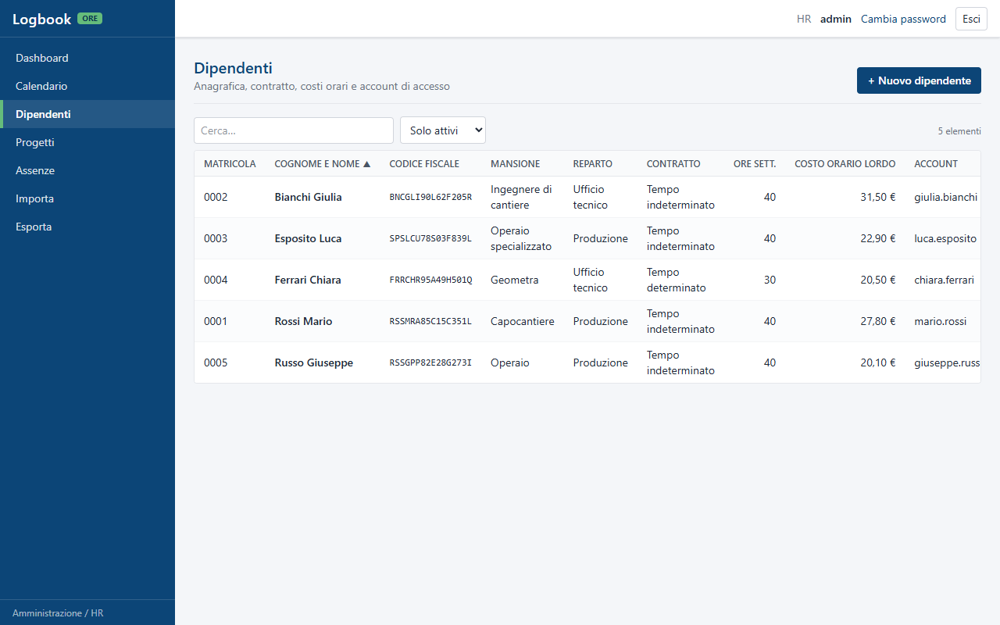
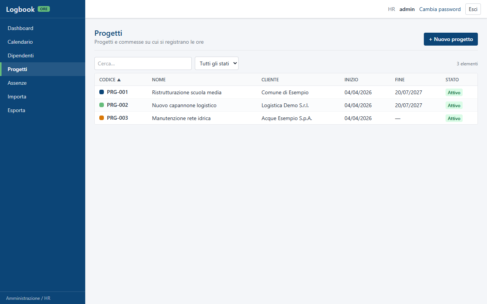
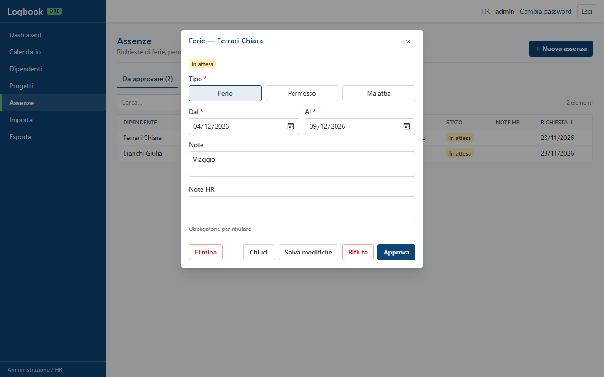
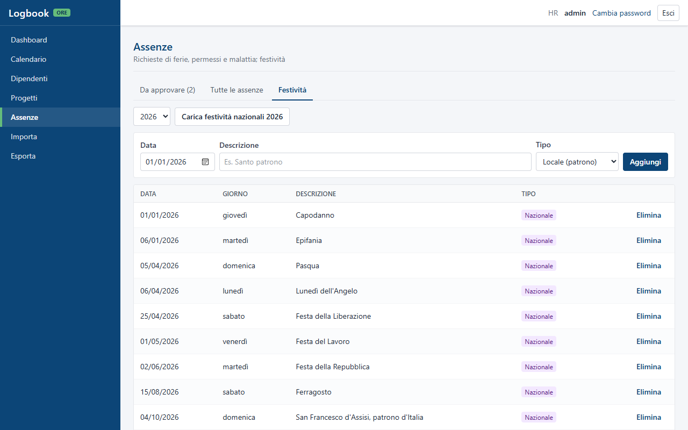
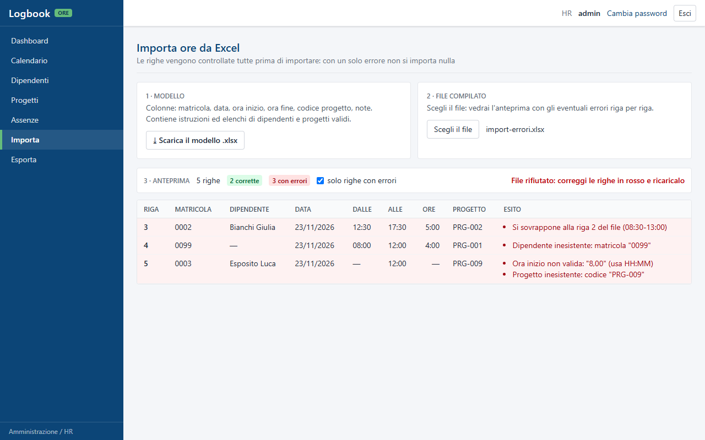

<!-- "><(((º> sabusabu <º)))><" -->

# Logbook — guida d'uso

Logbook raccoglie le **ore lavorate** di ogni dipendente, divise per fasce orarie e
progetti, e gestisce **ferie, permessi, malattia e festività**. HR può anche importare le ore
da Excel ed estrarre i report.

Si apre dal browser all'indirizzo che vi ha dato l'ufficio (sul PC: **http://127.0.0.1:5210**)
oppure dalla card **Logbook** del Portale della suite.

---

## 1. Entrare

Nome utente e password sono **quelli di Logbook**, non quelli del Portale: li assegna HR
dalla scheda del dipendente. Al primo accesso conviene cambiare la password da
**Cambia password**, in alto a destra (almeno 8 caratteri, con lettere e numeri).

Dopo 5 tentativi sbagliati l'accesso si blocca per 15 minuti.

---

## 2. Per i dipendenti

Il menu ha tre voci: **Dashboard**, **Calendario**, **Le mie assenze**. Ognuno vede e
modifica solo i propri dati.

### Dashboard

Mostra le ore del mese (lavorate e attese in base al contratto), le richieste in attesa e i
**giorni da registrare**: giorni lavorativi fino a ieri senza ore. Il pulsante
**Registra ore** apre subito il giorno da compilare.

### Registrare le ore

Dal **Calendario** si fa clic su un giorno: si apre il dettaglio della giornata.

- **+ Aggiungi fascia** crea una riga: progetto, ora di inizio, ora di fine (24 ore), note.
- Le **ore si calcolano da sole**, riga per riga, insieme al totale del giorno.
- Più fasce nello stesso giorno vanno bene (mattina e pomeriggio, progetti diversi),
  purché **non si sovrappongano**. Se si sovrappongono le righe diventano rosse e non si
  può salvare:

- Una fascia non può passare la mezzanotte: un turno di notte va diviso in due giorni.
- Non si registrano ore nei giorni futuri né nei giorni di ferie o malattia approvate.
- **Salva giornata** salva tutte le righe insieme; con la ✕ si toglie una riga.

### Chiedere ferie, permessi o malattia

Da **Le mie assenze** → **+ Nuova richiesta**:

- **Ferie**: dal giorno… al giorno… (sabati, domeniche e festivi non si contano).
- **Permesso**: un giorno e la durata in ore (es. 2 oppure 1,5).
- **Malattia**: le date e solo il **numero di protocollo del certificato**. Non scrivete
  diagnosi né altre informazioni sanitarie: Logbook non ha campi per questo, di proposito.

La richiesta resta **In attesa** finché HR non la approva o la rifiuta (con il motivo).
Finché è in attesa si può modificare o ritirare. Nel calendario le richieste in attesa
compaiono tratteggiate, quelle approvate piene, quelle rifiutate non compaiono.

---

## 3. Per HR (amministrazione)

HR vede tutte le voci del menu e i dati di tutti i dipendenti.

### Dashboard HR

In alto, i quattro riquadri dicono cosa richiede attenzione e diventano **gialli** quando
c'è da intervenire:

- **Richieste da approvare**: clic per andare alle assenze.
- **Giorni senza ore**: dipendenti che non hanno registrato giorni lavorativi fino a ieri.
- **Ore del mese**: lavorate e attese, con l'avanzamento per dipendente e per progetto.
- **Assenti oggi**.

### Calendario

- Vista **Mese** o **Settimana**, frecce per spostarsi, **Oggi** per tornare al presente.
- Filtri per **dipendente**, **progetto** e **tipo di assenza**. Col filtro progetto i
  totali dei giorni sono le ore di quel progetto.
- Ogni progetto ha il suo colore; ferie in azzurro, permessi in giallo, malattia in rosso,
  festività in viola.
- Con "Tutti i dipendenti" il clic su un giorno apre il riepilogo per dipendente; da lì
  **Modifica** apre la giornata di quella persona.

### Dipendenti

Ricerca per nome, matricola, codice fiscale, mansione o reparto; clic sulle intestazioni
per ordinare; filtro attivi/cessati. Clic su una riga per aprire la scheda.

- **Anagrafica e contratto**: il **codice fiscale** viene controllato (un codice sbagliato
  non si salva); matricola e codice fiscale devono essere unici.
- **Costi**: costo orario **netto** e **lordo** in euro (es. 14,50). Li vede solo HR e
  servono al report delle ore per progetto.
- **Account di accesso**: crea il nome utente e la password del dipendente, o ne
  reimposta la password. Comunicateli al dipendente.
- **Disattiva dipendente**: quando il rapporto finisce. Le ore restano nei report e
  l'account viene bloccato. **Riattiva** lo rimette attivo, ma l'account va riattivato a mano.

### Progetti

Codice (unico), nome, cliente, date e colore nel calendario. **Chiudi progetto** lo toglie
dai progetti selezionabili per nuove ore; quelle già registrate restano.

### Assenze

- Scheda **Da approvare**: clic sulla richiesta → **Approva** o **Rifiuta** (il motivo va
  scritto nelle note HR). Si possono anche cambiare le date prima di approvare.
- Non si approvano ferie o malattia su giorni che hanno già ore registrate: prima vanno
  tolte o spostate (Logbook indica quali giorni).
- **+ Nuova assenza** registra un'assenza per un dipendente, anche già approvata (es.
  malattia comunicata per telefono).

### Festività

Le festività nazionali dell'anno si caricano con un clic (**Carica festività nazionali**).
Quelle **del paese** (il santo patrono) e le **chiusure aziendali** si aggiungono a mano,
scegliendo il tipo. Un giorno festivo non conta come giorno lavorativo.

### Importare le ore da Excel

1. **Importa → Scarica il modello .xlsx**. Il foglio "Ore" ha le colonne Matricola, Data
   (gg/mm/aaaa), Ora inizio e Ora fine (HH:MM), Codice progetto, Note. Gli altri fogli
   spiegano le regole ed elencano matricole e codici validi (anche nei menu a tendina).
2. Compilate una riga per ogni fascia oraria. La riga di esempio viene ignorata.
3. Scegliete il file: Logbook mostra l'**anteprima** e controlla ogni riga.

Se anche **una sola riga** ha un errore (dipendente o progetto inesistente, orario non
valido, sovrapposizione con altre righe o con ore già registrate, giorno futuro o di
ferie…) il file viene **rifiutato** e non si importa nulla: correggete le righe indicate e
ricaricatelo. Se è tutto corretto, **Conferma e importa** salva tutte le righe insieme.

### Esportare i report

Scegliete il periodo (o una scorciatoia: mese corrente, mese scorso…), i dipendenti e i
progetti (nessuna spunta = tutti). Il riepilogo mostra subito le ore totali, le stesse del
calendario. Poi:

- **Calendario lavorato**: un foglio per dipendente con anagrafica, ogni giorno del
  periodo (fasce, progetto, ore, assenze, festività), totali, ore contrattuali attese,
  giorni di ferie e malattia, ore di permesso.
- **Ore per progetto**: per ogni dipendente i progetti lavorati con ore e **costo lordo**,
  il totale complessivo e un foglio riassuntivo dipendenti × progetti.

Le ore nei file Excel sono in formato ore:minuti (es. 7:30) e si possono sommare.
