<!-- "><(((º> sabusabu <º)))><" -->

# Logbook — guida d'uso

Logbook raccoglie le **ore lavorate** di ogni dipendente, divise per fasce orarie e
progetti, e gestisce **ferie, permessi, malattia e festività**. HR può anche importare le ore
da Excel ed estrarre i report.

Si apre dal browser all'indirizzo che vi ha dato l'ufficio (sul PC: **http://127.0.0.1:5210**)
oppure dalla card **Logbook** del Portale della suite. Funziona anche dal **cellulare** e
sfrutta tutta la larghezza degli schermi **ultra wide** (vedi il capitolo 4).

---

## 1. Entrare

Nome utente e password sono **quelli di Logbook**, non quelli del Portale: li assegna HR
dalla scheda del dipendente.

**Al primo accesso Logbook chiede di scegliere una password nuova**: quella data da HR è
provvisoria e finché non la si cambia non si vede nient'altro. La nuova deve avere almeno
8 caratteri, con lettere e numeri, ed essere diversa da quella provvisoria. Lo stesso vale
per l'amministratore creato all'installazione e per gli account di prova. Dopo, la si
cambia quando si vuole da **Cambia password**, in alto a destra.

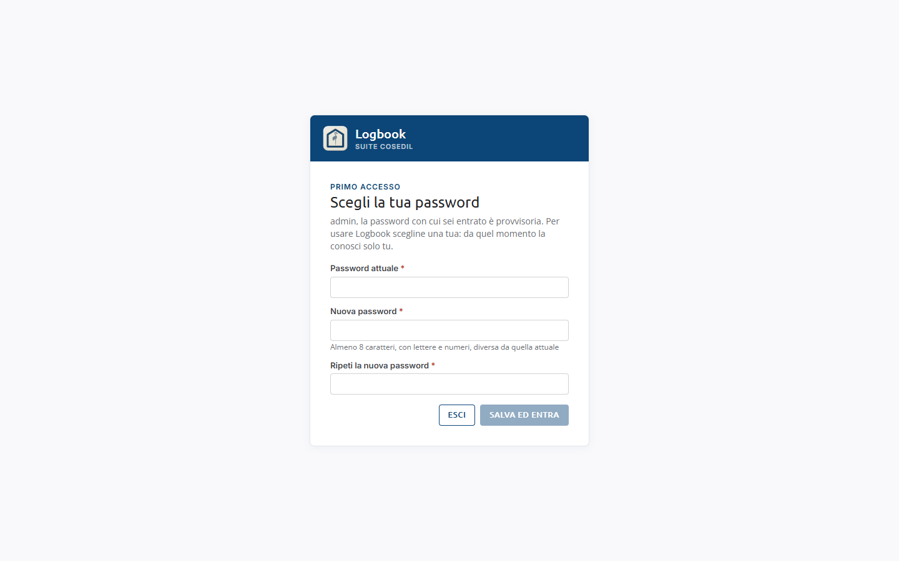

Dopo 5 tentativi sbagliati l'accesso si blocca per 15 minuti.

---

## 2. Per i dipendenti

Il menu ha quattro voci: **Dashboard**, **Calendario**, **I miei progetti**, **Le mie
assenze**. Ognuno vede solo i propri dati.

**Le ore le inserisce HR.** Il dipendente le vede nel calendario ma non le scrive né le
corregge: così nessuno può dichiarare ore non lavorate che finirebbero nei pagamenti. Se
qualcosa non torna, si manda una **segnalazione** a HR (vedi sotto).

### Dashboard

Mostra le ore del mese (lavorate e attese in base al contratto), le richieste in attesa, i
**giorni passati senza ore** (giorni lavorativi fino a ieri senza ore: il clic apre il
giorno, da cui si può segnalare) e **Le mie segnalazioni**, con lo stato e la risposta di HR.

### Le tue ore e le segnalazioni

Dal **Calendario** si fa clic su un giorno: si apre il dettaglio della giornata in **sola
lettura**, con le fasce (progetto, dalle, alle, note) e il totale. In fondo c'è il riquadro
**Qualcosa non torna? Segnalalo a HR**: scrivete cosa non va (es. «ho lavorato fino alle
17:30, non alle 16:30») e premete **Invia segnalazione**.

- HR vede la segnalazione appena entra in Logbook, corregge le ore se serve e la chiude con
  una risposta, che compare sotto la segnalazione e in dashboard.
- Finché è **aperta** la potete ritirare; una volta **risolta** resta come promemoria.
- Si segnala sui giorni fino a oggi, non su quelli futuri.

«Oggi» è la data di Logbook, non quella del computer. Se il PC ha una data diversa, in cima
alla pagina compare un avviso giallo.

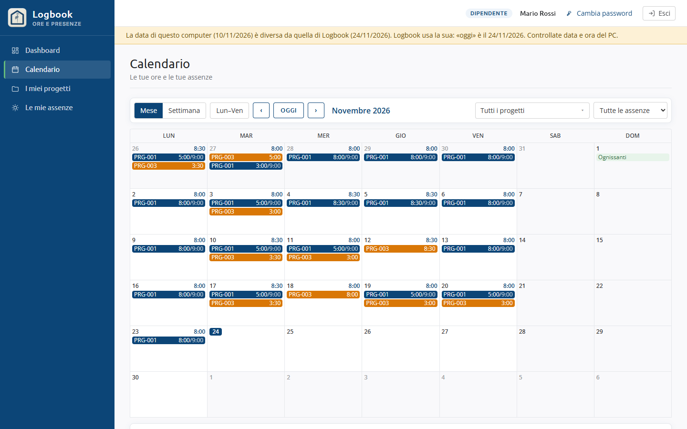

### I miei progetti

**I miei progetti** elenca i progetti a cui siete assegnati: sono quelli su cui HR registra le
vostre ore. Aprendone uno si vedono codice, cliente, ore massime al giorno e descrizione.
Avanzamento e documentazione del progetto li gestisce HR.

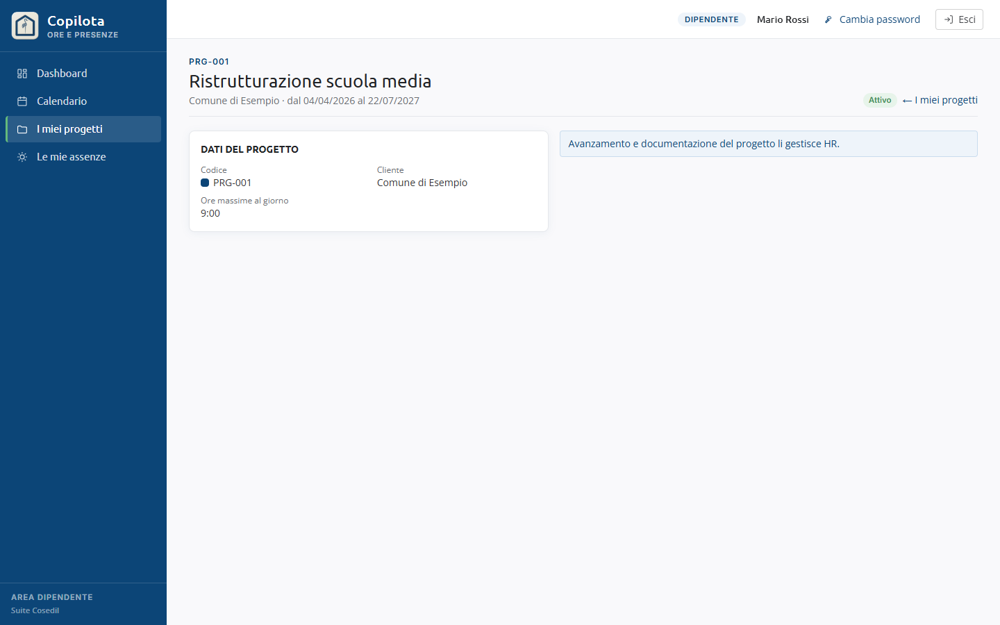

### Chiedere ferie, permessi o malattia

Da **Le mie assenze** → **+ Nuova richiesta** si apre la pagina della richiesta (a destra
le vostre altre assenze):

- **Ferie**: dal giorno… al giorno… (sabati, domeniche e festivi non si contano).
- **Permesso**: un giorno e la durata in ore (es. 2 oppure 1,5).
- **Malattia**: le date e solo il **numero di protocollo del certificato**. Non scrivete
  diagnosi né altre informazioni sanitarie: Logbook non ha campi per questo, di proposito.
- **Allegato** (facoltativo): con **Allega file…** si aggiunge un file, es. il giustificativo
  di un permesso: **solo PDF o immagini** (niente Word o Excel, che possono contenere
  macro). Per la malattia solo l'attestato per il datore di lavoro, **mai referti o
  certificati con la diagnosi**. Finché la richiesta è in attesa si può togliere o sostituire.

La richiesta resta **In attesa** finché HR non la approva o la rifiuta (con il motivo).
Finché è in attesa si può modificare o ritirare. Nel calendario le richieste in attesa
compaiono tratteggiate, quelle approvate piene, quelle rifiutate non compaiono.

---

## 3. Per HR (amministrazione)

HR vede tutte le voci del menu e i dati di tutti i dipendenti. **Solo HR inserisce e
corregge le ore** (dal calendario o con l'import Excel) e la documentazione dei progetti; i
dipendenti vedono le loro ore e mandano segnalazioni.

### Segnalazioni dei dipendenti

Nell'intestazione, la **campanella** mostra quante segnalazioni sono aperte. **Appena si
entra in Logbook**, se ce ne sono, si apre da sola la finestra con l'elenco: chi, che giorno,
cosa non torna. **Apri il giorno →** porta al dettaglio di quella giornata: si correggono le
fasce, si scrive la risposta e si preme **Segna risolta**. La finestra si riapre con la
campanella; in dashboard c'è anche il riquadro **Segnalazioni aperte**.

### Registrare le ore

Dal **Calendario** (filtrato su un dipendente, o dal riepilogo del giorno con **Modifica**)
si apre il dettaglio della giornata. Le ore si scrivono anche nei giorni passati; mai in
quelli futuri.

- **+ Aggiungi fascia** crea una riga: progetto, ora di inizio, ora di fine (24 ore), note.
- Le **ore si calcolano da sole**, riga per riga, insieme al totale del giorno.
- Più fasce nello stesso giorno vanno bene (mattina e pomeriggio, progetti diversi),
  purché **non si sovrappongano**. Se si sovrappongono le righe diventano rosse e non si
  può salvare:

- Nel menu dei progetti ci sono **solo i progetti a cui il dipendente è assegnato**. Se non
  ne ha nessuno compare un avviso: assegnatelo dalla pagina del progetto o dalla sua scheda.
- Una fascia non può passare la mezzanotte: un turno di notte va diviso in due giorni.
- Non si registrano ore nei giorni futuri né nei giorni di ferie o malattia approvate.
- **Sabato, domenica e festivi non accettano ore**: nel calendario quei giorni non si aprono
  (passandoci sopra compare il motivo, es. «Sabato: non si registrano ore»). Se in uno di
  quei giorni sono rimaste ore inserite prima di questa regola, il dettaglio si apre solo
  per toglierle.
- Non si inserisce **nulla prima del 01/01/2020** (ore, assenze, festività, date di
  assunzione e dei progetti, righe dell'import).
- Se il progetto ha **ore massime al giorno**, sotto le righe compare per ogni progetto
  "ore del giorno / max": oltre il limite il riquadro diventa rosso e **Salva giornata** si
  disattiva (il limite vale per ciascun dipendente).
- **Salva giornata** salva tutte le righe insieme.
- La **✕** di una fascia già salvata la **elimina subito** (dopo la conferma), senza
  toccare le altre righe; il calendario si aggiorna e la finestra resta aperta. La ✕ di una
  riga nuova, non ancora salvata, la toglie soltanto.

### Dashboard HR

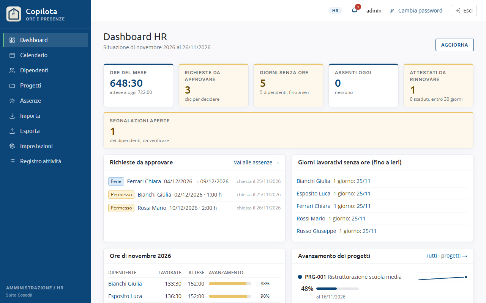

In alto, i quattro riquadri dicono cosa richiede attenzione e diventano **gialli** quando
c'è da intervenire:

- **Richieste da approvare**: clic per andare alle assenze.
- **Giorni senza ore**: dipendenti che non hanno registrato giorni lavorativi fino a ieri
  (clic: si scende all'elenco).
- **Ore del mese**: lavorate e attese, con l'avanzamento per dipendente e per progetto.
- **Assenti oggi** (clic: tutte le assenze).
- **Attestati da rinnovare**: scaduti o in scadenza entro 30 giorni; il pannello sotto li
  elenca e il clic apre la scheda Attestati del dipendente.
- **Segnalazioni aperte**: cosa i dipendenti segnalano sulle loro ore; il pannello sotto le
  elenca e il clic apre quel giorno di quel dipendente.
- **Documentazione da vedere** (compare solo se c'è): documenti di progetto rimessi «da
  vedere»; il clic apre la pagina del progetto.

Ogni voce dei pannelli sotto porta al suo elemento:

- una **richiesta** o un'**assenza in arrivo** apre quella richiesta nella pagina Assenze;
- il **nome** di chi ha giorni senza ore apre il suo calendario; il singolo **giorno** apre
  subito il dettaglio di quel giorno per registrare le ore;
- un dipendente nelle **ore del mese** apre il suo calendario;
- un **progetto** apre la sua pagina;
- una **festività** apre la scheda Festività.

Il dipendente, dalla sua dashboard, va al calendario filtrato sul progetto o sul giorno
della festività.

### Calendario

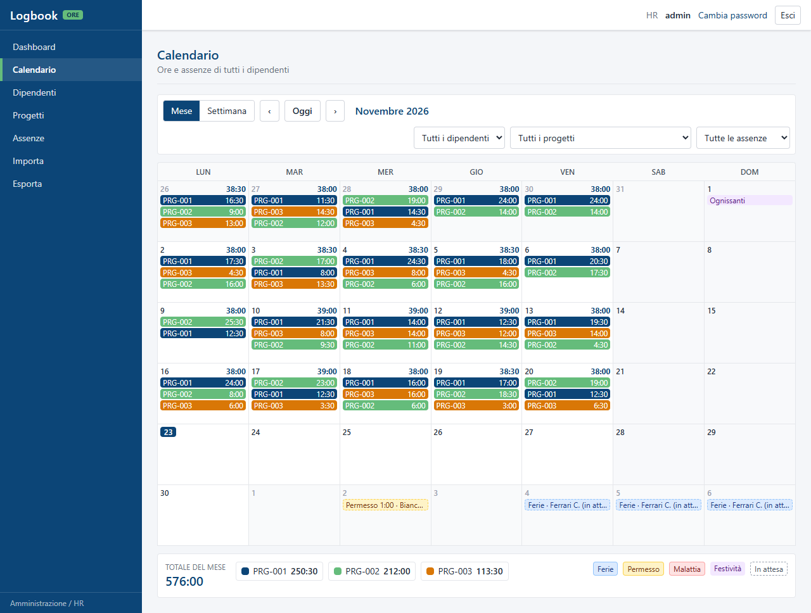

- Vista **Mese** o **Settimana**, frecce per spostarsi, **Oggi** per tornare al presente.
- **Lun–Ven** mostra solo i giorni da lunedì a venerdì (in mese e settimana); la scelta
  resta finché non la si toglie.
- Filtri per **dipendente**, **progetto** e **tipo di assenza**. Col filtro progetto i
  totali dei giorni sono le ore di quel progetto. Dipendente e progetto si scelgono
  **scrivendo alcune lettere** (nome, matricola, codice fiscale; codice, nome o cliente del
  progetto): l'elenco si restringe mentre si scrive, frecce e Invio per scegliere.

- Ogni progetto ha il suo colore; ferie in azzurro, permessi in giallo, malattia in rosso,
  festività in verde.
- Con "Tutti i dipendenti" il clic su un giorno apre il riepilogo per dipendente; da lì
  **Modifica** apre la giornata di quella persona.

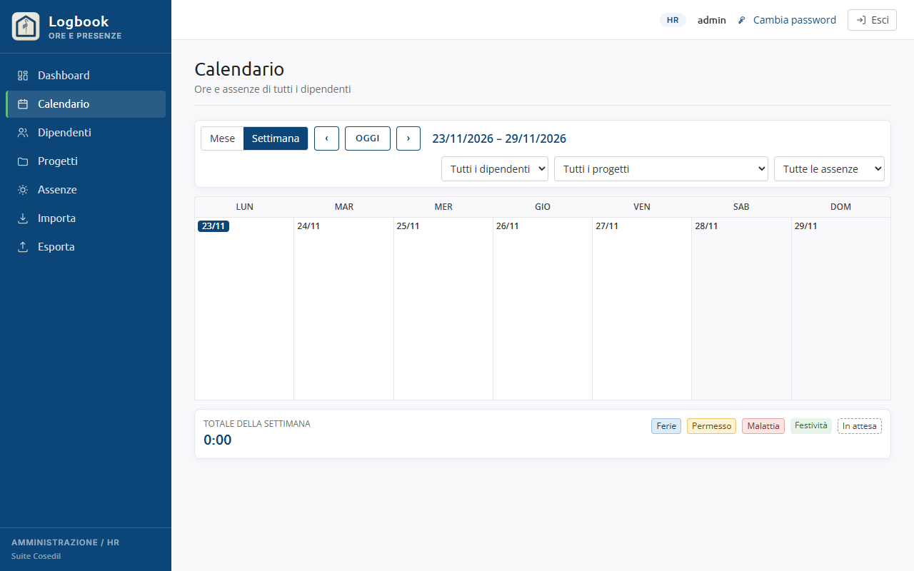

### Dipendenti

Ricerca per nome, matricola, codice fiscale, mansione o reparto; clic sulle intestazioni
per ordinare; filtro attivi/cessati. Clic su una riga per aprire la scheda.

La scheda mostra **tutto nella stessa pagina**, senza schede da cambiare: anagrafica,
contratto e costi in alto; sotto account, stato del rapporto e progetti assegnati; in fondo
attestati e documenti. La riga di collegamenti in cima porta alle sezioni. Per un
dipendente nuovo c'è solo il modulo in alto: dopo **Crea dipendente** compare il resto.

**Omonimi**: se esiste già un dipendente con lo stesso nome, sotto l'anagrafica compare chi
è, con matricola e codice fiscale. È il codice fiscale a distinguere le persone: in tutti gli
elenchi e i menu di Logbook, due omonimi si riconoscono dall'inizio del codice fiscale
accanto al nome (es. «Rossi Mario (CF RSSMRA8)»).

- **Anagrafica**: il **codice fiscale** viene controllato (un codice sbagliato non si
  salva); matricola e codice fiscale devono essere unici.
- **Contratto e costi**: contratto, assunzione, ore settimanali e costo orario **netto** e
  **lordo** in euro (es. 14,50). I costi li vede solo HR e servono ai report.
- **Account**: crea il nome utente e la password del dipendente, o ne reimposta la
  password (comunicateli al dipendente). La password è **provvisoria**: al primo accesso il
  dipendente ne sceglie una sua, e finché non lo fa la scheda lo indica. **Disattiva dipendente** quando il rapporto finisce:
  le ore restano nei report e l'account viene bloccato. **Riattiva** lo rimette attivo, ma
  l'account va riattivato a mano.
- **Progetti assegnati**: gli stessi della pagina del progetto, visti dal dipendente. Si
  aggiunge un progetto alla volta cercandolo per codice, nome o cliente; **Togli** lascia le
  ore già fatte.
- **Attestati**: formazione sicurezza, primo soccorso, antincendio, patentini, visite
  mediche e altro, con data di rilascio, **scadenza** e file. **+ Nuovo attestato** (o il
  clic su un attestato) apre il modulo dentro la sezione, sopra l'elenco: il resto della
  scheda resta visibile. Lo stato si aggiorna da solo:
  *Valido*, *In scadenza* (nei 30 giorni prima), *Scaduto*, *Non scade*. Gli attestati in
  scadenza o scaduti compaiono anche nella dashboard di HR. Per la visita medica si scrive
  solo l'esito (es. «idoneo»), mai diagnosi.

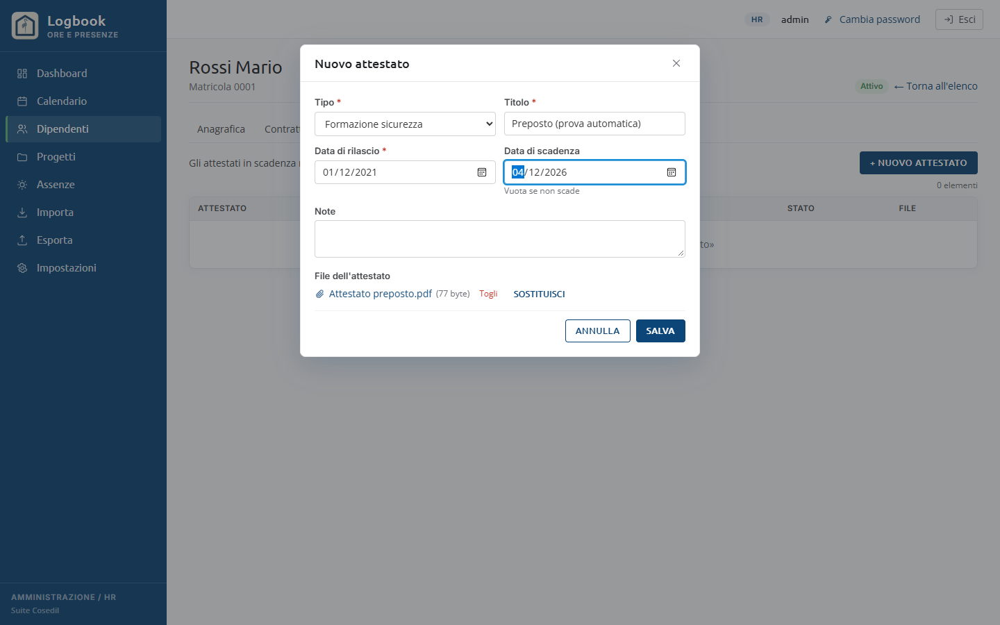

- **Documenti**: contratto, documenti d'identità e altri file del dipendente (titolo, note,
  file obbligatorio).

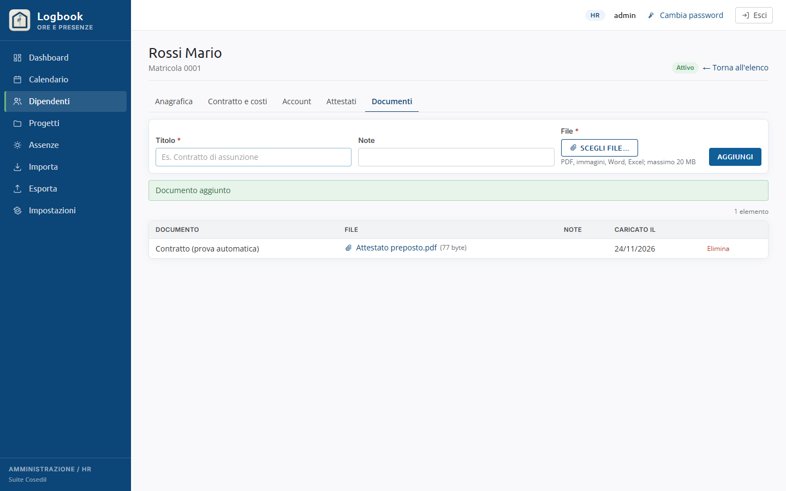

I file si caricano con **Scegli file…**: PDF, immagini, Word, Excel, OpenDocument, testo e
PDF firmati (.p7m), fino a 20 MB. Clic sul nome per aprirlo. Un file caricato e mai salvato
in una scheda si cancella da solo dopo un giorno; ognuno può averne al massimo 20 in sospeso. Attestati e documenti del
dipendente li vede solo HR.

### Progetti

L'elenco ha la ricerca a caratteri, il filtro di stato e la colonna **Dipendenti** (quanti
sono assegnati; "nessuno" in rosso = nessuno può registrare ore). **+ Nuovo progetto** e il
clic su una riga aprono la **pagina del progetto**, con tutto nella stessa pagina: a
sinistra dati, dipendenti assegnati e note interne, a destra avanzamento e documentazione.
Un progetto nuovo mostra solo i dati: il resto compare dopo **Crea progetto**.

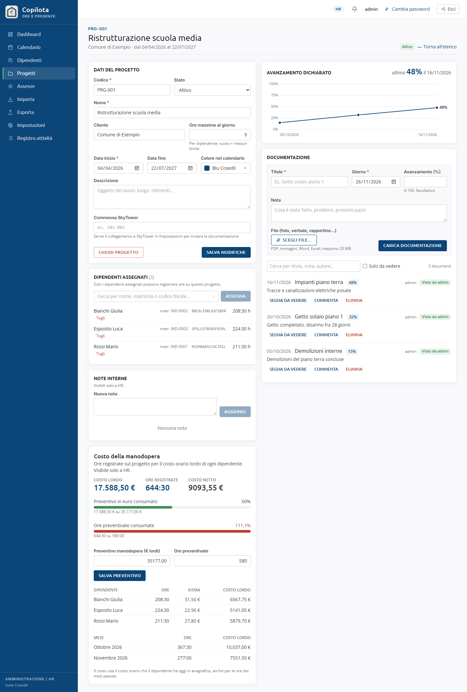

**Dati del progetto**: codice (unico), nome, cliente, date, colore nel calendario e **ore massime al giorno**
per dipendente (vuoto = nessun limite). Il limite compare nella tabella dei progetti, nel
calendario (con un dipendente filtrato le caselle mostrano "ore/massimo", la legenda
"max …/giorno") e nell'editor della giornata; oltre il limite le ore non si salvano, né da
interfaccia né da import. **Chiudi progetto** lo toglie dai progetti selezionabili per
nuove ore; quelle già registrate restano.

Il **colore nel calendario** si sceglie da un menu con i colori del marchio, ognuno col suo
nome. **Automatico** lascia scegliere a Logbook (sempre lo stesso colore per quel
progetto); **Altro colore…** serve solo per un codice colore particolare.

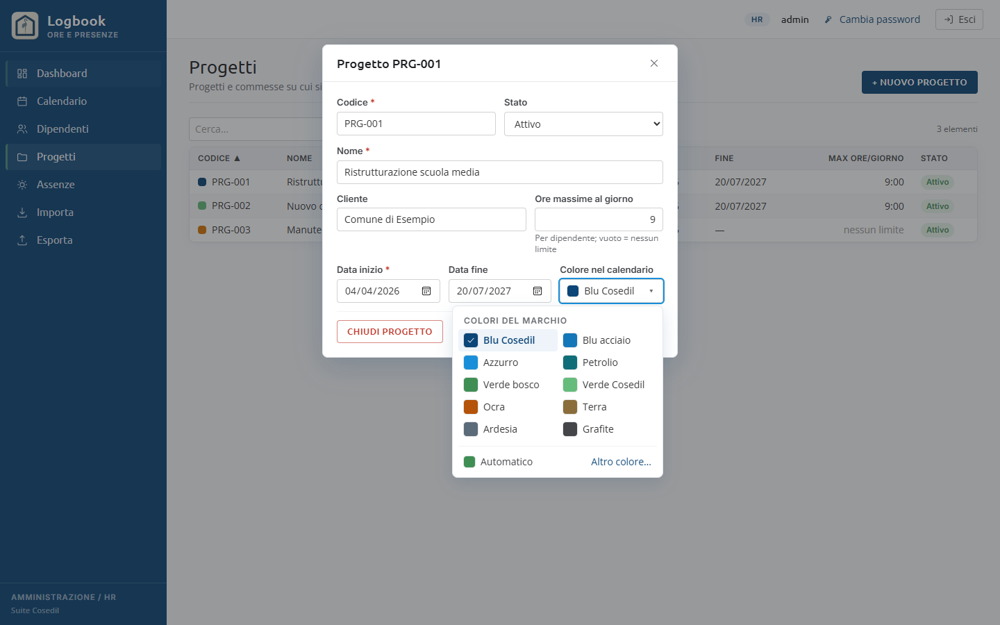

Nei dati ci sono anche la **descrizione** e la **commessa SkyTower** (es. 101-003): serve
per inviare la documentazione all'archivio della suite; con il collegamento attivo il campo
suggerisce le commesse di SkyTower.

**Dipendenti assegnati**: **solo chi è assegnato può registrare ore sul progetto**, dal
calendario, dall'import Excel e anche quando le inserisce HR. I dipendenti si aggiungono
**uno alla volta**: si scrivono alcune lettere del nome, della matricola o del codice
fiscale, si sceglie dall'elenco e si preme **Assegna**. Sotto ogni nome compaiono matricola
e codice fiscale: con due omonimi è il codice fiscale che li distingue.

Accanto a ogni assegnato ci sono le ore che ha già registrato sul progetto. **Togli** lo
toglie: le ore fatte restano (e restano correggibili nella loro giornata), ma non se ne
possono aggiungere altre. Con l'aggiornamento del 24/11/2026 chi aveva già ore su un
progetto ne è diventato assegnato automaticamente.

**Avanzamento e documentazione** (solo HR): titolo, giorno, percentuale di avanzamento, nota
e file (foto, verbale, rapportino…). Ogni percentuale diventa un punto del grafico
**Avanzamento**. L'elenco ha il filtro a caratteri; ogni documento si può **commentare**,
segnare **da vedere** (per ricordarsi di riguardarlo), **eliminare** e, se in Impostazioni
c'è il collegamento e il progetto ha la commessa, **inviare a SkyTower** (solo i documenti
con un file, una volta sola; poi compare il link al documento in SkyTower).

**Note interne**: appunti di HR sul progetto, che i dipendenti non vedono.

### Assenze

Il clic su una richiesta (o **+ Nuova assenza**) apre la **pagina dell'assenza**: a sinistra
i dati con i pulsanti, a destra le altre assenze dello stesso dipendente, per decidere
vedendo il resto dell'anno. La ricerca dell'elenco trova anche matricola e codice fiscale.

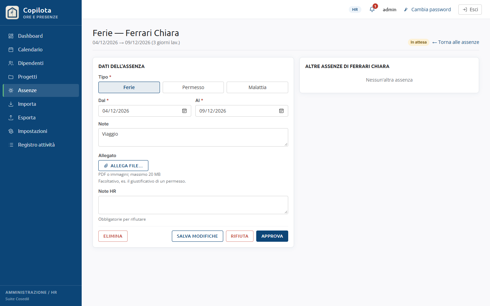

- Scheda **Da approvare**: clic sulla richiesta → **Approva** o **Rifiuta** (il motivo va
  scritto nelle note HR). Si possono anche cambiare le date prima di approvare.
- Non si approvano ferie o malattia su giorni che hanno già ore registrate: prima vanno
  tolte o spostate (Logbook indica quali giorni).
- **+ Nuova assenza** registra un'assenza per un dipendente, anche già approvata (es.
  malattia comunicata per telefono). Il dipendente si sceglie scrivendo nome, matricola o
  codice fiscale.
- Gli **allegati** si vedono con la graffetta nell'elenco e si aprono dalla pagina
  dell'assenza. HR può allegarne o sostituirne uno anche a una richiesta già decisa; il
  dipendente lo apre dalla sua richiesta.

### Festività

Le festività nazionali dell'anno si caricano con un clic (**Carica festività nazionali**).
Quelle **del paese** (il santo patrono) e le **chiusure aziendali** si aggiungono a mano,
scegliendo il tipo. Un giorno festivo non conta come giorno lavorativo.

### Impostazioni (solo amministratori)

Qui si registra il **collegamento a SkyTower**, l'archivio documentale della suite:
indirizzo dell'API (sul server di solito `http://127.0.0.1:8100`), token di servizio della
suite (file `shared\suite\.token` sul server) ed eventualmente l'email dell'utente SkyTower
che risulterà autore dei documenti. **Prova collegamento** controlla che SkyTower risponda.

I documenti restano comunque in Logbook. Con il collegamento attivo, nella documentazione
dei progetti che hanno una commessa SkyTower compare il pulsante **Invia a SkyTower**; senza
collegamento il pulsante non c'è. Il token, una volta salvato, non si rilegge più.

### Importare le ore da Excel

1. **Importa → Scarica il modello .xlsx**. Il foglio "Ore" ha le colonne Matricola, Data
   (gg/mm/aaaa), Ora inizio e Ora fine (HH:MM), Codice progetto, Note. Gli altri fogli
   spiegano le regole ed elencano matricole e codici validi (anche nei menu a tendina).
2. Compilate una riga per ogni fascia oraria. La riga di esempio viene ignorata.
3. Scegliete il file: Logbook mostra l'**anteprima** e controlla ogni riga.

Se anche **una sola riga** ha un errore (dipendente o progetto inesistente, orario non
valido, sovrapposizione con altre righe o con ore già registrate, giorno futuro o di
ferie…) il file viene **rifiutato** e non si importa nulla: correggete le righe indicate e
ricaricatelo. Se è tutto corretto, **Conferma e importa** salva tutte le righe insieme.

### Esportare i report

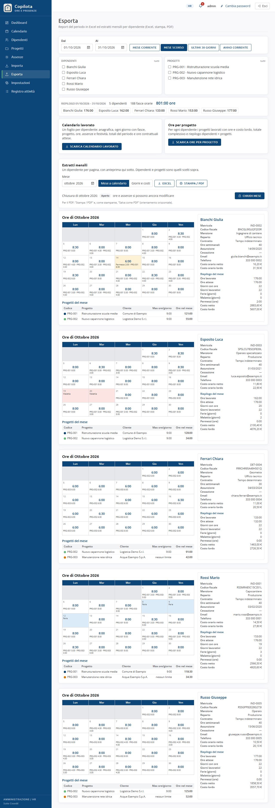

Scegliete il periodo (o una scorciatoia: mese corrente, mese scorso…), i dipendenti e i
progetti (nessuna spunta = tutti). Il riepilogo mostra subito le ore totali, le stesse del
calendario. Poi:

- **Calendario lavorato**: un foglio per dipendente con anagrafica, ogni giorno del
  periodo (fasce, progetto, ore, assenze, festività), totali, ore contrattuali attese,
  giorni di ferie e malattia, ore di permesso.
- **Ore per progetto**: per ogni dipendente i progetti lavorati con ore e **costo lordo**,
  il totale complessivo e un foglio riassuntivo dipendenti × progetti.

Le ore nei file Excel sono in formato ore:minuti (es. 7:30) e si possono sommare.

### Estratti mensili (Excel, stampa e PDF)

In fondo alla pagina **Esporta**: scegliete il **mese** (da gennaio 2020) e, se serve, i
dipendenti e i progetti nelle caselle in alto. Sotto compare l'anteprima, un dipendente per
pagina, in due versioni:

**Mese a calendario**: a sinistra il calendario del mese con le ore di ogni giorno e i
progetti (ferie in azzurro, malattia in rosso, permessi in giallo, festivi in grigio, festività in verde),
a destra l'anagrafica e il riepilogo del mese (ore lavorate e attese, ferie, malattia,
permessi, costo netto e lordo), in basso la descrizione dei progetti lavorati con le ore
massime al giorno e le ore del mese.

**Giorni e costi**: in testa tutti i dati del dipendente, poi una riga per ogni giorno con
ore, progetti, fasce, assenze (ferie, malattia, permessi), festività, ore retribuite e
**costo netto e lordo del giorno**. Ferie e malattia nei giorni lavorativi valgono le ore
del contratto di quel giorno (ore settimanali / 5), i permessi la loro durata; le festività
sono indicate senza costo.

- **Excel** scarica la versione scelta (un foglio per dipendente).
- **Stampa / PDF** apre la stampa del browser: scegliete "Salva come PDF" (orientamento
  orizzontale). In stampa spariscono menu e comandi e ogni dipendente va su una pagina.

---

## 4. Dal cellulare e sugli schermi grandi

Logbook si adatta da solo alla larghezza dello schermo: non c'è un'app da installare, basta
aprire lo stesso indirizzo dal browser del telefono.

Su computer e tablet (da 768px) il **menu a sinistra resta fermo** mentre la pagina scorre,
con tutte le voci sempre visibili; su uno schermo molto basso scorrono solo le voci del menu.

**Sul cellulare**

- Il menu si apre col pulsante **☰ Logbook** in alto a sinistra.
- Nel **calendario del mese** ogni giorno mostra il numero, le ore totali e un **pallino
  colorato** per ogni progetto, ferie, permesso, malattia o festività. Toccate il giorno per
  vedere e modificare il dettaglio.
- La **settimana** diventa un elenco di giorni, uno sotto l'altro.

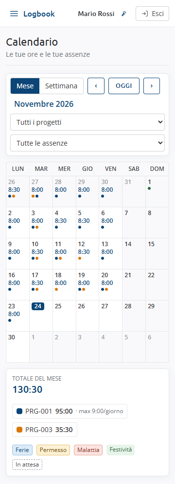

- Nel **dettaglio della giornata** ogni fascia è un riquadro con progetto, orari e note uno
  sotto l'altro; le regole sono le stesse del computer (sovrapposizioni e ore massime
  bloccano il salvataggio).

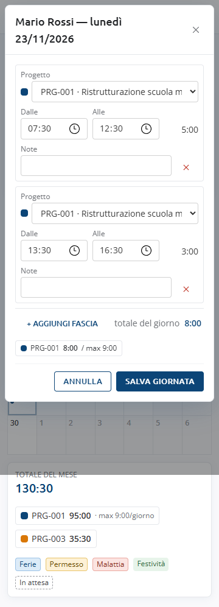

- Gli **elenchi** (dipendenti, progetti, assenze, festività) diventano schede: il nome in
  alto e gli altri dati sotto. Per l'ordine si usa il menu accanto alla ricerca.

- Le tabelle molto larghe (anteprima dell'import, estratto "giorni e costi") scorrono in
  orizzontale dentro il loro riquadro: si sposta il dito sulla tabella.

**Sugli schermi grandi e ultra wide**

La pagina usa tutta la larghezza e affianca i riquadri finché c'è spazio: la dashboard mette
i pannelli uno accanto all'altro, la scheda del dipendente affianca anagrafica, contratto e
costi, gli estratti mensili mostrano due o tre dipendenti per riga. La stampa non cambia:
sempre un dipendente per pagina A4.

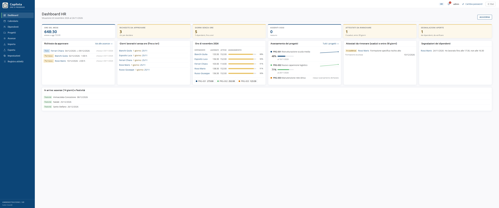
