<!-- "><(((º> sabusabu <º)))><" -->

# Copilota — guida d'uso

Copilota raccoglie le **ore lavorate** di ogni dipendente, divise per fasce orarie e
progetti, e gestisce **ferie, permessi, malattia e festività**. HR può anche importare le ore
da Excel ed estrarre i report.

Si apre dal browser all'indirizzo che vi ha dato l'ufficio (sul PC: **http://127.0.0.1:5210**)
oppure dalla card **Copilota** del Portale della suite. Funziona anche **senza la suite**: su
un PC con Node.js si installa con un doppio clic su `InstallaLogbook.exe`, nella cartella di
Copilota, e si apre dall'icona **Copilota** sul desktop. Funziona anche dal **cellulare** e
sfrutta tutta la larghezza degli schermi **ultra wide** (vedi il capitolo 4).

---

## 1. Entrare

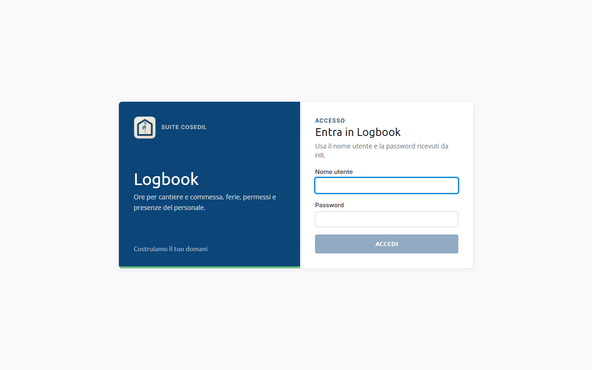

Nome utente e password sono **quelli di Copilota**, non quelli del Portale: li assegna HR
dalla scheda del dipendente.

**Al primo accesso Copilota chiede di scegliere una password nuova**: quella data da HR è
provvisoria e finché non la si cambia non si vede nient'altro. La nuova deve avere almeno
8 caratteri (12 per gli amministratori), con lettere e numeri, non essere una password comune
ed essere diversa da quella provvisoria. Lo stesso vale
per l'amministratore creato all'installazione e per gli account di prova. Dopo, la si
cambia quando si vuole da **Cambia password**, in alto a destra.

Dopo **10 password sbagliate** bisogna aspettare 5 minuti; se si sbaglia ancora l'attesa
raddoppia ogni volta (10, 20, 40 minuti…).

**Sessione**: se per 15 minuti non si tocca mouse o tastiera, Copilota si chiude da solo e
chiede di rientrare. Un modulo lasciato a metà va salvato prima di allontanarsi.

**Amministratori, codice via email**: la prima volta che un amministratore entra da un PC,
dopo la password Copilota manda un codice di 6 cifre alla sua email. Su quel PC non lo
chiede più per 30 giorni.

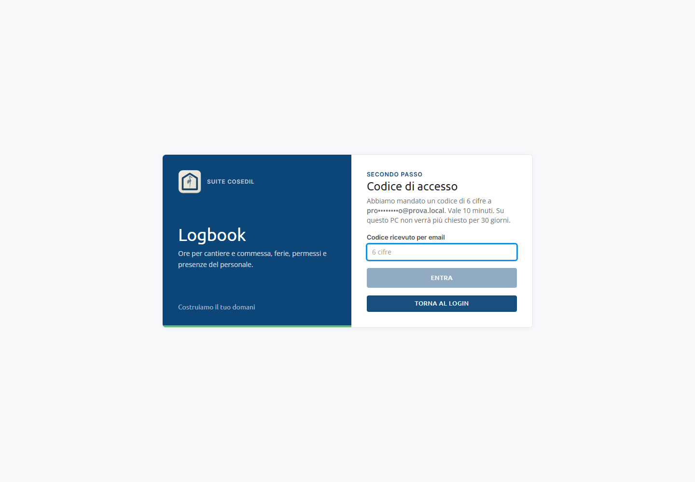

---

### Password dimenticata

Dal 26/11/2026 chi ha dimenticato la password la cambia da solo, senza chiamare HR:

1. nella pagina di accesso, **Password dimenticata?**;
2. scrivere il proprio nome utente e premere **Mandami il codice**: arriva un'email con un
   codice di 6 cifre, all'indirizzo che HR ha scritto nella scheda del dipendente;
3. scrivere il codice e la password nuova (due volte), poi **Cambia password**;
4. entrare con la password nuova.

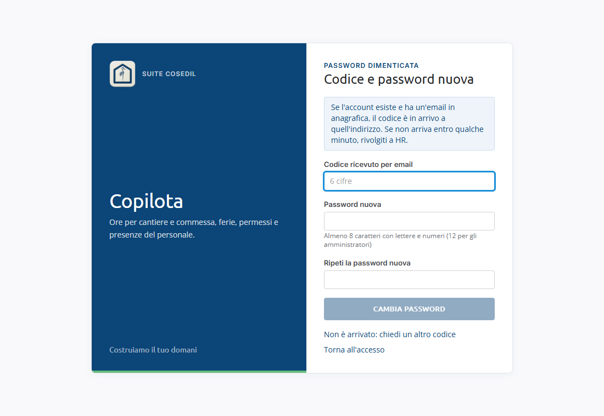

Da sapere:
- il codice vale 10 minuti e una volta sola; dopo 5 codici sbagliati ne serve uno nuovo;
- Copilota risponde allo stesso modo anche se il nome utente non esiste: se l'email non
  arriva, il nome è sbagliato oppure in anagrafica manca l'indirizzo. In quel caso serve HR,
  che dalla scheda del dipendente dà una password provvisoria;
- dopo il cambio, chi era collegato con la vecchia password viene scollegato.

## 2. Per i dipendenti

Il menu ha quattro voci (cinque per i capisquadra, con **La mia squadra**): **Dashboard**, **Calendario**, **I miei progetti**, **Le mie
assenze**. Ognuno vede solo i propri dati.

**Le ore le inserisce HR.** Il dipendente le vede nel calendario ma non le scrive né le
corregge: così nessuno può dichiarare ore non lavorate che finirebbero nei pagamenti. Se
qualcosa non torna, si manda una **segnalazione** a HR (vedi sotto).

### Dashboard

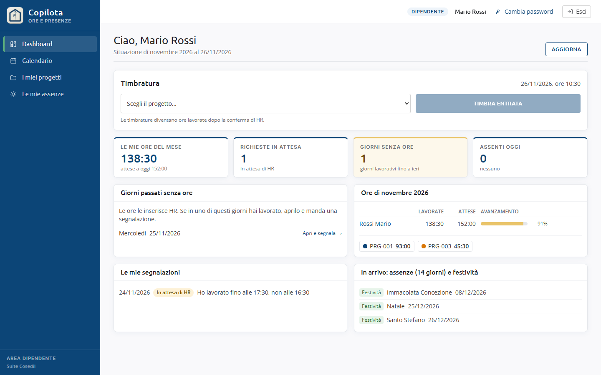

Mostra le ore del mese (lavorate e attese in base al contratto), le richieste in attesa, i
**giorni passati senza ore** (giorni lavorativi fino a ieri senza ore: il clic apre il
giorno, da cui si può segnalare) e **Le mie segnalazioni**, con lo stato e la risposta di HR.

### Timbrare entrata e uscita

Dal 26/11/2026 in cima alla dashboard c'è il riquadro **Timbratura**, pensato per il telefono.

1. All'arrivo: scegliere il progetto (se ne hai uno solo è già scelto) e premere **Timbra entrata**.

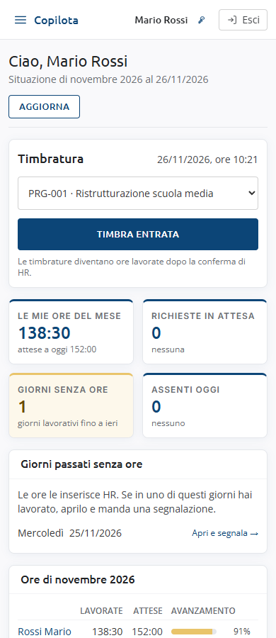

2. A fine lavoro: **Timbra uscita**.

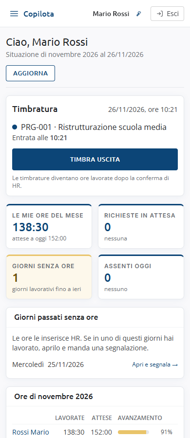

3. La timbratura passa a HR con la scritta **In attesa di HR**. Diventa ore lavorate solo
   quando HR la conferma: allora compare **Confermata** e le ore si vedono nel calendario.
   Se HR la rifiuta, sotto c'è il motivo.

Da sapere:
- l'ora è quella del server, non quella del telefono;
- si può timbrare solo su un progetto attivo a cui si è assegnati, e non nei giorni festivi
  o mentre si è in ferie o malattia;
- se dimentichi l'uscita, il giorno dopo puoi timbrare di nuovo: la timbratura vecchia va a
  HR senza orario di uscita, e l'orario lo completa HR;
- le pause si fanno con due timbrature: uscita prima della pausa, entrata dopo.

### Le tue ore e le segnalazioni

Dal **Calendario** si fa clic su un giorno: si apre il dettaglio della giornata in **sola
lettura**, con le fasce (progetto, dalle, alle, note) e il totale. In fondo c'è il riquadro
**Qualcosa non torna? Segnalalo a HR**: scrivete cosa non va (es. «ho lavorato fino alle
17:30, non alle 16:30») e premete **Invia segnalazione**.

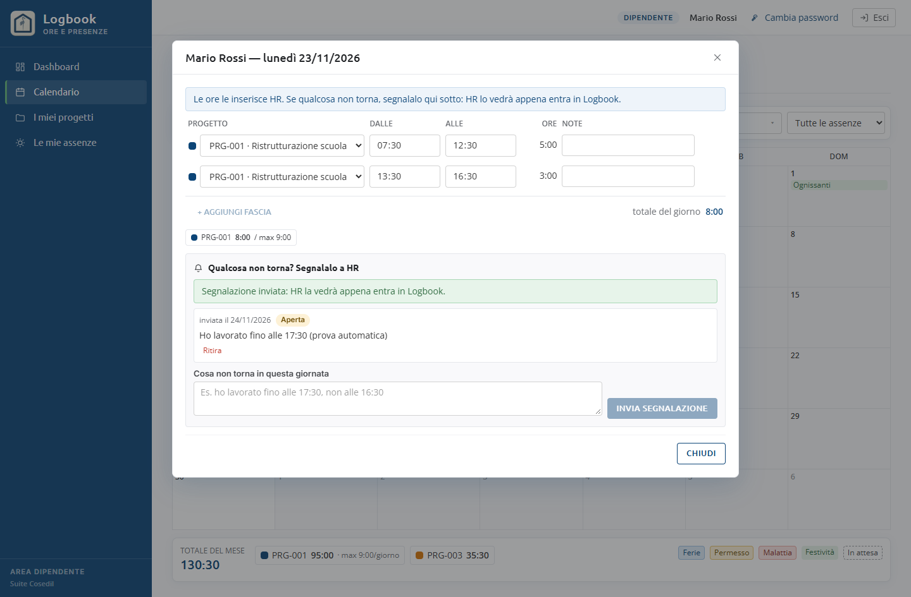

- HR vede la segnalazione appena entra in Copilota, corregge le ore se serve e la chiude con
  una risposta, che compare sotto la segnalazione e in dashboard.
- Finché è **aperta** la potete ritirare; una volta **risolta** resta come promemoria.
- Si segnala sui giorni fino a oggi, non su quelli futuri.

«Oggi» è la data di Copilota, non quella del computer. Se il PC ha una data diversa, in cima
alla pagina compare un avviso giallo.

### La mia squadra (per i capisquadra)

Dal 26/11/2026 chi è stato nominato **caposquadra** di un progetto trova nel menu la voce
**La mia squadra**. Da lì scrive le ore dei colleghi assegnati a quel progetto:

1. scegliere il **progetto** e il **giorno** (oggi o uno dei sette giorni precedenti);
2. per ogni persona: **+ Fascia**, orario di inizio e di fine, poi **Salva** sulla sua riga;
3. per correggere, cambiare gli orari e salvare di nuovo; togliendo tutte le fasce e
   salvando, le ore di quella persona su quel progetto vengono tolte.

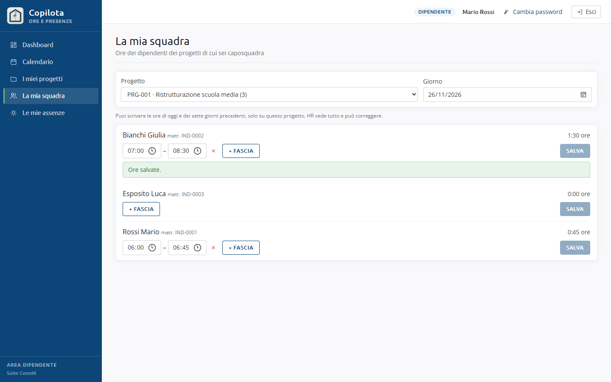

Da sapere:
- si scrivono solo le ore **su quel progetto**. Se una persona ha già ore su un altro progetto
  compare *Già occupato su altri progetti* con gli orari, per non sovrapporsi;
- valgono le regole di sempre (niente festivi, ferie o malattia, massimo di ore del progetto,
  mesi chiusi);
- per date più vecchie di sette giorni, o per qualsiasi dubbio, serve HR, che vede tutto e
  può correggere.

### I miei progetti

**I miei progetti** elenca i progetti a cui siete assegnati: sono quelli su cui HR registra le
vostre ore. Aprendone uno si vedono codice, cliente, ore massime al giorno e descrizione.
Avanzamento e documentazione del progetto li gestisce HR.

### Chiedere ferie, permessi o malattia

Da **Le mie assenze** → **+ Nuova richiesta** si apre la pagina della richiesta (a destra
le vostre altre assenze):

- **Ferie**: dal giorno… al giorno… (sabati, domeniche e festivi non si contano).
- **Permesso**: un giorno e la durata in ore (es. 2 oppure 1,5).
- **Malattia**: le date e solo il **numero di protocollo del certificato**. Non scrivete
  diagnosi né altre informazioni sanitarie: Copilota non ha campi per questo, di proposito.
- **Allegato** (facoltativo): con **Allega file…** si aggiunge un file, es. il giustificativo
  di un permesso: **solo PDF o immagini** (niente Word o Excel, che possono contenere
  macro). Per la malattia solo l'attestato per il datore di lavoro, **mai referti o
  certificati con la diagnosi**. Finché la richiesta è in attesa si può togliere o sostituire.

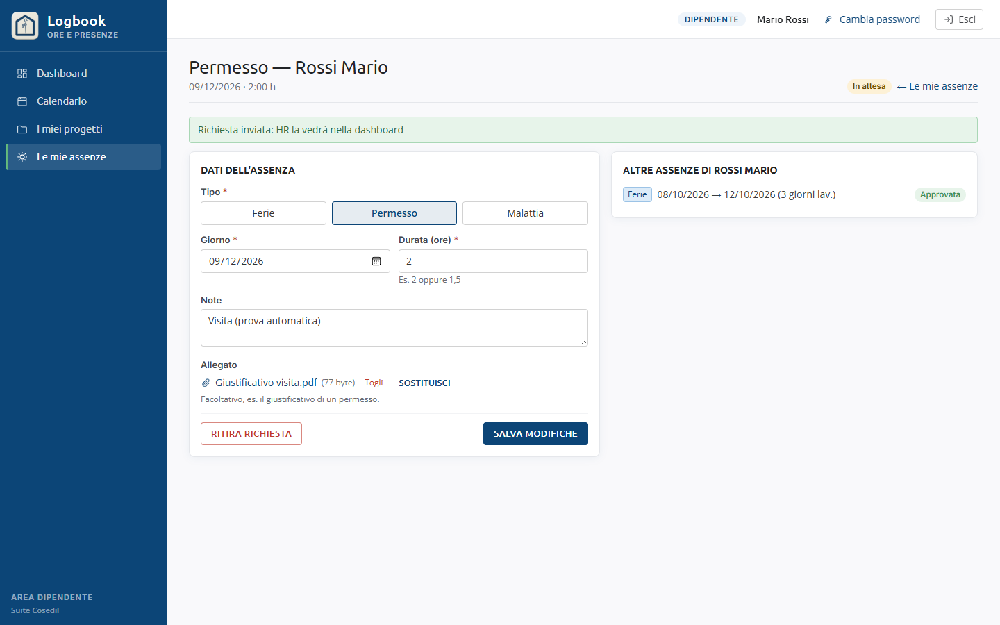

La richiesta resta **In attesa** finché HR non la approva o la rifiuta (con il motivo).
Finché è in attesa si può modificare o ritirare. Nel calendario le richieste in attesa
compaiono tratteggiate, quelle approvate piene, quelle rifiutate non compaiono.

---

## 3. Per HR (amministrazione)

HR vede tutte le voci del menu e i dati di tutti i dipendenti. **Solo HR inserisce e
corregge le ore** (dal calendario o con l'import Excel) e la documentazione dei progetti; i
dipendenti vedono le loro ore e mandano segnalazioni.

### Note spese

Dal 26/11/2026 chi anticipa una spesa di lavoro (un pranzo in trasferta, il carburante, del
materiale) la inserisce da **Le mie note spese**, anche dal telefono:

1. **+ Nuova nota spese**;
2. giorno, importo, categoria, descrizione e, se serve, il progetto;
3. **Foto o file dello scontrino**: dal telefono si può scattare la foto al momento. Senza
   scontrino la nota non si può salvare;
4. **Salva**. La nota resta *In attesa* finché HR non decide.

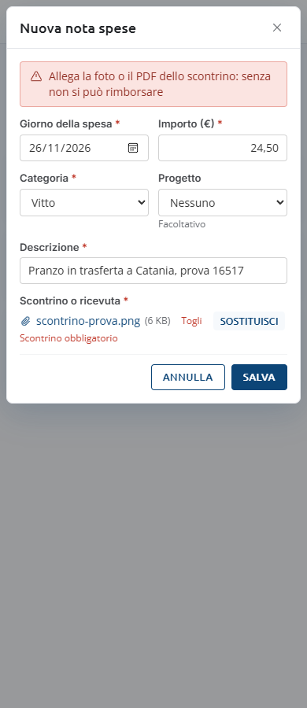

Finché è in attesa si può **modificare** o **ritirare**. Poi diventa *Approvata, da
rimborsare*, *Rifiutata* (con il motivo scritto da HR) o *Rimborsata*.

### Segnalazioni dei dipendenti

Nell'intestazione, la **campanella** mostra quante segnalazioni sono aperte. **Appena si
entra in Copilota**, se ce ne sono, si apre da sola la finestra con l'elenco: chi, che giorno,
cosa non torna. **Apri il giorno →** porta al dettaglio di quella giornata: si correggono le
fasce, si scrive la risposta e si preme **Segna risolta**. La finestra si riapre con la
campanella; in dashboard c'è anche il riquadro **Segnalazioni aperte**.

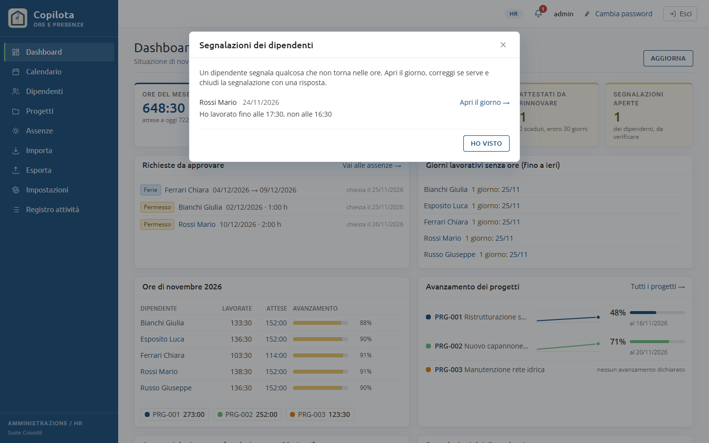

### Registrare le ore

**Più giorni e più dipendenti insieme: il pannello a destra.** Nel **Calendario** un clic su un
giorno lo sceglie e apre il pannello a destra (sotto il calendario sugli schermi più stretti):

- **Ctrl + clic** aggiunge o toglie un giorno; **Maiusc + clic** sceglie tutti i giorni fra
  quello cliccato prima e questo (solo quelli che ricevono ore).
- Nel pannello si sceglie il **progetto** (scrivendo alcune lettere), si spuntano i
  **dipendenti assegnati** a quel progetto (**Tutti** / **Nessuno**, filtro se sono tanti),
  si indicano le **fasce orarie** (di partenza 08:00-12:00 e 13:00-17:00) e una nota.
- Sotto c'è il conto (es. 3 dipendenti × 4 giorni × 8:00 = 96:00 ore) e **Inserisci**: le
  fasce **si aggiungono** a quelle già presenti, per ogni dipendente in ogni giorno.
- **Tutto o niente**: se anche una sola giornata non va bene (fascia sovrapposta a ore già
  registrate, ferie, dipendente non assegnato, massimo del progetto…) non si inserisce
  nulla e il pannello elenca chi, quale giorno e perché.
- Giorni futuri, sabati, domeniche e festivi restano nell'elenco in grigio ma non ricevono ore.
- Con un solo giorno scelto, **Ore del giorno** mostra chi ha lavorato; **Apri** porta al
  dettaglio della giornata di quella persona, per correggere o eliminare una fascia.

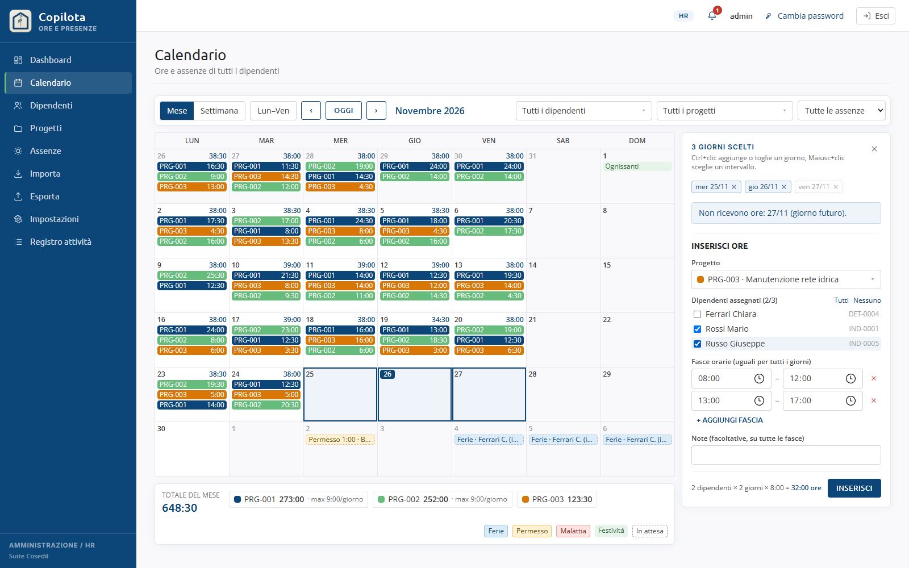

**Una giornata alla volta.** Dal pannello (**Apri**) o dai collegamenti della dashboard si apre
il dettaglio della giornata di un dipendente. Le ore si scrivono anche nei giorni passati; mai
in quelli futuri.

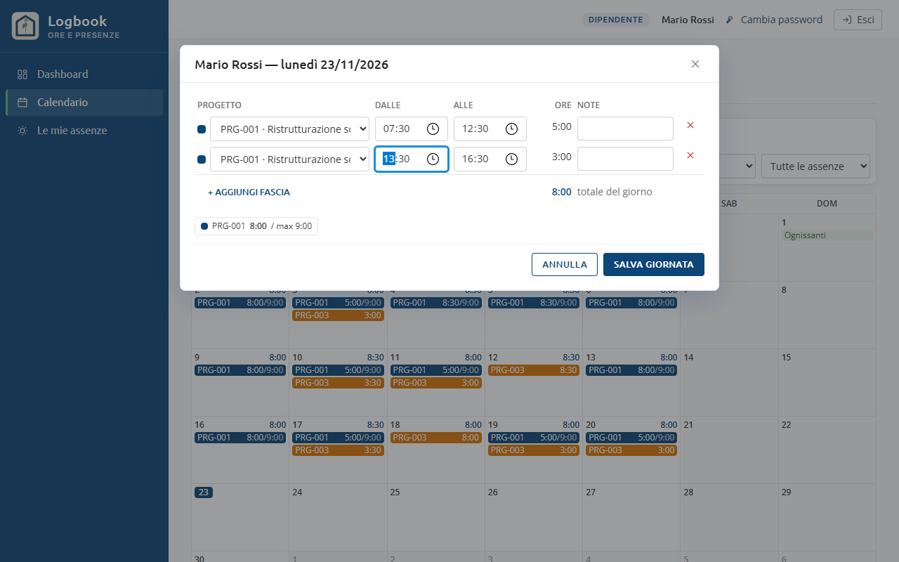

- **+ Aggiungi fascia** crea una riga: progetto, ora di inizio, ora di fine (24 ore), note.
- Le **ore si calcolano da sole**, riga per riga, insieme al totale del giorno.
- Più fasce nello stesso giorno vanno bene (mattina e pomeriggio, progetti diversi),
  purché **non si sovrappongano**. Se si sovrappongono le righe diventano rosse e non si
  può salvare:

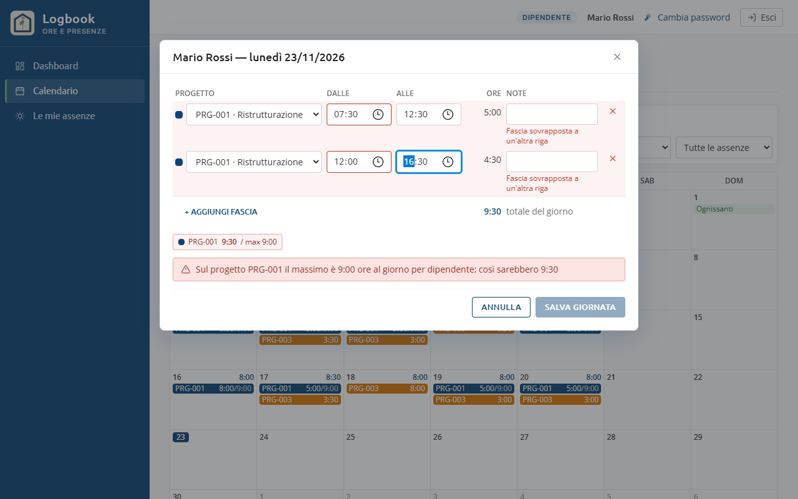

- Nel menu dei progetti ci sono **solo i progetti a cui il dipendente è assegnato**. Se non
  ne ha nessuno compare un avviso: assegnatelo dalla pagina del progetto o dalla sua scheda.
- Una fascia non può passare la mezzanotte: un turno di notte va diviso in due giorni.
- Non si registrano ore nei giorni futuri né nei giorni di ferie o malattia approvate.
- **Sabato, domenica e festivi non accettano ore**: nel calendario quei giorni non si aprono
  (passandoci sopra compare il motivo, es. «Sabato: non si registrano ore»). Se in uno di
  quei giorni sono rimaste ore inserite prima di questa regola, il dettaglio si apre solo
  per toglierle.
- Non si inserisce **nulla prima del 01/01/2020** (ore, assenze, festività, date di
  assunzione e dei progetti, righe dell'import).
- Se il progetto ha **ore massime al giorno**, sotto le righe compare per ogni progetto
  "ore del giorno / max": oltre il limite il riquadro diventa rosso e **Salva giornata** si
  disattiva (il limite vale per ciascun dipendente).
- **Salva giornata** salva tutte le righe insieme.
- La **✕** di una fascia già salvata la **elimina subito** (dopo la conferma), senza
  toccare le altre righe; il calendario si aggiorna e la finestra resta aperta. La ✕ di una
  riga nuova, non ancora salvata, la toglie soltanto.

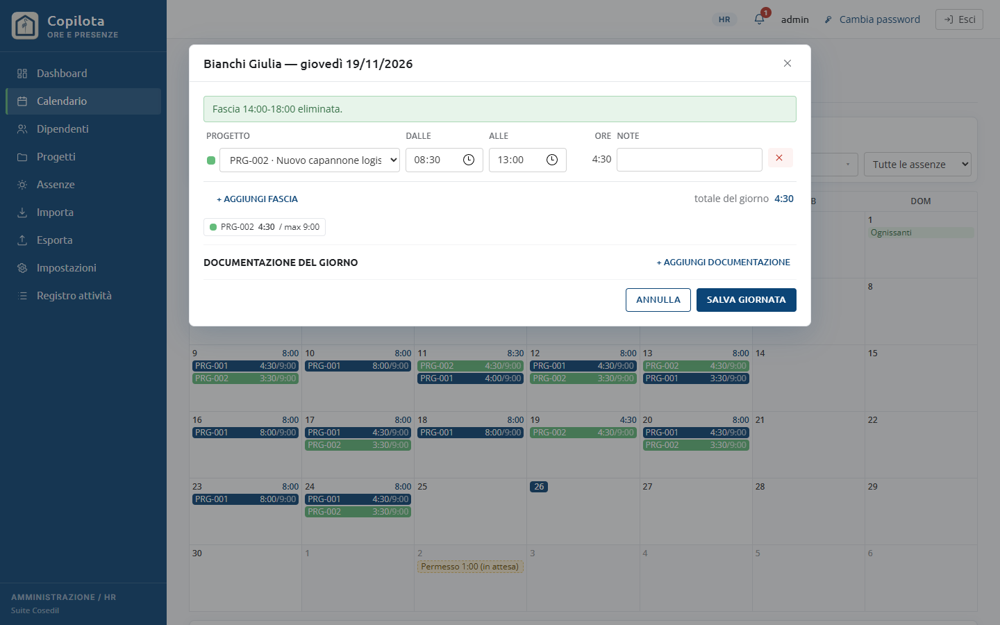

**Documentazione del giorno.** Sotto le fasce, **+ Aggiungi documentazione** allega a quella
giornata un file (verbale, foto, rapportino) con una nota e, se serve, la percentuale di
avanzamento. Il titolo è già proposto («Giornata del 20/11/2026 – Rossi Mario»). Va sul
progetto di una fascia **già salvata**: con più progetti nel giorno si sceglie quale.
Si salva subito con **Salva documentazione**, senza «Salva giornata», e compare anche nella
pagina del progetto con l'etichetta «dalla giornata». **Elimina** la toglie con il suo file.

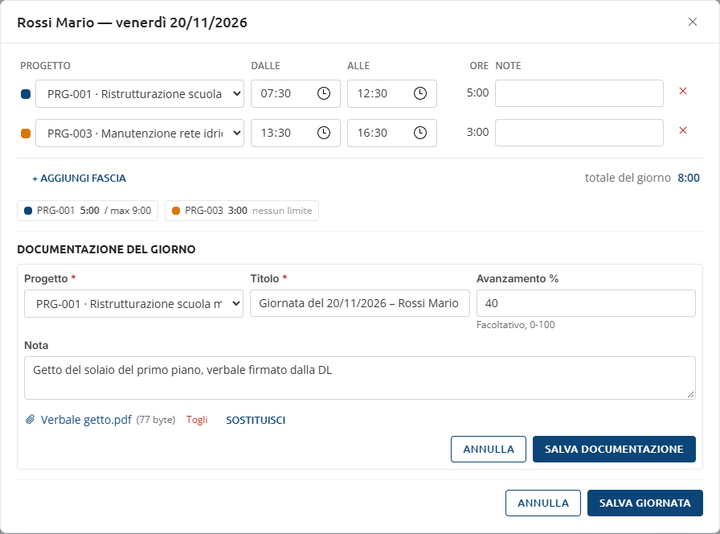

### Dashboard HR

In alto, i quattro riquadri dicono cosa richiede attenzione e diventano **gialli** quando
c'è da intervenire:

- **Richieste da approvare**: clic per andare alle assenze.
- **Giorni senza ore**: dipendenti che non hanno registrato giorni lavorativi fino a ieri
  (clic: si scende all'elenco).
- **Ore del mese**: lavorate e attese, con l'avanzamento per dipendente e per progetto.
- **Assenti oggi** (clic: tutte le assenze).
- **Attestati da rinnovare**: scaduti o in scadenza entro 30 giorni; il pannello sotto li
  elenca e il clic apre la scheda Attestati del dipendente.
- **Segnalazioni aperte**: cosa i dipendenti segnalano sulle loro ore; il pannello sotto le
  elenca e il clic apre quel giorno di quel dipendente.
- **Documentazione da vedere** (compare solo se c'è): documenti di progetto rimessi «da
  vedere»; il clic apre la pagina del progetto.

Ogni voce dei pannelli sotto porta al suo elemento:

- una **richiesta** o un'**assenza in arrivo** apre quella richiesta nella pagina Assenze;
- il **nome** di chi ha giorni senza ore apre il suo calendario; il singolo **giorno** apre
  subito il dettaglio di quel giorno per registrare le ore;
- un dipendente nelle **ore del mese** apre il suo calendario;
- un **progetto** apre la sua pagina;
- una **festività** apre la scheda Festività.

Il dipendente, dalla sua dashboard, va al calendario filtrato sul progetto o sul giorno
della festività.

**Avanzamento dei progetti** (solo HR): una riga per ogni progetto attivo o sospeso con
l'andamento delle percentuali di avanzamento dichiarate nella documentazione (piccolo
grafico, sempre da 0 a 100% per confrontare le righe), l'ultima percentuale con la sua barra
e il giorno in cui è stata dichiarata. Passando sui punti del grafico compare data e
percentuale; il clic sulla riga apre il progetto. I progetti senza percentuali lo dicono.

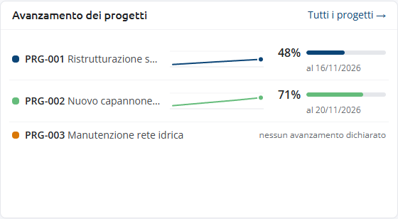

#### Timbrature da confermare

Quando un dipendente ha timbrato entrata e uscita, in cima alla **Dashboard HR** compare
*Timbrature da confermare*. Per ogni riga si possono correggere gli orari, poi:

- **Conferma**: la timbratura diventa una fascia oraria del dipendente, come se fosse stata
  inserita a mano (stessi controlli: sovrapposizioni, festivi, ferie, massimo del progetto,
  mese chiuso). Se l'orario è stato corretto, resta scritto quello timbrato;
- **Rifiuta**: chiede il motivo, che il dipendente leggerà. Non nasce nessuna ora.

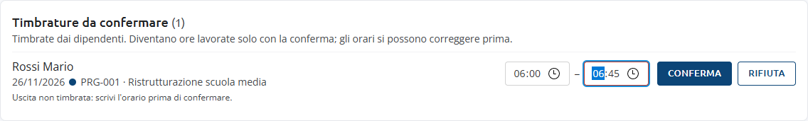

Una timbratura senza uscita ha il campo dell'uscita evidenziato: va scritto l'orario prima di
confermare. Finché HR non conferma, le timbrature non contano nelle ore né negli estratti.

### Calendario

- Vista **Mese** o **Settimana**, frecce per spostarsi, **Oggi** per tornare al presente.
- **Lun–Ven** mostra solo i giorni da lunedì a venerdì (in mese e settimana); la scelta
  resta finché non la si toglie.
- Filtri per **dipendente**, **progetto** e **tipo di assenza**. Col filtro progetto i
  totali dei giorni sono le ore di quel progetto. Dipendente e progetto si scelgono
  **scrivendo alcune lettere** (nome, matricola, codice fiscale; codice, nome o cliente del
  progetto): l'elenco si restringe mentre si scrive, frecce e Invio per scegliere.

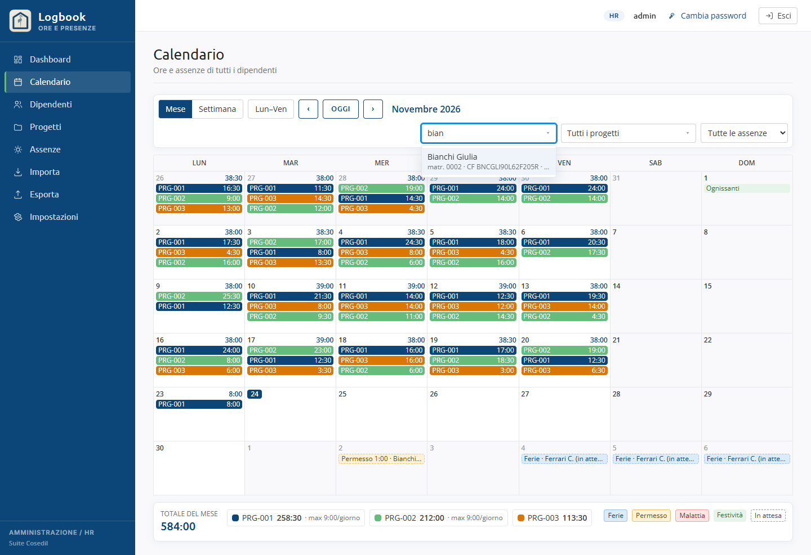
- Ogni progetto ha il suo colore; ferie in azzurro, permessi in giallo, malattia in rosso,
  festività in verde.
- Per HR il clic su un giorno apre il **pannello a destra** (vedi «Registrare le ore»): più
  giorni con Ctrl o Maiusc, ore per più dipendenti insieme, e **Apri** verso la giornata di
  ciascuno. Il dipendente invece apre il suo giorno in sola lettura.

### Dipendenti

Ricerca per nome, matricola, codice fiscale, mansione o reparto; clic sulle intestazioni
per ordinare; filtro attivi/cessati. Clic su una riga per aprire la scheda.

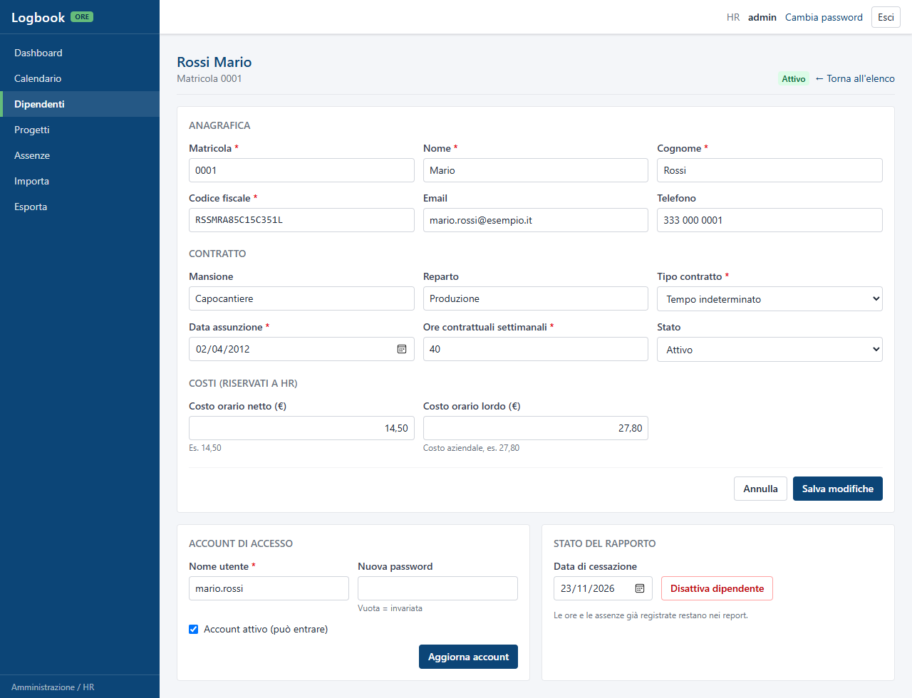

La scheda mostra **tutto nella stessa pagina**, senza schede da cambiare: anagrafica,
contratto e costi in alto; sotto account, stato del rapporto e progetti assegnati; in fondo
attestati e documenti. La riga di collegamenti in cima porta alle sezioni. Per un
dipendente nuovo c'è solo il modulo in alto: dopo **Crea dipendente** compare il resto.

**Omonimi**: se esiste già un dipendente con lo stesso nome, sotto l'anagrafica compare chi
è, con matricola e codice fiscale. È il codice fiscale a distinguere le persone: in tutti gli
elenchi e i menu di Copilota, due omonimi si riconoscono dall'inizio del codice fiscale
accanto al nome (es. «Rossi Mario (CF RSSMRA8)»).

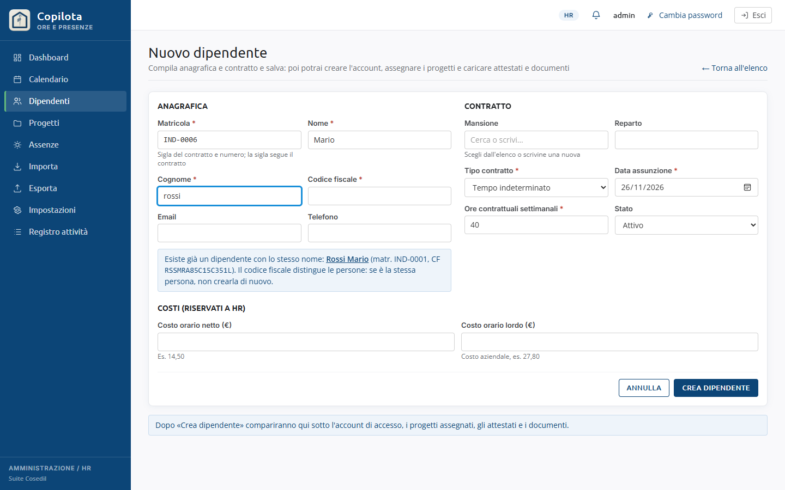

- **Anagrafica**: il **codice fiscale** viene controllato (un codice sbagliato non si
  salva); matricola e codice fiscale devono essere unici.
- **Matricola**: è la **sigla del contratto + un numero**, così si riconosce subito il tipo
  di rapporto: IND (indeterminato), DET (determinato), APP (apprendistato), SOM
  (somministrazione), COL (collaborazione), TIR (tirocinio). Esempi: IND-0001, DET-0004.
  Per un dipendente nuovo Copilota propone il **prossimo numero libero**, che si può
  correggere (basta scrivere il numero, la sigla la mette Copilota). Se cambia il contratto
  **cambia solo la sigla** e il numero resta (DET-0004 diventa IND-0004). Il numero è unico:
  IND-0004 e DET-0004 non possono esistere insieme.
- **Mansione**: si sceglie dall'**elenco**, scrivendo alcune lettere. Se se ne scrive una
  nuova compare l'avviso «Nuova mansione» e al salvataggio entra nell'elenco per tutti. Una
  mansione già presente scritta con altre maiuscole prende la grafia dell'elenco.

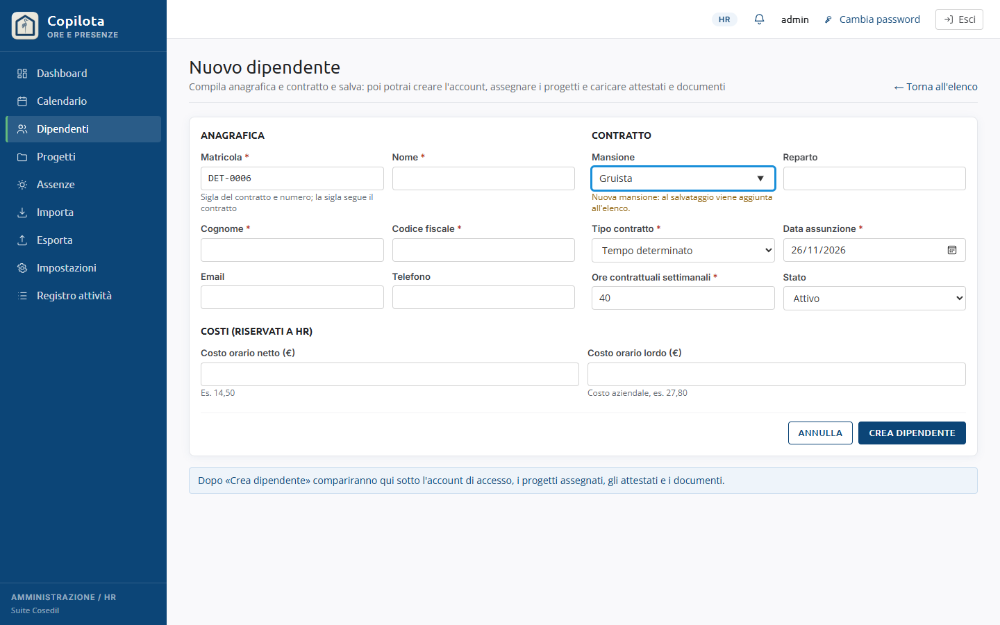

- **Contratto e costi**: contratto, assunzione, ore settimanali e costo orario **netto** e
  **lordo** in euro (es. 14,50). I costi li vede solo HR e servono ai report.
- **Account**: crea il nome utente e la password del dipendente, o ne reimposta la
  password (comunicateli al dipendente). La password è **provvisoria**: al primo accesso il
  dipendente ne sceglie una sua, e finché non lo fa la scheda lo indica. **Disattiva dipendente** quando il rapporto finisce:
  le ore restano nei report e l'account viene bloccato. **Riattiva** lo rimette attivo, ma
  l'account va riattivato a mano.
- **Progetti assegnati**: gli stessi della pagina del progetto, visti dal dipendente. Si
  aggiunge un progetto alla volta cercandolo per codice, nome o cliente; **Togli** lascia le
  ore già fatte.
- **Attestati**: formazione sicurezza, primo soccorso, antincendio, patentini, visite
  mediche e altro, con data di rilascio, **scadenza** e file. **+ Nuovo attestato** (o il
  clic su un attestato) apre il modulo dentro la sezione, sopra l'elenco: il resto della
  scheda resta visibile. Lo stato si aggiorna da solo:
  *Valido*, *In scadenza* (nei 30 giorni prima), *Scaduto*, *Non scade*. Gli attestati in
  scadenza o scaduti compaiono anche nella dashboard di HR. Per la visita medica si scrive
  solo l'esito (es. «idoneo»), mai diagnosi.

- **Documenti**: contratto, documenti d'identità e altri file del dipendente (titolo, note,
  file obbligatorio).

I file si caricano con **Scegli file…**: PDF, immagini, Word, Excel, OpenDocument, testo e
PDF firmati (.p7m), fino a 20 MB. Clic sul nome per aprirlo. Un file caricato e mai salvato
in una scheda si cancella da solo dopo un giorno; ognuno può averne al massimo 20 in sospeso. Attestati e documenti del
dipendente li vede solo HR.

### Progetti

L'elenco ha la ricerca a caratteri, il filtro di stato e la colonna **Dipendenti** (quanti
sono assegnati; "nessuno" in rosso = nessuno può registrare ore). **+ Nuovo progetto** e il
clic su una riga aprono la **pagina del progetto**, con tutto nella stessa pagina: a
sinistra dati, dipendenti assegnati e note interne, a destra avanzamento e documentazione.
Un progetto nuovo mostra solo i dati: il resto compare dopo **Crea progetto**.

**Dati del progetto**: codice (unico), nome, cliente, date, colore nel calendario e **ore massime al giorno**
per dipendente (vuoto = nessun limite). Il limite compare nella tabella dei progetti, nel
calendario (con un dipendente filtrato le caselle mostrano "ore/massimo", la legenda
"max …/giorno") e nell'editor della giornata; oltre il limite le ore non si salvano, né da
interfaccia né da import. **Chiudi progetto** lo toglie dai progetti selezionabili per
nuove ore; quelle già registrate restano.

Il **colore nel calendario** si sceglie da un menu con i colori del marchio, ognuno col suo
nome. **Automatico** lascia scegliere a Copilota (sempre lo stesso colore per quel
progetto); **Altro colore…** serve solo per un codice colore particolare.

Nei dati ci sono anche la **descrizione** e la **commessa SkyTower** (es. 101-003): serve
per inviare la documentazione all'archivio della suite; con il collegamento attivo il campo
suggerisce le commesse di SkyTower.

**Dipendenti assegnati**: **solo chi è assegnato può registrare ore sul progetto**, dal
calendario, dall'import Excel e anche quando le inserisce HR. I dipendenti si aggiungono
**uno alla volta**: si scrivono alcune lettere del nome, della matricola o del codice
fiscale, si sceglie dall'elenco e si preme **Assegna**. Sotto ogni nome compaiono matricola
e codice fiscale: con due omonimi è il codice fiscale che li distingue.

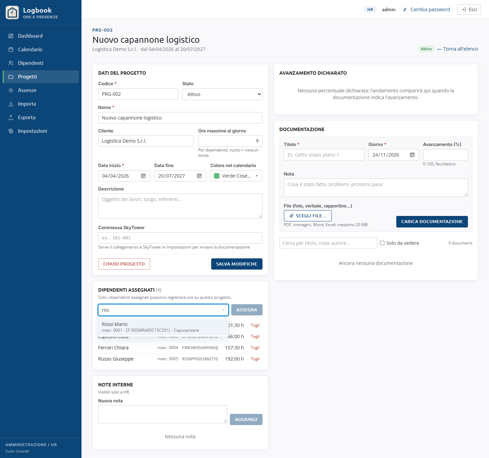

Accanto a ogni assegnato ci sono le ore che ha già registrato sul progetto. **Togli** lo
toglie: le ore fatte restano (e restano correggibili nella loro giornata), ma non se ne
possono aggiungere altre. Con l'aggiornamento del 24/11/2026 chi aveva già ore su un
progetto ne è diventato assegnato automaticamente.

**Avanzamento e documentazione** (solo HR): titolo, giorno, percentuale di avanzamento, nota
e file (foto, verbale, rapportino…). Ogni percentuale diventa un punto del grafico
**Avanzamento**. L'elenco ha il filtro a caratteri; ogni documento si può **commentare**,
segnare **da vedere** (per ricordarsi di riguardarlo), **eliminare** e, se in Impostazioni
c'è il collegamento e il progetto ha la commessa, **inviare a SkyTower** (solo i documenti
con un file, una volta sola; poi compare il link al documento in SkyTower).

**Note interne**: appunti di HR sul progetto, che i dipendenti non vedono.

#### Nominare un caposquadra

Nella scheda del progetto, riquadro **Dipendenti assegnati**, ogni riga ha la spunta
**Caposquadra**. Chi ce l'ha può inserire le ore di tutti i dipendenti assegnati a quel
progetto, solo su quel progetto, per oggi e i sette giorni precedenti (pagina *La mia
squadra*). Le ore inserite così si riconoscono dall'origine "caposquadra" e HR può sempre
correggerle. Togliendo la spunta, torna un dipendente come gli altri.

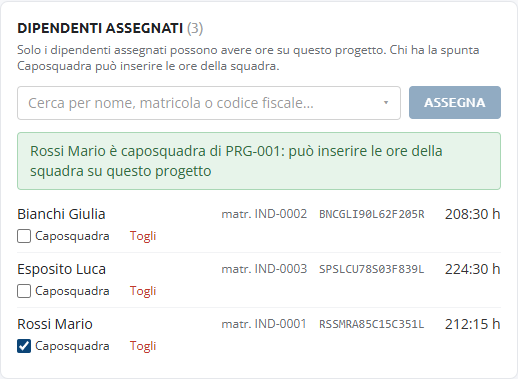

#### Costo della manodopera di un progetto

Dal 26/11/2026 la scheda di ogni progetto ha il riquadro **Costo della manodopera**, visibile
solo agli amministratori:

- **costo lordo e netto** delle ore registrate sul progetto (ore di ogni dipendente per il suo
  costo orario, scritto nella scheda del dipendente);
- **preventivo**: si scrivono qui gli euro lordi e le ore preventivate, poi **Salva preventivo**.
  Due barre mostrano quanto è stato consumato: verdi fino all'80%, gialle fino al 100%, rosse
  quando si sfora;
- il dettaglio **per dipendente** e **per mese**.

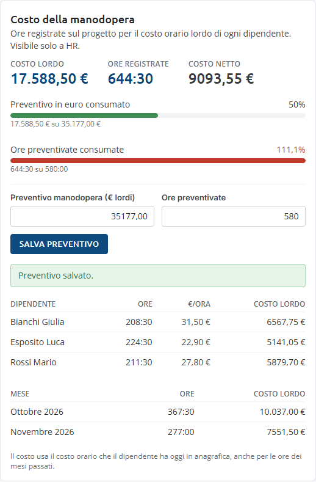

Da sapere:
- chi ha ore sul progetto ma **nessun costo orario** in anagrafica conta nelle ore e non negli
  euro: il riquadro avvisa che il totale è parziale;
- il costo usa il costo orario che il dipendente ha **oggi**, anche per le ore dei mesi passati;
- i dipendenti non vedono né questo riquadro né il preventivo.

### Assenze

Il clic su una richiesta (o **+ Nuova assenza**) apre la **pagina dell'assenza**: a sinistra
i dati con i pulsanti, a destra le altre assenze dello stesso dipendente, per decidere
vedendo il resto dell'anno. La ricerca dell'elenco trova anche matricola e codice fiscale.

- Scheda **Da approvare**: clic sulla richiesta → **Approva** o **Rifiuta** (il motivo va
  scritto nelle note HR). Si possono anche cambiare le date prima di approvare.
- Non si approvano ferie o malattia su giorni che hanno già ore registrate: prima vanno
  tolte o spostate (Copilota indica quali giorni).
- **+ Nuova assenza** registra un'assenza per un dipendente, anche già approvata (es.
  malattia comunicata per telefono). Il dipendente si sceglie scrivendo nome, matricola o
  codice fiscale.
- Gli **allegati** si vedono con la graffetta nell'elenco e si aprono dalla pagina
  dell'assenza. HR può allegarne o sostituirne uno anche a una richiesta già decisa; il
  dipendente lo apre dalla sua richiesta.

#### Saldo ferie e permessi

Dal 26/11/2026 la pagina **Assenze** mostra quante ferie e quanti permessi restano.

**Per HR.** In cima alla pagina c'è il riquadro *Saldi ferie e permessi* (si apre con un clic).
Per ogni dipendente il pulsante **Quota** apre il modulo con i numeri del suo contratto:

- giorni di ferie e ore di permesso che maturano in un anno;
- **Conta dal**: la data da cui Copilota comincia a contare (di solito il 1° gennaio);
- ferie e permessi **residui a quella data**, riportati da come si contava prima.

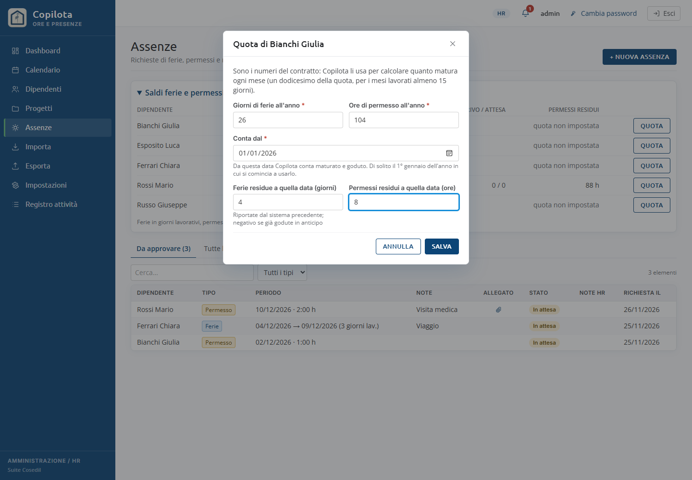

Finché la quota non è scritta, per quel dipendente c'è *quota non impostata* e nessun saldo:
Copilota non inventa i numeri del contratto.

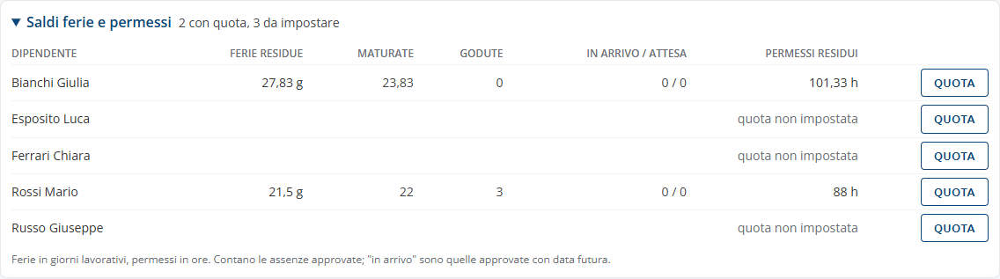

**Per il dipendente.** Due tessere con ferie (giorni) e permessi (ore) residui e il conto che
porta a quel numero. Se ha ferie già approvate per il futuro o richieste in attesa, compare
anche *Ancora da chiedere*.

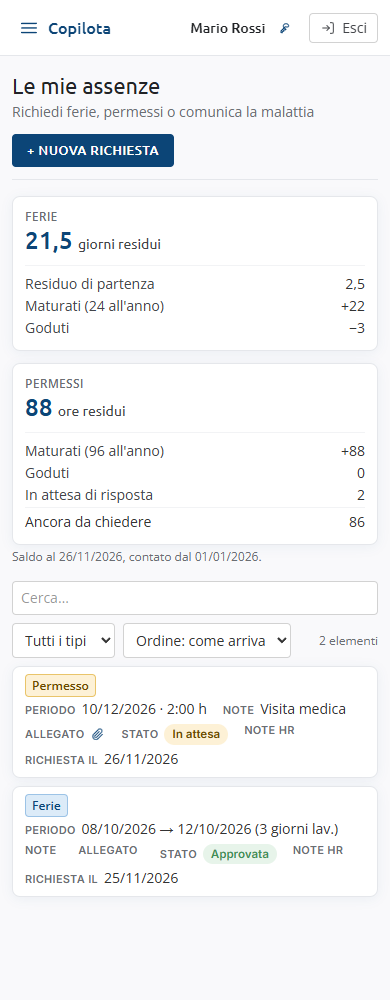

Come si calcola:
- ogni mese matura **un dodicesimo** della quota annua; un mese conta se il dipendente è in
  forza per **almeno 15 giorni** di quel mese (il mese in corso matura dal giorno 15);
- **goduto**: le assenze *approvate* fino a oggi. Le ferie si contano in giorni lavorativi
  (sabati, domeniche e festività non contano), i permessi in ore;
- **residuo** = residuo di partenza + maturato − goduto. Può andare sotto zero (in rosso).

Il saldo non si scrive a mano: si aggiorna da solo quando una richiesta viene approvata,
rifiutata o corretta.

### Note spese (HR)

La voce **Note spese** del menu mostra le spese anticipate dai dipendenti. In alto tre
riquadri con i totali: *Da decidere*, *Da rimborsare*, *Rimborsate*; un clic su un riquadro
filtra l'elenco.

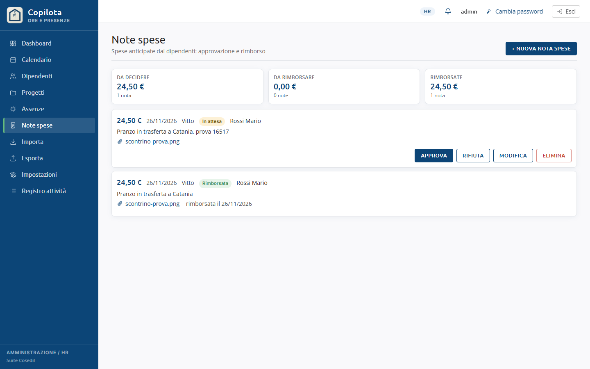

Per ogni nota: lo scontrino si apre con un clic sul nome del file, poi
- **Approva** oppure **Rifiuta** (chiede il motivo, che il dipendente leggerà);
- quando la spesa è stata pagata, **Segna rimborsata**: da lì la nota non si modifica più e
  resta agli atti.

HR può anche inserire una nota a nome di un dipendente con **+ Nuova nota spese**, anche
senza scontrino.

### Festività

Su un Copilota appena installato le festività nazionali dell'anno in corso e del successivo
ci sono già. Per gli anni dopo si caricano con un clic (**Carica festività nazionali**).
Quelle **del paese** (il santo patrono) e le **chiusure aziendali** si aggiungono a mano,
scegliendo il tipo. Un giorno festivo non conta come giorno lavorativo.

### Impostazioni (solo amministratori)

Qui si registra il **collegamento a SkyTower**, l'archivio documentale della suite:
indirizzo dell'API (sul server di solito `http://127.0.0.1:8100`), token di servizio della
suite (file `shared\suite\.token` sul server) ed eventualmente l'email dell'utente SkyTower
che risulterà autore dei documenti. **Prova collegamento** controlla che SkyTower risponda.

I documenti restano comunque in Copilota. Con il collegamento attivo, nella documentazione
dei progetti che hanno una commessa SkyTower compare il pulsante **Invia a SkyTower**; senza
collegamento il pulsante non c'è. Il token, una volta salvato, non si rilegge più.

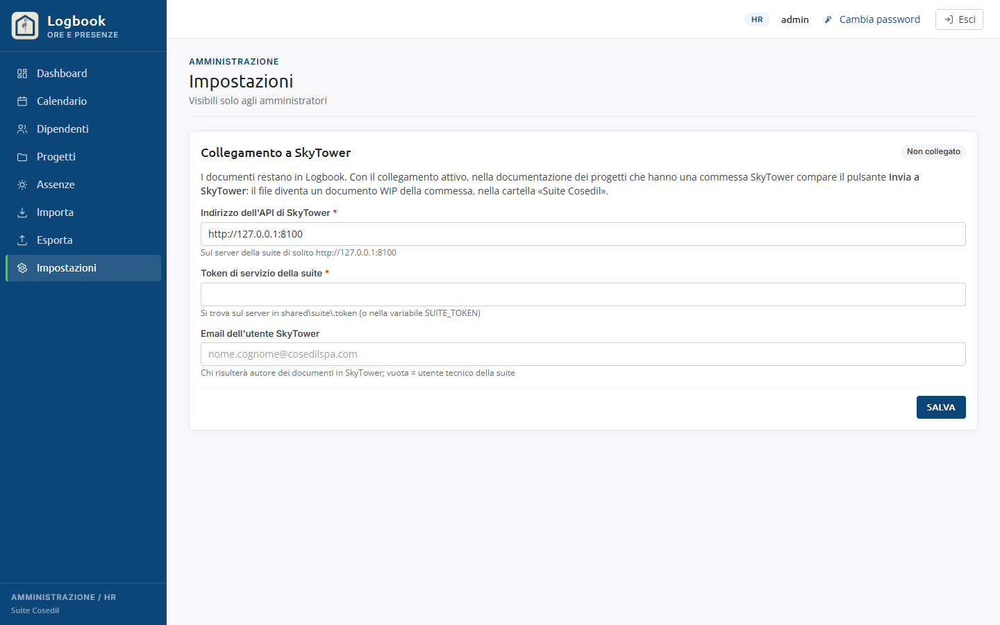

#### Dati del programma (solo il proprietario)

Il proprietario di Copilota vede in Impostazioni anche il riquadro **Dati del programma**.
Gli altri amministratori non lo vedono.

- **Carica dati di esempio** riempie Copilota con 5 dipendenti, 3 progetti, le ore dal
  primo giorno del mese scorso a ieri e qualche assenza, per vedere come si visualizzano
  i dati. Funziona solo con Copilota vuoto.
- **Cancella tutti i dati** riporta Copilota come appena installato. Si fa in due passi:
  1. **Invia il codice per email**: arrivano 6 cifre all'indirizzo del proprietario,
     valide 10 minuti;
  2. si scrivono il codice e la parola **CANCELLA**, poi **Cancella tutti i dati**.

  Restano il tuo account con la sua password, il collegamento a SkyTower e le festività
  nazionali. Va via tutto il resto, compresi gli altri account e i file caricati. Non si
  può annullare. A cose fatte arriva un'email di avviso.

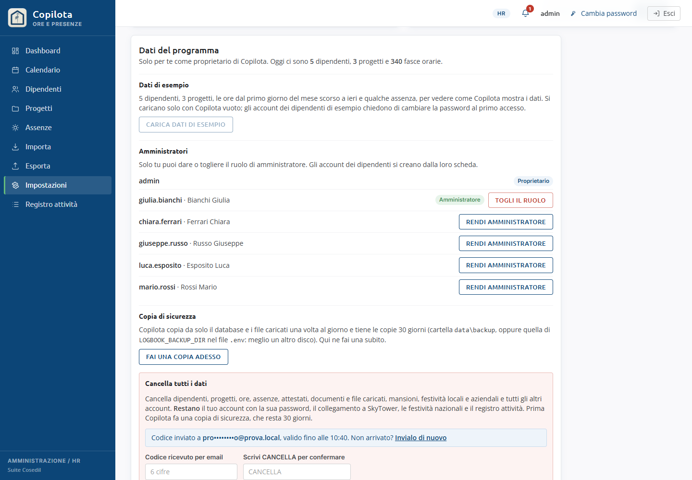

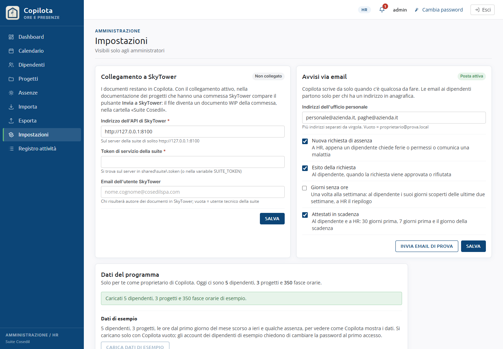

Nello stesso riquadro:

- **Amministratori**: solo il proprietario rende amministratore un account o gli toglie il
  ruolo. Chi cambia ruolo viene scollegato e rientra con i nuovi poteri.
- **Copia di sicurezza**: Copilota ne fa una da solo ogni giorno e le tiene 30 giorni; con
  **Fai una copia adesso** se ne fa una subito. Prima di "Cancella tutti i dati" ne parte
  sempre una.

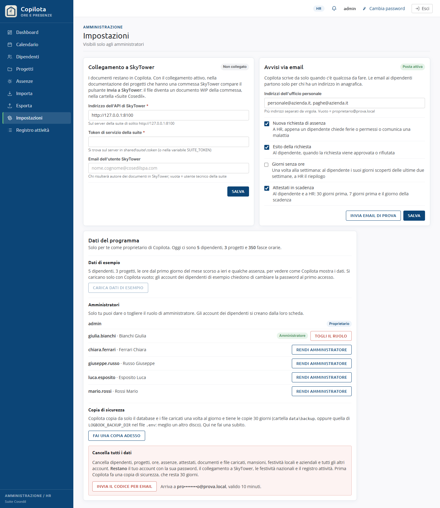

#### Avvisi via email

Dal 26/11/2026 Copilota scrive da solo quando c'è qualcosa da fare. In **Impostazioni → Avvisi
via email** si sceglie a chi arrivano gli avvisi per l'ufficio personale (più indirizzi
separati da virgola; se il campo è vuoto arrivano al proprietario) e quali avvisi mandare:

| Avviso | A chi | Quando |
|---|---|---|
| Nuova richiesta di assenza | ufficio personale | appena un dipendente chiede ferie o permessi o comunica una malattia |
| Esito della richiesta | dipendente | quando la richiesta viene approvata o rifiutata, con la nota di HR |
| Giorni senza ore | dipendente, più riepilogo a HR | una volta alla settimana, sui giorni lavorativi scoperti delle ultime due settimane |
| Attestati in scadenza | dipendente e HR | 30 giorni prima, 7 giorni prima e il giorno della scadenza |
| Progetto chiuso | ufficio personale e dipendenti assegnati | subito, quando HR mette un progetto su **Chiuso** |

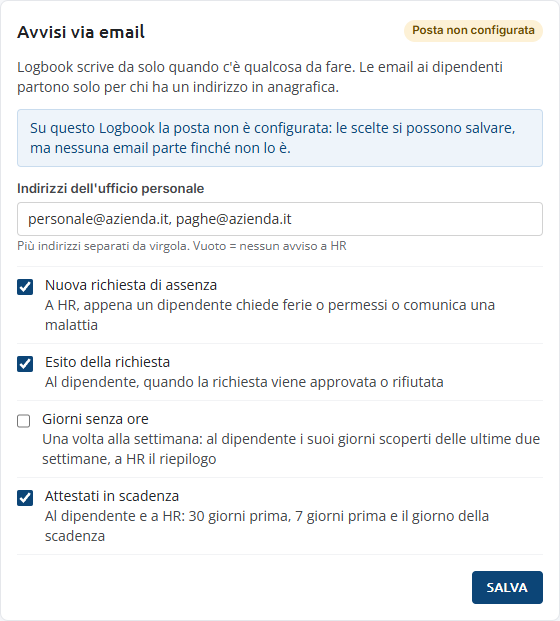

**Progetto chiuso** (dal 26/11/2026). Quando nella scheda di un progetto si sceglie lo stato
*Chiuso* e si salva, partono due email diverse:

- all'**ufficio personale** il riepilogo: ore registrate e costo lordo della manodopera, con
  la percentuale sul preventivo se è stato inserito, periodo lavorato, numero di assegnati e
  quello che è rimasto in attesa su quel progetto (timbrature da confermare, note spese da
  approvare). Se qualcuno ha ore ma non il costo orario in anagrafica, l'email lo dice;
- ai **dipendenti assegnati** solo l'avviso che il progetto è chiuso e che non si possono più
  timbrare né registrare ore. Ore e costi a loro non arrivano.

Se un progetto viene riaperto e poi richiuso, le email partono di nuovo. Salvare altre
modifiche su un progetto già chiuso non manda niente.

Da sapere:
- le email ai dipendenti partono solo per chi ha un **indirizzo in anagrafica** (scheda del dipendente);
- **Invia email di prova** controlla subito che la posta funzioni;
- se in alto c'è scritto *Posta non configurata*, le scelte si salvano ma nessuna email parte:
  la posta si imposta sul server (variabili `LOGBOOK_SMTP_*`);
- gli indirizzi dei dati di esempio (`@esempio.it`) non ricevono mai nulla.

### Registro attività (solo amministratori)

Nel menu a sinistra, **Registro attività** elenca dal più recente chi ha fatto cosa: accessi
riusciti e falliti, blocchi per troppi tentativi, ore salvate, dipendenti modificati, dati
esportati, ruoli dati o tolti. Per ogni riga ci sono data e ora, utente, esito e indirizzo
del PC. Si può cercare per utente o azione e filtrare per esito e periodo. Le righe non si
possono modificare e restano 400 giorni.

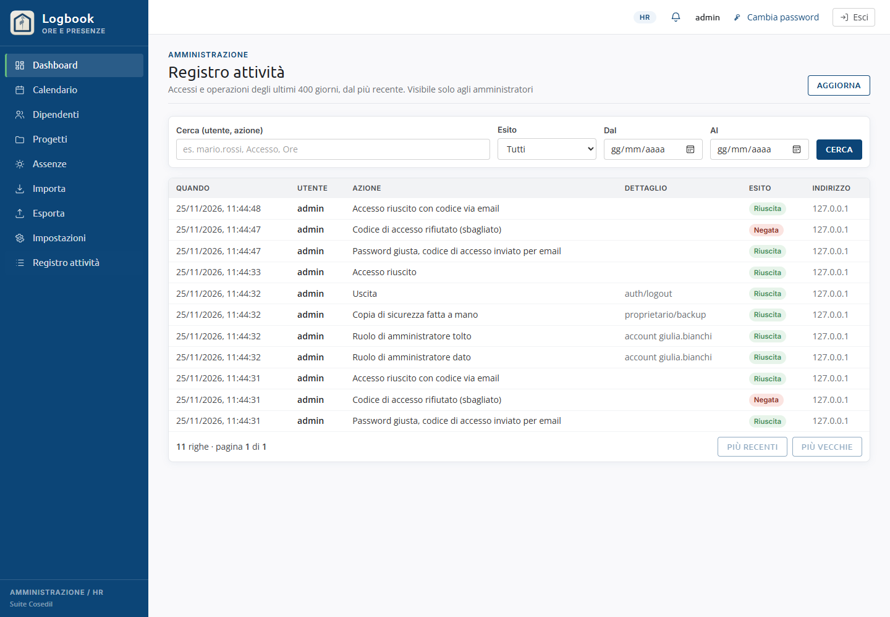

### Importare le ore da Excel

1. **Importa → Scarica il modello .xlsx**. Il foglio "Ore" ha le colonne Matricola, Data
   (gg/mm/aaaa), Ora inizio e Ora fine (HH:MM), Codice progetto, Note. Gli altri fogli
   spiegano le regole ed elencano matricole e codici validi (anche nei menu a tendina).
   Il dipendente si riconosce dal **numero** della matricola: valgono anche i file vecchi
   con «0004» o con la sigla del contratto di prima.
2. Compilate una riga per ogni fascia oraria. La riga di esempio viene ignorata.
3. Scegliete il file: Copilota mostra l'**anteprima** e controlla ogni riga.

Se anche **una sola riga** ha un errore (dipendente o progetto inesistente, orario non
valido, sovrapposizione con altre righe o con ore già registrate, giorno futuro o di
ferie…) il file viene **rifiutato** e non si importa nulla: correggete le righe indicate e
ricaricatelo. Se è tutto corretto, **Conferma e importa** salva tutte le righe insieme.

### Esportare i report

Scegliete il periodo (o una scorciatoia: mese corrente, mese scorso…), i dipendenti e i
progetti (nessuna spunta = tutti). Il riepilogo mostra subito le ore totali, le stesse del
calendario. Poi:

- **Calendario lavorato**: un foglio per dipendente con anagrafica, ogni giorno del
  periodo da lunedì a venerdì (fasce, progetto, ore, assenze, festività), totali, ore contrattuali attese,
  giorni di ferie e malattia, ore di permesso.
- **Ore per progetto**: per ogni dipendente i progetti lavorati con ore e **costo lordo**,
  il totale complessivo e un foglio riassuntivo dipendenti × progetti.

Le ore nei file Excel sono in formato ore:minuti (es. 7:30) e si possono sommare.

**Sabato e domenica non compaiono mai** nelle estrazioni (report, estratti mensili, Excel,
stampa e PDF): nel fine settimana non si registrano ore.

### Presenze per il consulente paghe

Dal 26/11/2026 nella pagina **Esporta**, scelti periodo e dipendenti, il riquadro *Presenze
per il consulente paghe* scarica un file con **una riga per dipendente e per giorno**:

| Colonna | Cosa contiene |
|---|---|
| Matricola, Cognome, Nome, Codice fiscale | il dipendente |
| Data, Giorno, Tipo giorno | la data; lavorativo, sabato, domenica o festivo |
| Ore lavorate | le ore registrate, come numero (7,5) e come ore e minuti (7:30) |
| Ferie, Malattia | 1 se quel giorno lavorativo è di ferie o di malattia |
| Permesso (ore) | le ore di permesso del giorno |
| Festività | il nome della festa |
| Ore contrattuali | le ore previste dal contratto in un giorno lavorativo |
| Note | le note scritte sulle ore |

- **Scarica Excel**: un foglio solo, con i filtri sulle colonne.
- **Scarica CSV**: lo stesso contenuto in formato testo (punto e virgola, virgola decimale),
  che i programmi paghe importano di solito.

Contano solo le ore registrate e le assenze **approvate**. Conviene scaricarlo dopo aver
**chiuso il mese**, così i numeri non cambiano più. Se il consulente chiede un formato
diverso (altre colonne, altro ordine) si adatta: va detto a chi segue il programma.

### Estratti mensili (Excel, stampa e PDF)

In fondo alla pagina **Esporta**: scegliete il **mese** (da gennaio 2020) e, se serve, i
dipendenti e i progetti nelle caselle in alto. Sotto compare l'anteprima, un dipendente per
pagina, in due versioni:

**Mese a calendario**: a sinistra il calendario del mese, **da lunedì a venerdì**, con le ore di ogni giorno e i
progetti (ferie in azzurro, malattia in rosso, permessi in giallo, festivi in grigio, festività in verde),
a destra l'anagrafica e il riepilogo del mese (ore lavorate e attese, ferie, malattia,
permessi, costo netto e lordo), in basso la descrizione dei progetti lavorati con le ore
massime al giorno e le ore del mese.

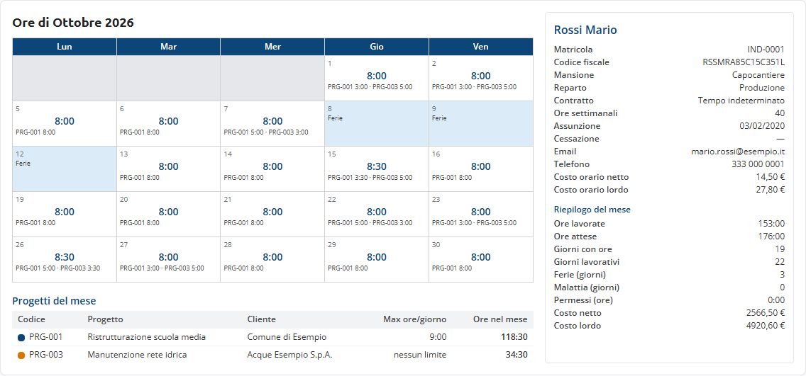

**Giorni e costi**: in testa tutti i dati del dipendente, poi una riga per ogni giorno da
lunedì a venerdì con
ore, progetti, fasce, assenze (ferie, malattia, permessi), festività, ore retribuite e
**costo netto e lordo del giorno**. Ferie e malattia nei giorni lavorativi valgono le ore
del contratto di quel giorno (ore settimanali / 5), i permessi la loro durata; le festività
sono indicate senza costo.

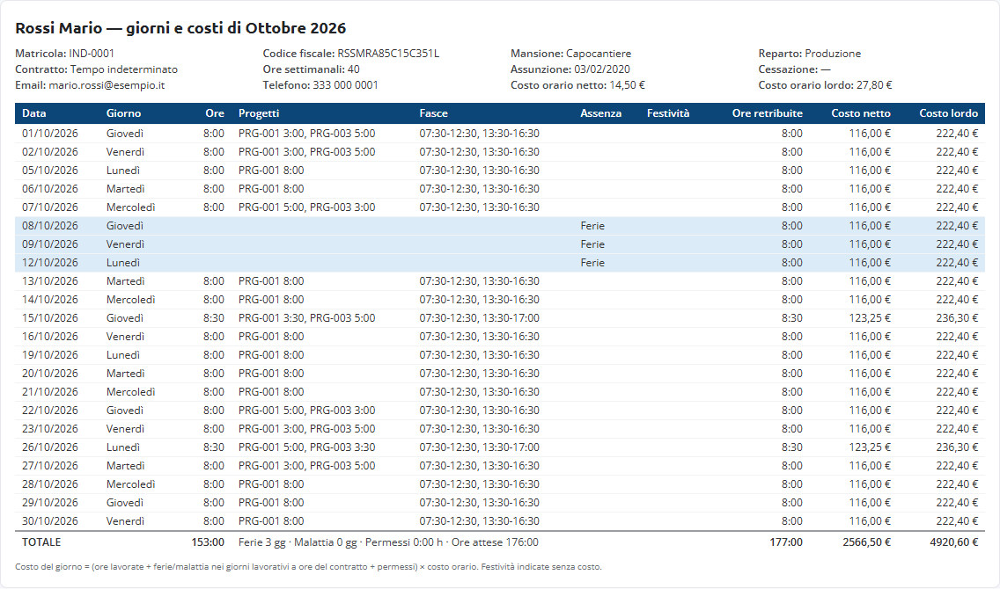

- **Excel** scarica la versione scelta (un foglio per dipendente).
- **Stampa / PDF** apre la stampa del browser: scegliete "Salva come PDF" (orientamento
  orizzontale). In stampa spariscono menu e comandi e ogni dipendente va su una pagina.

---

### Chiusura del mese (solo amministratori)

Dal 26/11/2026 HR può **chiudere** un mese dopo averlo controllato. Da quel momento ore,
assenze e festività di quel mese non si modificano più: l'estratto mandato al consulente
paghe resta uguale a quello che c'è in Copilota.

1. **Esporta → Estratti mensili**, scegliere il mese. Sotto i pulsanti c'è la riga
   *Chiusura di …* con lo stato: **Aperto** o **Chiuso** (con chi l'ha chiuso e quando).
2. **Chiudi mese** apre una finestra con i controlli:
   - le **richieste di assenza ancora in attesa** bloccano la chiusura: vanno prima approvate o rifiutate;
   - i **giorni lavorativi senza ore né assenza** sono solo un avviso: si può chiudere lo stesso.

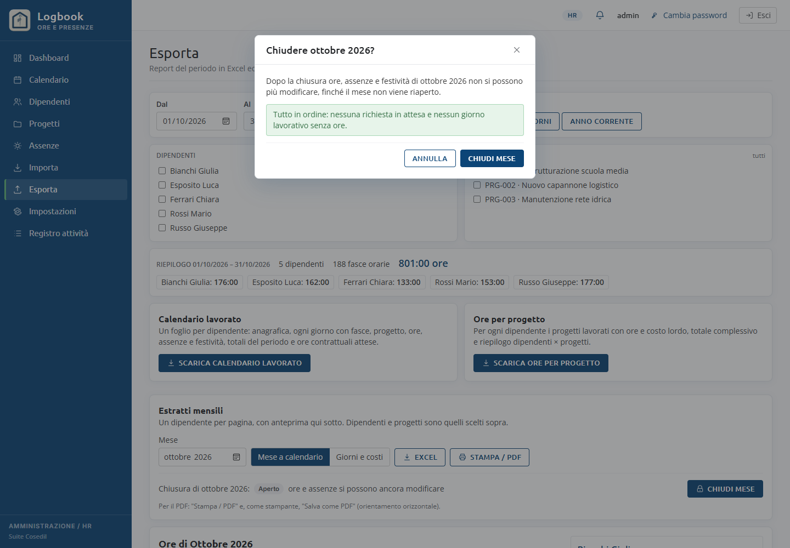

3. Un mese si può chiudere solo quando è **finito** (dal primo giorno del mese dopo).
4. Per correggere qualcosa in un mese chiuso: **Riapri mese**, correzione, di nuovo **Chiudi mese**.
   Chiusure e riaperture restano nel registro attività.

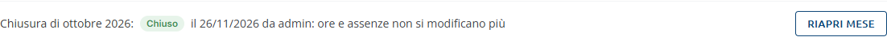

Nel **Calendario** accanto al nome di un mese chiuso compare un lucchetto con *Mese chiuso*; chi
prova a modificarne le ore riceve il messaggio "Il mese di … è chiuso".

## 4. Dal cellulare e sugli schermi grandi

### Copilota come un'app sul telefono

Dal 26/11/2026 Copilota si può mettere sulla schermata del telefono, con la sua icona, e
aprire senza passare dal browser. Non c'è niente da scaricare da uno store.

- **Android (Chrome):** aprire Copilota, menu con i tre puntini → **Aggiungi a schermata Home**
  (o **Installa app**).
- **iPhone (Safari):** aprire Copilota, pulsante **Condividi** → **Aggiungi alla schermata Home**.
- **PC (Chrome o Edge):** icona **Installa** nella barra dell'indirizzo.

Serve che Copilota sia aperto a un indirizzo sicuro (`https://`, come quello su Vercel) oppure
sullo stesso PC. È sempre lo stesso Copilota: accesso, dati e regole non cambiano, e serve la
connessione.

Copilota si adatta da solo alla larghezza dello schermo: non serve scaricare nulla da uno store, basta
aprire lo stesso indirizzo dal browser del telefono.

Su computer e tablet (da 768px) il **menu a sinistra resta fermo** mentre la pagina scorre,
con tutte le voci sempre visibili; su uno schermo molto basso scorrono solo le voci del menu.

**Sul cellulare**

- Il menu si apre col pulsante **☰ Copilota** in alto a sinistra.
- Nel **calendario del mese** ogni giorno mostra il numero, le ore totali e un **pallino
  colorato** per ogni progetto, ferie, permesso, malattia o festività. Toccate il giorno per
  vedere e modificare il dettaglio.
- La **settimana** diventa un elenco di giorni, uno sotto l'altro.

- Nel **dettaglio della giornata** ogni fascia è un riquadro con progetto, orari e note uno
  sotto l'altro; le regole sono le stesse del computer (sovrapposizioni e ore massime
  bloccano il salvataggio).

- Gli **elenchi** (dipendenti, progetti, assenze, festività) diventano schede: il nome in
  alto e gli altri dati sotto. Per l'ordine si usa il menu accanto alla ricerca.

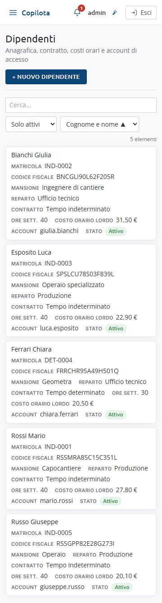

- Le tabelle molto larghe (anteprima dell'import, estratto "giorni e costi") scorrono in
  orizzontale dentro il loro riquadro: si sposta il dito sulla tabella.

**Sugli schermi grandi e ultra wide**

La pagina usa tutta la larghezza e affianca i riquadri finché c'è spazio: la dashboard mette
i pannelli uno accanto all'altro, la scheda del dipendente affianca anagrafica, contratto e
costi, gli estratti mensili mostrano due o tre dipendenti per riga. La stampa non cambia:
sempre un dipendente per pagina A4.

