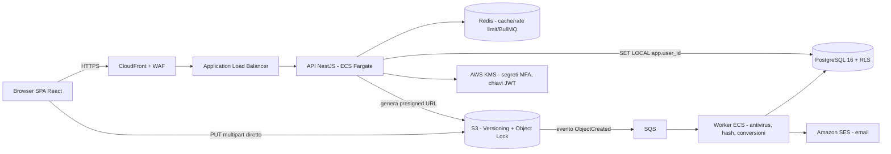

# Piano di Sviluppo CDE (Common Data Environment) — ISO 19650

> Web Application Cloud Enterprise, multi-tenant, per la gestione documentale di grandi cantieri.
> Durata: **12 settimane = 60 giorni lavorativi**, 6 Sprint da 2 settimane (10 giorni ciascuno).

---

## Indice

1. [Ipotesi di progetto e team](#1-ipotesi-di-progetto-e-team)
2. [Architettura tecnica iniziale](#2-architettura-tecnica-iniziale)
3. [Roadmap giornaliera (G1–G60)](#3-roadmap-giornaliera-g1g60)
4. [Sprint 1 — Schema database SQL pronto all&#39;uso](#4-sprint-1--schema-database-sql-pronto-alluso)
5. [Sprint 1 — API, JWT e test di isolamento](#5-sprint-1--api-jwt-e-test-di-isolamento)
6. [Definition of Done e rischi](#6-definition-of-done-e-rischi)

---

## 1. Ipotesi di progetto e team

| Ruolo              | N. | Responsabilità                                                           |
| ------------------ | -- | ------------------------------------------------------------------------- |
| CTO / Tech Lead    | 1  | Architettura, ADR, code review, sicurezza                                 |
| Product Owner      | 1  | Backlog, priorità, accettazione storie, rapporto con BIM Manager cliente |
| Backend Developer  | 3  | API, DB, workflow engine, integrazioni storage                            |
| Frontend Developer | 2  | SPA, viewer 2D/3D, dashboard                                              |
| DevOps / SRE       | 1  | IaC, CI/CD, osservabilità, sicurezza infrastruttura                      |
| QA Engineer        | 1  | Test automatici, test di isolamento tenant, test di carico                |

**Cerimonie fisse per sprint:** G1 Sprint Planning (mattina) · Daily Stand-up 15' ogni giorno · G6 Backlog Refinement dello sprint successivo · G10 Sprint Review + Retrospective + deploy su staging.

**Legenda colonne:** BE = Backend · FE = Frontend · OPS = DevOps · QA = Quality Assurance.

---

## 2. Architettura tecnica iniziale

### 2.1 Scelte tecnologiche (ADR sintetici)

| #      | Decisione            | Scelta                                                                                                                                                      | Motivazione                                                                                               |
| ------ | -------------------- | ----------------------------------------------------------------------------------------------------------------------------------------------------------- | --------------------------------------------------------------------------------------------------------- |
| ADR-01 | Stile architetturale | **Monolite modulare** (moduli: identity, tenancy, documents, workflow, audit, notifications, reporting) con confini netti, estraibili in microservizi | Velocità in 12 settimane, transazioni ACID tra moduli, un solo deploy                                    |
| ADR-02 | Backend              | **Node.js 22 + NestJS + TypeScript**                                                                                                                  | DI, guard/decorator per RBAC, OpenAPI nativo, team full-stack TS                                          |
| ADR-03 | Database             | **PostgreSQL 16** (AWS RDS Multi-AZ)                                                                                                                  | Row-Level Security, JSONB, trigger per immutabilità, `UNIQUE NULLS NOT DISTINCT`                       |
| ADR-04 | Multi-tenancy        | **DB condiviso + `organization_id` + Row-Level Security**                                                                                           | Un progetto è condiviso da più aziende: serve isolamento *a livello di riga*, non a livello di schema |
| ADR-05 | Autenticazione       | Auth service interno: **Argon2id + JWT RS256 (15') + refresh token opachi ruotati + MFA TOTP/WebAuthn**; federazione OIDC/SAML (Entra ID) in backlog  | Controllo completo su MFA obbligatoria per tenant e audit                                                 |
| ADR-06 | Storage file         | **AWS S3** (regione EU), Versioning + **Object Lock (Compliance)** + SSE-KMS; upload diretto con **presigned URL multipart**              | File da GB, il backend non fa da proxy; immutabilità a livello storage                                   |
| ADR-07 | Code / job           | **Redis + BullMQ**, pattern **Transactional Outbox**                                                                                            | Notifiche, scansione antivirus, conversioni viewer, scadenze                                              |
| ADR-08 | Frontend             | **React 18 + TypeScript + Vite + TanStack Query + MUI**                                                                                               | Ecosistema maturo, componenti enterprise (tabelle, form)                                                  |
| ADR-09 | Viewer               | **PDF.js** (PDF), **That Open Engine / web-ifc** (IFC), **Autodesk APS Viewer** (DWG/RVT)                                                 | Open-source dove possibile, APS solo per formati proprietari                                              |
| ADR-10 | Infrastruttura       | **AWS ECS Fargate**, ALB + WAF, CloudFront, **Terraform**, GitHub Actions                                                                       | Serverless container, nessun cluster da gestire                                                           |
| ADR-11 | Osservabilità       | OpenTelemetry → Grafana (Loki/Tempo/Prometheus), Sentry FE                                                                                                 | Tracciamento end-to-end delle richieste                                                                   |
| ADR-12 | Migrazioni DB        | SQL versionato con **dbmate** (file `.sql` puri)                                                                                                    | Lo schema è codice SQL rivedibile, nessun ORM che nasconda RLS                                           |

### 2.2 Diagramma dei componenti



### 2.3 Modello di multi-tenancy (concetto chiave)

- **Organization (Tenant)** = azienda (committente, progettista, impresa, subappaltatore). Ogni utente appartiene a **una sola** organizzazione.
- **Project** = commessa, di proprietà di un'organizzazione (Appointing Party), a cui **partecipano** più organizzazioni (`project_organizations`) con un ruolo ISO 19650.
- **Container** = cartella/contenitore informativo, sempre di proprietà di **un'organizzazione** dentro un progetto. Nello Sprint 2 i documenti vivranno nei container.
- **Regola di default: visibilità zero.** Un utente vede un container solo se:
  1. il suo ruolo ha l'azione con scope `PROJECT` (es. Project Admin), **oppure**
  2. il container è della sua organizzazione e il suo ruolo ha l'azione con scope `OWN_ORGANIZATION`, **oppure**
  3. esiste un **grant esplicito** (`access_grants`) verso lui o la sua organizzazione **e** il suo ruolo possiede comunque quell'azione (principio del minimo privilegio: il grant non può *ampliare* il ruolo).
- L'isolamento è applicato **due volte**: nel guard NestJS (`@RequirePermission`) e nel database con **Row-Level Security** (difesa in profondità: un bug applicativo non espone dati di altre aziende).

### 2.4 Struttura del repository (monorepo pnpm + Turborepo)

```
cde/
├─ apps/
│  ├─ api/                 # NestJS
│  │  └─ src/modules/{identity,tenancy,rbac,containers,audit}/
│  ├─ worker/              # job BullMQ / SQS
│  └─ web/                 # React SPA
├─ packages/
│  ├─ contracts/           # DTO + schema OpenAPI condivisi
│  └─ iso19650/            # motore naming convention (Sprint 2)
├─ db/
│  ├─ migrations/          # dbmate *.sql
│  └─ seeds/
├─ infra/terraform/        # VPC, RDS, S3, ECS, KMS, WAF
└─ .github/workflows/
```

---

## 3. Roadmap giornaliera (G1–G60)

### MESE 1 — Fondamenta architetturali, sicurezza e dati

#### Sprint 1 (Settimane 1–2) — Core Database, Multi-Tenancy e RBAC avanzato

**Sprint Goal:** due aziende nello stesso progetto non vedono reciprocamente i propri container, salvo grant esplicito; login con MFA funzionante.

| Giorno        | Focus                  | Attività                                                                                                                                                             | Deliverable                                               |
| ------------- | ---------------------- | --------------------------------------------------------------------------------------------------------------------------------------------------------------------- | --------------------------------------------------------- |
| **G1**  | Avvio                  | Sprint Planning; monorepo, lint, commit convention; ADR-01…12 approvati; OPS: Terraform base (VPC, subnet, RDS dev, bucket S3 dev, KMS)                              | Repo + pipeline CI vuota verde                            |
| **G2**  | Schema DB              | BE: migrazioni `organizations`, `users`, `projects`, `project_organizations`; ruoli DB `cde_owner`/`cde_app`/`cde_auth`; QA: piano di test isolamento   | Migrazioni 001–002 applicate su dev                      |
| **G3**  | Matrice permessi       | BE: `roles`, `role_permissions`, `project_memberships`, `containers`, `access_grants`; funzione `has_permission()`; seed ruoli di sistema                 | Migrazione 003 + seed                                     |
| **G4**  | Row-Level Security     | BE: policy RLS su tutte le tabelle di dominio, trigger di coerenza (utente/organizzazione/progetto); `security_events` append-only                                  | Migrazione 004 + test pgTAP RLS                           |
| **G5**  | Autenticazione         | BE: login Argon2id, JWT RS256 (chiave in KMS), refresh token con rotazione e rilevamento riuso, lockout progressivo; FE: pagine login/reset                           | `POST /auth/login`, `/auth/refresh`, `/auth/logout` |
| **G6**  | MFA                    | BE: enrollment TOTP (segreto cifrato KMS), recovery code, verifica MFA, policy `mfa_required` per organizzazione; FE: QR code + verifica; Refinement Sprint 2       | `/auth/mfa/*`                                           |
| **G7**  | RBAC applicativo       | BE: middleware contesto (`SET LOCAL app.user_id`) per transazione, guard `@RequirePermission(action)`, rate limiting Redis; OPS: secret manager                   | Guard + interceptor transazionale                         |
| **G8**  | API di amministrazione | BE: CRUD organizzazioni, progetti, inviti organizzazioni al progetto, membri e ruoli, container, grant; FE: selettore progetto, gestione membri                       | API admin + OpenAPI                                       |
| **G9**  | UI matrice + test      | FE: UI matrice permessi (ruolo × azione × scope) e gestione grant; QA: suite di isolamento cross-tenant automatizzata (≥ 40 casi), SAST (Semgrep), dependency scan | Report test isolamento                                    |
| **G10** | Chiusura               | Fix, hardening header di sicurezza, deploy staging; Sprint Review (demo: subappaltatore non vede file progettista) + Retro                                            | Release `v0.1.0` su staging                             |

#### Sprint 2 (Settimane 3–4) — File system cloud immutabile e metadati ISO 19650

**Sprint Goal:** caricare file pesanti direttamente su S3 con nome validato ISO 19650 e storico revisioni inalterabile.

| Giorno        | Focus                | Attività                                                                                                                                                                                                 | Deliverable                               |
| ------------- | -------------------- | --------------------------------------------------------------------------------------------------------------------------------------------------------------------------------------------------------- | ----------------------------------------- |
| **G11** | Avvio storage        | Sprint Planning; OPS: bucket prod-like con Versioning, **Object Lock Compliance**, SSE-KMS, Block Public Access, CORS ristretto, lifecycle                                                          | Bucket configurato via Terraform          |
| **G12** | Modello documentale  | BE: tabelle `documents` (identificativo ISO univoco per progetto), `document_revisions`, `file_objects` (key S3, SHA-256, size, mime); trigger che vieta UPDATE/DELETE sulle revisioni              | Migrazione 005                            |
| **G13** | Naming convention    | BE (`packages/iso19650`): configurazione per progetto dei campi *Progetto-Originatore-Volume/Sistema-Livello-Tipo-Ruolo-Numero* con liste codici, lunghezze, regex; es. `PRJ01-ABC-ZZ-01-DR-A-0001` | Motore di validazione + 100% test unitari |
| **G14** | Presigned upload     | BE: `POST /uploads/initiate` (multipart, part da 64 MB), `/uploads/{id}/parts`, `/complete`, `/abort`; URL firmati a 15', vincolati a utente e checksum                                           | Upload diretto funzionante                |
| **G15** | Pipeline post-upload | OPS/BE: evento S3 → SQS → worker: verifica SHA-256, antivirus ClamAV, quarantena se infetto, estrazione metadati base                                                                                   | Worker in staging                         |
| **G16** | Versioning           | BE: logica revisioni (stesso identificativo ⇒ `P01.01 → P01.02`), lock ottimistico sulla sequenza, nessuna sovrascrittura possibile; Refinement Sprint 3                                              | `POST /documents/{id}/revisions`        |
| **G17** | Metadati             | BE: codici di idoneità (Suitability S0…S4, A, CR), titolo, descrizione, attributi custom JSONB validati da schema di progetto; ricerca full-text                                                        | API metadati + indice di ricerca          |
| **G18** | Frontend upload      | FE: drag & drop multiplo, ripresa upload interrotto, validazione nome in tempo reale con suggerimenti, tabella documenti con storico revisioni                                                            | UI caricamento                            |
| **G19** | Download e test      | BE: download via presigned GET (permesso `DOWNLOAD`), watermark opzionale in backlog; QA: test file 5 GB, nomi non conformi, tentativi di sovrascrittura                                                | Report test                               |
| **G20** | Chiusura             | Fix, deploy staging; Review (demo: caricamento IFC 2 GB, revisione P01.02, storico intatto) + Retro                                                                                                       | Release `v0.2.0`                        |

---

### MESE 2 — Stati informativi, workflow e audit trail

#### Sprint 3 (Settimane 5–6) — Motore degli stati del CDE

**Sprint Goal:** ciclo di vita WIP → SHARED → PUBLISHED → ARCHIVED con visibilità ricalcolata automaticamente.

| Giorno        | Focus                 | Attività                                                                                                                                                                                                          | Deliverable                      |
| ------------- | --------------------- | ------------------------------------------------------------------------------------------------------------------------------------------------------------------------------------------------------------------ | -------------------------------- |
| **G21** | Avvio                 | Sprint Planning; ADR macchina a stati (tabella transizioni ammesse in DB, non hard-coded)                                                                                                                          | ADR-13                           |
| **G22** | Modello stati         | BE: enum `cde_state`, colonna stato su revisione, tabella `state_transitions` (da, a, permesso richiesto, codici idoneità ammessi), storico transizioni append-only                                           | Migrazione 006                   |
| **G23** | Regole di visibilità | BE: estensione `has_permission()` — **WIP visibile solo all'organizzazione autrice anche per scope PROJECT**; SHARED visibile al team di coordinamento; PUBLISHED a tutti i membri; ARCHIVED sola lettura | Policy RLS v2 + test             |
| **G24** | Endpoint transizione  | BE: `POST /revisions/{id}/transitions` con verifica permesso, validazione idoneità, ricodifica revisione (`P01.02 → P01` in Shared, `C01` in Published)                                                    | API transizioni                  |
| **G25** | Prestazioni permessi  | BE: tabella materializzata `effective_permissions` aggiornata da trigger/job, per evitare ricorsione per riga nelle liste                                                                                        | Liste < 200 ms su 100k documenti |
| **G26** | Eventi                | BE: evento `revision.state_changed` su outbox; invalidazione cache; Refinement Sprint 4                                                                                                                          | Outbox operativo                 |
| **G27** | Frontend stati        | FE: viste per area CDE (WIP/Shared/Published/Archived), badge stato, azione "Condividi/Pubblica" con dialog motivazione                                                                                            | UI stati                         |
| **G28** | Operazioni massive    | BE/FE: transizione multipla di documenti con esito per documento (transazione per elemento, report finale)                                                                                                         | Bulk transition                  |
| **G29** | Test                  | QA: matrice stato × ruolo × organizzazione (≥ 60 casi), test di regressione isolamento Sprint 1                                                                                                                 | Report test                      |
| **G30** | Chiusura              | Deploy staging; Review (demo: progettista condivide, impresa vede solo da SHARED in poi) + Retro                                                                                                                   | Release `v0.3.0`               |

#### Sprint 4 (Settimane 7–8) — Workflow engine e RFI

**Sprint Goal:** approvazione multi-step con scadenze, blocco file e notifiche.

| Giorno        | Focus            | Attività                                                                                                                               | Deliverable                 |
| ------------- | ---------------- | --------------------------------------------------------------------------------------------------------------------------------------- | --------------------------- |
| **G31** | Avvio            | Sprint Planning; ADR workflow (definizioni JSON versionate, esecuzione su DB, nessun motore esterno nell'MVP)                           | ADR-14                      |
| **G32** | Modello workflow | BE: `workflow_templates`, `workflow_instances`, `workflow_steps` (sequenziale/parallelo, quorum "tutti/uno/N"), `tasks`         | Migrazione 007              |
| **G33** | Esecuzione       | BE: avvio workflow su revisione, avanzamento step, esiti Approvato / Approvato con commenti / Rifiutato, ritorno all'autore             | Motore v1 + test            |
| **G34** | Blocco file      | BE: lock della revisione durante la review — vietato caricare nuove revisioni o transizioni (vincolo DB + check API); sblocco su esito | Lock garantito a livello DB |
| **G35** | Scadenze         | BE: SLA per step, job schedulato BullMQ per promemoria (−48h, −24h), scadenza superata ed escalation al responsabile                  | Scheduler operativo         |
| **G36** | Notifiche        | BE: servizio notifiche (in-app via SSE, email via SES con template IT/EN), preferenze utente, digest giornaliero; Refinement Sprint 5   | `/notifications`          |
| **G37** | RFI              | BE: modulo RFI (numerazione progressiva per progetto, destinatari, thread risposte, allegati, scadenza, stato)                          | API RFI                     |
| **G38** | Frontend         | FE: designer template workflow (step e assegnatari), inbox compiti, pagina review con esito e commenti, UI RFI                          | UI workflow                 |
| **G39** | Test             | QA: workflow paralleli concorrenti, race condition sul lock, scadenze simulate (time travel), consegna email                            | Report test                 |
| **G40** | Chiusura         | Deploy staging; Review (demo: Autore → Verificatore → DL, rifiuto e notifica) + Retro                                                 | Release `v0.4.0`          |

---

### MESE 3 — Visualizzazione web, controllo e rilascio MVP

#### Sprint 5 (Settimane 9–10) — Viewer 2D/3D e audit trail legale

**Sprint Goal:** visualizzazione in browser senza download e registro attività immutabile esportabile.

| Giorno        | Focus            | Attività                                                                                                                                                                                     | Deliverable                   |
| ------------- | ---------------- | --------------------------------------------------------------------------------------------------------------------------------------------------------------------------------------------- | ----------------------------- |
| **G41** | Avvio            | Sprint Planning; spike prestazioni IFC grandi (> 500 MB) e licenza APS                                                                                                                        | ADR-15 viewer                 |
| **G42** | Viewer PDF       | FE: PDF.js con streaming a range, zoom, ricerca testo, confronto due revisioni sovrapposte                                                                                                    | Viewer PDF                    |
| **G43** | Viewer IFC       | Worker: conversione IFC → fragments (That Open Engine) post-upload; FE: viewer 3D con albero spaziale, proprietà, sezioni                                                                   | Viewer IFC                    |
| **G44** | Viewer DWG       | Worker: invio a APS Model Derivative, polling e salvataggio derivati; FE: APS Viewer integrato con token a scope ridotto                                                                      | Viewer DWG                    |
| **G45** | Markup           | FE/BE: annotazioni e commenti ancorati a pagina/elemento, legati alla revisione e al task di review                                                                                           | Markup persistito             |
| **G46** | Audit trail      | BE: tabella `audit_log` append-only con **hash chain** (hash = SHA-256(record + hash precedente)), REVOKE UPDATE/DELETE anche per ruoli admin, trigger di blocco; Refinement Sprint 6 | Migrazione 008                |
| **G47** | Copertura eventi | BE: interceptor che registra visualizzazione, download, upload, transizione, approvazione, commento, cambio permessi (timestamp UTC, user, org, IP, user-agent)                               | 100% eventi critici tracciati |
| **G48** | Valore legale    | OPS/BE: ancoraggio giornaliero dell'hash di testa su S3 Object Lock (WORM) + marca temporale RFC 3161 da TSA qualificata eIDAS; job di verifica integrità                                    | Verifica catena automatica    |
| **G49** | Export           | BE/FE: export audit CSV/PDF firmato, filtri per documento/utente/periodo; QA: tentativi di manomissione come admin DB                                                                         | Export + report test          |
| **G50** | Chiusura         | Deploy staging; Review + Retro                                                                                                                                                                | Release `v0.5.0`            |

#### Sprint 6 (Settimane 11–12) — Dashboard, reportistica, collaudo e go-live

**Sprint Goal:** MVP in produzione, testato sotto carico e con pentest superato.

| Giorno        | Focus          | Attività                                                                                                                                            | Deliverable                      |
| ------------- | -------------- | ---------------------------------------------------------------------------------------------------------------------------------------------------- | -------------------------------- |
| **G51** | Avvio          | Sprint Planning; code freeze funzionale a G56; ingaggio pentester esterno                                                                            | Piano di collaudo                |
| **G52** | KPI            | BE: viste materializzate KPI (file in attesa, tempo medio per step, colli di bottiglia, upload per azienda, scadenze superate), refresh incrementale | API `/dashboard`               |
| **G53** | Dashboard      | FE: dashboard Project Manager con grafici, filtri per azienda/disciplina, drill-down ai documenti                                                    | UI dashboard                     |
| **G54** | Transmittal    | BE: modulo Transmittal (registro di protocollo emissioni, destinatari, documenti e revisioni inclusi, numerazione), PDF con intestazione progetto    | Transmittal PDF                  |
| **G55** | Report         | BE: export Excel (registro documenti, stato approvazioni, RFI aperte) con job asincrono e link scadenza; Refinement post-MVP                         | Report Excel                     |
| **G56** | Test di carico | QA/OPS: k6 — 500 utenti concorrenti, 50 upload paralleli da 1 GB, liste su 1M documenti; tuning indici e autoscaling                                | Report performance               |
| **G57** | Sicurezza      | Pentest API (OWASP API Top 10, focus IDOR cross-tenant, JWT, presigned URL); DAST (ZAP); fix vulnerabilità critiche/alte                            | Report pentest                   |
| **G58** | Produzione     | OPS: ambiente prod via Terraform (RDS Multi-AZ, backup PITR 35 gg, WAF, alert), runbook, test di disaster recovery (RPO 15', RTO 4h)                 | Prod pronta                      |
| **G59** | UAT            | Collaudo con utenti pilota (BIM Manager, DL, subappaltatore), migrazione dati di prova, fix bloccanti                                                | Verbale UAT                      |
| **G60** | Go-live        | Deploy produzione, smoke test, monitoraggio rafforzato; Sprint Review finale + Retrospettiva di release                                              | **Release MVP `v1.0.0`** |

---

## 4. Sprint 1 — Schema database SQL pronto all'uso

**Target:** PostgreSQL 16. Eseguire come utente proprietario (`cde_owner`). L'applicazione si connette **solo** come `cde_app` (mai owner né superuser), così la Row-Level Security è sempre applicata.

Per ogni transazione l'API imposta il contesto utente:

```sql
BEGIN;
SELECT set_config('app.user_id', '<uuid utente dal JWT>', true);  -- true = solo per questa transazione
-- ... query applicative ...
COMMIT;
```

### 4.1 Migrazione completa

```sql
-- =====================================================================
-- CDE ISO 19650 — Sprint 1: Multi-tenancy, utenti, progetti, RBAC, RLS
-- PostgreSQL 16
-- =====================================================================

CREATE EXTENSION IF NOT EXISTS pgcrypto;   -- gen_random_uuid()
CREATE EXTENSION IF NOT EXISTS citext;     -- email case-insensitive

CREATE SCHEMA IF NOT EXISTS cde;
SET search_path = cde, public;

-- ---------------------------------------------------------------------
-- Ruoli database (eseguire una volta per cluster; password da secret manager)
-- ---------------------------------------------------------------------
DO $$
BEGIN
  IF NOT EXISTS (SELECT 1 FROM pg_roles WHERE rolname = 'cde_app') THEN
    CREATE ROLE cde_app LOGIN;          -- API applicativa: soggetta a RLS
  END IF;
  IF NOT EXISTS (SELECT 1 FROM pg_roles WHERE rolname = 'cde_auth') THEN
    CREATE ROLE cde_auth LOGIN;         -- servizio di autenticazione
  END IF;
END $$;

-- ---------------------------------------------------------------------
-- Tipi enumerati
-- ---------------------------------------------------------------------
CREATE TYPE org_status         AS ENUM ('ACTIVE', 'SUSPENDED', 'ARCHIVED');
CREATE TYPE user_status        AS ENUM ('INVITED', 'ACTIVE', 'LOCKED', 'DISABLED');
CREATE TYPE project_status     AS ENUM ('SETUP', 'ACTIVE', 'ON_HOLD', 'CLOSED', 'ARCHIVED');
CREATE TYPE project_party_role AS ENUM (
  'APPOINTING_PARTY',       -- Committente
  'LEAD_APPOINTED_PARTY',   -- Capofila (es. General Contractor / capogruppo progettazione)
  'APPOINTED_PARTY',        -- Progettista / impresa incaricata
  'SUBCONTRACTOR',          -- Subappaltatore
  'CONSULTANT',             -- Consulente / verificatore
  'OBSERVER'                -- Ente, collaudatore, sola consultazione
);
CREATE TYPE permission_action  AS ENUM ('READ', 'WRITE', 'DOWNLOAD', 'APPROVE', 'ADMIN');
CREATE TYPE permission_scope   AS ENUM ('OWN_ORGANIZATION', 'PROJECT');
CREATE TYPE grantee_type       AS ENUM ('USER', 'ORGANIZATION');
CREATE TYPE mfa_method         AS ENUM ('TOTP', 'WEBAUTHN');

-- ---------------------------------------------------------------------
-- Funzioni di utilità
-- ---------------------------------------------------------------------
CREATE FUNCTION set_updated_at() RETURNS trigger
LANGUAGE plpgsql AS $$
BEGIN
  NEW.updated_at := now();
  RETURN NEW;
END $$;

CREATE FUNCTION forbid_mutation() RETURNS trigger
LANGUAGE plpgsql AS $$
BEGIN
  RAISE EXCEPTION 'Tabella % append-only: operazione % non consentita', TG_TABLE_NAME, TG_OP
    USING ERRCODE = 'insufficient_privilege';
END $$;

-- Utente corrente impostato dall'API con set_config('app.user_id', ..., true)
CREATE FUNCTION current_app_user() RETURNS uuid
LANGUAGE sql STABLE AS $$
  SELECT nullif(current_setting('app.user_id', true), '')::uuid
$$;

-- =====================================================================
-- TENANT: Organizzazioni
-- =====================================================================
CREATE TABLE organizations (
  id            uuid PRIMARY KEY DEFAULT gen_random_uuid(),
  legal_name    text        NOT NULL,
  vat_number    text,
  code          varchar(6)  NOT NULL UNIQUE                 -- Codice Originatore ISO 19650
                CHECK (code ~ '^[A-Z0-9]{3,6}$'),
  status        org_status  NOT NULL DEFAULT 'ACTIVE',
  mfa_required  boolean     NOT NULL DEFAULT true,          -- policy MFA a livello tenant
  data_region   text        NOT NULL DEFAULT 'eu-south-1',
  created_at    timestamptz NOT NULL DEFAULT now(),
  updated_at    timestamptz NOT NULL DEFAULT now()
);
CREATE UNIQUE INDEX ux_organizations_vat ON organizations (vat_number) WHERE vat_number IS NOT NULL;
CREATE TRIGGER trg_organizations_updated BEFORE UPDATE ON organizations
  FOR EACH ROW EXECUTE FUNCTION set_updated_at();

-- =====================================================================
-- Utenti
-- =====================================================================
CREATE TABLE users (
  id                   uuid PRIMARY KEY DEFAULT gen_random_uuid(),
  organization_id      uuid        NOT NULL REFERENCES organizations (id),
  email                citext      NOT NULL UNIQUE,
  first_name           text        NOT NULL,
  last_name            text        NOT NULL,
  password_hash        text,                                -- Argon2id; NULL se solo SSO
  status               user_status NOT NULL DEFAULT 'INVITED',
  failed_login_count   integer     NOT NULL DEFAULT 0,
  locked_until         timestamptz,
  password_changed_at  timestamptz,
  last_login_at        timestamptz,
  created_at           timestamptz NOT NULL DEFAULT now(),
  updated_at           timestamptz NOT NULL DEFAULT now()
);
CREATE INDEX ix_users_org ON users (organization_id);
CREATE TRIGGER trg_users_updated BEFORE UPDATE ON users
  FOR EACH ROW EXECUTE FUNCTION set_updated_at();

-- ---------------------------------------------------------------------
-- MFA e sessioni (accessibili solo al servizio di autenticazione)
-- ---------------------------------------------------------------------
CREATE TABLE user_mfa_factors (
  id                     uuid PRIMARY KEY DEFAULT gen_random_uuid(),
  user_id                uuid        NOT NULL REFERENCES users (id) ON DELETE CASCADE,
  method                 mfa_method  NOT NULL,
  label                  text        NOT NULL DEFAULT 'Authenticator',
  totp_secret_encrypted  bytea,                             -- cifrato con envelope encryption KMS
  webauthn_credential_id bytea UNIQUE,
  webauthn_public_key    bytea,
  webauthn_sign_count    bigint,
  verified_at            timestamptz,                       -- NULL = enrollment non completato
  last_used_at           timestamptz,
  created_at             timestamptz NOT NULL DEFAULT now(),
  CHECK (
    (method = 'TOTP'     AND totp_secret_encrypted IS NOT NULL) OR
    (method = 'WEBAUTHN' AND webauthn_credential_id IS NOT NULL AND webauthn_public_key IS NOT NULL)
  )
);
CREATE INDEX ix_mfa_user ON user_mfa_factors (user_id);

CREATE TABLE user_recovery_codes (
  id          uuid PRIMARY KEY DEFAULT gen_random_uuid(),
  user_id     uuid        NOT NULL REFERENCES users (id) ON DELETE CASCADE,
  code_hash   text        NOT NULL,                         -- Argon2id del codice
  used_at     timestamptz,
  created_at  timestamptz NOT NULL DEFAULT now()
);
CREATE INDEX ix_recovery_user ON user_recovery_codes (user_id) WHERE used_at IS NULL;

CREATE TABLE refresh_tokens (
  id            uuid PRIMARY KEY DEFAULT gen_random_uuid(),
  user_id       uuid        NOT NULL REFERENCES users (id) ON DELETE CASCADE,
  family_id     uuid        NOT NULL,                       -- catena di rotazione: riuso ⇒ revoca intera famiglia
  token_hash    bytea       NOT NULL UNIQUE,                -- SHA-256 del token opaco
  mfa_verified  boolean     NOT NULL DEFAULT false,
  issued_at     timestamptz NOT NULL DEFAULT now(),
  expires_at    timestamptz NOT NULL,
  revoked_at    timestamptz,
  replaced_by   uuid REFERENCES refresh_tokens (id),
  ip            inet,
  user_agent    text
);
CREATE INDEX ix_refresh_user_active ON refresh_tokens (user_id) WHERE revoked_at IS NULL;
CREATE INDEX ix_refresh_family ON refresh_tokens (family_id);

-- =====================================================================
-- Progetti e partecipazione delle organizzazioni
-- =====================================================================
CREATE TABLE projects (
  id                     uuid PRIMARY KEY DEFAULT gen_random_uuid(),
  owner_organization_id  uuid           NOT NULL REFERENCES organizations (id),  -- Appointing Party
  code                   varchar(6)     NOT NULL CHECK (code ~ '^[A-Z0-9]{2,6}$'), -- campo "Progetto" ISO 19650
  name                   text           NOT NULL,
  description            text,
  status                 project_status NOT NULL DEFAULT 'SETUP',
  start_date             date,
  end_date               date,
  timezone               text           NOT NULL DEFAULT 'Europe/Rome',
  settings               jsonb          NOT NULL DEFAULT '{}'::jsonb,
  created_by             uuid           REFERENCES users (id),
  created_at             timestamptz    NOT NULL DEFAULT now(),
  updated_at             timestamptz    NOT NULL DEFAULT now(),
  UNIQUE (owner_organization_id, code),
  CHECK (end_date IS NULL OR start_date IS NULL OR end_date >= start_date)
);
CREATE TRIGGER trg_projects_updated BEFORE UPDATE ON projects
  FOR EACH ROW EXECUTE FUNCTION set_updated_at();

CREATE TABLE project_organizations (
  project_id       uuid               NOT NULL REFERENCES projects (id) ON DELETE CASCADE,
  organization_id  uuid               NOT NULL REFERENCES organizations (id),
  party_role       project_party_role NOT NULL,
  is_active        boolean            NOT NULL DEFAULT true,
  invited_by       uuid               REFERENCES users (id),
  joined_at        timestamptz        NOT NULL DEFAULT now(),
  PRIMARY KEY (project_id, organization_id)
);
CREATE INDEX ix_project_orgs_org ON project_organizations (organization_id);

-- =====================================================================
-- RBAC: ruoli e matrice dei permessi
-- =====================================================================
CREATE TABLE roles (
  id           uuid PRIMARY KEY DEFAULT gen_random_uuid(),
  project_id   uuid    REFERENCES projects (id) ON DELETE CASCADE,  -- NULL = ruolo template di sistema
  code         text    NOT NULL CHECK (code ~ '^[A-Z][A-Z0-9_]{1,40}$'),
  name         text    NOT NULL,
  description  text,
  is_system    boolean NOT NULL DEFAULT false,
  created_at   timestamptz NOT NULL DEFAULT now(),
  UNIQUE NULLS NOT DISTINCT (project_id, code)
);

-- Matrice: ruolo × azione × ambito
CREATE TABLE role_permissions (
  role_id  uuid              NOT NULL REFERENCES roles (id) ON DELETE CASCADE,
  action   permission_action NOT NULL,
  scope    permission_scope  NOT NULL,
  PRIMARY KEY (role_id, action, scope)
);

CREATE TABLE project_memberships (
  project_id  uuid        NOT NULL REFERENCES projects (id) ON DELETE CASCADE,
  user_id     uuid        NOT NULL REFERENCES users (id) ON DELETE CASCADE,
  role_id     uuid        NOT NULL REFERENCES roles (id),
  granted_by  uuid        REFERENCES users (id),
  granted_at  timestamptz NOT NULL DEFAULT now(),
  expires_at  timestamptz,
  PRIMARY KEY (project_id, user_id, role_id)
);
CREATE INDEX ix_memberships_user ON project_memberships (user_id);

-- =====================================================================
-- Container informativi (cartelle) — proprietà di UNA organizzazione
-- =====================================================================
CREATE TABLE containers (
  id                     uuid PRIMARY KEY DEFAULT gen_random_uuid(),
  project_id             uuid        NOT NULL REFERENCES projects (id) ON DELETE CASCADE,
  parent_id              uuid        REFERENCES containers (id),
  owner_organization_id  uuid        NOT NULL REFERENCES organizations (id),
  name                   text        NOT NULL,
  inherit_permissions    boolean     NOT NULL DEFAULT true,   -- eredita i grant del padre
  created_by             uuid        REFERENCES users (id),
  created_at             timestamptz NOT NULL DEFAULT now(),
  updated_at             timestamptz NOT NULL DEFAULT now(),
  CHECK (parent_id IS NULL OR parent_id <> id),
  UNIQUE NULLS NOT DISTINCT (project_id, parent_id, name)
);
CREATE INDEX ix_containers_project_owner ON containers (project_id, owner_organization_id);
CREATE INDEX ix_containers_parent ON containers (parent_id);
CREATE TRIGGER trg_containers_updated BEFORE UPDATE ON containers
  FOR EACH ROW EXECUTE FUNCTION set_updated_at();

-- =====================================================================
-- Grant espliciti (unico modo per vedere dati di un'altra organizzazione)
-- =====================================================================
CREATE TABLE access_grants (
  id                       uuid PRIMARY KEY DEFAULT gen_random_uuid(),
  project_id               uuid                NOT NULL REFERENCES projects (id) ON DELETE CASCADE,
  container_id             uuid                NOT NULL REFERENCES containers (id) ON DELETE CASCADE,
  grantee_type             grantee_type        NOT NULL,
  grantee_user_id          uuid                REFERENCES users (id),
  grantee_organization_id  uuid                REFERENCES organizations (id),
  actions                  permission_action[] NOT NULL CHECK (cardinality(actions) > 0),
  reason                   text                NOT NULL,      -- motivazione obbligatoria (tracciabilità)
  valid_from               timestamptz         NOT NULL DEFAULT now(),
  valid_until              timestamptz,
  granted_by               uuid                NOT NULL REFERENCES users (id),
  created_at               timestamptz         NOT NULL DEFAULT now(),
  revoked_at               timestamptz,
  revoked_by               uuid                REFERENCES users (id),
  CHECK (
    (grantee_type = 'USER'         AND grantee_user_id IS NOT NULL AND grantee_organization_id IS NULL) OR
    (grantee_type = 'ORGANIZATION' AND grantee_organization_id IS NOT NULL AND grantee_user_id IS NULL)
  ),
  CHECK (NOT ('ADMIN' = ANY (actions))),                    -- l'amministrazione non si delega via grant
  CHECK (valid_until IS NULL OR valid_until > valid_from)
);
CREATE INDEX ix_grants_container_active ON access_grants (container_id) WHERE revoked_at IS NULL;
CREATE INDEX ix_grants_user ON access_grants (grantee_user_id) WHERE revoked_at IS NULL;
CREATE INDEX ix_grants_org  ON access_grants (grantee_organization_id) WHERE revoked_at IS NULL;

-- =====================================================================
-- Eventi di sicurezza (append-only; l'audit trail completo arriva nello Sprint 5)
-- =====================================================================
CREATE TABLE security_events (
  id               bigint GENERATED ALWAYS AS IDENTITY PRIMARY KEY,
  occurred_at      timestamptz NOT NULL DEFAULT now(),
  event_type       text        NOT NULL,   -- LOGIN_OK, LOGIN_FAIL, MFA_ENROLLED, TOKEN_REUSE, GRANT_CREATED, ...
  user_id          uuid,
  organization_id  uuid,
  project_id       uuid,
  ip               inet,
  user_agent       text,
  details          jsonb       NOT NULL DEFAULT '{}'::jsonb
);
CREATE INDEX ix_security_events_user ON security_events (user_id, occurred_at DESC);
CREATE TRIGGER trg_security_events_no_update BEFORE UPDATE OR DELETE ON security_events
  FOR EACH ROW EXECUTE FUNCTION forbid_mutation();
CREATE TRIGGER trg_security_events_no_truncate BEFORE TRUNCATE ON security_events
  FOR EACH STATEMENT EXECUTE FUNCTION forbid_mutation();

-- =====================================================================
-- Trigger di coerenza tra tenant
-- =====================================================================

-- L'utente può essere membro solo se la sua organizzazione partecipa al progetto,
-- e il ruolo deve essere di sistema o dello stesso progetto.
CREATE FUNCTION check_membership() RETURNS trigger
LANGUAGE plpgsql SECURITY DEFINER SET search_path = cde, pg_temp AS $$
BEGIN
  IF NOT EXISTS (
    SELECT 1
    FROM users u
    JOIN project_organizations po
      ON po.organization_id = u.organization_id AND po.project_id = NEW.project_id AND po.is_active
    WHERE u.id = NEW.user_id
  ) THEN
    RAISE EXCEPTION 'L''organizzazione dell''utente % non partecipa al progetto %', NEW.user_id, NEW.project_id;
  END IF;

  IF NOT EXISTS (
    SELECT 1 FROM roles r
    WHERE r.id = NEW.role_id AND (r.project_id IS NULL OR r.project_id = NEW.project_id)
  ) THEN
    RAISE EXCEPTION 'Il ruolo % non appartiene al progetto %', NEW.role_id, NEW.project_id;
  END IF;
  RETURN NEW;
END $$;
CREATE TRIGGER trg_membership_check BEFORE INSERT OR UPDATE ON project_memberships
  FOR EACH ROW EXECUTE FUNCTION check_membership();

-- Il proprietario del container deve partecipare al progetto; il padre deve essere nello stesso progetto.
CREATE FUNCTION check_container() RETURNS trigger
LANGUAGE plpgsql SECURITY DEFINER SET search_path = cde, pg_temp AS $$
BEGIN
  IF NOT EXISTS (
    SELECT 1 FROM project_organizations
    WHERE project_id = NEW.project_id AND organization_id = NEW.owner_organization_id AND is_active
  ) THEN
    RAISE EXCEPTION 'L''organizzazione proprietaria non partecipa al progetto';
  END IF;

  IF NEW.parent_id IS NOT NULL AND NOT EXISTS (
    SELECT 1 FROM containers WHERE id = NEW.parent_id AND project_id = NEW.project_id
  ) THEN
    RAISE EXCEPTION 'Il container padre appartiene a un altro progetto';
  END IF;
  RETURN NEW;
END $$;
CREATE TRIGGER trg_container_check BEFORE INSERT OR UPDATE ON containers
  FOR EACH ROW EXECUTE FUNCTION check_container();

-- Il grant deve riferirsi a un container del progetto e a un destinatario che partecipa al progetto.
CREATE FUNCTION check_grant() RETURNS trigger
LANGUAGE plpgsql SECURITY DEFINER SET search_path = cde, pg_temp AS $$
DECLARE
  v_grantee_org uuid;
BEGIN
  IF NOT EXISTS (SELECT 1 FROM containers WHERE id = NEW.container_id AND project_id = NEW.project_id) THEN
    RAISE EXCEPTION 'Container non appartenente al progetto';
  END IF;

  v_grantee_org := CASE NEW.grantee_type
    WHEN 'USER' THEN (SELECT organization_id FROM users WHERE id = NEW.grantee_user_id)
    ELSE NEW.grantee_organization_id
  END;

  IF NOT EXISTS (
    SELECT 1 FROM project_organizations
    WHERE project_id = NEW.project_id AND organization_id = v_grantee_org AND is_active
  ) THEN
    RAISE EXCEPTION 'Il destinatario del grant non partecipa al progetto';
  END IF;
  RETURN NEW;
END $$;
CREATE TRIGGER trg_grant_check BEFORE INSERT OR UPDATE ON access_grants
  FOR EACH ROW EXECUTE FUNCTION check_grant();

-- =====================================================================
-- Motore permessi
-- =====================================================================

CREATE FUNCTION is_project_member(p_user_id uuid, p_project_id uuid) RETURNS boolean
LANGUAGE sql STABLE SECURITY DEFINER SET search_path = cde, pg_temp AS $$
  SELECT EXISTS (
    SELECT 1
    FROM project_memberships pm
    JOIN users u ON u.id = pm.user_id AND u.status = 'ACTIVE'
    JOIN project_organizations po
      ON po.project_id = pm.project_id AND po.organization_id = u.organization_id AND po.is_active
    WHERE pm.user_id = p_user_id
      AND pm.project_id = p_project_id
      AND (pm.expires_at IS NULL OR pm.expires_at > now())
  )
$$;

CREATE FUNCTION has_project_permission(p_user_id uuid, p_project_id uuid,
                                       p_action permission_action, p_scope permission_scope)
RETURNS boolean
LANGUAGE sql STABLE SECURITY DEFINER SET search_path = cde, pg_temp AS $$
  SELECT is_project_member(p_user_id, p_project_id) AND EXISTS (
    SELECT 1
    FROM project_memberships pm
    JOIN role_permissions rp ON rp.role_id = pm.role_id
    WHERE pm.user_id = p_user_id
      AND pm.project_id = p_project_id
      AND (pm.expires_at IS NULL OR pm.expires_at > now())
      AND (rp.action = p_action OR rp.action = 'ADMIN')
      AND (p_scope IS NULL OR rp.scope = p_scope)
  )
$$;

/*
  has_permission(utente, container, azione)
  VERO se e solo se l'utente è membro attivo del progetto E vale almeno una tra:
    1. un suo ruolo concede l'azione (o ADMIN) con scope PROJECT;
    2. il container è della sua organizzazione e un suo ruolo concede l'azione con scope OWN_ORGANIZATION;
    3. esiste un grant attivo sul container (o su un antenato, se ereditato) verso di lui o la sua
       organizzazione che include l'azione, E un suo ruolo concede comunque quell'azione
       (il grant estende la VISIBILITÀ, non i PRIVILEGI del ruolo).
  NB Sprint 3: verrà aggiunta la regola "WIP mai visibile fuori dall'organizzazione autrice".
*/
CREATE FUNCTION has_permission(p_user_id uuid, p_container_id uuid, p_action permission_action)
RETURNS boolean
LANGUAGE sql STABLE SECURITY DEFINER SET search_path = cde, pg_temp AS $$
  WITH RECURSIVE
  u AS (
    SELECT id, organization_id FROM users WHERE id = p_user_id AND status = 'ACTIVE'
  ),
  c AS (
    SELECT id, project_id, owner_organization_id FROM containers WHERE id = p_container_id
  ),
  role_actions AS (
    SELECT rp.scope
    FROM c
    JOIN u ON true
    JOIN project_memberships pm ON pm.project_id = c.project_id AND pm.user_id = u.id
    JOIN project_organizations po
      ON po.project_id = c.project_id AND po.organization_id = u.organization_id AND po.is_active
    JOIN role_permissions rp ON rp.role_id = pm.role_id
    WHERE (pm.expires_at IS NULL OR pm.expires_at > now())
      AND (rp.action = p_action OR rp.action = 'ADMIN')
  ),
  ancestors AS (
    SELECT id, parent_id, inherit_permissions, 0 AS depth
    FROM containers WHERE id = p_container_id
    UNION ALL
    SELECT p.id, p.parent_id, p.inherit_permissions, a.depth + 1
    FROM containers p
    JOIN ancestors a ON p.id = a.parent_id
    WHERE a.inherit_permissions AND a.depth < 50
  )
  SELECT
       EXISTS (SELECT 1 FROM role_actions WHERE scope = 'PROJECT')
    OR EXISTS (
         SELECT 1 FROM role_actions ra, c, u
         WHERE ra.scope = 'OWN_ORGANIZATION' AND c.owner_organization_id = u.organization_id
       )
    OR (
         EXISTS (SELECT 1 FROM role_actions)
         AND EXISTS (
           SELECT 1
           FROM access_grants g
           JOIN ancestors a ON a.id = g.container_id
           CROSS JOIN u
           WHERE g.revoked_at IS NULL
             AND g.valid_from <= now()
             AND (g.valid_until IS NULL OR g.valid_until > now())
             AND p_action = ANY (g.actions)
             AND (   (g.grantee_type = 'USER'         AND g.grantee_user_id = u.id)
                  OR (g.grantee_type = 'ORGANIZATION' AND g.grantee_organization_id = u.organization_id))
         )
       )
$$;

-- =====================================================================
-- Row-Level Security (cde_app non è owner ⇒ RLS sempre applicata)
-- =====================================================================
ALTER TABLE organizations         ENABLE ROW LEVEL SECURITY;
ALTER TABLE users                 ENABLE ROW LEVEL SECURITY;
ALTER TABLE projects              ENABLE ROW LEVEL SECURITY;
ALTER TABLE project_organizations ENABLE ROW LEVEL SECURITY;
ALTER TABLE roles                 ENABLE ROW LEVEL SECURITY;
ALTER TABLE role_permissions      ENABLE ROW LEVEL SECURITY;
ALTER TABLE project_memberships   ENABLE ROW LEVEL SECURITY;
ALTER TABLE containers            ENABLE ROW LEVEL SECURITY;
ALTER TABLE access_grants         ENABLE ROW LEVEL SECURITY;

-- Organizzazione di appartenenza dell'utente corrente
CREATE FUNCTION current_app_org() RETURNS uuid
LANGUAGE sql STABLE SECURITY DEFINER SET search_path = cde, pg_temp AS $$
  SELECT organization_id FROM users WHERE id = current_app_user()
$$;

-- Organizzazioni: la propria + quelle con cui condivido almeno un progetto
CREATE POLICY org_select ON organizations FOR SELECT USING (
  id = current_app_org()
  OR EXISTS (
    SELECT 1 FROM project_organizations po
    WHERE po.organization_id = organizations.id
      AND is_project_member(current_app_user(), po.project_id)
  )
);

-- Utenti: della mia organizzazione o colleghi di progetto
CREATE POLICY users_select ON users FOR SELECT USING (
  organization_id = current_app_org()
  OR EXISTS (
    SELECT 1 FROM project_memberships pm
    WHERE pm.user_id = users.id AND is_project_member(current_app_user(), pm.project_id)
  )
);

-- Progetti: solo quelli di cui sono membro
CREATE POLICY projects_select ON projects FOR SELECT
  USING (is_project_member(current_app_user(), id));
CREATE POLICY projects_update ON projects FOR UPDATE
  USING (has_project_permission(current_app_user(), id, 'ADMIN', 'PROJECT'));

CREATE POLICY project_orgs_select ON project_organizations FOR SELECT
  USING (is_project_member(current_app_user(), project_id));
CREATE POLICY project_orgs_write ON project_organizations FOR ALL
  USING      (has_project_permission(current_app_user(), project_id, 'ADMIN', 'PROJECT'))
  WITH CHECK (has_project_permission(current_app_user(), project_id, 'ADMIN', 'PROJECT'));

-- Ruoli: template di sistema + ruoli dei miei progetti
CREATE POLICY roles_select ON roles FOR SELECT
  USING (project_id IS NULL OR is_project_member(current_app_user(), project_id));
CREATE POLICY roles_write ON roles FOR ALL
  USING      (project_id IS NOT NULL AND has_project_permission(current_app_user(), project_id, 'ADMIN', 'PROJECT'))
  WITH CHECK (project_id IS NOT NULL AND NOT is_system
              AND has_project_permission(current_app_user(), project_id, 'ADMIN', 'PROJECT'));

CREATE POLICY role_perms_select ON role_permissions FOR SELECT USING (
  EXISTS (SELECT 1 FROM roles r WHERE r.id = role_permissions.role_id)   -- eredita la RLS di roles
);
CREATE POLICY role_perms_write ON role_permissions FOR ALL
  USING (EXISTS (
    SELECT 1 FROM roles r WHERE r.id = role_permissions.role_id AND NOT r.is_system
      AND has_project_permission(current_app_user(), r.project_id, 'ADMIN', 'PROJECT')))
  WITH CHECK (EXISTS (
    SELECT 1 FROM roles r WHERE r.id = role_permissions.role_id AND NOT r.is_system
      AND has_project_permission(current_app_user(), r.project_id, 'ADMIN', 'PROJECT')));

-- Membership: le vedono i membri del progetto; le gestisce il Project Admin
-- oppure l'admin di organizzazione per i propri colleghi
CREATE POLICY memberships_select ON project_memberships FOR SELECT
  USING (user_id = current_app_user() OR is_project_member(current_app_user(), project_id));
CREATE POLICY memberships_write ON project_memberships FOR ALL
  USING (
    has_project_permission(current_app_user(), project_id, 'ADMIN', 'PROJECT')
    OR (has_project_permission(current_app_user(), project_id, 'ADMIN', 'OWN_ORGANIZATION')
        AND EXISTS (SELECT 1 FROM users x WHERE x.id = user_id AND x.organization_id = current_app_org()))
  )
  WITH CHECK (
    has_project_permission(current_app_user(), project_id, 'ADMIN', 'PROJECT')
    OR (has_project_permission(current_app_user(), project_id, 'ADMIN', 'OWN_ORGANIZATION')
        AND EXISTS (SELECT 1 FROM users x WHERE x.id = user_id AND x.organization_id = current_app_org()))
  );

-- Container: visibilità governata da has_permission
CREATE POLICY containers_select ON containers FOR SELECT
  USING (has_permission(current_app_user(), id, 'READ'));
CREATE POLICY containers_insert ON containers FOR INSERT WITH CHECK (
  owner_organization_id = current_app_org()
  AND (
    (parent_id IS NULL AND has_project_permission(current_app_user(), project_id, 'WRITE', NULL))
    OR (parent_id IS NOT NULL AND has_permission(current_app_user(), parent_id, 'WRITE'))
  )
);
CREATE POLICY containers_update ON containers FOR UPDATE
  USING      (has_permission(current_app_user(), id, 'ADMIN'))
  WITH CHECK (has_permission(current_app_user(), id, 'ADMIN'));
-- Nessuna policy DELETE: i container non si cancellano (si archiviano, Sprint 3)

-- Grant: li vede il destinatario o chi amministra il container; li crea/revoca solo l'admin del container
CREATE POLICY grants_select ON access_grants FOR SELECT USING (
  grantee_user_id = current_app_user()
  OR grantee_organization_id = current_app_org()
  OR has_permission(current_app_user(), container_id, 'ADMIN')
);
CREATE POLICY grants_insert ON access_grants FOR INSERT WITH CHECK (
  granted_by = current_app_user() AND has_permission(current_app_user(), container_id, 'ADMIN')
);
CREATE POLICY grants_update ON access_grants FOR UPDATE   -- usato solo per la revoca
  USING      (has_permission(current_app_user(), container_id, 'ADMIN'))
  WITH CHECK (has_permission(current_app_user(), container_id, 'ADMIN'));

-- =====================================================================
-- Privilegi
-- =====================================================================
REVOKE ALL ON ALL TABLES IN SCHEMA cde FROM PUBLIC;
GRANT USAGE ON SCHEMA cde TO cde_app, cde_auth;

GRANT SELECT, INSERT, UPDATE ON organizations, users, projects, project_organizations,
      roles, project_memberships, containers, access_grants TO cde_app;
GRANT SELECT, INSERT, UPDATE, DELETE ON role_permissions TO cde_app;
GRANT DELETE ON project_organizations, project_memberships, roles TO cde_app;   -- sempre filtrati dalla RLS
GRANT INSERT ON security_events TO cde_app;
GRANT USAGE ON ALL SEQUENCES IN SCHEMA cde TO cde_app, cde_auth;

-- Il servizio di auth gestisce credenziali e sessioni; l'API applicativa non le vede mai
GRANT SELECT, UPDATE (failed_login_count, locked_until, last_login_at, password_hash,
                      password_changed_at, status) ON users TO cde_auth;
GRANT SELECT (id, mfa_required, status) ON organizations TO cde_auth;
GRANT SELECT, INSERT, UPDATE, DELETE ON user_mfa_factors, user_recovery_codes, refresh_tokens TO cde_auth;
GRANT INSERT ON security_events TO cde_auth;
ALTER ROLE cde_auth SET row_security = off;   -- opera su credenziali, non su dati di progetto
-- (in alternativa: policy dedicate a cde_auth; nessun privilegio sulle tabelle di dominio)

REVOKE ALL ON FUNCTION has_permission(uuid, uuid, permission_action) FROM PUBLIC;
GRANT EXECUTE ON FUNCTION has_permission(uuid, uuid, permission_action),
                          has_project_permission(uuid, uuid, permission_action, permission_scope),
                          is_project_member(uuid, uuid),
                          current_app_user(), current_app_org() TO cde_app;
```

> **Nota su `cde_auth`:** `row_security = off` fa fallire le query su tabelle con RLS invece di bypassarla (comportamento sicuro di PostgreSQL per ruoli non-owner). Le uniche tabelle con RLS lette da `cde_auth` sono `users` e `organizations`: in alternativa aggiungere policy `TO cde_auth USING (true)` limitate a quelle due tabelle. Decisione da chiudere in G5.

### 4.2 Seed: ruoli di sistema e matrice dei permessi

```sql
SET search_path = cde, public;

INSERT INTO roles (project_id, code, name, description, is_system) VALUES
  (NULL, 'PROJECT_ADMIN',       'Amministratore di progetto',      'Configura progetto, organizzazioni, ruoli', true),
  (NULL, 'INFORMATION_MANAGER', 'Information Manager ISO 19650',   'Governa il CDE e i flussi informativi',     true),
  (NULL, 'DIRETTORE_LAVORI',    'Direttore dei Lavori',            'Approva la documentazione per costruzione', true),
  (NULL, 'ORG_ADMIN',           'Amministratore di organizzazione','Gestisce i colleghi e i container propri',  true),
  (NULL, 'LEAD_DESIGNER',       'Capo progettista',                'Verifica e approva internamente',           true),
  (NULL, 'DESIGNER',            'Progettista',                     'Produce informazioni',                      true),
  (NULL, 'SUBCONTRACTOR',       'Subappaltatore',                  'Produce informazioni nel proprio perimetro',true),
  (NULL, 'VIEWER',              'Sola lettura',                    'Consultazione',                             true);

INSERT INTO role_permissions (role_id, action, scope)
SELECT r.id, m.action::permission_action, m.scope::permission_scope
FROM (VALUES
  ('PROJECT_ADMIN',       'ADMIN',    'PROJECT'),
  ('INFORMATION_MANAGER', 'READ',     'PROJECT'),
  ('INFORMATION_MANAGER', 'DOWNLOAD', 'PROJECT'),
  ('INFORMATION_MANAGER', 'ADMIN',    'OWN_ORGANIZATION'),
  ('DIRETTORE_LAVORI',    'READ',     'OWN_ORGANIZATION'),
  ('DIRETTORE_LAVORI',    'DOWNLOAD', 'OWN_ORGANIZATION'),
  ('DIRETTORE_LAVORI',    'APPROVE',  'OWN_ORGANIZATION'),
  ('ORG_ADMIN',           'ADMIN',    'OWN_ORGANIZATION'),
  ('LEAD_DESIGNER',       'READ',     'OWN_ORGANIZATION'),
  ('LEAD_DESIGNER',       'WRITE',    'OWN_ORGANIZATION'),
  ('LEAD_DESIGNER',       'DOWNLOAD', 'OWN_ORGANIZATION'),
  ('LEAD_DESIGNER',       'APPROVE',  'OWN_ORGANIZATION'),
  ('DESIGNER',            'READ',     'OWN_ORGANIZATION'),
  ('DESIGNER',            'WRITE',    'OWN_ORGANIZATION'),
  ('DESIGNER',            'DOWNLOAD', 'OWN_ORGANIZATION'),
  ('SUBCONTRACTOR',       'READ',     'OWN_ORGANIZATION'),
  ('SUBCONTRACTOR',       'WRITE',    'OWN_ORGANIZATION'),
  ('SUBCONTRACTOR',       'DOWNLOAD', 'OWN_ORGANIZATION'),
  ('VIEWER',              'READ',     'OWN_ORGANIZATION')
) AS m(role_code, action, scope)
JOIN roles r ON r.code = m.role_code AND r.project_id IS NULL;
```

**Matrice risultante** (● = proprio perimetro aziendale · ◆ = intero progetto · ○ = solo tramite grant esplicito):

| Ruolo               | READ  | WRITE | DOWNLOAD | APPROVE | ADMIN |
| ------------------- | ----- | ----- | -------- | ------- | ----- |
| PROJECT_ADMIN       | ◆    | ◆    | ◆       | ◆      | ◆    |
| INFORMATION_MANAGER | ◆    | ●    | ◆       | ●      | ●    |
| DIRETTORE_LAVORI    | ● ○ | —    | ● ○    | ● ○   | —    |
| ORG_ADMIN           | ● ○ | ● ○ | ● ○    | ● ○   | ●    |
| LEAD_DESIGNER       | ● ○ | ● ○ | ● ○    | ● ○   | —    |
| DESIGNER            | ● ○ | ● ○ | ● ○    | —      | —    |
| SUBCONTRACTOR       | ● ○ | ● ○ | ● ○    | —      | —    |
| VIEWER              | ● ○ | —    | —       | —      | —    |

*(ADMIN implica tutte le azioni nello stesso scope.)*

---

## 5. Sprint 1 — API, JWT e test di isolamento

### 5.1 Endpoint Sprint 1

| Metodo         | Endpoint                                                | Permesso                                                       |
| -------------- | ------------------------------------------------------- | -------------------------------------------------------------- |
| POST           | `/auth/login`                                         | pubblico (rate limit 5/min per IP+email)                       |
| POST           | `/auth/mfa/verify`                                    | token parziale `mfa_pending`                                 |
| POST           | `/auth/mfa/totp/enroll` · `/auth/mfa/totp/confirm` | autenticato                                                    |
| POST           | `/auth/refresh` · `/auth/logout`                   | refresh token (cookie `HttpOnly; Secure; SameSite=Strict`)   |
| POST           | `/auth/invitations/{token}/accept`                    | token invito monouso (72h)                                     |
| GET            | `/me` · `/me/projects`                             | autenticato                                                    |
| POST/GET/PATCH | `/organizations`                                      | platform admin / ORG_ADMIN                                     |
| POST/GET/PATCH | `/projects`                                           | creazione: organizzazione committente; modifica: ADMIN PROJECT |
| POST/DELETE    | `/projects/{id}/organizations`                        | ADMIN PROJECT                                                  |
| POST/DELETE    | `/projects/{id}/members`                              | ADMIN PROJECT o ADMIN OWN_ORGANIZATION (colleghi)              |
| GET/POST/PATCH | `/projects/{id}/roles`                                | ADMIN PROJECT                                                  |
| GET/POST       | `/projects/{id}/containers`                           | READ / WRITE                                                   |
| POST/DELETE    | `/containers/{id}/grants`                             | ADMIN sul container                                            |

### 5.2 JWT di accesso (RS256, TTL 15 minuti)

```json
{
  "iss": "https://auth.cde.example",
  "sub": "7c1e...-uuid-utente",
  "org": "a3f2...-uuid-organizzazione",
  "amr": ["pwd", "otp"],
  "mfa": true,
  "iat": 1761200000,
  "exp": 1761200900,
  "jti": "uuid"
}
```

I permessi **non** sono inseriti nel token (cambierebbero dopo l'emissione): vengono valutati a ogni richiesta da `has_permission()` / guard, con cache Redis di 60 secondi invalidata a ogni modifica di membership o grant.

### 5.3 Scenari obbligatori della suite di isolamento (G9)

| #   | Scenario                                                    | Atteso                                                     |
| --- | ----------------------------------------------------------- | ---------------------------------------------------------- |
| T1  | Subappaltatore *SUB1* elenca i container del progetto     | Vede solo container di *SUB1*                            |
| T2  | *SUB1* chiede per ID un container del progettista *DES* | 404 (non 403: non si rivela l'esistenza)                   |
| T3  | *DES* concede READ a *SUB1* su una cartella             | *SUB1* vede la cartella e le sottocartelle che ereditano |
| T4  | Grant WRITE a utente con ruolo VIEWER                       | Scrittura negata (il grant non amplia il ruolo)            |
| T5  | Grant scaduto o revocato                                    | Accesso negato immediatamente                              |
| T6  | Utente di organizzazione non partecipante al progetto       | Nessun dato visibile, membership rifiutata dal trigger     |
| T7  | Query SQL diretta come `cde_app` senza `app.user_id`    | Zero righe                                                 |
| T8  | ORG_ADMIN di *SUB1* aggiunge un utente di *DES*         | Rifiutato dalla policy                                     |
| T9  | Riuso di un refresh token già ruotato                      | Revoca dell'intera famiglia + evento `TOKEN_REUSE`       |
| T10 | UPDATE/DELETE/TRUNCATE su `security_events`               | Eccezione                                                  |

---

## 6. Definition of Done e rischi

### Definition of Done (valida per tutti gli sprint)

- Codice revisionato da almeno 1 sviluppatore + Tech Lead per modifiche a sicurezza/DB.
- Copertura test ≥ 80% sui moduli `identity`, `rbac`, `documents`, `workflow`, `audit`.
- Nessuna vulnerabilità critica/alta aperta (Semgrep, Trivy, npm audit).
- Migrazioni reversibili o con piano di roll-forward documentato.
- Endpoint documentati in OpenAPI; eventi di sicurezza tracciati.
- Deploy automatico su staging superato con smoke test.
- implementare il modello **REA (Resource-Event-Agent)**

### Rischi principali

| Rischio                                                      | Impatto | Mitigazione                                                                        |
| ------------------------------------------------------------ | ------- | ---------------------------------------------------------------------------------- |
| Prestazioni di `has_permission()` per riga su liste grandi | Alto    | Tabella `effective_permissions` materializzata (G25), indici, paginazione keyset |
| File IFC/DWG molto grandi nel viewer                         | Alto    | Conversione asincrona lato worker, streaming, spike in G41                         |
| Costi e licenza Autodesk APS                                 | Medio   | Limitare APS a DWG/RVT; valutare ODA in roadmap post-MVP                           |
| Valore legale dell'audit trail                               | Alto    | Hash chain + WORM + marca temporale qualificata eIDAS; parere legale prima di G48  |
| Scope creep (RFI, transmittal, dashboard) in 12 settimane    | Alto    | MVP rigido, backlog post-MVP gestito dal PO, code freeze G56                       |
| Perdita di isolamento tra tenant                             | Critico | Doppio controllo (guard + RLS), suite T1–T10 in CI a ogni merge, pentest G57      |
