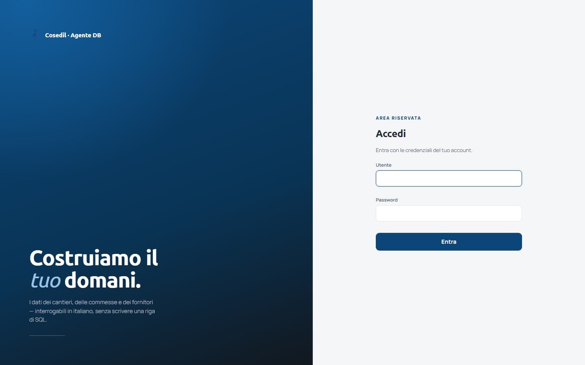
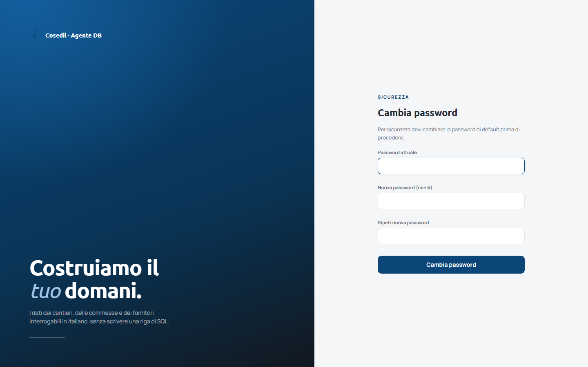
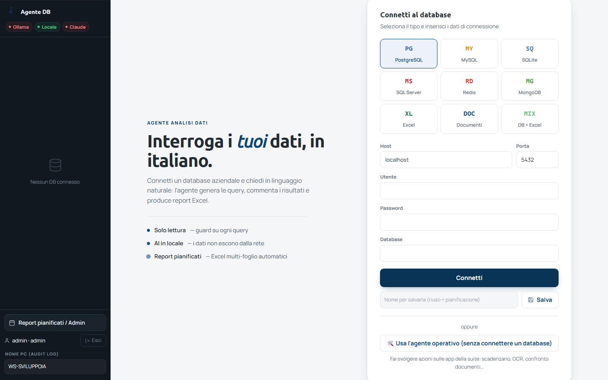

<!-- "><(((º> sabusabu <º)))>< -->
# 1. Accesso e primo ingresso

[← Indice](README.md)

## 1.1 Entrare

Dal Portale apri *Analista Dati*: entri **direttamente**, con il tuo utente del Portale e senza un'altra
password. La prima volta l'account di Analista Dati si crea da solo, con lo stesso nome utente del Portale.
Se nel Portale sei **amministratore**, lo sei anche qui (anche se il tuo account di Analista Dati era nato
come utente semplice): un amministratore del Portale vale come amministratore in tutti i programmi.

La pagina **Accedi** compare solo se apri Analista Dati senza passare dal Portale (o con il Portale spento):

1. **Utente** e **Password** del tuo account di Analista Dati;
2. **Entra** (o Invio).

Dopo 5 tentativi sbagliati l'account viene **bloccato per 15 minuti**: aspetta
o chiedi all'amministratore.

## 1.2 Primo ingresso: cambio password obbligatorio

La prima volta (e dopo che l'amministratore ti ha reimpostato la password) il
programma chiede di sceglierne una tua prima di poter lavorare:

1. **Password attuale**: quella ricevuta;
2. **Nuova password (min 6)** e **Ripeti nuova password**. Usa **almeno 8
   caratteri**: la pagina dice "min 6", ma il server rifiuta le password più
   corte di 8;
3. **Cambia password**.

## 1.3 La schermata dopo l'accesso

- **A sinistra (barra scura):**
  - in alto i pallini dei motori di intelligenza artificiale: **Ollama**,
    **Locale**, **Claude** — verde = raggiungibile, rosso = spento o non configurato;
    se compare anche **Grafici**, i report Excel escono con i grafici;
  - al centro il database collegato (per ora *Nessun DB connesso*);
  - in basso **Report pianificati / Admin** (solo amministratori), il tuo
    nome con **Esci**, e **Nome PC (audit log)**: scrivi il nome del tuo
    computer (es. `PC-UFFICIO-3`), serve a sapere da quale postazione sono
    partite le richieste.
- **A destra:** il riquadro **Connetti al database** per scegliere i dati
  (vedi il [capitolo 2](02-sorgenti.md)).

[Avanti: Scegliere i dati →](02-sorgenti.md)
