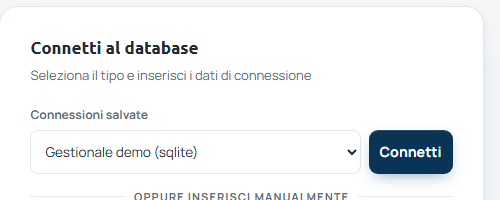
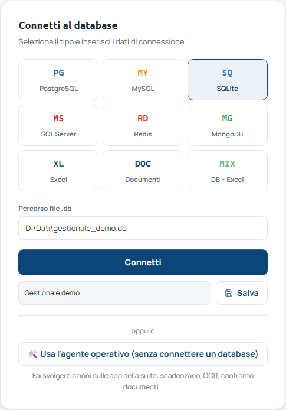
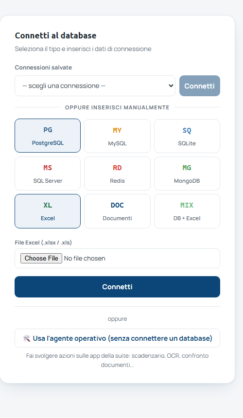
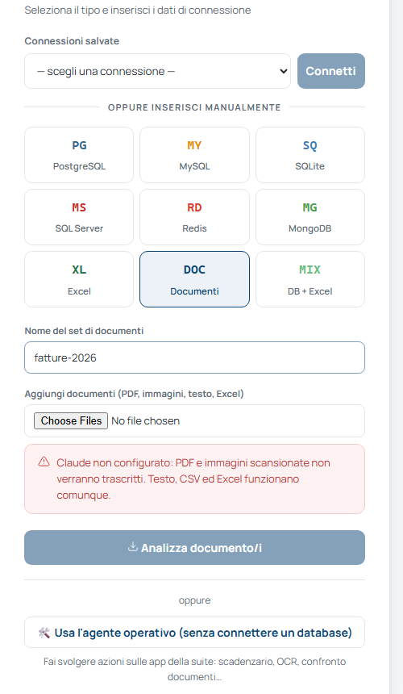
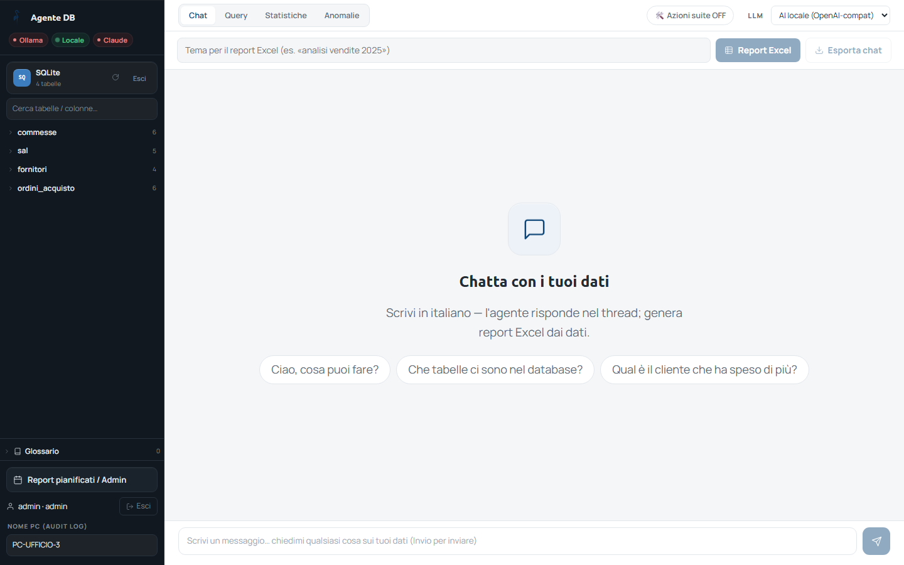
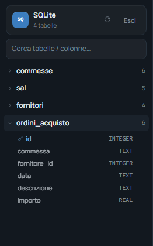

<!-- "><(((º> sabusabu <º)))>< -->
# 2. Scegliere i dati da interrogare

[← Indice](README.md)

Prima di fare domande bisogna dire al programma **su quali dati** lavorare.
Lo si fa nel riquadro **Connetti al database**.

## 2.1 Il modo più semplice: una connessione salvata

Gli amministratori preparano le connessioni ai gestionali aziendali e le
salvano con un nome. Tu le trovi in **Connessioni salvate**:

1. scegli la connessione dal menu (es. *Gestionale demo (sqlite)*);
2. premi **Connetti** accanto al menu.

Le password delle connessioni salvate sono custodite (cifrate) dal programma:
non serve conoscerle.

## 2.2 Le altre sorgenti

Sotto **Oppure inserisci manualmente** ci sono nove riquadri:

| Riquadro | Cosa collega | Cosa serve |
|---|---|---|
| **PostgreSQL**, **MySQL**, **SQL Server** | un database aziendale | indirizzo (**Host**, **Porta**), **Utente**, **Password**, nome del **Database**: li fornisce l'IT |
| **SQLite** | un file di database | il **Percorso file .db**; solo per gli amministratori e solo dentro le cartelle autorizzate |
| **Redis**, **MongoDB** | archivi tecnici | dati forniti dall'IT |
| **Excel** | un file `.xlsx` / `.xls` caricato dal tuo PC: ogni foglio diventa una tabella | il file |
| **Documenti** | un archivio di PDF, scansioni, immagini, testi, Excel da interrogare (vedi 2.4) | un nome per l'archivio e i file |
| **DB + Excel** | un database **e** uno o più Excel insieme, per incrociarli (es. ordini del gestionale × listino in Excel) | una connessione salvata e i file Excel |

Per collegarsi: scegli il riquadro, compila i campi, premi **Connetti**.

**Salvare una connessione** (amministratori): prima di **Connetti** scrivi un
nome in *Nome per salvarla (riuso + pianificazione)* e premi **Salva**. Da quel
momento compare in *Connessioni salvate* per tutti e si può usare nei report
pianificati.

## 2.3 Excel

Scegli **Excel**, premi il pulsante di scelta file e prendi il tuo `.xlsx`,
poi **Connetti**. Ogni foglio diventa una tabella interrogabile come un
database. Per incrociare un Excel con il gestionale usa **DB + Excel**: scegli
la connessione salvata e aggiungi uno o più file; se i dati sono tanti, il
programma copia al massimo 100.000 righe per foglio e lo dice in cima alla
pagina (*Dati parziali*).

## 2.4 Documenti

1. Scegli **Documenti** e dai un nome all'archivio in **Nome del set di
   documenti** (es. `fatture-2026`);
2. aggiungi i file (PDF, immagini, testo/CSV, Excel);
3. premi **Analizza documento/i**.

Il programma legge ogni file, riconosce il tipo (fattura, DDT, contratto,
preventivo, ordine, rapportino…), estrae i campi principali (fornitore,
importo, data…) e li rende interrogabili. Nelle risposte cita la fonte
(*documento · pagina*). Lo stesso file caricato due volte non viene duplicato.

> **PDF scansionati e immagini** si leggono solo se è configurato **Claude**:
> altrimenti compare l'avviso rosso *«Claude non configurato: PDF e immagini
> scansionate non verranno trascritti. Testo, CSV ed Excel funzionano
> comunque.»*. Ricorda che con Claude il contenuto dei documenti passa dal
> servizio esterno.

Gli archivi sono **personali**; un nome che inizia con `@` indica un archivio
**condiviso** (ad esempio `@sorvegliati`, alimentato in automatico da una cartella
di rete se l'amministratore l'ha attivato).

## 2.5 Collegato: cosa cambia

- A sinistra compaiono il tipo di sorgente, il numero di tabelle, **↻**
  (rilegge tabelle e colonne) ed **Esci** (scollega e torna alla scelta delle
  sorgenti; si torna indietro anche con **← Sorgenti**).
- **Cerca tabelle / colonne…** filtra l'elenco; clic su una tabella per
  vederne le colonne e il tipo di dato:

  

- Al centro la chat, con alcune domande d'esempio da cliccare.

[← Accesso](01-accesso.md) · [Avanti: Fare domande →](03-domande.md)
