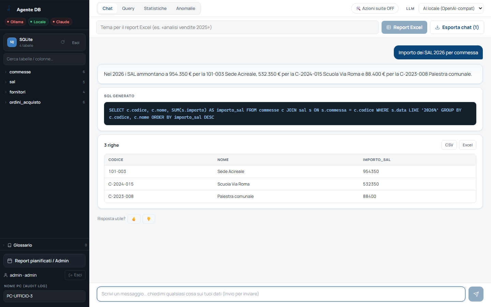
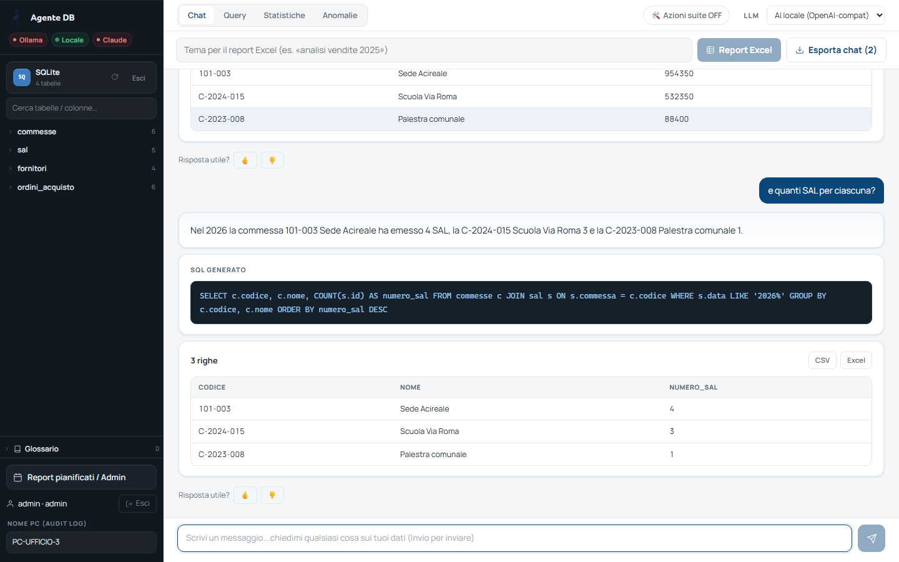
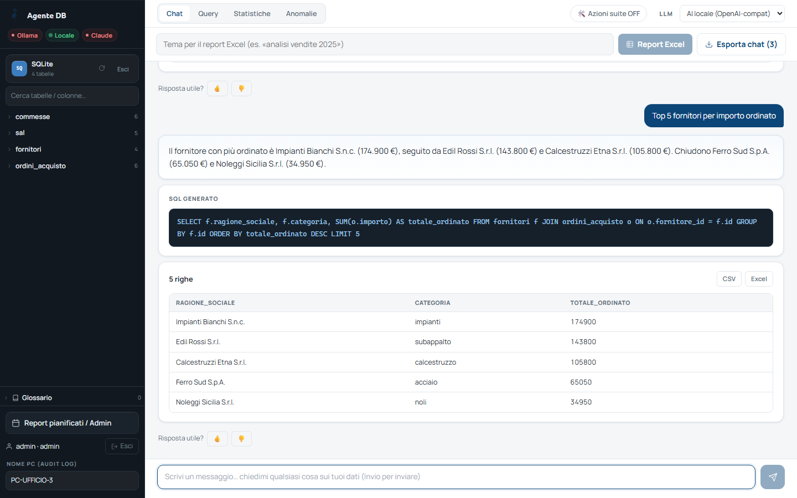
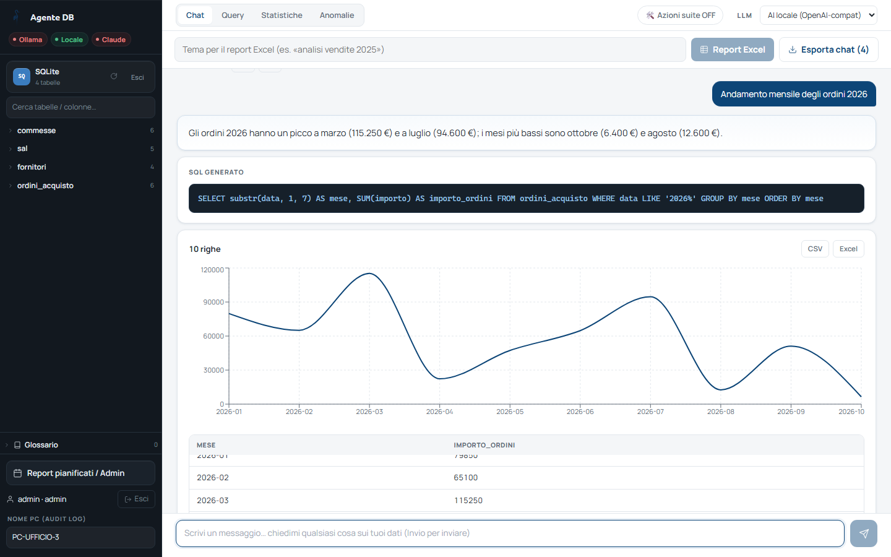
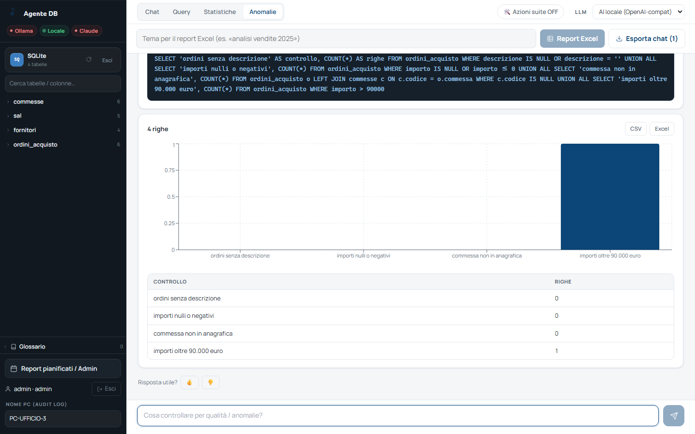

<!-- "><(((º> sabusabu <º)))>< -->
# 3. Fare domande

[← Indice](README.md)

## 3.1 La chat

Scrivi la domanda nel campo in basso e premi **Invio** (Maiusc+Invio va a capo).
La risposta arriva man mano. Ogni risposta è composta da:

1. **la frase** di risposta in italiano;
2. **SQL GENERATO**: l'interrogazione che il programma ha eseguito — serve a
   chi vuole controllare *come* è stato calcolato il numero;
3. **la tabella** dei dati (con il numero di righe), i pulsanti **CSV** ed
   **Excel** per scaricarla, e un **grafico** quando il risultato ha due
   colonne (barre per le categorie, linea per l'andamento nel tempo);
4. **Risposta utile? 👍 👎**.

### Domande di seguito

Si può continuare il discorso senza ripetere tutto: dopo *«Importo dei SAL 2026
per commessa»* basta chiedere *«e quanti SAL per ciascuna?»*.

### Tabelle e grafici

L'anteprima mostra al massimo 1000 righe; se ce ne sono di più compare
**Carica altre**. Gli export Excel arrivano fino a 200.000 righe.

### Consigli per domande che funzionano

- indica **periodo** e **raggruppamento**: *«ordini 2026 per mese»*, *«SAL per commessa»*;
- usa i nomi che compaiono nei dati (codici commessa, nomi fornitori);
- per date relative va bene parlare normale: *«questo mese»*, *«ultimi 30
  giorni»* — il programma conosce la data di oggi;
- se la risposta non convince, riformula o premi **👎**: le risposte con
  **👍** vengono ricordate e migliorano le domande simili successive, quelle
  con 👎 vengono dimenticate.

Il programma risponde **solo a domande sui dati**: richieste generiche
(poesie, traduzioni, cultura generale…) vengono rifiutate per non sprecare il
servizio.

## 3.2 Le quattro modalità

In alto a sinistra:

| Modalità | Quando usarla |
|---|---|
| **Chat** | conversazione normale (predefinita) |
| **Query** | solo l'interrogazione e i dati, senza frase di commento |
| **Statistiche** | totali, medie, raggruppamenti, andamenti |
| **Anomalie** | controlli di qualità: valori mancanti, doppioni, importi fuori scala |

## 3.3 Scegliere il motore (LLM)

Il menu **LLM** in alto a destra sceglie chi interpreta le domande:

| Voce | Note |
|---|---|
| **Ollama (locale)** / **AI locale (OpenAI-compat)** | gira sui server aziendali: i dati non escono dalla rete |
| **Claude** | servizio esterno a pagamento, di solito più preciso; disponibile solo se l'amministratore ha inserito la chiave. C'è un tetto giornaliero per utente: superato, si passa da soli all'AI locale |

[← Scegliere i dati](02-sorgenti.md) · [Avanti: Report Excel →](04-report-excel.md)
