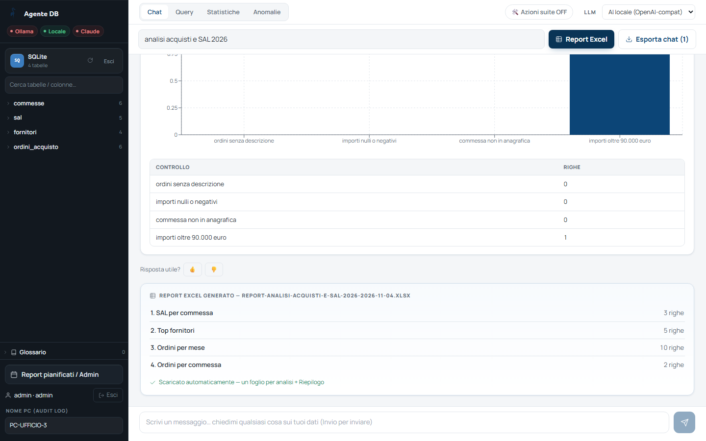

<!-- "><(((º> sabusabu <º)))>< -->
# 4. Report Excel ed esportazioni

[← Indice](README.md)

## 4.1 Report Excel su un tema

Il report Excel fa in automatico il lavoro di un'analisi: dato un **tema**, il
programma decide da solo 4–8 analisi utili (andamenti, classifiche, totali,
anomalie), le esegue e le mette in **un unico file Excel**, un foglio per
analisi più un foglio **Riepilogo** con l'indice.

1. Scrivi il tema nella barra in alto, *Tema per il report Excel* — ad
   esempio `analisi acquisti e SAL 2026`;
2. premi **Report Excel**;
3. attendi: quando ha finito il file si **scarica da solo** e in chat compare
   il riepilogo.

Il riepilogo in chat elenca le analisi e quante righe ha ciascuna; in fondo
*«Scaricato automaticamente — un foglio per analisi + Riepilogo»*. Se
l'amministratore ha attivato il servizio dei grafici (pallino **Grafici** a
sinistra) l'Excel contiene anche grafici, filtri e intestazioni bloccate;
altrimenti contiene solo le tabelle.

## 4.2 Esportare la conversazione

**Esporta chat (N)**, in alto a destra, crea un Excel con **un foglio per ogni
domanda** della conversazione (N = quante sono). Le interrogazioni vengono
rieseguite per intero, quindi il file contiene tutte le righe, non solo
l'anteprima.

## 4.3 Scaricare una singola tabella

Sopra ogni tabella ci sono **CSV** ed **Excel**: scaricano quel risultato.

## 4.4 Report che arrivano da soli

Gli amministratori possono **pianificare** un report (es. ogni lunedì alle 8:00):
il file viene preparato in automatico e conservato sul server. Vedi il
[capitolo 7](07-pannello-admin.md).

[← Fare domande](03-domande.md) · [Avanti: L'agente operativo →](05-agente-operativo.md)
