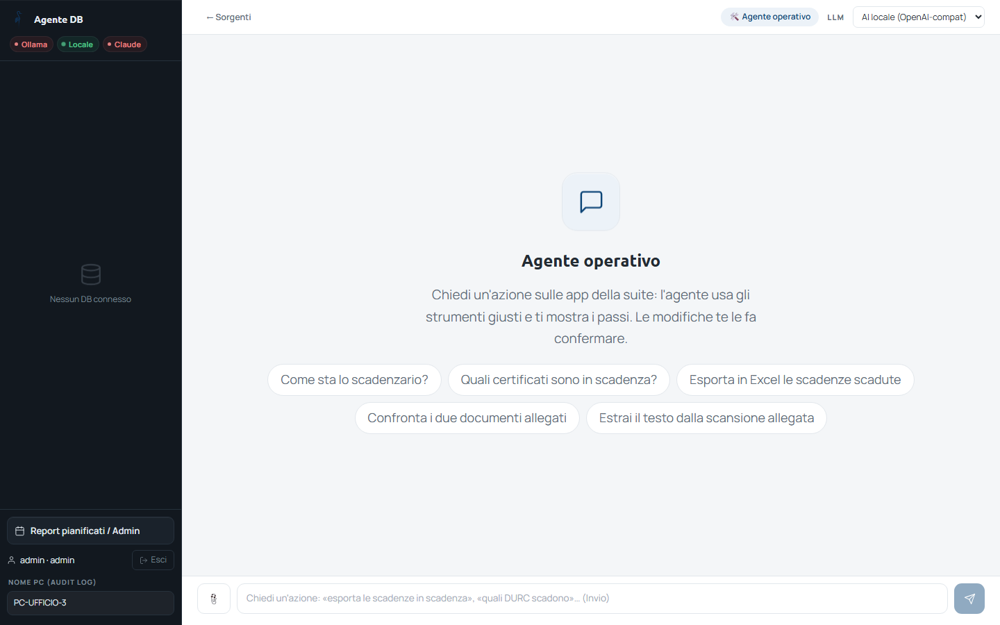

<!-- "><(((º> sabusabu <º)))>< -->
# 5. L'agente operativo: usare le altre app della suite

[← Indice](README.md)

Oltre a interrogare un database, Analista Dati può **lavorare con le altre
app della suite** al posto tuo: leggere lo Scadenzario, confrontare due
documenti con Confronto documenti, estrarre il testo da una scansione con OCR
Documenti, guardare le giacenze del Magazzino, il riepilogo di InCampo o i
documenti di SkyTower di una commessa.

## 5.1 Come si attiva

- **Senza database**: nella schermata delle sorgenti premi **🛠️ Usa l'agente
  operativo (senza connettere un database)**;
- **con un database già collegato**: in alto premi **🛠️ Azioni suite** finché
  diventa **ON**.

Esempi di richieste (cliccabili nella pagina): *«Come sta lo scadenzario?»*,
*«Quali certificati sono in scadenza?»*, *«Esporta in Excel le scadenze
scadute»*, *«Confronta i due documenti allegati»*, *«Estrai il testo dalla
scansione allegata»*. Altri esempi: *«documenti di SkyTower della commessa
C-2024-015»*, *«apri lo scadenzario»* (risponde con un pulsante per aprirlo),
*«fammi un report sulle vendite 2026»* (serve un database collegato).

Mentre lavora, l'agente mostra i passi (*«Uso scadenzario_dashboard…»*).
Con **Claude** anche la risposta compare mentre viene scritta (*«Sto
scrivendo…»*); una frase iniziale del tipo *«Controllo lo scadenzario.»*
può comparire e sparire subito: l'agente sta passando a uno strumento e la
risposta vera arriva dopo. Con i modelli locali (Ollama) la risposta arriva
intera alla fine.

## 5.2 Allegare file

La graffetta **📎** accanto al campo di testo allega file alla richiesta
(immagini, PDF, Word — al massimo 6 file da 15 MB). Poi scrivi cosa farne:
*«confronta i due PDF allegati»*.

## 5.3 Le azioni che cambiano qualcosa chiedono conferma

Leggere è libero; **creare, rinnovare o inviare** (es. creare una scadenza,
mandare le notifiche dello Scadenzario) **non succede mai da solo**: l'agente
mostra una scheda **Conferma azione** con cosa sta per fare.

- **Conferma ed esegui** → *Azione confermata* e l'azione viene eseguita a tuo nome;
- **Annulla** → *Azione annullata.*

La conferma vale 5 minuti; dopo, va richiesta di nuovo.

## 5.4 Se un'app è spenta

L'agente prova ad accenderla tramite il Portale; se non ci riesce lo dice in
chiaro nella risposta (non è un errore del programma). Le azioni sulle app
sono fatte **con la tua identità del Portale**: vedi solo ciò che puoi vedere
nell'app.

[← Report Excel](04-report-excel.md) · [Avanti: Glossario e colonne sensibili →](06-glossario-e-privacy.md)
