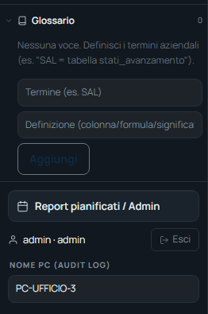

<!-- "><(((º> sabusabu <º)))>< -->
# 6. Glossario e colonne sensibili

[← Indice](README.md)

Due strumenti nella barra a sinistra, visibili con un database collegato.
Si modificano **solo dagli amministratori**; valgono per tutti gli utenti di
quel database.

## 6.1 Glossario aziendale

Insegna al programma il **lessico dell'azienda**: cosa significa una parola
in termini di dati.

1. Apri **Glossario** (il numero accanto dice quante voci ci sono);
2. scrivi il **Termine** (es. `SAL`) e la **Definizione** (es. `tabella sal,
   importo = SUM(sal.importo)`);
3. **Aggiungi**. Con la **×** si elimina una voce.

Esempi utili: *"fatturato" = somma degli importi SAL*, *"commesse aperte" =
stato 'in corso'*, *"acquisti" = tabella ordini_acquisto*.

## 6.2 Colonne sensibili (dati personali)

Accanto a ogni colonna di una tabella (barra a sinistra) l'amministratore può
mettere il **lucchetto 🔒**: la colonna diventa **sensibile**. Da quel momento:

- il suo contenuto **non viene mai mandato** all'intelligenza artificiale;
- nei risultati, negli export e nei report compare **mascherato** (`***`).

Gli utenti vedono il lucchetto ma non possono toglierlo. Va usato per nomi di
persone, codici fiscali, IBAN, stipendi e simili.

[← L'agente operativo](05-agente-operativo.md) · [Avanti: Pannello Admin →](07-pannello-admin.md)
