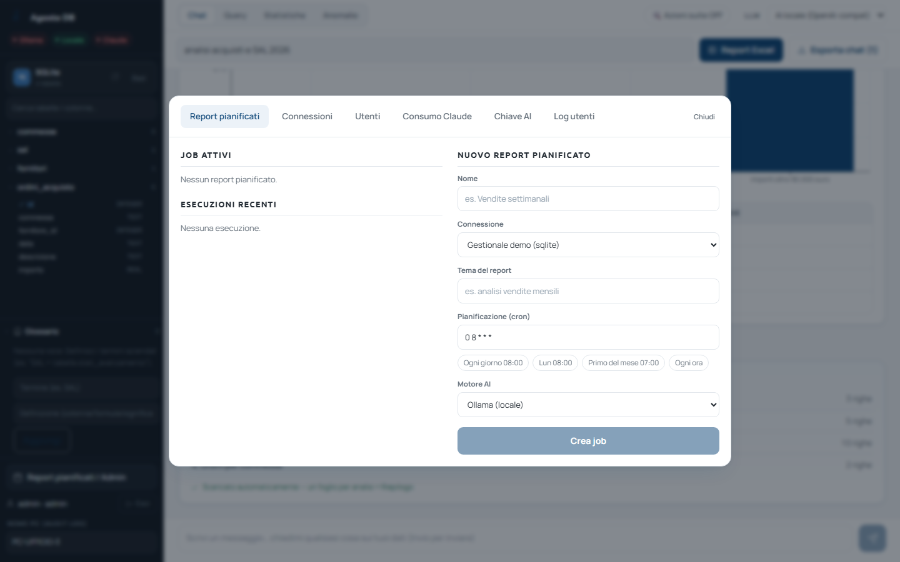
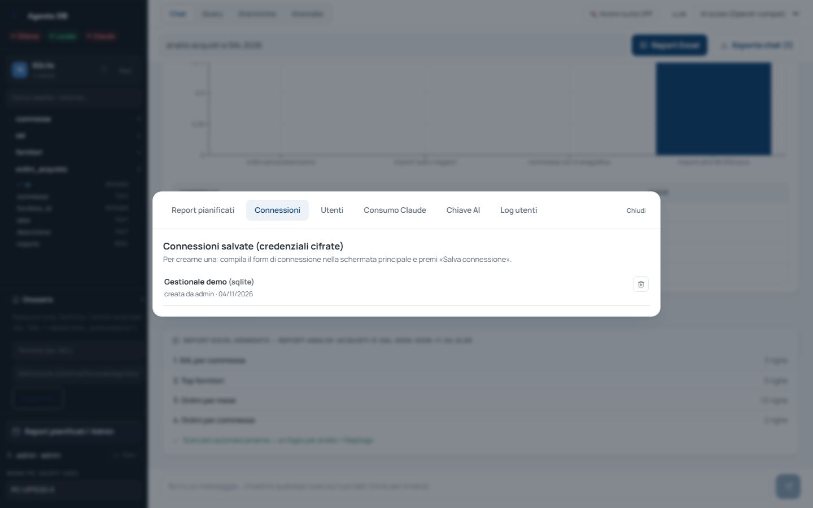
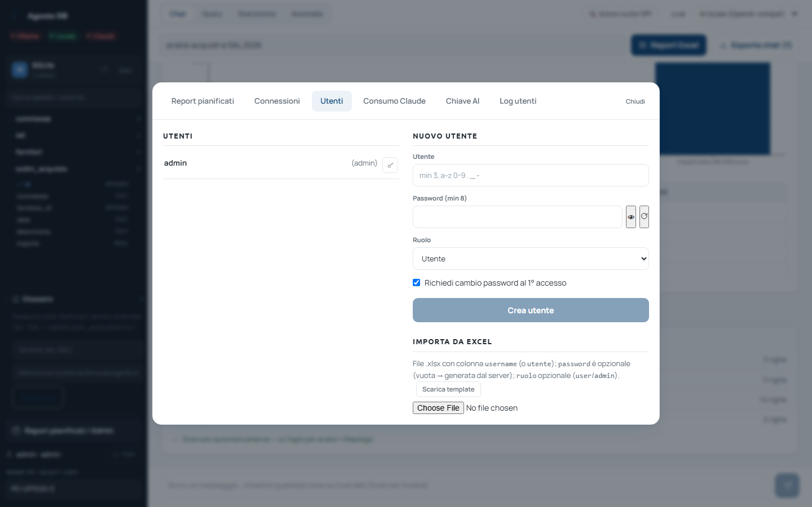
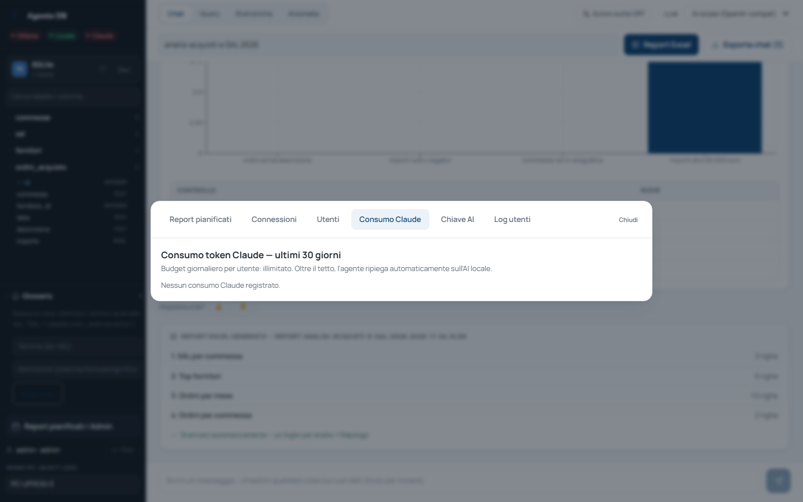
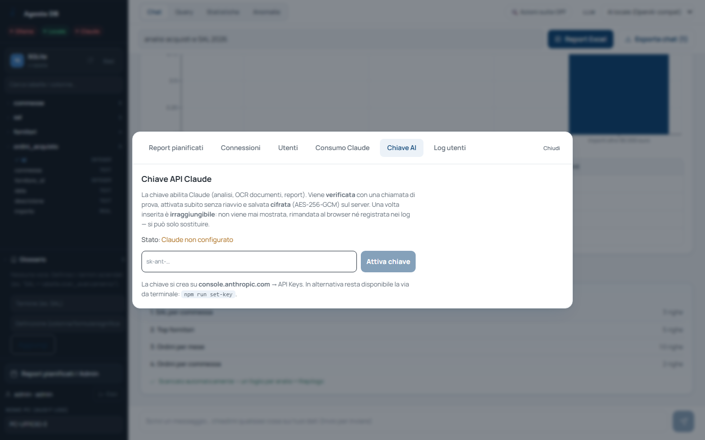

<!-- "><(((º> sabusabu <º)))>< -->
# 7. Pannello Admin

[← Indice](README.md)

Solo per gli amministratori di Analista Dati: in basso a sinistra
**Report pianificati / Admin**. **Chiudi** in alto a destra chiude il pannello.

## 7.1 Report pianificati

A sinistra i **job attivi** e le **esecuzioni recenti** (con il file da
scaricare); a destra **Nuovo report pianificato**:

| Campo | Cosa scrivere |
|---|---|
| **Nome** | es. "Acquisti settimanali" |
| **Connessione** | una connessione salvata |
| **Tema del report** | come nel [capitolo 4](04-report-excel.md), es. "analisi acquisti del mese" |
| **Pianificazione (cron)** | quando: usa i pulsanti pronti **Ogni giorno 08:00**, **Lun 08:00**, **Primo del mese 07:00**, **Ogni ora** |
| **Motore AI** | quale motore usare (di norma quello locale) |

**Crea job**. Ogni esecuzione produce un Excel conservato sul server (le ultime
20 per job). Se il server era spento all'ora prevista, il report viene fatto
alla riaccensione.

## 7.2 Connessioni

Elenco delle connessioni salvate, con chi le ha create; il cestino le elimina.
Per crearne una: compila il modulo nella schermata delle sorgenti e premi
**Salva** (vedi il [capitolo 2](02-sorgenti.md)).

## 7.3 Utenti

- **Nuovo utente**: **Utente** (almeno 3 caratteri: lettere minuscole, cifre,
  `. _ -`), **Password (min 8)** (l'occhio la mostra, ↻ ne genera una),
  **Ruolo** (*Utente* o *Admin*), spunta **Richiedi cambio password al 1°
  accesso** → **Crea utente**;
- la chiave accanto a un utente reimposta la password (l'utente dovrà cambiarla);
- **Importa da Excel**: un file con la colonna `username` (o `utente`), e
  facoltative `password` e `ruolo`; **Scarica template** dà il modello.

## 7.4 Consumo Claude e Chiave AI

- **Consumo Claude**: quanto ha usato Claude ogni utente negli ultimi 30
  giorni e il tetto giornaliero. Oltre il tetto, l'utente passa da solo all'AI locale.

  

- **Chiave AI**: dove si incolla la chiave del servizio Claude (`sk-ant-…`) e
  si preme **Attiva chiave**. La chiave viene provata, attivata subito e
  conservata cifrata: **non si può più rileggere**, solo sostituire. Lo stato
  dice *Claude non configurato* finché non c'è.

  

## 7.5 Log utenti

Registro di chi ha fatto cosa: data, evento (collegamento, domanda, report…),
utente, PC/IP e dettagli. Si filtra per **Utente** ed **Evento**; **Aggiorna**
rilegge; **Scarica CSV** esporta.

[← Glossario e colonne sensibili](06-glossario-e-privacy.md) · [Avanti: Se qualcosa non va →](08-problemi.md)
