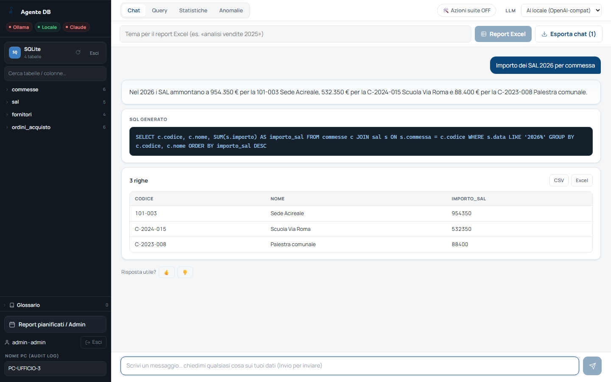

<!-- "><(((º> sabusabu <º)))>< -->
# Analista Dati — Guida utente

Analista Dati permette di **interrogare i dati aziendali scrivendo in
italiano**: commesse, SAL, ordini, fornitori, fogli Excel, archivi di
documenti. Si fa una domanda ("importo dei SAL 2026 per commessa"), il
programma prepara da solo l'interrogazione, la esegue **in sola lettura** e
risponde con una frase, la tabella dei dati e, quando ha senso, un grafico.
Sa anche preparare **report Excel** completi su un tema e, in modalità
*agente operativo*, usare le altre app della suite.

> **Nota sulle immagini.** Le schermate sono state fatte con una copia di prova
> del programma, un database dimostrativo (commesse 101-003 Sede Acireale e
> C-2024-015 Scuola Via Roma, fornitori inventati) e una **intelligenza
> artificiale simulata**: le frasi delle risposte sono state scritte a mano per
> l'esempio. Con il modello vero il contenuto cambia, la forma è la stessa.

## Come si entra

1. Dal **Portale** della suite Cosedil apri la scheda *Analista Dati* (vedi la
   [guida del Portale](../../../portale/docs/guida/README.md)).
2. Analista Dati ha **un suo accesso**, distinto da quello del Portale: inserisci
   **utente e password di Analista Dati** (te li dà l'amministratore del
   programma). Dettagli nel [capitolo 1](01-accesso.md).

## Capitoli

1. [Accesso e primo ingresso](01-accesso.md)
2. [Scegliere i dati da interrogare](02-sorgenti.md) — database, Excel, documenti
3. [Fare domande: chat, query, statistiche, anomalie](03-domande.md)
4. [Report Excel ed esportazioni](04-report-excel.md)
5. [L'agente operativo: usare le altre app della suite](05-agente-operativo.md)
6. [Glossario e colonne sensibili](06-glossario-e-privacy.md)
7. [Pannello Admin: report pianificati, connessioni, utenti](07-pannello-admin.md)
8. [Se qualcosa non va](08-problemi.md)
9. [Per l'amministratore di sistema](09-amministratore-sistema.md)

## Tre cose da sapere subito

- **Il programma non modifica mai i dati.** Ogni interrogazione è controllata:
  qualunque tentativo di scrivere, cancellare o modificare viene bloccato.
- **Le risposte vanno verificate.** L'intelligenza artificiale può sbagliare
  la domanda o il filtro: sotto ogni risposta c'è il **SQL generato** e la
  **tabella dei dati** da cui è tratta. Se un numero è importante, controllalo.
- **Dove finiscono i dati.** Con l'**AI locale** i dati restano nella rete
  aziendale. Con **Claude** (servizio esterno a pagamento) la domanda e una
  parte dei dati vanno al fornitore del servizio: usalo solo se l'azienda lo ha
  previsto.
