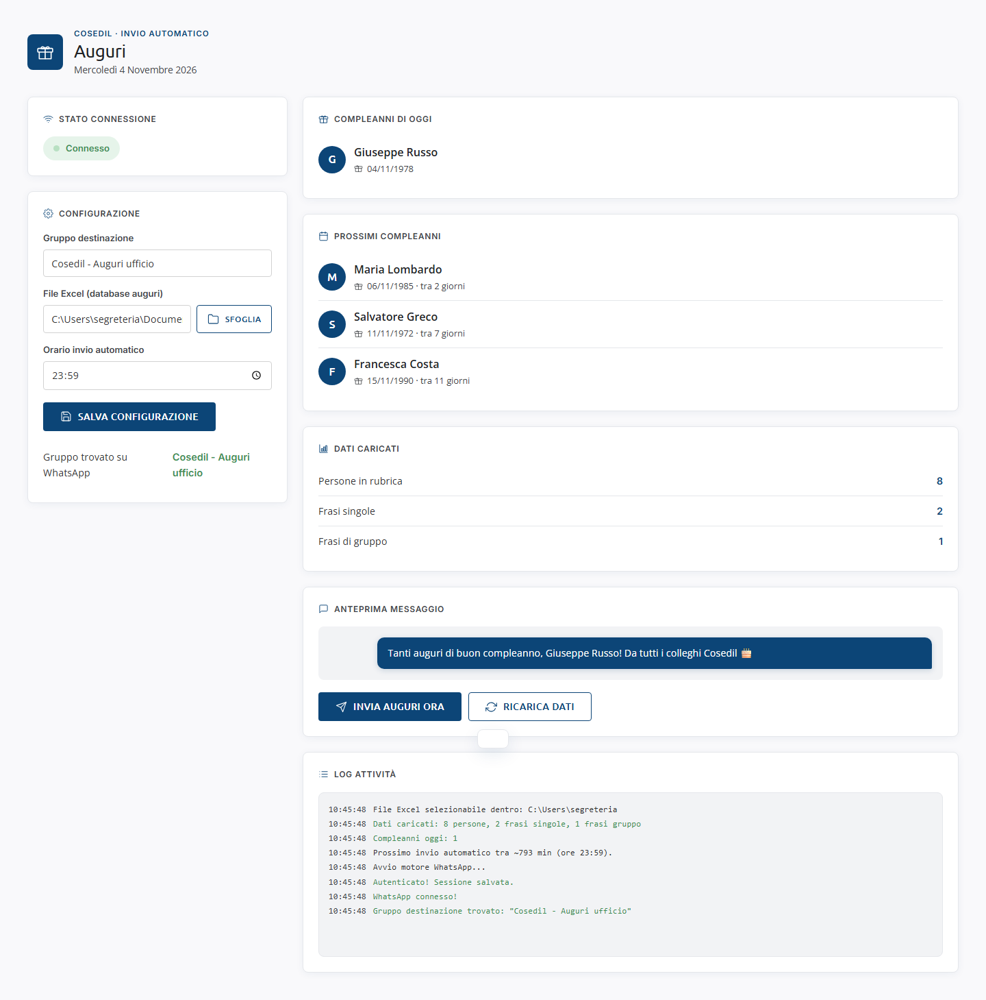
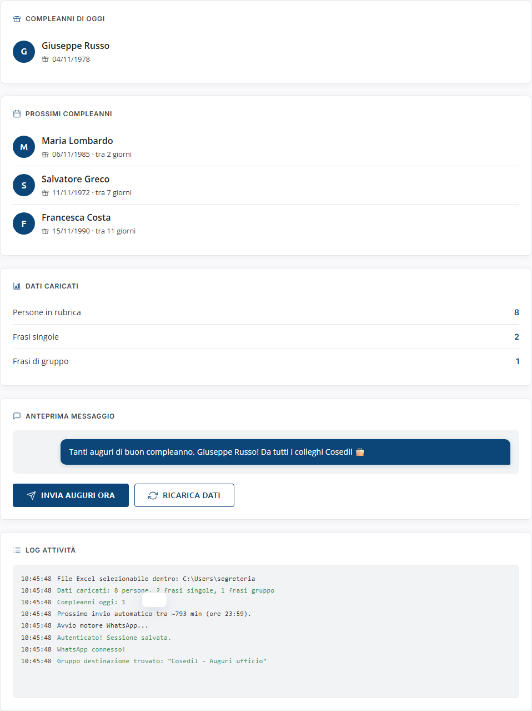
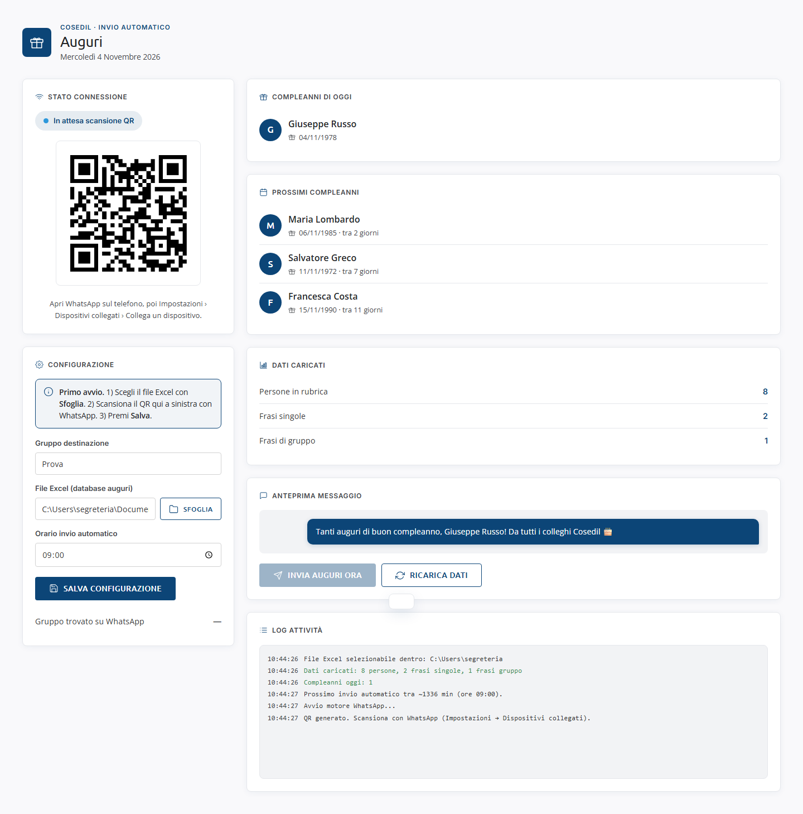
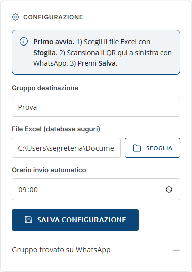
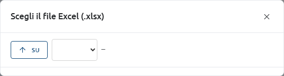
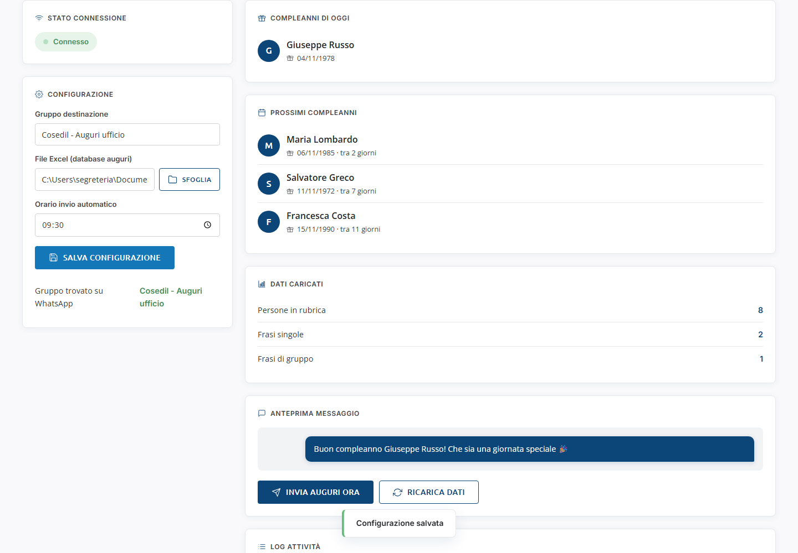
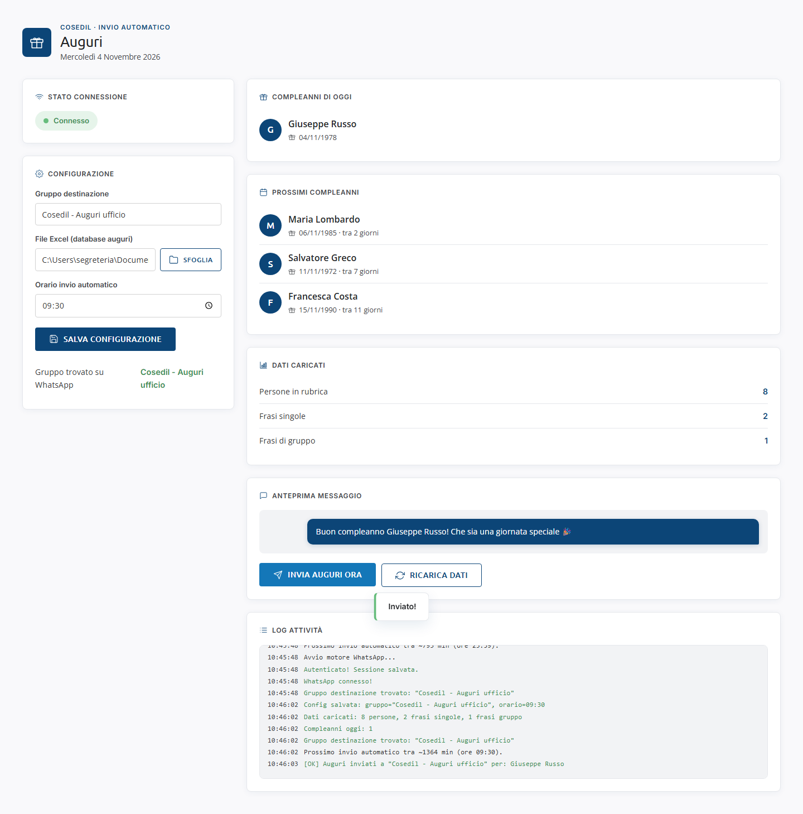
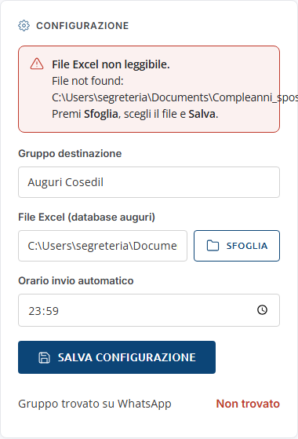

<!-- "><(((º> sabusabu <º)))>< -->
# Auguri — Guida utente

Auguri manda **da solo, ogni giorno**, gli auguri di compleanno dei colleghi in
un **gruppo WhatsApp** aziendale. Nomi e date di nascita li legge da un file
Excel; il messaggio lo compone pescando a caso una frase tra quelle scritte
nello stesso file.

> **Nota sulle immagini.** Le schermate di questa guida sono state fatte con
> una copia di prova del programma, **senza collegarsi a WhatsApp** e con nomi
> inventati: il QR mostrato è un esempio e non funziona. Il percorso del file
> Excel è stato reso leggibile (`C:\Users\segreteria\…`).

## Indice

1. [Come si entra](#1-come-si-entra)
2. [La schermata](#2-la-schermata)
3. [Il file Excel](#3-il-file-excel)
4. [Primo avvio: collegare WhatsApp e configurare](#4-primo-avvio-collegare-whatsapp-e-configurare)
5. [L'invio automatico di ogni giorno](#5-linvio-automatico-di-ogni-giorno)
6. [Mandare gli auguri a mano](#6-mandare-gli-auguri-a-mano)
7. [Avvisi e allarmi](#7-avvisi-e-allarmi)
8. [Se qualcosa non va](#8-se-qualcosa-non-va)
9. [Per l'amministratore di sistema](#9-per-lamministratore-di-sistema)

---

## 1. Come si entra

Si apre dal **Portale** della suite Cosedil, scheda *Auguri* (vedi la
[guida del Portale](../../../portale/docs/guida/README.md)). È **riservato agli
amministratori del Portale**: comanda il WhatsApp aziendale, quindi gli altri
utenti non lo vedono.

Il programma **lavora anche a pagina chiusa**: la pagina serve solo a
controllare e a configurare. Non chiuderlo "per sicurezza": se è spento, gli
auguri non partono.

## 2. La schermata

| Riquadro | Cosa mostra |
|---|---|
| **Stato connessione** | se WhatsApp è collegato: *Avvio…*, *In attesa scansione QR*, *Caricamento…*, **Connesso**, *Errore*, *Disconnesso*. Qui compaiono anche il QR e gli allarmi rossi. |
| **Configurazione** | gruppo WhatsApp di destinazione, file Excel, orario dell'invio automatico, e se il gruppo è stato trovato |
| **Compleanni di oggi** | chi festeggia oggi |
| **Prossimi compleanni** | i compleanni dei prossimi 14 giorni (*domani*, *tra N giorni*) |
| **Dati caricati** | quante persone e quante frasi sono state lette dall'Excel |
| **Anteprima messaggio** | il testo che verrà mandato oggi; pulsanti **Invia auguri ora** e **Ricarica dati** |
| **Log attività** | cosa ha fatto il programma, con l'ora (verde = riuscito, rosso = errore) |

## 3. Il file Excel

Il file `.xlsx` deve avere **tre fogli** con questi nomi esatti:

| Foglio | Contenuto |
|---|---|
| **Compleanni** | colonna A: Nome · colonna B: Cognome · colonna C: Data di nascita (prima riga = intestazioni) |
| **Frasi di auguri** | colonna B: una frase per riga, usata quando festeggia **una** persona |
| **Auguri di gruppo** | colonna B: una frase per riga, usata quando festeggiano **più** persone lo stesso giorno |

Nelle frasi scrivi `{nome}` dove deve comparire il nome: ad esempio
`Tanti auguri di buon compleanno, {nome}! Da tutti i colleghi Cosedil 🎂`
diventa *«Tanti auguri di buon compleanno, Giuseppe Russo! …»*. Con più
festeggiati i nomi vengono uniti (*«Maria Lombardo e Salvatore Greco»*). Se una
frase non contiene `{nome}`, il messaggio inizia con *«🎉 Nome Cognome!»* e poi la frase.

Buono a sapersi:

- la data può essere una data di Excel o un testo `GG/MM/AAAA`; date
  impossibili (es. 31/04) vengono scartate;
- chi è nato il **29 febbraio** riceve gli auguri il 28 negli anni non bisestili;
- puoi modificare l'Excel quando vuoi: il programma lo rilegge prima dell'invio
  e lo ricontrolla ogni 15 minuti anche dopo l'orario (un compleanno aggiunto in
  giornata parte comunque). Per vedere subito le modifiche premi **Ricarica dati**.

## 4. Primo avvio: collegare WhatsApp e configurare

Al primo avvio la pagina mostra il riquadro azzurro **Primo avvio** con i tre passi
e, a sinistra, un **codice QR**.

### 4.1 Collegare WhatsApp

Con il telefono che ha il WhatsApp aziendale:

1. apri WhatsApp → **Impostazioni** → **Dispositivi collegati** → **Collega un dispositivo**;
2. inquadra il QR sullo schermo.

Lo stato passa a *Caricamento…* (barra di avanzamento) e poi a **Connesso**
(verde); nel log compaiono *«Autenticato! Sessione salvata.»* e *«WhatsApp connesso!»*.
Il QR si rinnova da solo ogni mezzo minuto circa: se scade, inquadra quello nuovo.

Il collegamento resta valido nel tempo: non va rifatto a ogni avvio. Il telefono
deve però collegarsi a internet ogni tanto, altrimenti WhatsApp scollega il
dispositivo e il QR ricompare.

### 4.2 Configurare

1. **Gruppo destinazione**: il nome **esatto** del gruppo WhatsApp (maiuscole e
   spazi in più non contano).
2. **File Excel (database auguri)**: premi **Sfoglia**, entra nelle cartelle con
   un clic, risali con **Su**, e clicca il file `.xlsx` (in verde). Compare
   *«File scelto. Premi Salva per applicare.»*. Si possono scegliere solo file
   nella cartella dell'utente del PC che fa girare il programma.

   

3. **Orario invio automatico**: l'ora in cui partono gli auguri (es. 09:30).
4. Premi **Salva configurazione** → *«Configurazione salvata»*.

Dopo il salvataggio il programma rilegge l'Excel e cerca il gruppo: alla voce
**Gruppo trovato su WhatsApp** deve comparire il nome del gruppo in verde. Se
compare **Non trovato** in rosso, il nome non corrisponde a nessun gruppo di cui
il numero collegato fa parte.

## 5. L'invio automatico di ogni giorno

Non serve fare niente. Ogni giorno, all'orario impostato:

1. il programma rilegge l'Excel;
2. se oggi c'è almeno un compleanno e gli auguri non sono ancora partiti,
   manda il messaggio nel gruppo;
3. nel log compare *«[OK] Auguri inviati a "…" per: …»*.

Se a quell'ora il PC era spento, gli auguri partono appena il programma si
riaccende. Se WhatsApp non è collegato o l'invio non riesce, il programma
**riprova da solo per circa due ore**; se non ce la fa, scatta un allarme
(vedi [capitolo 7](#7-avvisi-e-allarmi)). Gli auguri non partono mai due volte
nello stesso giorno da soli.

## 6. Mandare gli auguri a mano

Il pulsante **Invia auguri ora** manda subito il messaggio dell'**Anteprima**
nel gruppo. È attivo solo se WhatsApp è *Connesso*, il gruppo è trovato e oggi
c'è un compleanno. Esito: *«Inviato!»* in basso e la riga verde nel log.

> **Attenzione: premilo una volta sola.** Dopo un invio riuscito il pulsante
> resta attivo e un secondo clic **manda di nuovo** il messaggio nel gruppo.
> Prima di premerlo guarda nel log se c'è già *«[OK] Auguri inviati…»* di oggi.
> Dopo un invio manuale l'invio automatico della giornata non riparte.

La frase viene scelta a caso: l'anteprima può cambiare dopo **Ricarica dati**.

## 7. Avvisi e allarmi

| Cosa vedi | Significato | Cosa fare |
|---|---|---|
| Riquadro rosso **File Excel non leggibile.** con il motivo | Il file è stato spostato, rinominato, è aperto in modo esclusivo o manca un foglio (es. *Foglio "Compleanni" non trovato*). | **Sfoglia**, scegli il file giusto, **Salva**. |
| **Gruppo trovato su WhatsApp: Non trovato** (rosso) | Il nome del gruppo non corrisponde. | Correggi il nome, **Salva**. |
| Riquadro rosso **Auguri non inviati.** | Oggi c'era un compleanno ma dopo due ore di tentativi non è partito niente. | Ricollega WhatsApp se serve, poi **Invia auguri ora**. |
| Riquadro rosso **WhatsApp scollegato.** | WhatsApp è scollegato da più di 6 ore. | Scansiona il QR che compare sopra. |

Gli allarmi restano anche nel file `log\allarmi.log` e, quando WhatsApp è
collegato, arrivano come messaggio nella chat **"Messaggi a te stesso"** del
numero aziendale.

## 8. Se qualcosa non va

| Cosa succede | Cosa fare |
|---|---|
| Lo stato resta su *In attesa scansione QR* | WhatsApp non è collegato: scansiona il QR (capitolo 4.1). |
| Lo stato è *Errore* o *Disconnesso* | Il programma riprova da solo (nel log: *«Nuovo tentativo di connessione tra …s»*). Se dopo qualche minuto ricompare il QR, scansionalo. |
| *«Sessione del portale scaduta: rientra dal Portale Suite Cosedil»* | Rientra dal Portale e riapri Auguri. |
| *«Il file Excel deve stare dentro …»* | Hai scritto a mano un percorso fuori dalla cartella consentita: usa **Sfoglia**. |
| *«Invio già in corso, riprova tra poco»* | Sta già partendo un invio (automatico o manuale): aspetta. |
| *«Nessun compleanno oggi»* | Normale: niente da mandare. Se invece qualcuno compie gli anni, controlla la data nell'Excel e premi **Ricarica dati**. |
| *«Cartella non accessibile: …»* nella finestra Sfoglia | Quella cartella non si può aprire: scegline un'altra. |

## 9. Per l'amministratore di sistema

- **Dove gira.** Sul PC/server con la sessione WhatsApp aziendale. Attualmente la
  copia in esercizio è quella in `Documents\suite cosedil\whatss'app_web_Compleanni`,
  non quella del repository: non sostituirla senza aver previsto la nuova
  scansione del QR.
- **Avvio.** Dal Portale, oppure `avvia.bat`; per l'avvio automatico ogni giorno
  `installa-avvio-automatico.bat` (attività pianificata di Windows con il
  "guardiano" che lo riavvia se si ferma), rimozione con `disinstalla-avvio-automatico.bat`.
  Requisiti: Node.js; prima installazione con `installa-dipendenze.bat`.
  Istruzioni complete in [LEGGIMI.txt](../../LEGGIMI.txt).
- **Una sola istanza.** Se il programma è già acceso, una seconda copia si chiude da sola.
- **Dati.** `config.json` (gruppo, file Excel, orario), `.wwebjs_auth\` (la
  sessione WhatsApp: **riservata**, chi la copia può usare il WhatsApp aziendale),
  `log\` (log giornalieri conservati 30 giorni, `allarmi.log`, `.ultimo-invio`).
  L'Excel sta dove lo si è scelto (di solito nei Documenti dell'utente).
- **Cartella consentita per l'Excel.** Di default la cartella dell'utente
  Windows; si cambia con la variabile `AUGURI_ROOT`.
- **Backup.** `config.json` e il file Excel. La cartella `.wwebjs_auth` non serve
  salvarla: in caso di perdita basta riscansionare il QR.
