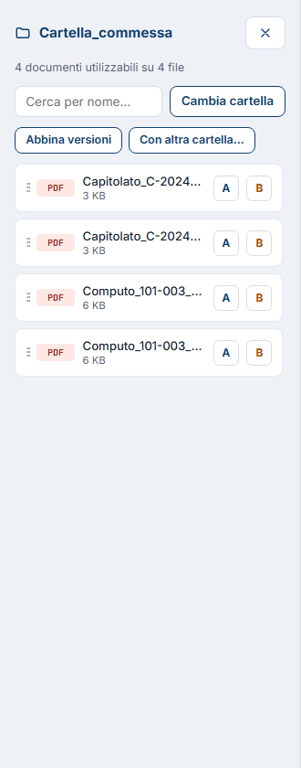
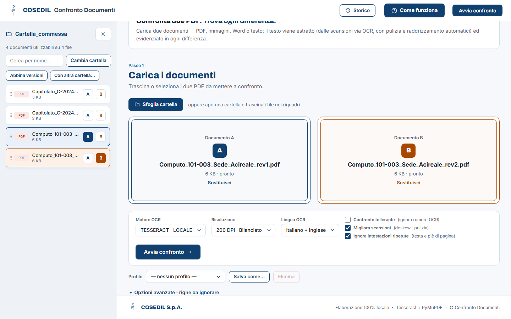
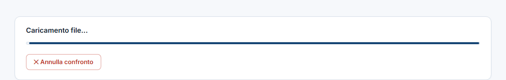
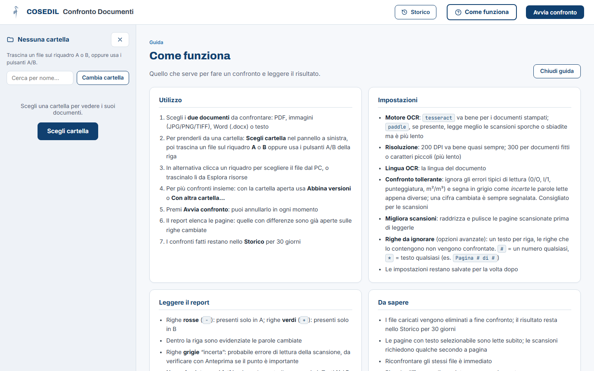

<!-- "><(((º> sabusabu <º)))>< -->
# 1. Il primo confronto

[← Indice](README.md)

L'esempio usa due revisioni del computo metrico della commessa
**101-003 Sede Acireale** (rev. 1 del 12/10 e rev. 2 del 28/10).

## 1.1 Scegliere i due documenti

Ci sono tre modi, equivalenti:

- **trascinare** il file da Esplora risorse sul riquadro **Documento A**
  (azzurro) o **Documento B** (arancio);
- **fare clic** su un riquadro e scegliere il file dal PC;
- **aprire una cartella** nel pannello a sinistra (vedi sotto) e usare i
  pulsanti **A** / **B** di ogni riga.

Regola pratica: in **A** la versione **vecchia**, in **B** quella **nuova**.
Le righe rosse del report saranno "tolte", le verdi "aggiunte".

Formati accettati: PDF, immagini (JPG, PNG, TIFF, BMP, WEBP, GIF), Word `.docx`,
testo (`.txt`, `.md`, `.csv`).

## 1.2 Il pannello cartella

Su uno schermo largo il pannello a sinistra è già aperto. Premi
**Scegli cartella** e seleziona la cartella della commessa: compaiono tutti i
file utilizzabili, anche delle sottocartelle. Il browser può chiedere conferma
per "caricare" i file: è normale, **i file restano sul computer** finché non
avvii il confronto.

- **Cerca per nome…** filtra l'elenco;
- **Cambia cartella** apre un'altra cartella (o rilegge la stessa se sono arrivati file nuovi);
- trascina una riga (dalla maniglia **⋮⋮**) su un riquadro, oppure premi **A** o **B**;
- il file scelto resta evidenziato nell'elenco;
- la **✕** chiude il pannello, **Sfoglia cartella** lo riapre. Il programma
  ricorda se l'avevi lasciato aperto o chiuso.

## 1.3 Avviare

Quando entrambi i riquadri mostrano il nome del file e la scritta **pronto**,
il pulsante **Avvia confronto** diventa blu. Premilo.

Per cambiare un file clicca **Sostituisci** nel suo riquadro, o trascinaci sopra
un altro file.

Durante il lavoro una barra mostra l'avanzamento (*Caricamento file…*, poi
lettura delle pagine). **✕ Annulla confronto** lo ferma.

Quanto ci mette:

- PDF "nati al computer" (testo selezionabile): pochi secondi;
- scansioni: qualche secondo **per pagina**, perché il testo va letto con l'OCR;
- lo stesso confronto rifatto una seconda volta: immediato.

Finito, sotto compare il **Report differenze**: vedi
[Leggere il report](03-leggere-il-report.md).

## 1.4 La guida dentro il programma

Il pulsante blu **Come funziona**, in alto, apre un riassunto di questa guida
in cima alla pagina. Si chiude con **Chiudi guida** o premendo di nuovo il pulsante.

[Avanti: Le impostazioni →](02-impostazioni.md)
