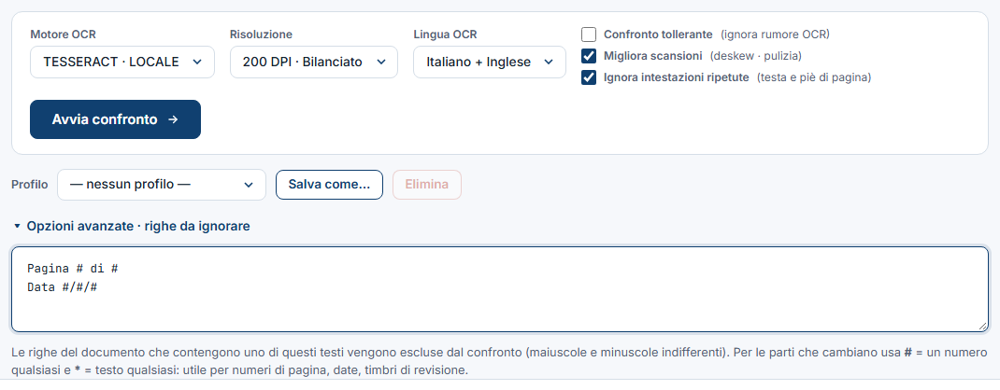

<!-- "><(((º> sabusabu <º)))>< -->
# 2. Le impostazioni

[← Indice](README.md)

Sotto i due riquadri ci sono le impostazioni. **Di solito vanno bene quelle già
proposte**; vale la pena toccarle soprattutto per le scansioni. Restano salvate
per la volta successiva (nello stesso browser).

| Impostazione | A cosa serve |
|---|---|
| **Motore OCR** | Chi "legge" le scansioni. **TESSERACT · LOCALE** va bene per i documenti stampati. **PADDLE**, se compare nell'elenco, legge meglio le scansioni sporche o sbiadite ma è più lento. Per i PDF con testo selezionabile non conta. |
| **Risoluzione** | **200 DPI · Bilanciato** va bene quasi sempre. **300 DPI · Preciso** per caratteri piccoli o documenti fitti (più lento). **150 DPI · Veloce** per una prova rapida. |
| **Lingua OCR** | La lingua del documento (di solito *Italiano + Inglese*). |
| **Confronto tollerante** | Ignora gli errori tipici di lettura delle scansioni (0/O, l/1, punteggiatura, m²/m³) e segna in grigio come *incerte* le parole lette in modo appena diverso. **I numeri non vengono mai "aggiustati"**: una cifra cambiata è sempre segnalata. Consigliato per le scansioni. |
| **Migliora scansioni** | Raddrizza e pulisce le pagine scansionate prima di leggerle. Attivo di default. |
| **Ignora intestazioni ripetute** | Toglie dal confronto le righe in testa e in fondo alla pagina che si ripetono in molte pagine di **entrambi** i documenti (ragione sociale, "Pagina 3 di 12"). Funziona solo da 3 pagine in su. Attivo di default. Vedi l'avvertenza sotto. |

> **Avvertenza su "Ignora intestazioni ripetute".** Una riga di intestazione
> che cambia solo per un **numero piccolo isolato** viene considerata uguale.
> Esempio: se in testa a ogni pagina c'è "Computo metrico – Rev. 1" in A e
> "Rev. 2" in B, quella differenza **non compare** nel report. Righe con
> importi, date o codici diversi invece restano confrontate. Se ti interessa
> vedere anche il cambio di revisione nell'intestazione, togli la spunta.

## 2.1 Righe da ignorare

Apri **Opzioni avanzate · righe da ignorare** e scrivi un testo per riga: le
righe del documento che lo **contengono** non vengono confrontate (maiuscole e
minuscole indifferenti). Per le parti che cambiano ci sono due simboli:

| Simbolo | Vale | Esempio | Toglie righe come |
|---|---|---|---|
| `#` | un numero qualsiasi | `Pagina # di #` | Pagina 3 di 12 |
| `#` | | `Data #/#/#` | Data 28/10/2026 |
| `*` | testo qualsiasi | `Timbro * del #` | Timbro ufficio tecnico del 12 |
| | testo semplice | `Documento riservato` | Documento riservato – copia controllata |

Non scrivere testi troppo generici: con `Pagina` da solo viene tolta ogni riga
che contiene la parola "pagina".

## 2.2 Profili

Se confronti spesso lo stesso tipo di documento, salva le impostazioni con un nome:

1. regola motore, risoluzione, lingua, spunte e righe da ignorare;
2. premi **Salva come…** e scrivi il nome (es. "Computi Lotto 3", "Contratti scansionati");
3. la volta dopo lo scegli dal menu **Profilo** e tutto si reimposta in un clic.

**Elimina** cancella il profilo scelto.

[← Il primo confronto](01-primo-confronto.md) · [Avanti: Leggere il report →](03-leggere-il-report.md)
