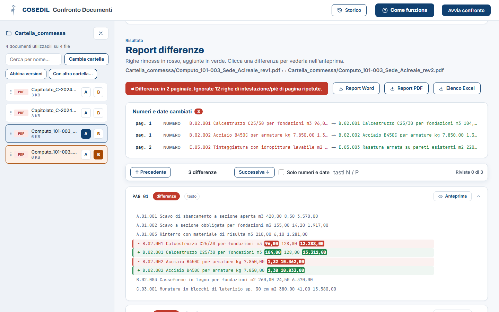
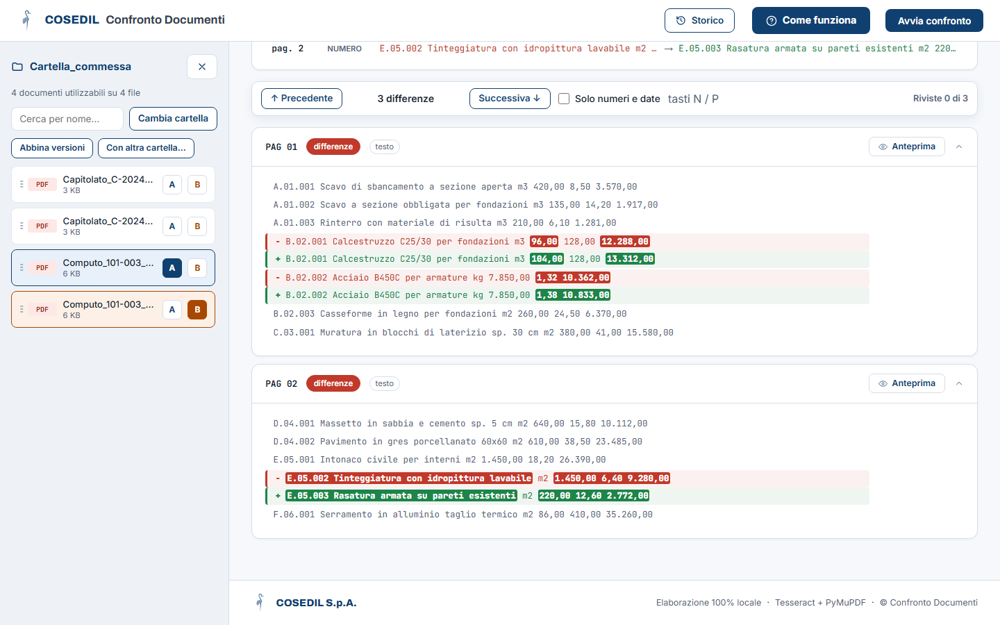
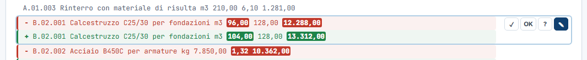
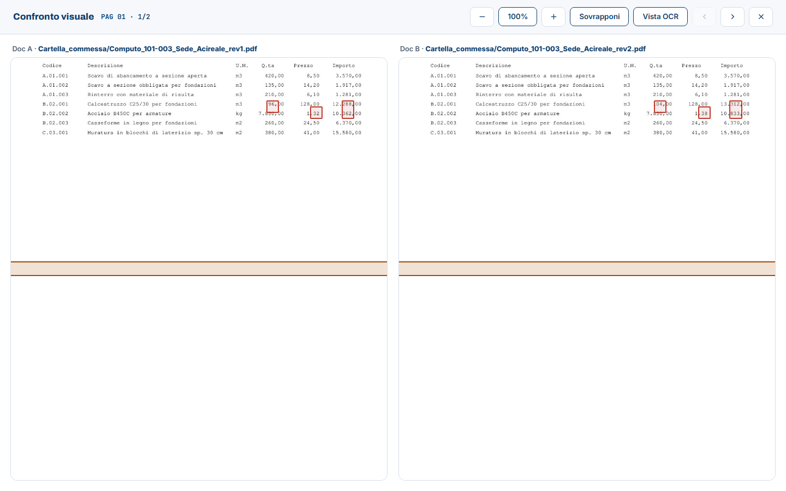
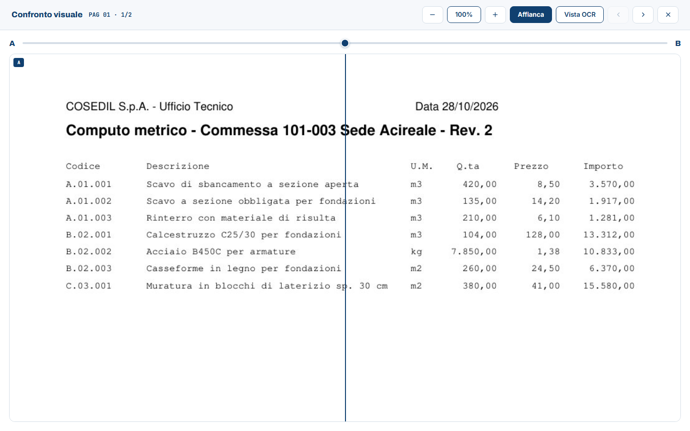

<!-- "><(((º> sabusabu <º)))>< -->
# 3. Leggere il report

[← Indice](README.md)

## 3.1 L'esito e i download

In cima al **Report differenze** ci sono i nomi dei due file, l'**esito** e i
pulsanti per scaricare il risultato.

- Esito **verde**: nessuna differenza. Esito **rosso**: differenze in N pagine;
  il messaggio dice anche quante righe di intestazione/piè di pagina sono state ignorate.
- **Report Word** e **Report PDF**: il confronto da salvare o allegare a una
  mail, con il riepilogo di numeri e date in testa.
- **Elenco Excel**: una riga per differenza (pagina, tipo, testo A e B, parole
  cambiate, numeri/date, stato di revisione e nota), con i filtri già attivi.

## 3.2 Numeri e date cambiati — da guardare per primo

Il riquadro elenca le righe in cui cambia un **importo**, una **quantità** o
una **data**: nell'esempio il calcestruzzo passa da 96 a 104 m³, il prezzo
dell'acciaio da 1,32 a 1,38 €/kg, una voce di tinteggiatura è sostituita da una
rasatura. **Clic su una voce** = il report salta a quella riga.

## 3.3 Le pagine e i colori

Sotto c'è una scheda per pagina. Quelle con differenze sono già aperte; un clic
sull'intestazione della pagina la apre o la chiude.

| Come appare | Significato |
|---|---|
| riga **rossa** con `−` | c'è solo nel documento **A** (tolta) |
| riga **verde** con `+` | c'è solo nel documento **B** (aggiunta) |
| parole evidenziate dentro la riga | le parole o cifre cambiate |
| riga **grigia** con etichetta *incerta* | probabile errore di lettura della scansione (solo con *Confronto tollerante*); non è nascosta: se il punto conta, controlla con l'Anteprima |
| riga in corsivo *spostata* | stessa riga, cambiata solo di posizione |
| etichetta *voce A.01.003* | nei computi, la riga con lo stesso codice è confrontata con la sua corrispondente anche se è cambiata molto o ha cambiato posto |
| pagina *testo uguale, grafica diversa* | il testo è identico ma cambia qualcosa nell'immagine (timbro, firma, disegno): guardala con l'Anteprima |
| pagina *solo differenze incerte* | ha solo righe grigie: resta chiusa |

### Muoversi tra le differenze

La barra sopra le pagine resta in vista mentre scorri:

- **↑ Precedente** / **Successiva ↓** (o i tasti **P** e **N**) saltano da una differenza all'altra;
- **Solo numeri e date** nasconde tutto il resto;
- a destra il contatore **Riviste x di N** dice a che punto sei con la revisione.

## 3.4 Segnare le differenze già controllate (revisione)

Passando il mouse su una differenza compaiono quattro pulsanti:

| Pulsante | Significato |
|---|---|
| **✓** | vista |
| **OK** | accettata |
| **?** | da chiarire |
| **✎** | aggiungi una nota |

Lo stato resta salvato nel confronto (lo ritrovi riaprendolo dallo Storico) e
finisce nell'**Elenco Excel**.

## 3.5 Anteprima: vedere la differenza sulla pagina

**Clic su una differenza** (o Invio) apre il *Confronto visuale* su quella pagina.

- **Affianca**: A e B uno accanto all'altro, le zone cambiate riquadrate in rosso.
  Una fascia arancio indica la zona della riga (posizione **stimata**: può
  cadere più in basso o più in alto del punto vero, fidati dei riquadri rossi);
- **Sovrapponi**: B sopra A; trascina il cursore A ↔ B per passare dall'uno all'altro;
- **Vista OCR**: la pagina come l'ha "vista" il programma dopo la pulizia;
- **−** / **100%** / **+**: zoom; frecce **‹ ›**: pagina precedente/successiva;
  **✕** o **Esc**: chiude.

Il pulsante **Anteprima** sull'intestazione di ogni pagina apre la stessa vista
anche senza scegliere una differenza.

[← Le impostazioni](02-impostazioni.md) · [Avanti: Più confronti insieme e Storico →](04-lotti-e-storico.md)
