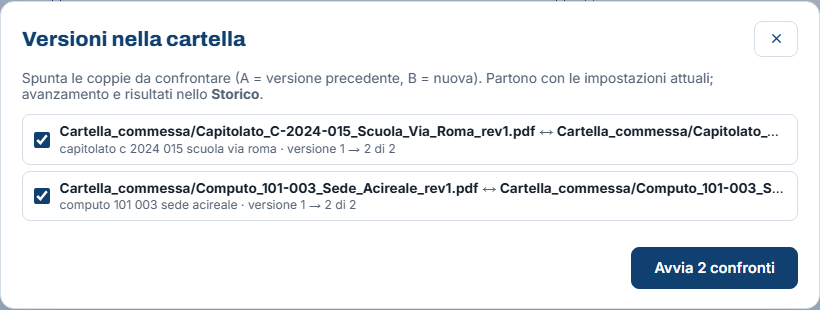
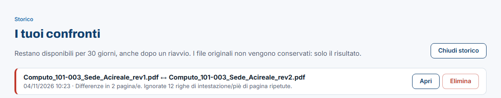

<!-- "><(((º> sabusabu <º)))>< -->
# 4. Più confronti insieme e Storico

[← Indice](README.md)

## 4.1 Più confronti in un colpo

Con una cartella aperta nel pannello a sinistra compaiono due pulsanti.

**Abbina versioni** raggruppa i file che hanno lo stesso nome a meno della
versione (`computo_rev1` / `computo_rev2`, `offerta v3`, `relazione_2026-10-01`,
`def`, `bozza`, `(2)`…) e propone di confrontare **penultima e ultima** versione
di ogni gruppo. Nell'esempio trova il capitolato della commessa C-2024-015 e il
computo della 101-003.

**Con altra cartella…** chiede una seconda cartella (es. *Rev1* e *Rev2*) e
abbina i file per nome uguale o molto simile; quelli senza corrispondenza sono
elencati a parte.

In entrambi i casi:

1. spunta le coppie da confrontare (A = versione precedente, B = nuova);
2. premi **Avvia N confronti**: partono con le impostazioni attuali;
3. il server li esegue pochi alla volta; segui l'avanzamento nello **Storico**.

## 4.2 Storico

Il pulsante **Storico** in alto elenca i confronti fatti, con data, ora ed esito.

- **Apri** riapre il report completo (anteprime e revisione comprese), anche
  dopo un riavvio del programma;
- **Elimina** lo toglie;
- **Chiudi storico** chiude l'elenco.

I confronti restano **30 giorni**. Dei file originali non si conserva niente:
solo il risultato (testo letto, differenze, anteprime, revisione).

**Mandare un confronto a un collega.** L'indirizzo della pagina di un confronto
(quello che finisce con `?job=…`) apre direttamente quel report a chi usa lo
stesso server.

[← Leggere il report](03-leggere-il-report.md) · [Avanti: Se qualcosa non va →](05-problemi.md)
