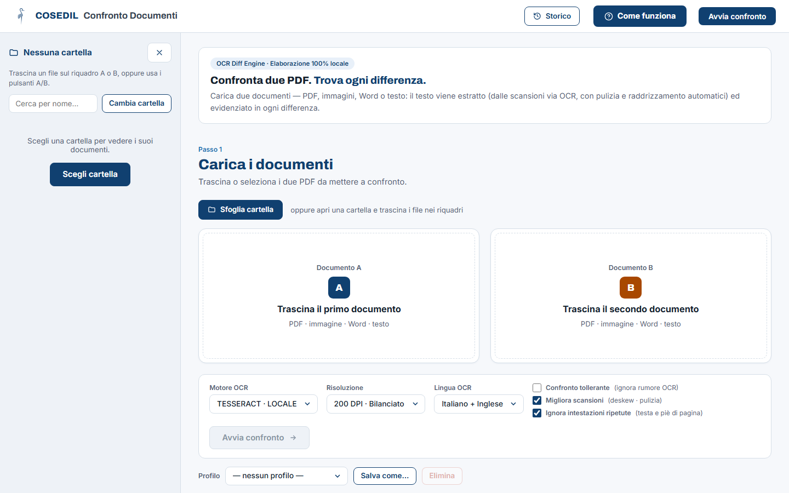

<!-- "><(((º> sabusabu <º)))>< -->
# Confronto documenti — Guida utente

Confronto documenti mette a confronto **due versioni dello stesso documento**
(computo, capitolato, offerta, contratto…) e mostra **ogni differenza**: righe
tolte, righe aggiunte, numeri e date cambiati. Funziona con PDF (anche
scansionati o firmati digitalmente `.p7m`, con la verifica della firma),
immagini, Word (`.docx`) e file di testo. Tutto avviene sul
computer o sul server dell'azienda: i documenti non vanno su internet.

## Come si entra

Si apre dal **Portale** della suite Cosedil: fai clic sulla scheda
*Confronto Documenti*. Per l'accesso al Portale vedi la
[guida del Portale](../../../portale/docs/guida/README.md).

Il confronto si può lanciare anche **da SkyTower**, dal dettaglio di un
documento («confronta con la revisione precedente»): SkyTower manda i due
file a Confronto documenti e apre il report descritto in questa guida.

## Capitoli

1. [Il primo confronto](01-primo-confronto.md) — scegliere i due documenti e avviare
2. [Le impostazioni](02-impostazioni.md) — scansioni, righe da ignorare, profili
3. [Leggere il report](03-leggere-il-report.md) — firma digitale, colori, numeri e date, anteprima, revisione, download
4. [Più confronti insieme e Storico](04-lotti-e-storico.md)
5. [Se qualcosa non va](05-problemi.md)
6. [Per l'amministratore di sistema](06-amministratore.md)

## In breve

| Voglio… | Faccio così |
|---|---|
| confrontare due file | li metto nei riquadri **A** (vecchio) e **B** (nuovo) e premo **Avvia confronto** |
| vedere subito importi e date cambiati | guardo il riquadro **Numeri e date cambiati** in cima al report |
| vedere il punto sulla pagina | clic sulla differenza: si apre l'**Anteprima** |
| mandare il risultato a un collega | **Report Word**, **Report PDF** o **Elenco Excel** |
| riaprire un confronto di ieri | **Storico** in alto a destra |
