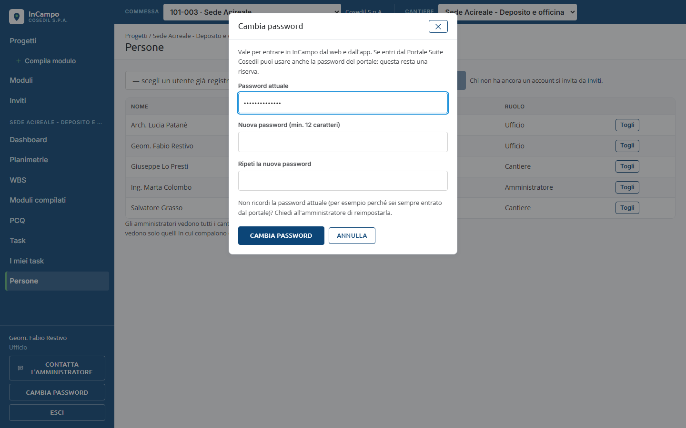
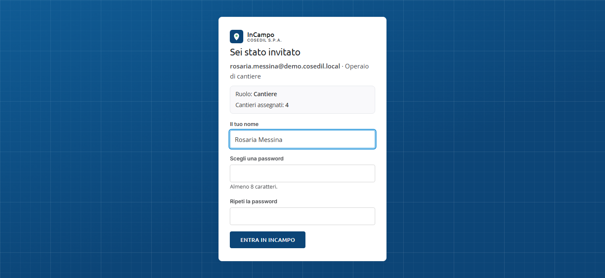
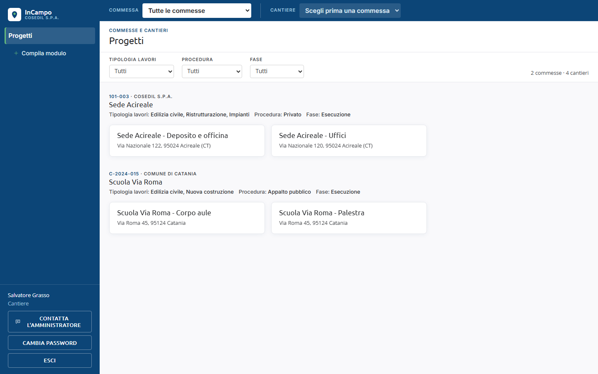

<!-- "><(((º> sabusabu <º)))>< -->
# 1. Entrare in InCampo

[Indice](README.md) · Capitolo successivo: [Commesse e cantieri](02-commesse-e-cantieri.md)

## Dal Portale (il modo normale)

In azienda InCampo si apre dal **Portale** della suite Cosedil: si entra nel Portale
con il proprio utente e si clicca sul riquadro **InCampo**. Come si entra nel Portale,
e cosa fare se la password non va, è spiegato nella
[guida del Portale](../../../portale/docs/guida/README.md).

Se apri un indirizzo di InCampo senza essere entrato nel Portale, vieni riportato
alla pagina di login del Portale: prima il Portale, poi InCampo.

Quando arrivi dal Portale succede una di queste due cose:

1. **Entri subito, senza altra password.** InCampo chiede al Portale chi sei e ritrova
   il tuo account InCampo: la prima volta per **la stessa email** del tuo utente del Portale,
   poi per il tuo **nome utente del Portale**, a cui l'account resta collegato. Se l'email
   cambia nel Portale, InCampo la aggiorna sullo stesso account (non ne crea un altro).
   - Se l'account InCampo non c'è ancora, viene creato in quel momento con il tuo nome:
     chi è **amministratore del Portale** entra come **Amministratore**, tutti gli altri come
     **Ufficio**. L'amministratore di InCampo può poi scegliere fra *Ufficio* e *Cantiere*.
   - **Il tuo profilo del Portale vale anche qui** (dall'11/11/2026): nome, email e ruolo di
     amministratore si aggiornano a ogni ingresso. Se nel Portale smetti di essere
     amministratore, al prossimo ingresso in InCampo torni al ruolo che avevi prima.
   - Un account creato così **non ha una password InCampo che conosci**: sul telefono e
     nella pagina di login entri con la tua email e la **password del Portale**.
2. **Vedi la pagina di login di InCampo.** Succede se il Portale non risponde, se
   InCampo non è abilitato per il tuo utente del Portale o se il tuo account InCampo
   è stato disattivato. In questo caso entri con email e password di InCampo, come
   spiegato qui sotto.

## La pagina di login

1. In **Email o utente** scrivi la tua email (es. `salvatore.grasso@...`).
2. In **Password** scrivi la password di InCampo oppure quella del **Portale**: vale l'una
   o l'altra (una password per tutti i programmi della suite).
3. Clicca **Accedi**. Mentre controlla, il pulsante diventa *Accesso…*.

Se email o password sono sbagliate compare in rosso **Email o password errati**:

Controlla le maiuscole e riprova. Se non ricordi la password di InCampo, prova quella
del Portale oppure chiedi all'amministratore di InCampo di reimpostarla: non c'è un
pulsante "password dimenticata".

Anche con la password di InCampo, se hai un utente del Portale InCampo gli chiede se
puoi entrare. Se il tuo account del Portale è stato **disattivato**, o InCampo **non è più
fra i tuoi programmi**, il login si ferma con il motivo scritto in rosso (per esempio
*Il tuo account del Portale è disattivato: rivolgiti a un amministratore*). Vale anche
per l'app sul telefono. Se il Portale in quel momento non risponde, la password di
InCampo ti fa entrare lo stesso.

## Cambiare la propria password

In basso a sinistra, sotto il tuo nome, c'è **Cambia password**:

1. scrivi la **Password attuale**;
2. scrivi la **Nuova password** (almeno **12 caratteri**, diversa da quella attuale) e
   ripetila;
3. clicca **Cambia password**: compare *Password cambiata*.

Se la password attuale è sbagliata compare *Password attuale errata*; dopo troppi
errori InCampo blocca i tentativi per qualche minuto, come al login. Se sei sempre
entrato dal Portale non conosci una password InCampo: usa quella del Portale, oppure
chiedi all'amministratore di impostartene una.

## Primo accesso con un invito

Spesso il primo accesso arriva con un **link d'invito** (per email o mandato da un
collega). Il link si apre anche senza essere entrati nel Portale.

- In alto vedi la tua email, l'etichetta dell'invito (es. *Operaio di cantiere*), il
  **ruolo** e quanti **cantieri** ti vengono assegnati.
- Scrivi **Il tuo nome**, scegli una password (**almeno 12 caratteri**) e ripetila.
- Clicca **Entra in InCampo**: sei già dentro, con i cantieri giusti.

Il link vale **una volta sola** e **scade dopo 7 giorni**. Se compare *Invito non
valido*, il link è già stato usato, è scaduto o è stato revocato: chiedi a chi ti ha
invitato di rimandarlo.

## La schermata principale

- **A sinistra** c'è il menu. Sempre presenti: **Progetti** (l'elenco di commesse e
  cantieri) e **+ Compila modulo**. Chi è *Ufficio* vede anche **Moduli** e **Inviti**;
  l'*Amministratore* vede in più la sezione **Amministrazione**.
- Quando apri un cantiere, sotto il suo nome compaiono le sue pagine: **Dashboard**,
  **Planimetrie**, **WBS**, **Moduli compilati**, **PCQ** (solo Ufficio), **Task**, **I miei task**
  e **Persone** (chi fa parte del cantiere, capitolo 2).
- **In basso a sinistra** ci sono il tuo nome, il ruolo (*Cantiere*, *Ufficio*,
  *Amministratore*), il pulsante **Contatta l'amministratore** (per segnalare un problema,
  vedi capitolo 12), **Cambia password** ed **Esci**.
- **In alto** c'è la barra **Commessa / Cantiere**, spiegata nel capitolo successivo.

Per uscire clicca **Esci** in basso a sinistra.
