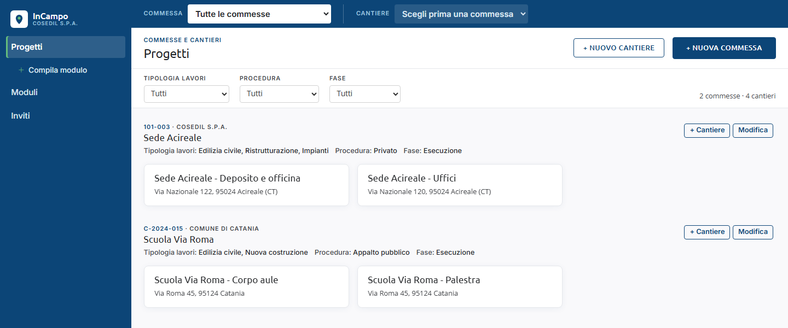
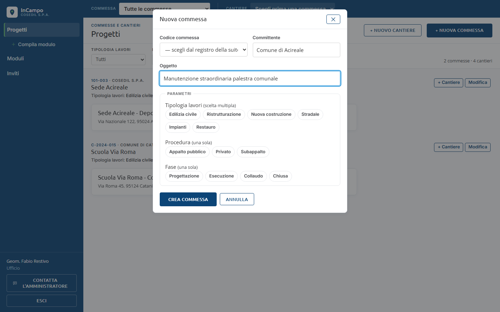
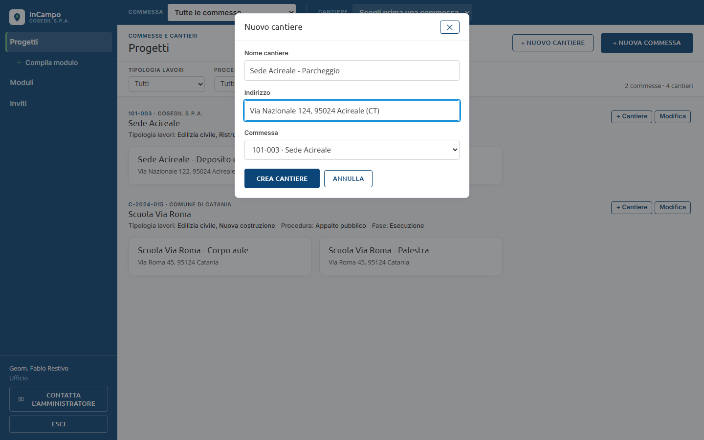
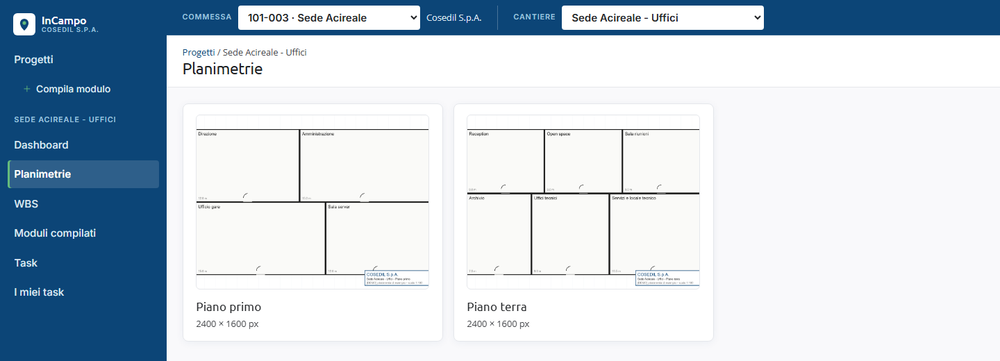

<!-- "><(((º> sabusabu <º)))>< -->
# 2. Commesse e cantieri

[Indice](README.md) · Precedente: [Entrare in InCampo](01-accesso.md) · Successivo: [Planimetrie e pin](03-planimetrie-e-pin.md)

## La pagina Progetti

Clicca **Progetti** nel menu a sinistra. I cantieri sono raggruppati per commessa:
sopra ogni gruppo vedi codice e committente (es. *101-003 · Cosedil S.p.A.*), il nome
della commessa e i suoi **parametri** (Tipologia lavori, Procedura, Fase).

- Clicca un **riquadro di cantiere** per aprirlo: si apre la pagina delle sue planimetrie.
- I menu in alto (**Tipologia lavori**, **Procedura**, **Fase**) filtrano le commesse;
  a destra c'è il conteggio (es. *2 commesse · 4 cantieri*).
- Chi è *Cantiere* vede solo le commesse in cui ha almeno un cantiere e non ha i
  pulsanti per creare o modificare.
- I cantieri non legati a una commessa stanno nel gruppo **Cantieri non associati**.

## La barra Commessa / Cantiere

In cima a ogni pagina c'è la barra blu con due menu a tendina:

- **Commessa**: scegli la commessa (o *Tutte le commesse*). Se la commessa ha un solo
  cantiere, InCampo lo apre direttamente; altrimenti mostra la pagina Progetti filtrata.
  Accanto compare il nome del committente.
- **Cantiere**: elenca i cantieri della commessa scelta (*Scegli un cantiere (2)*).
  Scegliendone uno, se stavi guardando **Dashboard**, **Task** o **WBS** resti sulla
  stessa sezione del nuovo cantiere; dalle altre pagine vai alle sue planimetrie.

Se apri un cantiere da un link (per esempio dalla home del Portale), la barra si
allinea da sola alla commessa giusta.

## Creare una commessa (Ufficio, Amministratore)

1. In **Progetti** clicca **+ Nuova commessa** (in alto a destra).
2. **Codice commessa**: se la suite ha il registro delle commesse, il codice si sceglie
   dal menu *— scegli dal registro della suite —*: così è lo stesso codice di SkyTower e
   del Magazzino. Se il registro è vuoto, si scrive a mano (es. `C-2026-014`).
3. **Committente** (es. *Comune di Acireale*) e **Oggetto** (il nome della commessa).
4. **Parametri**: clicca le voci che valgono per questa commessa (si colorano di blu).
   *Tipologia lavori* ammette più scelte, *Procedura* e *Fase* una sola.
5. Clicca **Crea commessa**. Compare il messaggio verde *Commessa ... creata*.

Per cambiarla clicca **Modifica** accanto alla commessa: nella stessa finestra c'è
anche **Archivia** (chiede conferma: *Archiviare la commessa ...? Sparisce dalla barra,
i cantieri restano.*).

## Aggiungere un cantiere (Ufficio, Amministratore)

1. Clicca **+ Cantiere** accanto alla commessa (oppure **+ Nuovo cantiere** in alto).
2. Scrivi **Nome cantiere** e **Indirizzo**; nel menu **Commessa** controlla che sia
   quella giusta (o *— nessuna —*).
3. Clicca **Crea cantiere**. Compare *Cantiere ... creato*.

Il passo successivo è caricare le planimetrie (capitolo 3) e far entrare le persone
con un invito (capitolo 9).

## Dentro un cantiere

Aperto un cantiere, il menu a sinistra mostra le sue pagine. La prima che vedi è
**Planimetrie**, con un riquadro per ogni pianta caricata:

Clicca una planimetria per aprirla.
