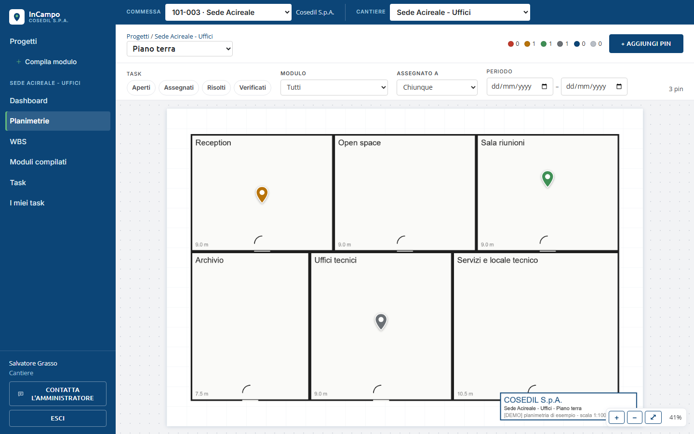
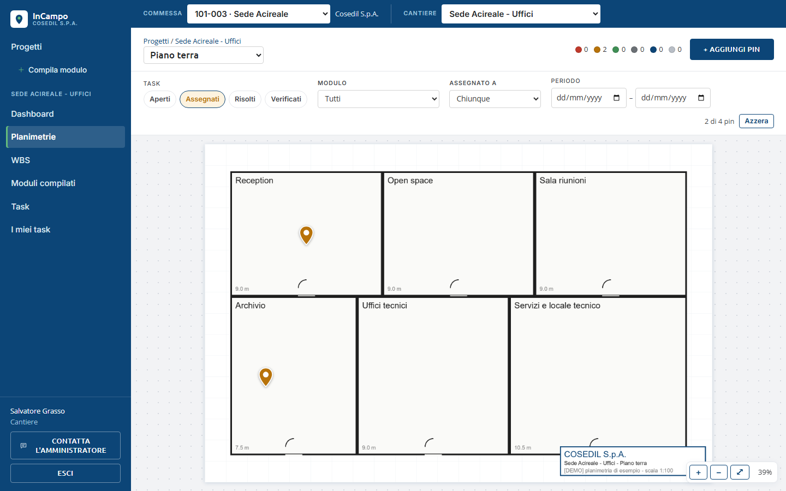
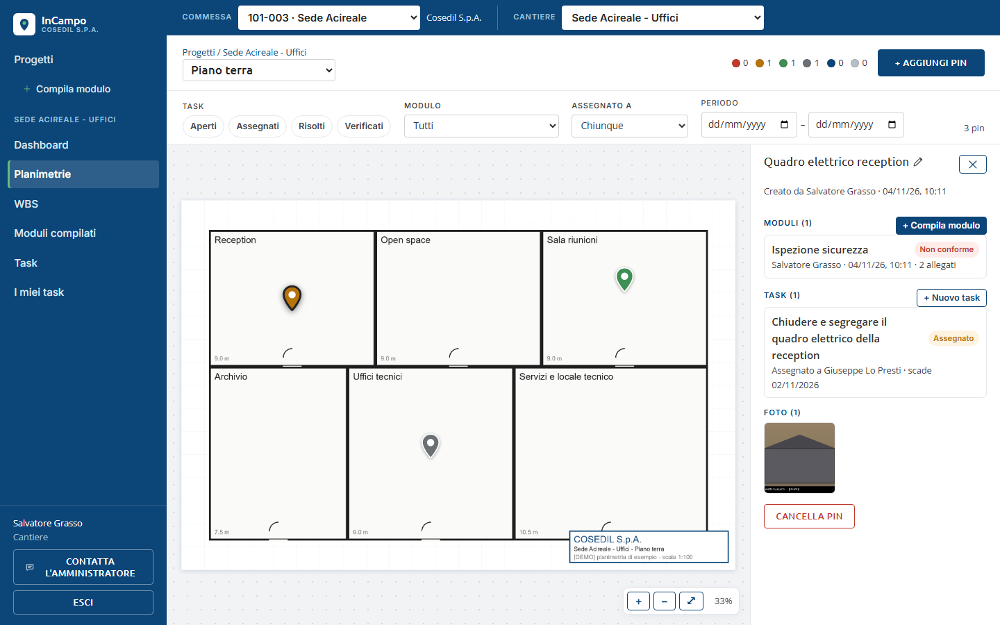
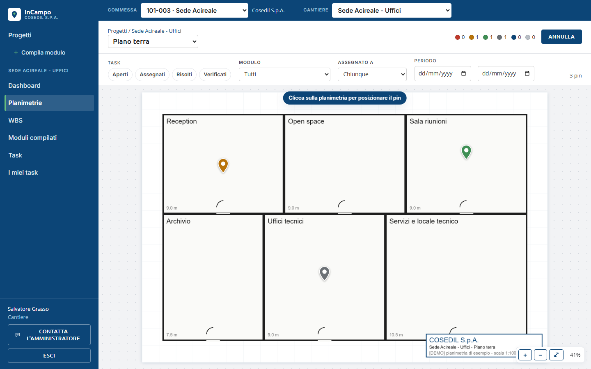
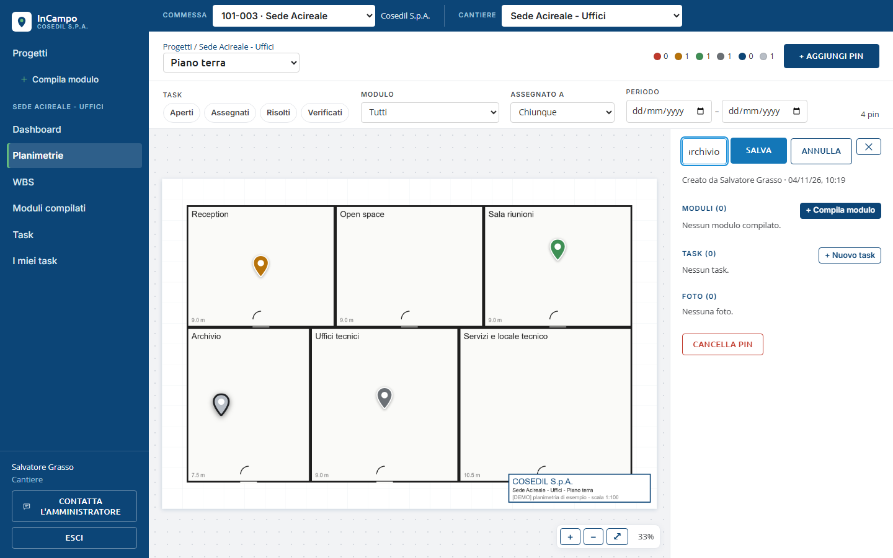
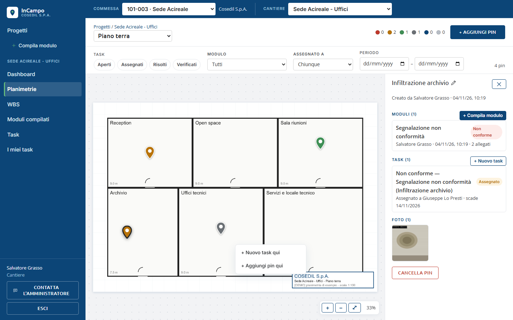
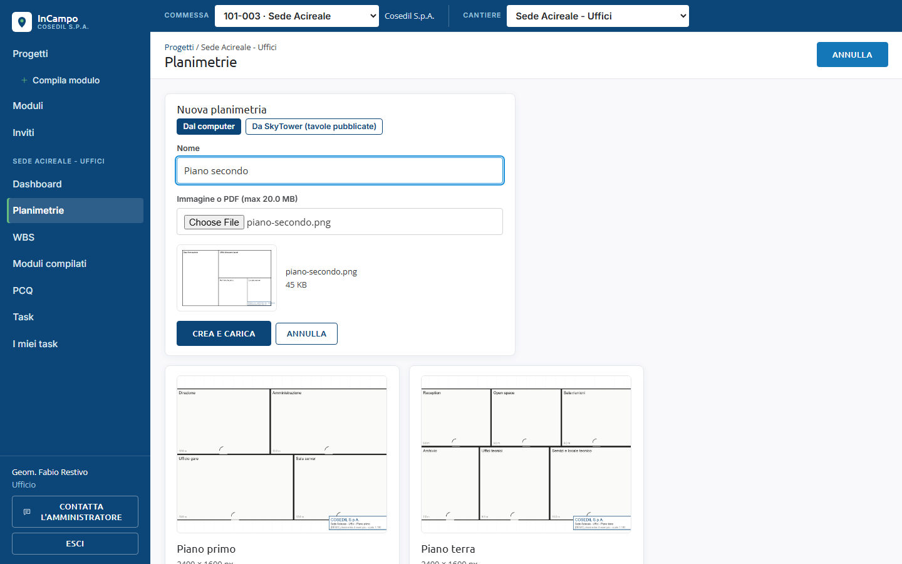
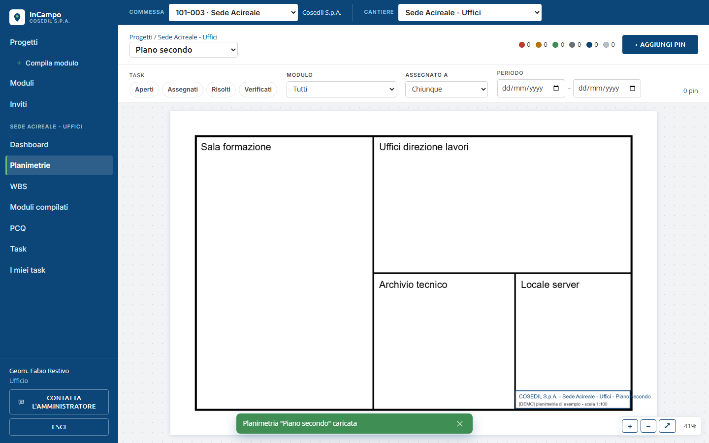

<!-- "><(((º> sabusabu <º)))>< -->
# 3. Planimetrie e pin

[Indice](README.md) · Precedente: [Commesse e cantieri](02-commesse-e-cantieri.md) · Successivo: [Compilare un modulo](04-moduli.md)

## La planimetria

Apri un cantiere, poi **Planimetrie** e clicca la pianta che ti serve.

- **In alto a sinistra** il percorso (*Progetti / nome cantiere*) e il menu con il nome
  della planimetria: da lì passi a un altro piano senza tornare indietro.
- **Muoversi**: rotella del mouse per avvicinare o allontanare, trascina con il mouse
  per spostarti. In basso a destra i pulsanti **+** (zoom avanti), **−** (zoom indietro),
  **⤢** (adatta allo schermo) e la percentuale di zoom.
- **I pin** sono le gocce colorate. Passandoci sopra col mouse vedi il nome.

### Cosa dice il colore del pin

In alto a destra c'è la legenda con quanti pin ci sono per colore. Il colore è quello
della situazione più urgente del pin:

| Colore | Significato |
|---|---|
| rosso | c'è almeno un task **Aperto** (nessuno se ne sta occupando) |
| arancione | task **Assegnato** a qualcuno, non ancora risolto |
| verde | task **Risolto**, in attesa di verifica dell'ufficio |
| grigio scuro | task **Verificato** (chiuso) |
| blu | nessun task, solo **moduli** compilati |
| grigio chiaro | pin **vuoto** |

### Filtrare i pin

Sotto il titolo ci sono i filtri:

- **Task**: clicca *Aperti*, *Assegnati*, *Risolti* o *Verificati* (anche più di uno).
- **Modulo**: mostra solo i pin con un certo tipo di modulo.
- **Assegnato a**: solo i pin con task di una persona.
- **Periodo**: dal giorno... al giorno...

A destra compare *N di M pin* e il pulsante **Azzera** per togliere i filtri.
I filtri restano anche cambiando planimetria dal menu in alto, utile per confrontare i piani.

## Aprire un pin

Clicca un pin: a destra si apre il suo **pannello**.

Nel pannello trovi:

- il **nome** del pin (clicca sul nome o sulla matita per rinominarlo), chi l'ha creato e quando;
- **Moduli (N)** con il pulsante **+ Compila modulo**: ogni modulo compilato è una riga
  cliccabile; quelli con esito negativo hanno l'etichetta rossa *Non conforme*;
- **Task (N)** con il pulsante **+ Nuovo task**: per ogni task stato, assegnatario e scadenza;
- **Foto (N)**: tutte le foto dei moduli e dei task del pin;
- **Cancella pin** (solo per chi l'ha creato e per l'Ufficio). Chiede conferma:
  *Cancellare il pin con tutti i moduli, task e foto collegati?*

Per chiudere il pannello clicca la **X** in alto oppure premi **Esc**.

## Aggiungere un pin

1. Clicca **+ Aggiungi pin** (in alto a destra). Il pulsante diventa **Annulla** e sulla
   pianta compare l'avviso *Clicca sulla planimetria per posizionare il pin*.

   

2. Clicca il punto esatto sulla pianta. Il pin nasce grigio chiaro e si apre il suo pannello.
3. Clicca sul titolo *Pin senza etichetta*, scrivi un nome che si capisca anche da chi
   non è in cantiere (es. *Infiltrazione archivio*) e clicca **Salva**.

   

4. Ora puoi compilare un modulo sul pin (capitolo 4) o aprire un task (capitolo 5).

**Spostare un pin**: trascinalo con il mouse nel punto giusto; la posizione si salva
al rilascio.

## Il menu del tasto destro

Con il **tasto destro** del mouse sulla planimetria si apre un piccolo menu:

- su un punto vuoto: **+ Nuovo task qui** (crea pin e task in un colpo solo) e
  **+ Aggiungi pin qui**;
- sopra un pin: **+ Nuovo task su questo pin** e **Apri pin**.

## Caricare una planimetria (Ufficio, Amministratore)

1. Nel cantiere apri **Planimetrie** e clicca **+ Nuova planimetria**.
2. Scegli da dove arriva:
   - **Dal computer**: scrivi il **Nome** (es. *Piano secondo*) e scegli il file
     (**Immagine o PDF**, al massimo 20 MB). Vedi un'anteprima; di un PDF viene usata
     solo **la prima pagina**. Clicca **Crea e carica**: la barra mostra
     *Caricamento N%* e poi *Elaborazione sul server…*.
   - **Da SkyTower (tavole pubblicate)**: se la commessa esiste anche in SkyTower, scegli
     una tavola pubblicata dall'elenco (puoi filtrare per titolo o codice) e clicca
     **Crea da SkyTower**. InCampo scarica la tavola e la tratta come un file caricato.

   

3. Finito il caricamento si apre la planimetria e compare *Planimetria "..." caricata*.

Una planimetria creata senza file si può completare più tardi: aprendola, l'Ufficio
vede il riquadro **File per "..."** con il pulsante **Carica file**. Chi è *Cantiere*
non può caricare planimetrie.
