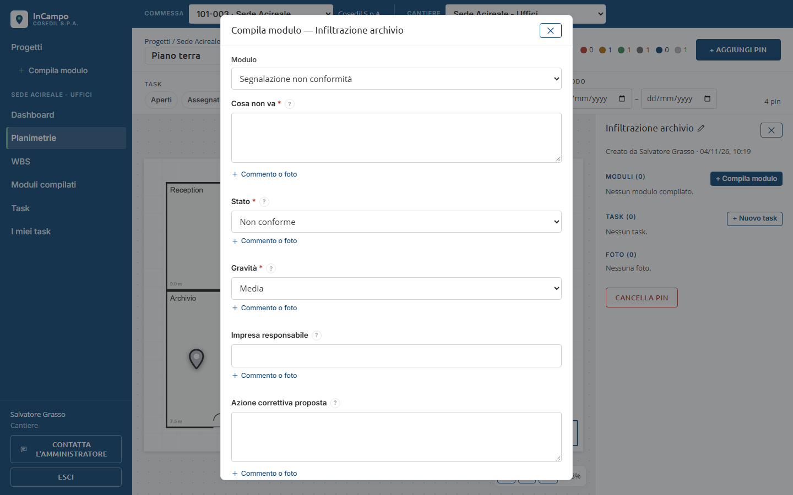
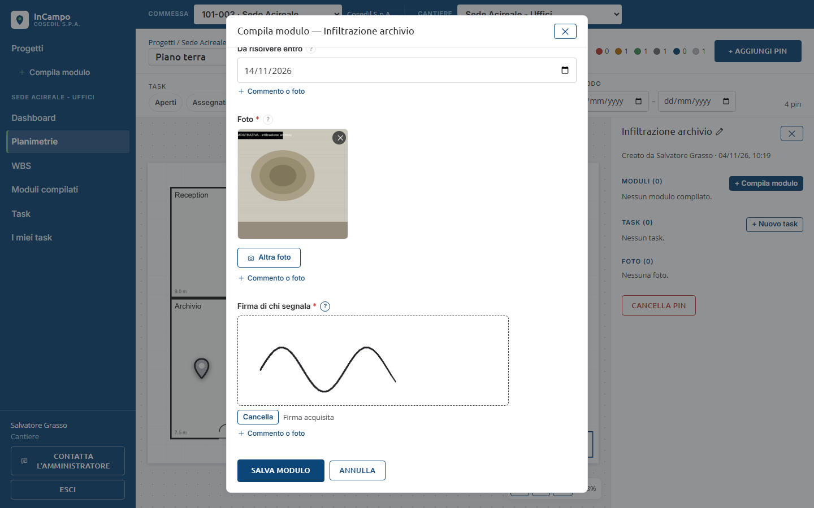
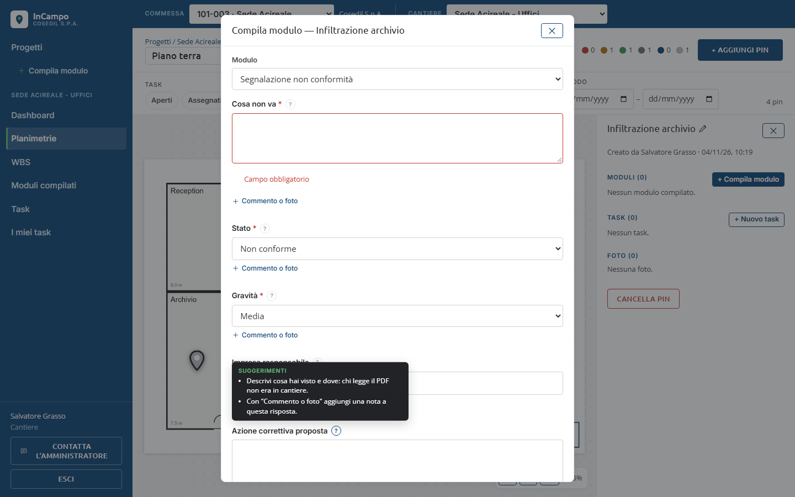
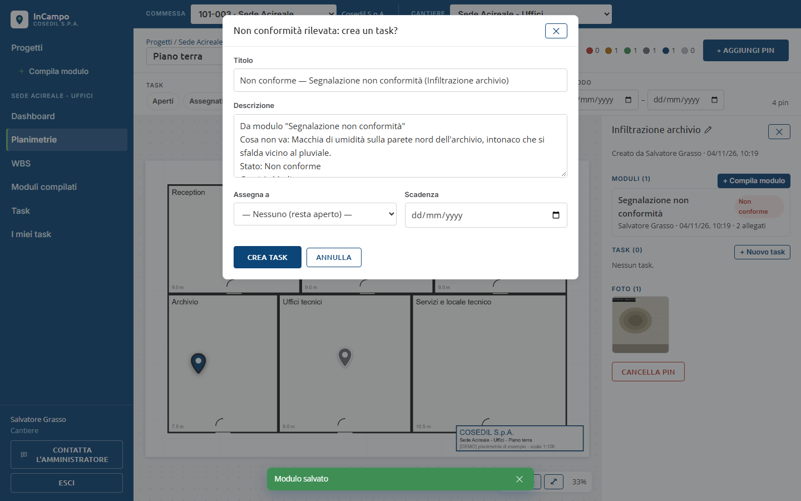
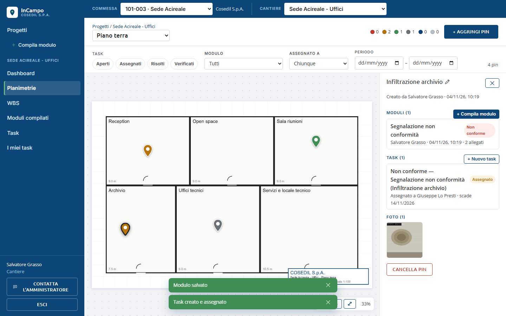
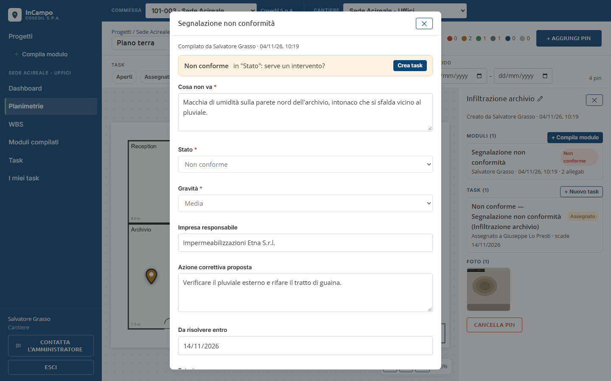
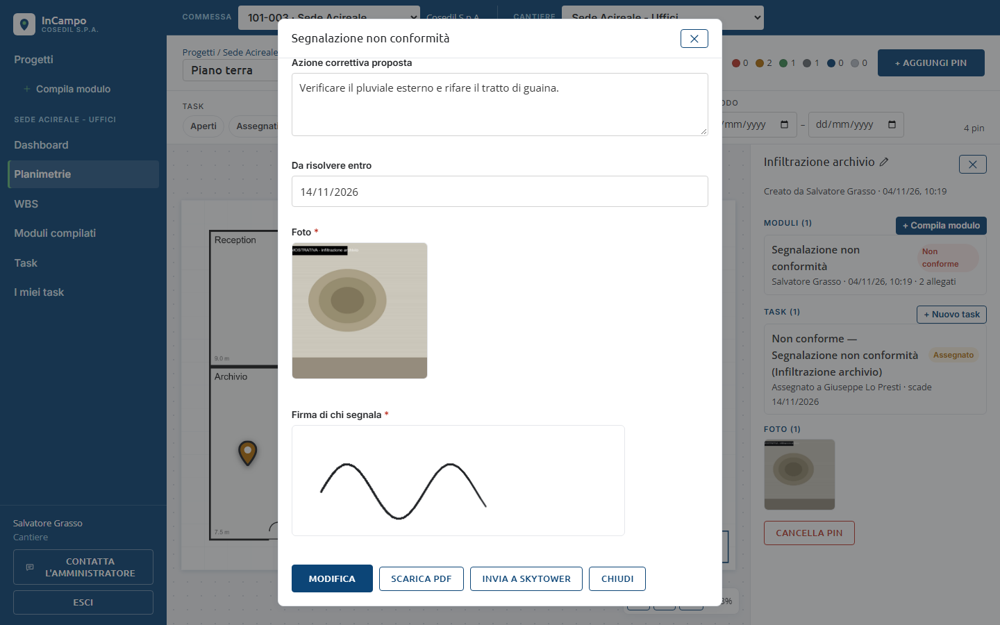
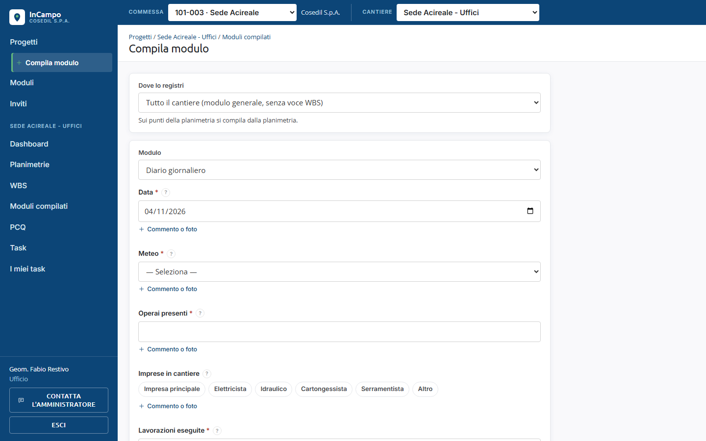
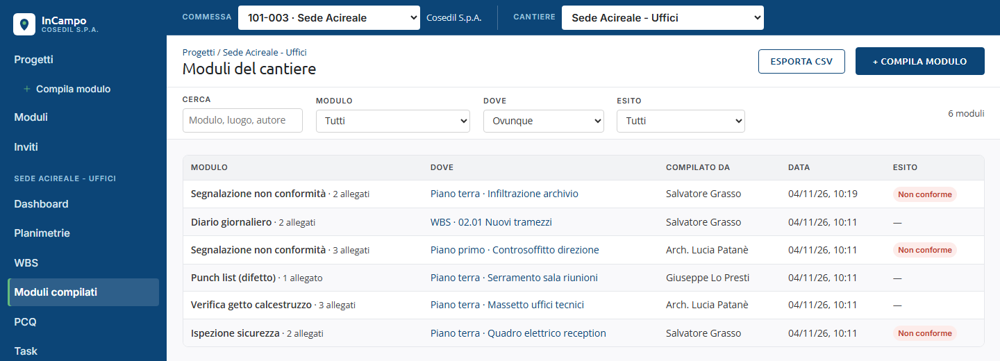

<!-- "><(((º> sabusabu <º)))>< -->
# 4. Compilare un modulo

[Indice](README.md) · Precedente: [Planimetrie e pin](03-planimetrie-e-pin.md) · Successivo: [Task](05-task.md)

Un modulo si può legare a tre cose diverse:

- a un **pin** della planimetria (un punto preciso: il quadro elettrico, una finestra);
- a una **voce della WBS** (una lavorazione: *02.01 Nuovi tramezzi*), vedi capitolo 6;
- a **tutto il cantiere** (modulo generale, es. il diario giornaliero).

## Compilare su un pin

1. Apri la planimetria e clicca il pin (o creane uno, capitolo 3).
2. Nel pannello del pin clicca **+ Compila modulo**.
3. Nella finestra *Compila modulo — nome del pin* scegli il **Modulo** dal menu.
   Sotto compaiono i suoi campi.

### Come si compilano i campi

- L'**asterisco rosso** (*) indica un campo obbligatorio: senza risposta il modulo non si salva.
- Il pulsante **?** accanto al nome del campo (o restare un attimo col mouse sopra il
  campo) mostra i **Suggerimenti**: cosa scrivere, se è obbligatorio, quante scelte ci sono.
- **Testo**: scrivi descrivendo cosa hai visto e dove: chi legge il PDF non era in cantiere.
- **Scelta singola**: menu a tendina. **Scelta multipla**: pulsanti da cliccare (diventano
  blu); clicca di nuovo per togliere.
- **Sì/No**: casella da spuntare (vuota vale "No").
- **Data**: scegli dal calendario; alcune sono già compilate con la data di oggi.
- **Foto**: **Aggiungi foto** apre la scelta del file (su tablet e telefono anche la
  fotocamera); con **Altra foto** ne aggiungi altre; la **x** sulla miniatura la toglie.
- **Firma**: firma con mouse, penna o dito nel riquadro tratteggiato; quando c'è scrive
  *Firma acquisita*. **Cancella** per rifarla.
- **Posizione GPS**: **Posizione attuale** usa la posizione del dispositivo (il browser
  chiede il permesso); se dice *Permesso negato: inserisci le coordinate a mano*, scrivi
  *Lat* e *Lng*.
- **+ Commento o foto** sotto ogni campo: aggiunge una **nota** a quella risposta
  (un commento e, se serve, una foto di dettaglio).

4. Clicca **Salva modulo** in fondo. Il pulsante mostra *Salvataggio…*; poi compare il
   messaggio verde **Modulo salvato**.

### Se manca qualcosa

Se un campo obbligatorio è vuoto o un valore non va bene, il modulo non si salva: il
campo diventa rosso con la spiegazione (es. **Campo obbligatorio**, *Deve essere un
numero*, *Firma mancante*), la pagina scorre al primo errore e accanto ai pulsanti
compare *N campi da correggere*.

Se il modulo è salvato ma una foto non è passata, compare in rosso *Modulo salvato ma
1 allegato non caricato*: riapri il modulo con **Modifica** e riaggiungi la foto.

### Le bozze

Mentre compili, InCampo tiene una **bozza** nel browser. Se chiudi la finestra prima di
salvare, la prossima volta che apri lo stesso modulo sullo stesso punto trovi l'avviso
*Bozza ripresa da dove l'avevi lasciata (...). Foto e firma vanno riaggiunte.* e il
pulsante **Scarta bozza** per ricominciare da zero. La bozza vale solo su quel
computer e quel browser.

## La non conformità diventa un task

Se in un campo a scelta selezioni **Non conforme** (o un'opzione simile), dopo il
salvataggio si apre da sola la finestra **Non conformità rilevata: crea un task?**,
già compilata con titolo e descrizione presi dal modulo.

1. Correggi il **Titolo** se serve (meglio un'azione: *Rifare la guaina...*).
2. **Assegna a**: scegli chi deve intervenire, oppure lascia *— Nessuno (resta aperto) —*.
3. **Scadenza**: la data entro cui va risolto.
4. Clicca **Crea e assegna** (o **Crea task** se non hai scelto nessuno).

Compare *Task creato e assegnato*; il pin diventa arancione (rosso se nessuno è assegnato)
e l'ufficio riceve la notifica della non conformità.

Se chiudi la finestra con **Annulla**, il task si può creare dopo dal dettaglio del modulo.

## Rivedere un modulo compilato

Clicca la riga del modulo nel pannello del pin (o nella pagina *Moduli compilati*).
Si apre il modulo in sola lettura, con chi l'ha compilato e quando. Se c'è una non
conformità, in alto c'è il riquadro giallo **Non conforme in "..." : serve un
intervento?** con il pulsante **Crea task**.

In fondo ci sono i pulsanti:

- **Modifica**: per chi ha compilato il modulo e per l'Ufficio. Si salva con **Salva modifiche**
  (*Modulo aggiornato*).
- **Crea task da questo modulo**: compare quando non c'è non conformità.
- **Scarica PDF**: il modulo in PDF, con foto e firma (*Preparo il PDF…*).
- **Invia a SkyTower**: dopo la conferma *Caricare il PDF di questo modulo su SkyTower come
  documento della commessa?* il PDF diventa un documento della commessa in SkyTower
  (messaggio *Caricato su SkyTower: ...*). Serve che la commessa esista anche in SkyTower
  e che SkyTower sia acceso; altrimenti compare un errore, es. *SkyTower non raggiungibile*.
- **Chiudi**.

## Compilare senza pin: modulo generale o su voce WBS

Usa **+ Compila modulo** nel menu a sinistra (o il pulsante **+ Compila modulo** nella
pagina *Moduli compilati*).

1. Se non sei dentro un cantiere, InCampo chiede prima **In quale cantiere?**.
2. **Dove lo registri**: *Tutto il cantiere (modulo generale, senza voce WBS)* oppure
   una voce della WBS. Per i punti della planimetria si compila dalla planimetria.
3. Scegli il **Modulo**, compila e clicca **Salva modulo**. Con **Annulla** torni indietro.

## La pagina Moduli compilati

Nel cantiere clicca **Moduli compilati**: l'elenco di tutti i moduli del cantiere.

- Colonne: **Modulo** (con il numero di allegati), **Dove** (planimetria e pin, voce WBS
  o generale: cliccando vai al punto), **Compilato da**, **Data**, **Esito**
  (*Non conforme* in rosso).
- Filtri: **Cerca** (modulo, luogo, autore), **Modulo**, **Dove** (*Planimetrie*, *Voci WBS*,
  *Generale del cantiere*), **Esito** (*Con non conformità*).
- **Esporta CSV** scarica le righe filtrate con le risposte di ogni modulo (si apre con Excel).
- Clicca una riga per aprire il modulo.
