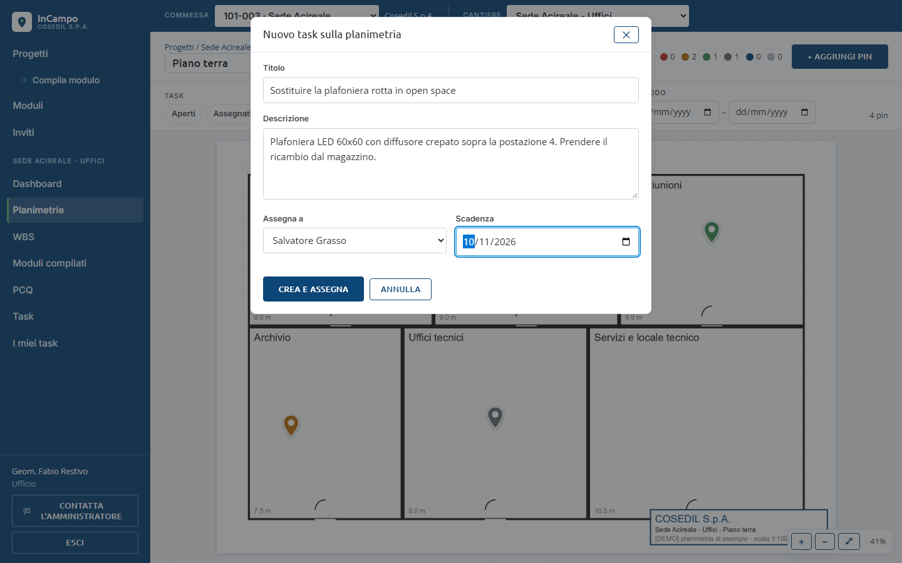
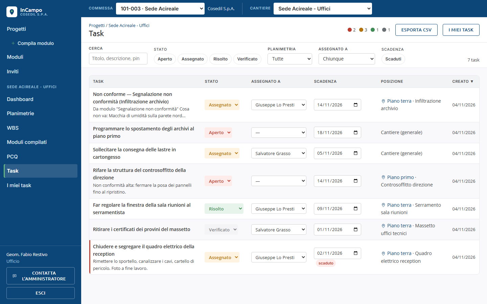
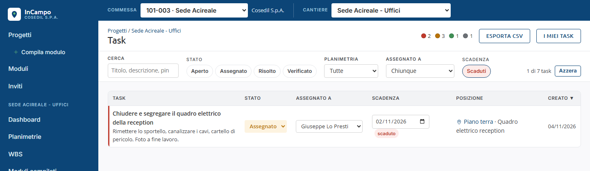
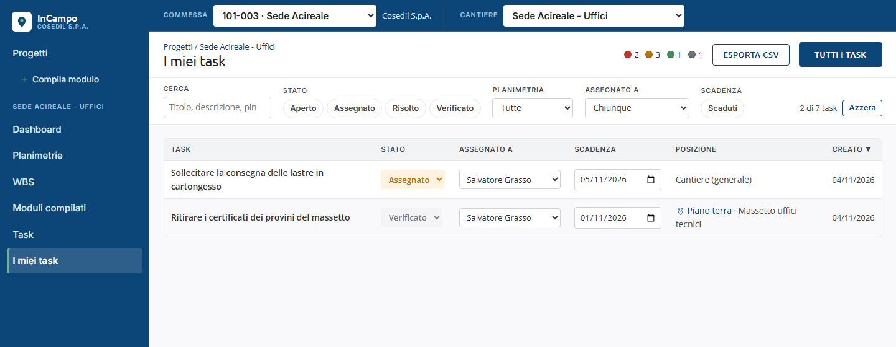

<!-- "><(((º> sabusabu <º)))>< -->
# 5. Task

[Indice](README.md) · Precedente: [Compilare un modulo](04-moduli.md) · Successivo: [WBS e PCQ](06-wbs-e-pcq.md)

Un task è una cosa da fare: *Chiudere e segregare il quadro elettrico della reception*.
Ha un **titolo**, una **descrizione**, chi lo deve fare (**assegnatario**), una
**scadenza** e uno **stato**.

## Il ciclo di un task

| Stato | Significa | Chi lo porta avanti |
|---|---|---|
| **Aperto** | c'è da fare, nessuno se ne occupa ancora | — |
| **Assegnato** | una persona ci sta lavorando | chi assegna il task |
| **Risolto** | il lavoro è fatto, va controllato | chi ha fatto il lavoro |
| **Verificato** | l'ufficio ha controllato: il task è chiuso | solo **Ufficio** e **Amministratore** |

Da *Assegnato* e da *Risolto* si può tornare ad *Aperto* (lavoro da rifare).
Un task *Verificato* non cambia più.

## Creare un task

Un task nasce in quattro modi:

- dal pannello di un pin: **+ Nuovo task**;
- con il tasto destro sulla planimetria: **+ Nuovo task qui** (crea anche il pin) o
  **+ Nuovo task su questo pin**;
- dalla proposta automatica dopo una **non conformità** (capitolo 4);
- dal dettaglio di un modulo: **Crea task** / **Crea task da questo modulo** (anche per
  moduli su voce WBS o generali: il task resta "sul cantiere").

La finestra è la stessa:

1. **Titolo**: cosa va fatto, in breve.
2. **Descrizione**: dettagli utili (dove, materiale, cosa fotografare a fine lavoro).
3. **Assegna a**: una persona del cantiere, oppure *— Nessuno (resta aperto) —*.
4. **Scadenza**: dal calendario.
5. **Crea e assegna** (o **Crea task**). Compare *Task creato e assegnato* (o *Task creato*).

La persona assegnata riceve una notifica (email, se configurata, e sull'app).

## La pagina Task

Nel cantiere clicca **Task**.

- **In alto a destra**: i pallini colorati con quanti task ci sono per stato,
  **Esporta CSV** (tutti i task del filtro, fino a 5000, in un file per Excel) e
  **I miei task** / **Tutti i task** per passare dai tuoi a tutti.
- **Filtri**: **Cerca** (titolo, descrizione, pin), **Stato** (Aperto, Assegnato,
  Risolto, Verificato), **Planimetria**, **Assegnato a**, **Scadenza → Scaduti**.
  **Azzera** li toglie.
- **Colonne**: clicca l'intestazione per ordinare (la freccia ▼ indica l'ordine).
  **Posizione** dice dove sta il task: *Piano terra · nome del pin* (clicca per aprire la
  planimetria centrata sul pin), *WBS · voce* oppure *Cantiere (generale)*.
- Con molti task, in fondo ci sono i pulsanti per andare alla pagina successiva.

### Cambiare stato, assegnatario e scadenza

Si fa direttamente nella riga, senza aprire niente:

- **Stato**: il menu colorato propone solo i passaggi permessi, con una freccia
  (es. *→ Risolto*, *→ Aperto*). *→ Verificato* lo vede solo l'Ufficio. *→ Assegnato*
  compare solo se il task ha già un assegnatario.
- **Assegnato a**: scegli la persona dal menu (o *—* per nessuno).
- **Scadenza**: cambia la data nel calendario.

La modifica si salva subito. Se il server la rifiuta, la riga torna com'era e compare
un messaggio rosso con il motivo.

### Task scaduti

Un task non risolto oltre la scadenza ha una **barra rossa** a sinistra e l'etichetta
**scaduto** sotto la data. Il filtro **Scaduti** li mostra tutti insieme:

## I miei task

**I miei task** nel menu del cantiere mostra solo i task assegnati a te. È la lista
da guardare ogni mattina. Gli stessi task (prima gli scaduti) compaiono anche nella
home del Portale, nel riquadro delle cose da fare.

Quando hai finito un lavoro, porta il task a **→ Risolto** (sull'app del telefono puoi
allegare una foto della risoluzione, capitolo 11). Chi ha creato il task riceve la
notifica; l'ufficio controlla e lo porta a **Verificato**.
