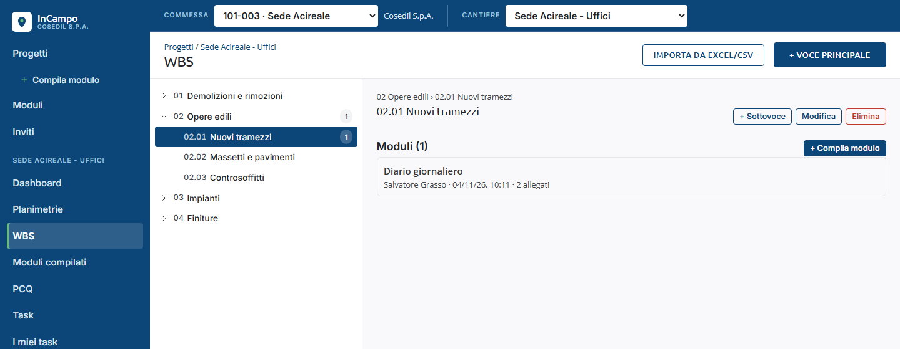
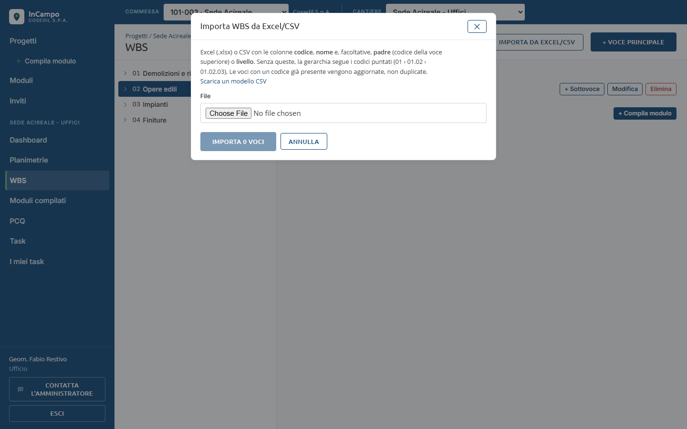
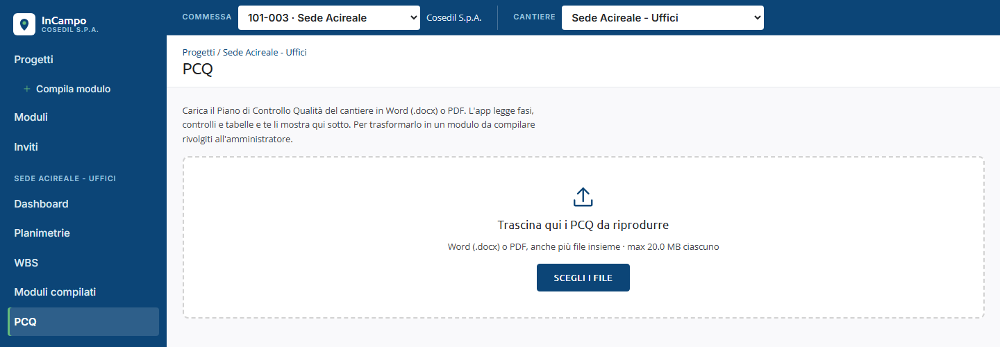

<!-- "><(((º> sabusabu <º)))>< -->
# 6. WBS e PCQ

[Indice](README.md) · Precedente: [Task](05-task.md) · Successivo: [Dashboard](07-dashboard.md)

## La WBS del cantiere

La WBS è l'elenco ad albero delle lavorazioni (es. *01 Demolizioni e rimozioni*,
*02 Opere edili › 02.01 Nuovi tramezzi*). Serve a registrare moduli che riguardano una
lavorazione e non un punto preciso della pianta: un diario sulla posa dei tramezzi,
una verifica sui massetti.

Nel cantiere clicca **WBS**.

- **A sinistra** l'albero: la freccia **›** apre e chiude le sottovoci; il numero nel
  cerchietto conta i moduli compilati sulla voce e sulle sue sottovoci.
- **Clicca una voce** per vederla a destra: il percorso (*02 Opere edili › 02.01 Nuovi
  tramezzi*), i **Moduli (N)** compilati su di essa (clicca per aprirli) e il pulsante
  **+ Compila modulo**, che apre la pagina di compilazione con la voce già scelta in
  *Dove lo registri*.

### Costruire la WBS (Ufficio, Amministratore)

- **+ Voce principale** (in alto a destra) crea una voce di primo livello; nella voce
  selezionata **+ Sottovoce** ne crea una dentro. Si chiedono **Codice** (es. `01.02`) e **Nome**.
- **Modifica** cambia codice e nome; **Elimina** chiede conferma
  (*Eliminare la voce "..."?*) e mostra *Voce eliminata*.
- **Importa da Excel/CSV** carica tutta la WBS da un file:

1. Il file (Excel `.xlsx` o CSV) deve avere le colonne **codice** e **nome**; facoltative
   **padre** (codice della voce superiore) o **livello**. Senza queste, la gerarchia
   segue i codici puntati (01 › 01.02 › 01.02.03). **Scarica un modello CSV** dà un
   esempio pronto.
2. Scegli il file: InCampo mostra cosa ha letto e il pulsante diventa **Importa N voci**.
3. Clicca il pulsante: *WBS importata: N nuove, M aggiornate* (le voci con un codice già
   presente vengono aggiornate, non duplicate; le righe sbagliate vengono saltate e contate).

Chi è *Cantiere* vede la WBS e ci compila moduli, ma non la modifica. Se la WBS è vuota
legge *Chiedi a un responsabile di impostare la WBS.*

## Il PCQ del cantiere (Ufficio, Amministratore)

Il **PCQ** (Piano di Controllo Qualità) è il documento Word o PDF con le fasi e i
controlli da fare in cantiere. Nella pagina **PCQ** del cantiere InCampo lo legge e lo
mostra in modo ordinato.

1. Trascina i file nel riquadro **Trascina qui i PCQ da riprodurre**, oppure clicca
   **Scegli i file** (Word `.docx` o PDF, anche più file insieme, massimo 20 MB ciascuno).
2. Ogni file compare in elenco con lo stato (*in coda*, *caricamento N%*, *lettura…*),
   poi un riassunto di quello che è stato letto. **Anteprima** lo mostra sotto;
   la **x** lo toglie; **Svuota elenco** toglie tutto.
3. Solo l'**Amministratore** vede anche **Crea modulo**: il PCQ diventa un modello di
   modulo da compilare (un esito per controllo), da rivedere nell'editor prima di
   salvarlo (capitolo 8). L'Ufficio legge *Per trasformarlo in un modulo da compilare
   rivolgiti all'amministratore.*

Il Word funziona meglio del PDF: dal PDF si legge solo il testo e i PDF scansionati non
si leggono. Come deve essere fatto il file lo spiega la pagina *Moduli → Struttura PCQ*
(capitolo 8). Chi è *Cantiere* legge *Il caricamento dei PCQ è riservato ai responsabili.*
