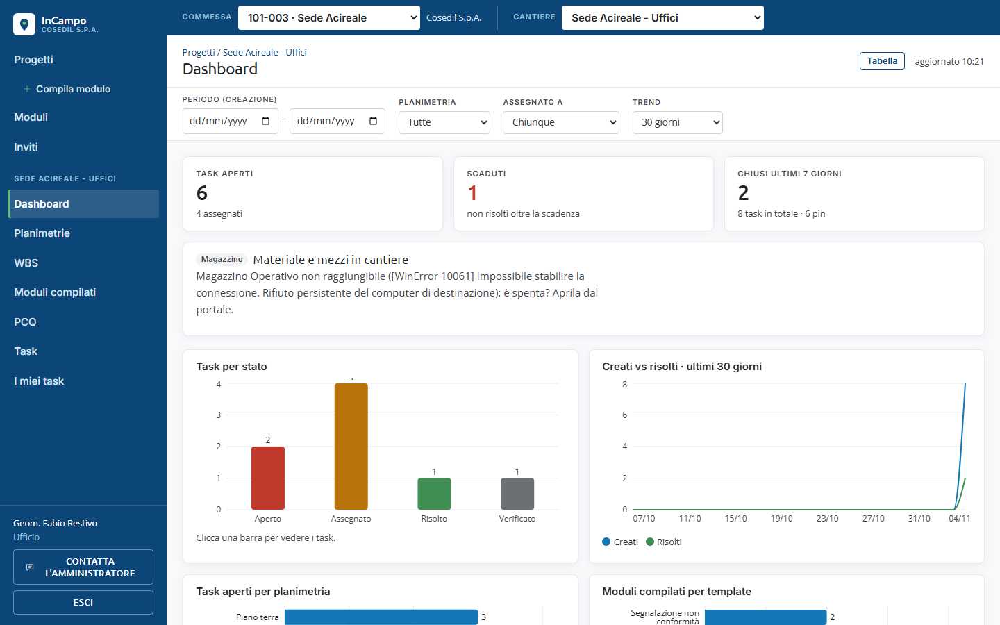
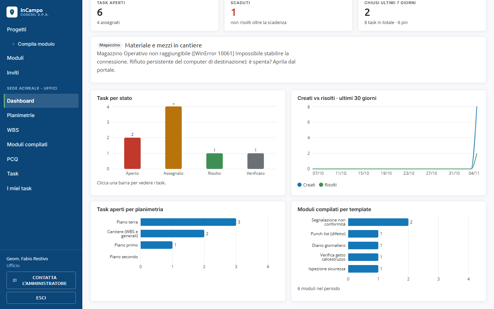

<!-- "><(((º> sabusabu <º)))>< -->
# 7. Dashboard

[Indice](README.md) · Precedente: [WBS e PCQ](06-wbs-e-pcq.md) · Successivo: [Modelli di modulo](08-modelli-di-modulo.md)

La dashboard è il riassunto del cantiere: quanti task ci sono, quanti sono in ritardo,
come vanno le cose nel tempo. Nel cantiere clicca **Dashboard**.

## Filtri

- **Periodo (creazione)**: conta solo task e moduli creati fra due date.
- **Planimetria**: solo quello che sta su una planimetria (i moduli e task su WBS o
  generali spariscono dal conteggio).
- **Assegnato a**: solo i task di una persona.
- **Trend**: quanti giorni mostrare nel grafico dell'andamento (14, 30 o 90).
- **Azzera** (compare quando c'è un filtro) li toglie.

In alto a destra *aggiornato hh:mm* dice quando sono stati calcolati i numeri; il
pulsante **Tabella** mostra gli stessi dati come tabella (**Grafici** per tornare indietro).

## I riquadri

- **Task aperti**: quanti non sono ancora risolti (e quanti di questi sono assegnati).
- **Scaduti**: quanti non sono risolti oltre la scadenza (in rosso).
- **Chiusi ultimi 7 giorni**: risolti nell'ultima settimana, con il totale dei task e dei pin.

## Materiale e mezzi in cantiere (dal Magazzino)

Se il cantiere è legato a una commessa che esiste anche nel **Magazzino**, il riquadro
*Magazzino · Materiale e mezzi in cantiere* mostra le giacenze di materiale e i mezzi
presenti, con il pulsante **Apri il Magazzino**. Con molti articoli, **Tutti i N articoli**
apre l'elenco completo.

Messaggi che puoi trovare al suo posto:

- *Il cantiere non è collegato a una commessa: scegline una dalla barra in alto.*
- *Magazzino Operativo non raggiungibile (...): è spenta? Aprila dal portale.*: il
  Magazzino è spento; aprilo dal Portale e ricarica la pagina. Il testo tra parentesi è
  un dettaglio tecnico, si può ignorare.

## I grafici

- **Task per stato**: le colonne Aperto, Assegnato, Risolto, Verificato.
  **Clicca una colonna** per aprire la pagina Task già filtrata su quello stato.
- **Creati vs risolti**: l'andamento giorno per giorno (blu creati, verde risolti).
  Se la linea blu sta sempre sopra la verde, i problemi si accumulano.
- **Task aperti per planimetria**: dove si concentrano i problemi. Clicca una barra per
  vedere i task aperti di quella planimetria. *Cantiere (WBS e generali)* raccoglie quelli
  non legati a un pin.
- **Moduli compilati per template**: quanti moduli di ogni tipo sono stati compilati nel periodo.
