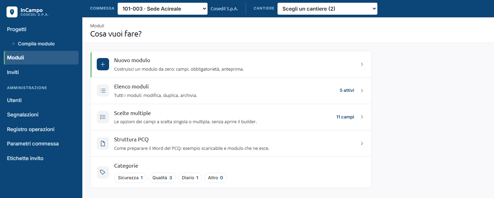
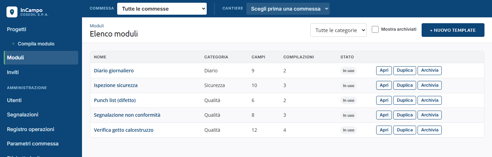
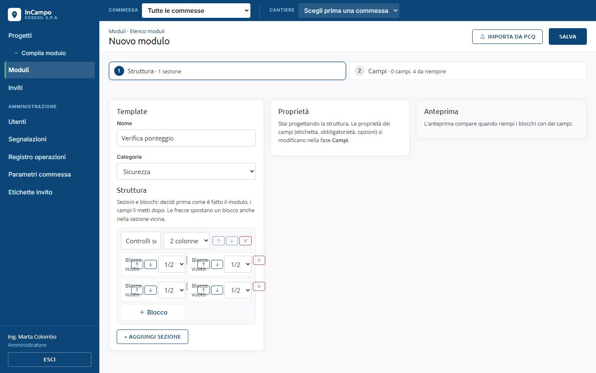
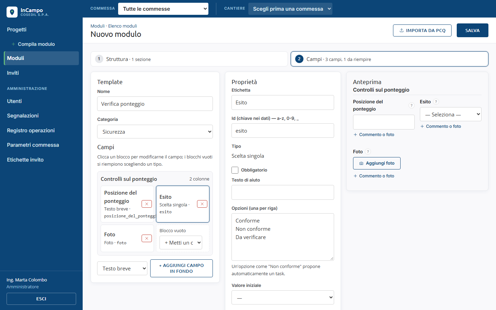
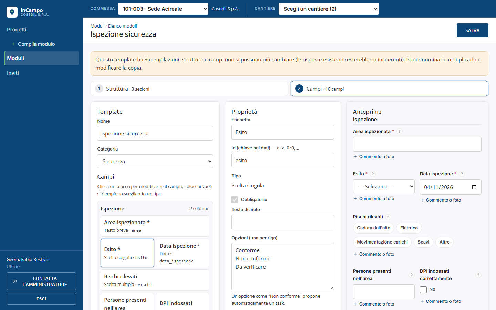
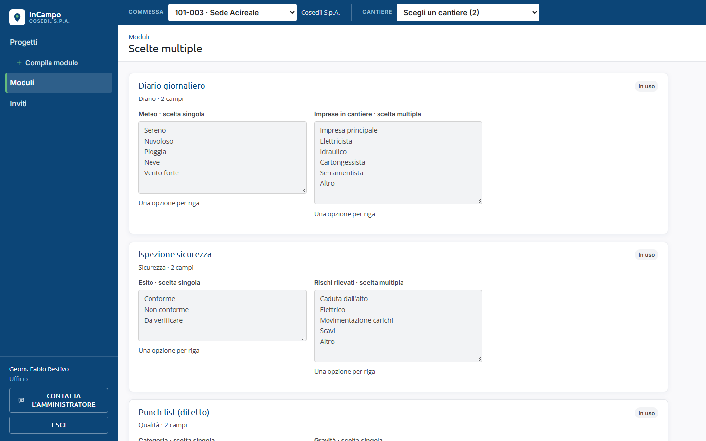
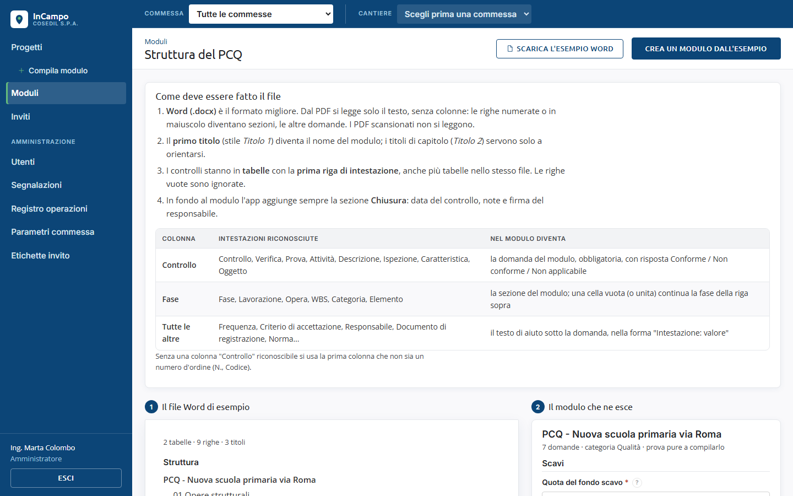

<!-- "><(((º> sabusabu <º)))>< -->
# 8. Modelli di modulo (Ufficio, Amministratore)

[Indice](README.md) · Precedente: [Dashboard](07-dashboard.md) · Successivo: [Inviti](09-inviti.md)

Un **modello** è la scheda vuota (es. *Ispezione sicurezza*) che poi si compila in cantiere.
I modelli valgono per tutti i cantieri.

Chi può fare cosa:

- **Amministratore**: crea modelli nuovi, li duplica, li importa da un PCQ, li modifica e li archivia.
- **Ufficio**: modifica e archivia i modelli esistenti, cambia le opzioni delle scelte.
- **Cantiere**: li compila e basta (nel menu non vede *Moduli*).

## La pagina Moduli

Clicca **Moduli** nel menu a sinistra: *Cosa vuoi fare?*

- **Nuovo modulo** (solo Amministratore): costruisci un modulo da zero.
- **Elenco moduli**: tutti i modelli, con quanti sono attivi.
- **Scelte multiple**: cambiare le opzioni dei campi a scelta senza aprire l'editor.
- **Struttura PCQ** (solo Amministratore): come preparare il Word del PCQ.
- **Categorie**: quanti modelli ci sono per *Sicurezza*, *Qualità*, *Diario*, *Altro*.

## Elenco moduli

- Colonne: **Nome**, **Categoria**, **Campi**, **Compilazioni**, **Stato** (*In uso* quando
  è già stato compilato almeno una volta).
- In alto: filtro **Tutte le categorie**, casella **Mostra archiviati** e, per
  l'Amministratore, **+ Nuovo template**.
- Su ogni riga: **Apri** (editor), **Duplica** (Amministratore; *Template duplicato:
  modifica la copia*), **Archivia** (*Template archiviato*: non si può più compilare, ma i
  moduli già compilati restano). Un modello archiviato si ripristina dalla vista *Mostra archiviati*.

## Costruire un modulo nuovo (Amministratore)

L'editor lavora in **due fasi**, che si possono ripetere quando si vuole: prima si
disegna la **Struttura**, poi si mettono i **Campi**. Le due schede in alto
(*1 Struttura · N sezioni*, *2 Campi · N campi*) passano dall'una all'altra.

### Fase 1: Struttura

1. Nel riquadro **Template** scrivi il **Nome** (es. *Verifica ponteggio*) e scegli la
   **Categoria**.
2. Ogni **sezione** ha un titolo facoltativo (es. *Controlli sul ponteggio*) e un numero
   di colonne (**1, 2 o 3 colonne**). Le frecce spostano la sezione, la **x** rossa la elimina.
3. **+ Blocco** aggiunge un riquadro vuoto nella sezione. Nel blocco le frecce lo spostano
   (anche nella sezione vicina) e il menu **1/2**, **1/3**... decide quanto è largo.
4. **+ Aggiungi sezione** aggiunge una sezione sotto.

Si può anche salvare un modulo con la sola struttura e riempirlo un altro giorno.

### Fase 2: Campi

1. Ogni blocco vuoto ha il menu **+ Metti un campo…**: scegli il tipo (*Testo breve*,
   *Testo lungo*, *Numero*, *Sì/No*, *Scelta singola*, *Scelta multipla*, *Data*, *Foto*,
   *Firma*, *Posizione GPS*). In fondo, **+ Aggiungi campo in fondo** con il tipo scelto
   nel menu accanto.
2. Clicca un blocco per vederne le **Proprietà** al centro:
   - **Etichetta**: il nome che legge chi compila;
   - **Id (chiave nei dati)**: nome tecnico (lettere minuscole, numeri, _). Si compila da solo;
   - **Obbligatorio**, **Testo di aiuto**;
   - per le scelte: **Opzioni (una per riga)**. *Un'opzione come "Non conforme" propone
     automaticamente un task.*;
   - per testi e numeri: lunghezza massima, minimo, massimo, **Valore iniziale**.
3. A destra l'**Anteprima** mostra il modulo come lo vedrà chi lo compila.
4. Clicca **Salva** in alto a destra: *Template creato*. Se manca il nome compare
   *Dai un nome al template*; se un campo ha un problema, *Correggi i campi segnalati
   prima di salvare*.

Sul telefono le colonne si richiudono una sotto l'altra; nel PDF ogni campo sta su una riga.

**Importa da PCQ** (in alto, solo Amministratore): carica il Word del PCQ e trasforma
i suoi controlli in campi (*PCQ importato: N controlli. Rivedi e salva.*).

## Modificare un modulo già compilato

Un modello già compilato **non cambia più struttura e campi**: le risposte esistenti
diventerebbero incoerenti. Aprendolo compare l'avviso giallo *Questo template ha N
compilazioni: struttura e campi non si possono più cambiare...*. Si può cambiare il
nome; per il resto l'Amministratore usa **Duplica e modifica** (*Copia creata: ora puoi
modificarla*) e poi archivia il vecchio.

## Scelte multiple

Qui si cambiano le opzioni dei campi a scelta di tutti i modelli, una per riga.

Per i modelli non ancora compilati modifica le righe e clicca **Salva** (*Scelte salvate:
nome*). I modelli **In uso** hanno le opzioni in grigio: l'Amministratore vede
**Duplica e modifica**.

## Struttura PCQ (Amministratore)

La pagina spiega come deve essere fatto il Word del PCQ perché InCampo lo legga bene
(primo titolo = nome del modulo, controlli in tabelle con la riga di intestazione,
colonne *Controllo*, *Fase* e altre) e mostra un esempio: a sinistra il Word, a destra
il modulo che ne esce. **Scarica l'esempio Word** dà il file di prova;
**Crea un modulo dall'esempio** lo apre nell'editor.

