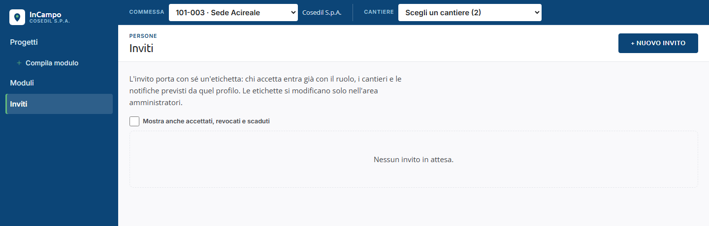
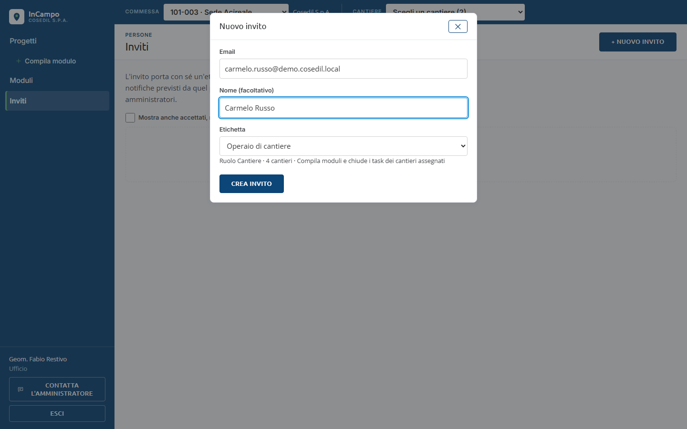
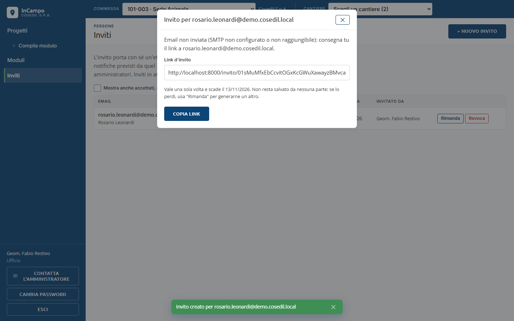

<!-- "><(((º> sabusabu <º)))>< -->
# 9. Inviti (Ufficio, Amministratore)

[Indice](README.md) · Precedente: [Modelli di modulo](08-modelli-di-modulo.md) · Successivo: [Amministrazione](10-amministrazione.md)

Per far entrare una persona nuova (un operaio, un direttore lavori esterno) non serve
creare l'utente a mano: le si manda un **invito**. L'invito porta con sé
un'**etichetta**, cioè un profilo già pronto (ruolo, cantieri o commesse, notifiche).
Chi accetta entra già con quei permessi. Le etichette le prepara l'Amministratore
(capitolo 10); chi invita le sceglie e basta.

Chi entra dal Portale non ha bisogno di inviti: l'account InCampo si crea da solo
(capitolo 1). L'invito serve soprattutto a chi non ha un utente del Portale.

## La pagina Inviti

Clicca **Inviti** nel menu a sinistra.

- L'elenco mostra gli inviti **in attesa**: email e nome, **Etichetta**, **Ruolo**,
  **Stato**, **Scadenza**, **Invitato da**. L'Ufficio vede gli inviti mandati da sé,
  l'Amministratore tutti.
- **Mostra anche accettati, revocati e scaduti** fa vedere lo storico.
- **Etichette** (solo Amministratore) porta alla gestione delle etichette.

## Mandare un invito

1. Clicca **+ Nuovo invito**.
2. Scrivi l'**Email** della persona e, se vuoi, il **Nome (facoltativo)**.
3. Scegli l'**Etichetta**: sotto il menu vedi cosa comporta
   (es. *Ruolo Cantiere · 4 cantieri · Compila moduli e chiude i task dei cantieri assegnati*).
   Chi è Ufficio può usare solo etichette di ruolo pari o inferiore al suo.
4. Clicca **Crea invito**. Compare *Invito creato per ...*.

Subito dopo si apre la finestra con il **link d'invito**:

- Clicca **Copia link** (*Link copiato*) e mandalo alla persona (email, messaggio).
- Il link **vale una volta sola** e **scade dopo 7 giorni**. Non resta salvato da nessuna
  parte: se lo perdi, usa **Rimanda** per generarne un altro.

La finestra dice il vero sull'email:

- *Email inviata a ...* solo se il server ha la posta configurata e l'email è partita;
- *Email non inviata (SMTP non configurato o non raggiungibile): consegna tu il link a ...*
  quando la posta non c'è o non ha funzionato. In questo caso **copia il link** e mandalo
  tu alla persona; nell'elenco degli inviti, sotto l'email, resta la nota *email non partita*.

Anche con l'email partita conviene tenere il link: se la persona non riceve niente entro
pochi minuti (spam, indirizzo sbagliato), mandaglielo tu.

Un invito serve solo a chi **non ha ancora un account**: per aggiungere a un cantiere una
persona già registrata usa la pagina **Persone** del cantiere (capitolo 2).

## Rimandare o revocare

Sulla riga dell'invito:

- **Rimanda**: crea un **nuovo link** (il vecchio smette di funzionare) e riapre la
  finestra del link. Messaggio: *Invito rimandato a ...* oppure *Nuovo link generato: copialo qui sotto*.
- **Revoca**: chiede conferma (*Revocare l'invito a ...? Il link smette di funzionare subito.*)
  e poi *Invito revocato*.

Se in alto compare *Nessuna etichetta disponibile*, chiedi a un amministratore di crearne una.

Cosa vede chi riceve l'invito è spiegato nel [capitolo 1](01-accesso.md#primo-accesso-con-un-invito).
