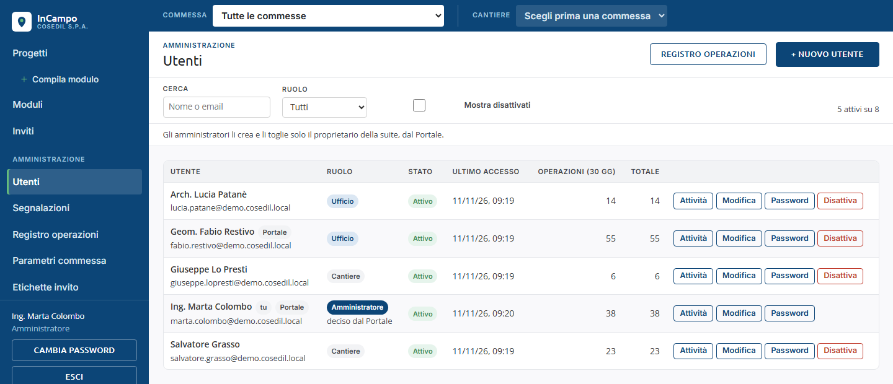
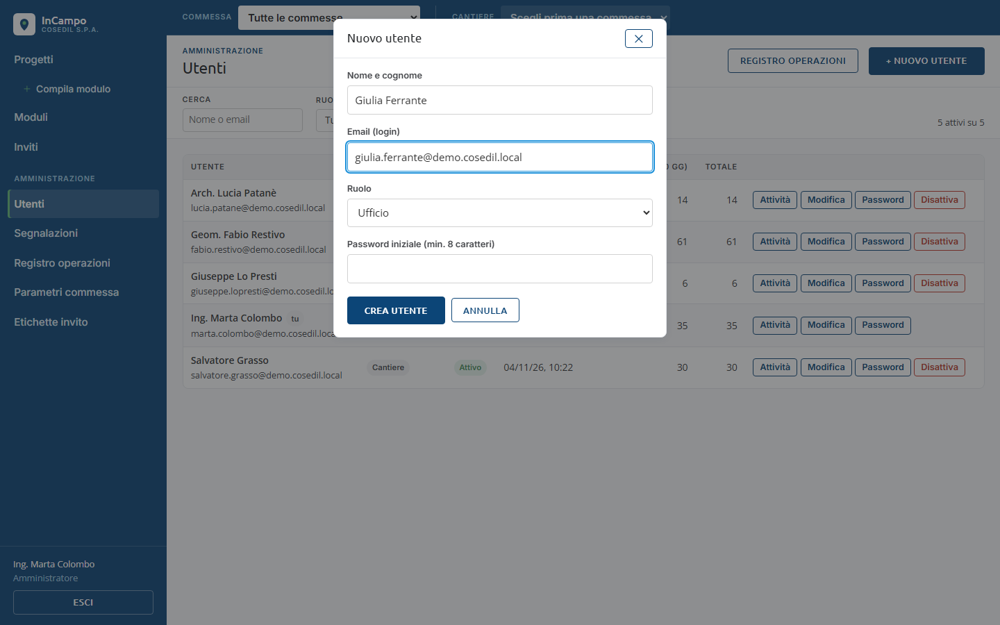
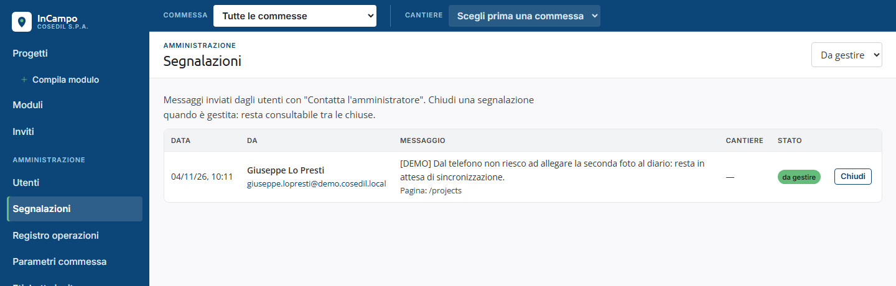
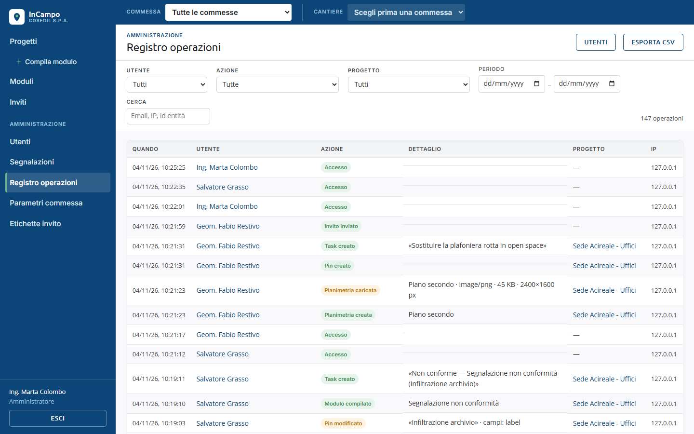
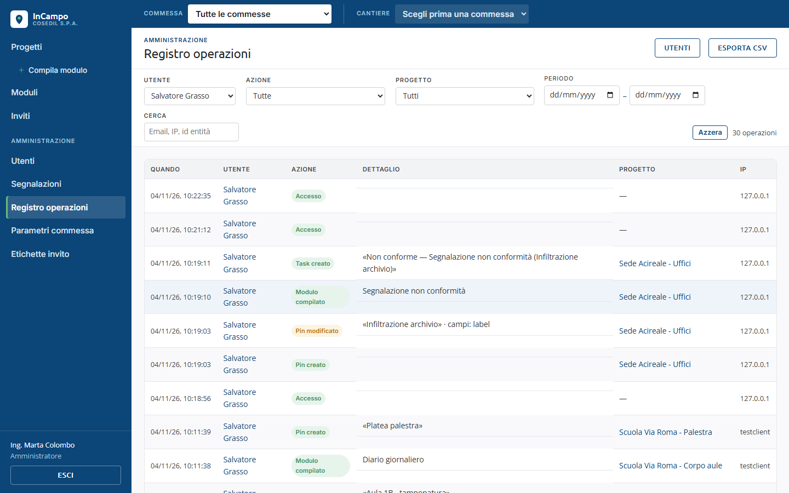
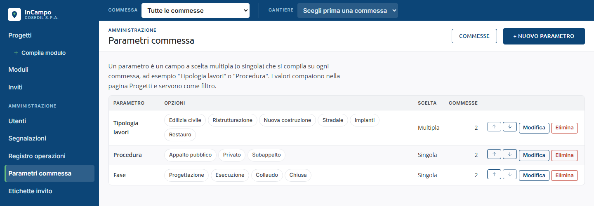
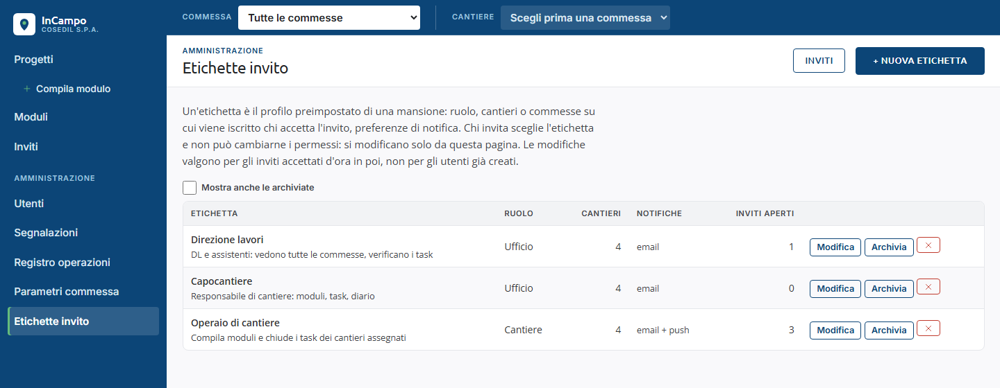
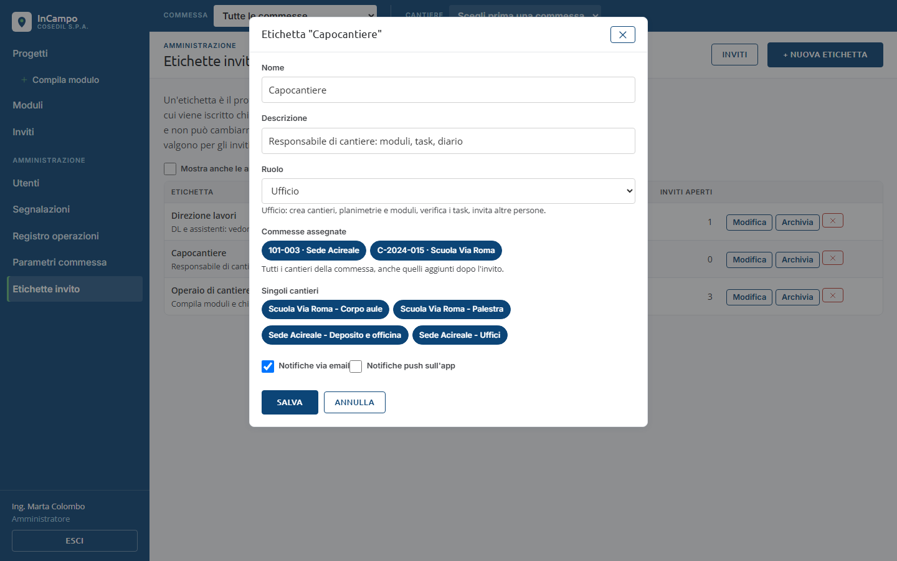

<!-- "><(((º> sabusabu <º)))>< -->
# 10. Amministrazione (Amministratore)

[Indice](README.md) · Precedente: [Inviti](09-inviti.md) · Successivo: [App sul telefono](11-app-mobile.md)

Chi ha il ruolo **Amministratore** vede nel menu a sinistra la sezione
**Amministrazione** con cinque pagine: **Utenti**, **Segnalazioni**, **Registro
operazioni**, **Parametri commessa**, **Etichette invito**.

## Utenti

- **Cerca** per nome o email, filtra per **Ruolo**, spunta **Mostra disattivati** per
  vedere anche chi è stato disattivato. A destra *N attivi su M*.
- Colonne: **Utente** (nome ed email; *tu* accanto al tuo nome), **Ruolo**, **Stato**,
  **Ultimo accesso**, **Operazioni (30 gg)** e **Totale**.
- Pulsanti su ogni riga:
  - **Attività**: apre il *Registro operazioni* filtrato su quella persona;
  - **Modifica**: nome e ruolo (*Utente aggiornato*);
  - **Password**: imposta una nuova password (almeno 12 caratteri; *Password di ... reimpostata*).
    Comunicala alla persona di persona, non per email. Di solito non serve a chi entra dal
    Portale: sul telefono può usare la password del Portale. Ognuno può anche cambiarsi la
    password da solo (**Cambia password**, capitolo 1);
  - **Disattiva** / **Riattiva**: chiede conferma (*Disattivare ...? Non potrà più accedere;
    i suoi dati restano.*). Non puoi disattivare te stesso né toglierti il ruolo di Amministratore.

### Nuovo utente

**+ Nuovo utente** apre la finestra con **Nome e cognome**, **Email (login)**,
**Ruolo** (*Cantiere*, *Ufficio*, *Amministratore*) e **Password iniziale (min. 12 caratteri)**.
**Crea utente** → *Utente ... creato*.

Di solito non serve: chi entra dal Portale ottiene l'account da solo, gli esterni si
invitano (capitolo 9). Un utente creato qui con ruolo **Cantiere** o **Ufficio** non vede
nessun cantiere finché non viene iscritto: aprilo dalla pagina **Persone** di ogni cantiere
in cui deve lavorare (capitolo 2).

## Segnalazioni

Qui arrivano i messaggi mandati con **Contatta l'amministratore** (dal web e dall'app),
con mittente, cantiere e pagina da cui sono stati scritti. Ogni amministratore attivo
riceve anche una notifica.

- Il menu in alto a destra sceglie quali vedere (es. **Da gestire**).
- **Chiudi** quando il problema è risolto (*Segnalazione chiusa*): resta consultabile tra
  le chiuse. **Riapri** se serve.
- Ogni utente può mandare al massimo 10 segnalazioni l'ora.

## Registro operazioni

Chi ha fatto cosa, quando e da quale indirizzo: accessi (anche quelli falliti), utenti,
commesse, planimetrie, pin, moduli, task, foto, sincronizzazioni dall'app. Le righe non
si cancellano mai.

Dal pulsante **Attività** della pagina Utenti si arriva al registro già filtrato su una persona:

- Filtri: **Utente**, **Azione**, **Progetto**, **Periodo**, **Cerca** (email, IP, id).
  **Azzera** li toglie; a destra il totale delle operazioni.
- Clicca una riga per vedere tutti i dettagli e il link **Storia di questa entità**
  (tutte le operazioni su quel pin, task, modulo...).
- **Esporta CSV** scarica le prime 500 righe del filtro (se sono di più lo dice:
  *Esportate le prime 500 righe di N: restringi il filtro per il resto*).
- **Utenti** torna all'elenco utenti.

## Parametri commessa

I parametri sono i campi a scelta che si compilano su ogni commessa (es. *Tipologia
lavori*, *Procedura*, *Fase*). Compaiono nella pagina Progetti come etichette e come filtri.

- **+ Nuovo parametro**: **Nome**, **Opzioni** (scrivi e premi Invio o **Aggiungi**),
  casella **Consenti più opzioni insieme (scelta multipla)**.
- Le frecce cambiano l'ordine; **Modifica** e **Elimina** (con conferma).
- Togliere o rinominare un'opzione la toglie anche dalle commesse che la usavano
  (*Hai tolto opzioni già usate: le commesse che le avevano le perderanno.*);
  eliminare il parametro cancella i suoi valori su tutte le commesse.
- **Commesse** torna alla pagina Progetti.

## Etichette invito

Un'etichetta è il profilo di una mansione: ruolo, commesse o cantieri su cui viene
iscritto chi accetta l'invito, notifiche. Chi invita la sceglie e non può cambiarne i
permessi. Le modifiche valgono per gli inviti accettati da quel momento in poi, non per
gli utenti già creati.

- Colonne: **Etichetta** (con descrizione), **Ruolo**, **Cantieri**, **Notifiche**, **Inviti aperti**.
- **+ Nuova etichetta**, **Modifica**, **Archivia** (non si può più scegliere per i nuovi
  inviti; *Mostra anche le archiviate* per ritrovarla e riattivarla), **x** per eliminarla.

Nella finestra: **Nome**, **Descrizione**, **Ruolo** (sotto c'è cosa può fare),
**Commesse assegnate** (tutti i cantieri della commessa, anche quelli aggiunti dopo
l'invito), **Singoli cantieri**, **Notifiche via email**, **Notifiche push sull'app**.
Clicca **Salva** (*Etichetta salvata*).
