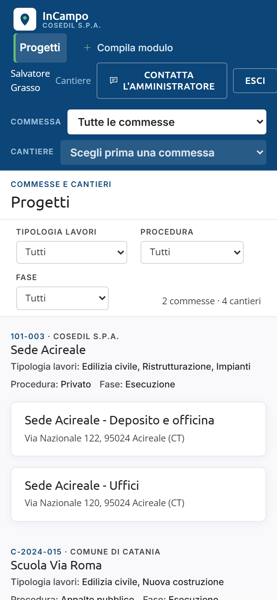

<!-- "><(((º> sabusabu <º)))>< -->
# 11. L'app InCampo sul telefono

[Indice](README.md) · Precedente: [Amministrazione](10-amministrazione.md) · Successivo: [Problemi e domande](12-problemi.md)

L'app **InCampo** (Android e iPhone) è pensata per il cantiere: planimetrie, pin, moduli
e task **funzionano anche senza rete**. Tutto quello che fai resta nel telefono e parte
da solo appena torna la connessione.

> Questo capitolo è scritto a partire dal programma dell'app. Non ci sono fotografie
> dell'app vera: per farle serve un telefono o un emulatore, che in questa revisione non
> è stato possibile usare in sicurezza. In fondo c'è un'immagine della **versione web**
> aperta nel browser del telefono, che è un'altra cosa.

## Installarla

- **Android**: l'ufficio ti manda il link per scaricare il file dell'app (APK). Aprilo e,
  se il telefono lo chiede, consenti l'installazione di **app da origini sconosciute**.
- **iPhone**: l'app si installa con **TestFlight**, seguendo l'invito che ti manda l'ufficio.

## Entrare

1. Apri l'app: vedi la schermata **InCampo** con **Email** e **Password**.
2. Scrivi email e **password di InCampo** (non quella del Portale) e tocca **Accedi**.
   - Se sei entrato in InCampo solo dal Portale, probabilmente una password InCampo non
     ce l'hai: chiedila all'amministratore (capitolo 10, *Password*).
3. Sotto c'è la riga **Server: ...** con **Cambia**. Di solito non si tocca. Se l'ufficio
   te lo dice, tocca **Cambia**, scrivi l'indirizzo (es. `incampo.nomeazienda.it`, senza
   `https://`) e tocca **Salva**: l'app lo verifica (*Verifica…*) e lo ricorda.
   **Predefinito** torna all'indirizzo di fabbrica.

## Primo avvio: scaricare i dati

La prima schermata è **Progetti**, l'elenco dei tuoi cantieri. **Trascina la lista verso il
basso**: l'app scarica cantieri, planimetrie, moduli e task. Quando la barra colorata in
alto dice **Sync hh:mm** sei pronto, anche offline.

In fondo alla lista c'è **Problemi? Contatta l'amministratore**.

## La barra della sincronizzazione

Sotto il titolo di ogni schermata c'è una barra colorata. Toccala per sincronizzare subito.

| Cosa leggi | Significa |
|---|---|
| ✓ **Sync 10:32** (verde) | tutto inviato e aggiornato all'ora indicata |
| **N in attesa (N foto)** (blu) | modifiche e foto ancora da spedire: partono da sole con la rete |
| ⇅ **Offline** (arancione) | nessuna rete: continua pure a lavorare |
| **Sincronizzazione…** | sta inviando e ricevendo |
| ⚠ con un messaggio, **N problemi** (rosso) | qualcosa è stato rifiutato: tocca **N problemi** |

L'app sincronizza da sola all'avvio, quando torna la rete, quando la riapri e ogni
15 minuti circa.

### Elementi non sincronizzati

Toccando **N problemi** (o il simbolo ⚠ in alto nella lista Progetti) si apre
**Non sincronizzati**. Per ogni elemento (Pin, Modulo, Task, Allegato):

- **Rifiutato** con il *Motivo* (es. il modulo è stato archiviato): **Riprova** dopo aver
  corretto, oppure **Scarta** (*Scartare la modifica? La versione locale verrà eliminata.*).
- **Conflitto**: *Una modifica più recente fatta altrove ha vinto: la tua è stata
  sostituita.* Tocca **Ho capito**.

Quando non c'è niente, la schermata dice *Tutto sincronizzato.*

## Planimetrie

Tocca un cantiere: vedi le sue planimetrie. Sotto ogni nome:

- **Disponibile offline ✓**: la pianta è già nel telefono;
- **Solo online**: serve la rete per vederla (sincronizza per scaricarla);
- **Senza file**: va caricata dal web.

In alto ci sono **Task del progetto** e **I miei task**; in fondo
**Problemi? Contatta l'amministratore**.

### Sulla planimetria

- **Pizzica** per lo zoom, **trascina** per spostarti, **doppio tocco** per tornare a tutta la pianta.
- In alto la legenda dei colori (Aperto, Assegnato, Risolto, Verificato, Moduli, Vuoto: gli
  stessi del web, capitolo 3) e la scritta *offline ✓ · tieni premuto per un pin*.
- **Tieni premuto** su un punto per aggiungere un pin: *Nuovo pin — Aggiungere un pin in
  questo punto?* → **Aggiungi**.
- **Tocca un pin**: dal basso si apre la sua scheda con **Moduli (N)** e
  **+ Compila modulo**, **Task (N)** (tocca un task per aprirlo), le foto (quelle *da
  caricare* non sono ancora partite) e **Cancella pin** (*Cancellare il pin? Con tutti i
  moduli, task e foto collegati.*).
- Per **rinominare il pin** si tocca il nome: su iPhone si apre la richiesta *Etichetta*.
  Su Android il nome non si può toccare: rinomina il pin dal web.

## Compilare un modulo dal telefono

1. Nella scheda del pin tocca **+ Compila modulo**: *Quale modulo?* Accanto ai modelli
   già iniziati trovi *Bozza salvata*.
2. Compila i campi. Le differenze rispetto al web:
   - **Foto**: **📷 Scatta** (fotocamera) o **🖼 Galleria**;
   - **Firma**: **✍️ Firma** apre *Firma con il dito*: **Conferma**, **Cancella**, **Chiudi**;
     dopo puoi **Rifai la firma**;
   - **Data**: c'è il pulsante **Oggi**;
   - **Posizione**: **📍 Posizione attuale** (se il GPS non va, scrivi le coordinate a mano).
3. Tocca **Salva modulo**. Messaggio: *Modulo salvato — Verrà inviato alla prossima
   sincronizzazione.* Se manca qualcosa: *Modulo incompleto — N campi da correggere.*

La bozza si salva da sola mentre scrivi: riaprendo trovi *Bozza ripristinata (...)*.
Sul telefono, dopo una non conformità, **non** compare la proposta di task: l'ufficio
riceve comunque l'avviso e il task si crea dal web (capitolo 4).

## Task dal telefono

Da **Task del progetto** o **I miei task** (filtri per stato e pulsante **I miei**) tocca
un task:

- **Prendo in carico**: compare sui task aperti senza assegnatario; il task diventa tuo
  e passa ad *Assegnato*.
- **✓ Risolto**: l'app chiede *Risolvere il task? Una foto della risoluzione aiuta chi
  verifica.*: scatta la foto oppure scegli **Senza foto**.
- **Riapri** riporta il task ad *Aperto*; **✓✓ Verificato** lo vede solo l'Ufficio.
- Sotto, le **Foto** del task (*sul server* o *da caricare*); *da sincronizzare* vuol dire
  che la modifica non è ancora partita.

Dal telefono non si creano task nuovi: si fanno dal web.

## Uscire

Nella schermata **Progetti**, in alto a destra, c'è il tuo nome con la freccia **↪**:
toccalo per uscire. Se ci sono modifiche non inviate
l'app avvisa: *Modifiche non inviate — N elementi non sono ancora sul server: uscendo
andranno persi. Sincronizza prima.* Scegli **Sincronizza**; usa **Esci comunque** solo se
sai di poter perdere quei dati. Uscendo, i dati del cantiere vengono tolti dal telefono.

## La versione web nel browser del telefono

InCampo si apre anche nel browser del telefono, entrando dal Portale come al computer.
Va bene per guardare l'elenco dei cantieri o dei task; per lavorare sulla planimetria
usa l'app (o un tablet), perché sullo schermo piccolo menu e filtri occupano quasi tutto lo spazio.

