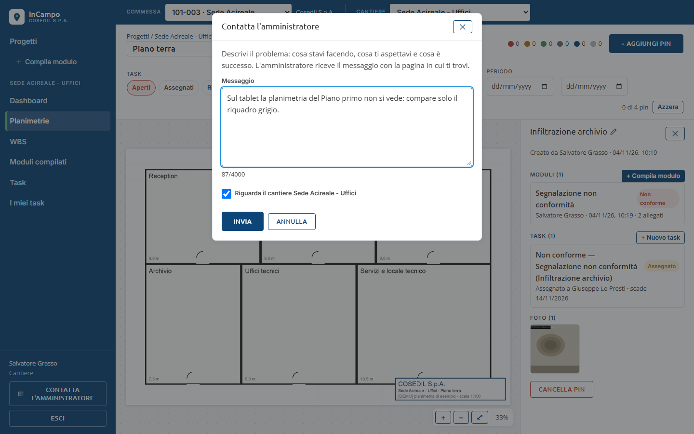

<!-- "><(((º> sabusabu <º)))>< -->
# 12. Problemi e domande frequenti

[Indice](README.md) · Precedente: [App sul telefono](11-app-mobile.md) · Appendice: [Per l'amministratore di sistema](13-amministratore-di-sistema.md)

## Contatta l'amministratore

Se qualcosa non va, il modo più veloce è il pulsante **Contatta l'amministratore**:

- sul web è in basso nel menu a sinistra (non lo vede chi è già Amministratore);
- nell'app è in fondo alle liste *Progetti* e *Planimetrie* (*Problemi? Contatta l'amministratore*).

1. Nel **Messaggio** scrivi cosa stavi facendo, cosa ti aspettavi e cosa è successo
   (massimo 4000 caratteri).
2. Lascia spuntato **Riguarda il cantiere ...** se il problema è su quel cantiere.
3. Clicca **Invia**: *Messaggio inviato all'amministratore*. L'amministratore riceve il
   messaggio con la pagina in cui ti trovavi.

Dall'app serve la connessione: senza rete compare *Serve la connessione per inviare il
messaggio: riprova quando sei online.*

## Messaggi frequenti

| Messaggio | Cosa vuol dire | Cosa fare |
|---|---|---|
| *Email o password errati* | email o password sbagliate | ricontrolla; prova anche la password del Portale; se non ricordi nessuna delle due chiedi all'amministratore |
| Vieni rimandato al login del Portale | non sei entrato nel Portale (o la sessione è scaduta) | entra nel Portale e riapri InCampo dal suo riquadro |
| Login di InCampo invece dell'accesso automatico | il Portale non risponde, InCampo non è abilitato per te o il tuo account è disattivato | entra con la tua email e la password di InCampo o del Portale; se non funziona, Contatta l'amministratore o scrivigli |
| *Invito non valido* | link già usato, scaduto (7 giorni) o revocato | chiedi a chi ti ha invitato di usare **Rimanda** |
| *Campo obbligatorio*, *N campi da correggere* | nel modulo manca qualcosa | compila i campi segnati in rosso |
| *Modulo salvato ma N allegati non caricati* | il modulo c'è, qualche foto no | apri il modulo, **Modifica**, riaggiungi la foto |
| *Bozza ripresa da dove l'avevi lasciata* | avevi chiuso senza salvare | continua, oppure **Scarta bozza**; foto e firma vanno rimesse |
| *Permesso negato: inserisci le coordinate a mano* | il browser non dà la posizione | consenti la posizione nelle impostazioni del browser o scrivi Lat e Lng |
| *Magazzino Operativo non raggiungibile ... è spenta? Aprila dal portale.* | il Magazzino è spento | aprilo dal Portale e ricarica la dashboard |
| *Il cantiere non è collegato a una commessa* | il cantiere non ha una commessa | l'Ufficio la imposta dalla pagina Progetti |
| *SkyTower non raggiungibile* (Invia a SkyTower, Da SkyTower) | SkyTower è spento o la commessa non c'è in SkyTower | apri SkyTower dal Portale; controlla che il codice commessa sia lo stesso |
| *Nessuna etichetta disponibile* (Inviti) | non ci sono profili d'invito | chiedi all'amministratore di crearne una |
| *Non ci sono moduli da compilare* | nessun modello attivo | chiedi all'amministratore di crearne uno |
| *Non fai parte di nessun cantiere* | non sei iscritto a nessun cantiere | chiedi a un responsabile di aggiungerti |
| App: barra rossa con **N problemi** | il server ha rifiutato una modifica | tocca **N problemi**, leggi il motivo, **Riprova** o **Scarta** |
| App: *Modifiche non inviate* uscendo | ci sono dati non ancora spediti | scegli **Sincronizza** prima di uscire |

## Domande

**Non vedo un cantiere.** Chi ha il ruolo *Cantiere* vede solo i cantieri a cui è
iscritto. Chiedi all'Ufficio un invito con l'etichetta giusta, o all'amministratore.

**Non vedo i pulsanti per creare commesse, planimetrie o modelli.** Dipende dal ruolo
(vedi la tabella dei ruoli nell'[indice](README.md#i-tre-ruoli)). I nuovi modelli di
modulo li crea solo l'Amministratore.

**Ho sbagliato un modulo.** Aprilo e usa **Modifica** (lo può fare chi l'ha compilato e
l'Ufficio). Il registro tiene traccia della modifica.

**Ho cancellato un pin per sbaglio.** Con il pin spariscono i suoi moduli, task e foto.
Avvisa subito l'amministratore.

**Non riesco a portare un task a Verificato.** Lo può fare solo l'Ufficio, e solo da *Risolto*.

**Il task non si può mettere ad Assegnato.** Prima scegli la persona in *Assegnato a*:
il task passa ad Assegnato da solo.

**Sul telefono non vedo le ultime modifiche fatte dall'ufficio.** Tocca la barra della
sincronizzazione o trascina in basso la lista Progetti.

**Le email di InCampo non arrivano.** Se il server non ha la posta configurata le email
non partono (vedi il riquadro *Attenzione* nel [capitolo 9](09-inviti.md)). Le notifiche
sull'app e la home del Portale funzionano lo stesso.

**Dove trovo le mie cose da fare senza aprire InCampo?** Nella home del Portale: i task
assegnati a te (prima gli scaduti) e, per l'Ufficio, le non conformità aperte dei tuoi cantieri.
