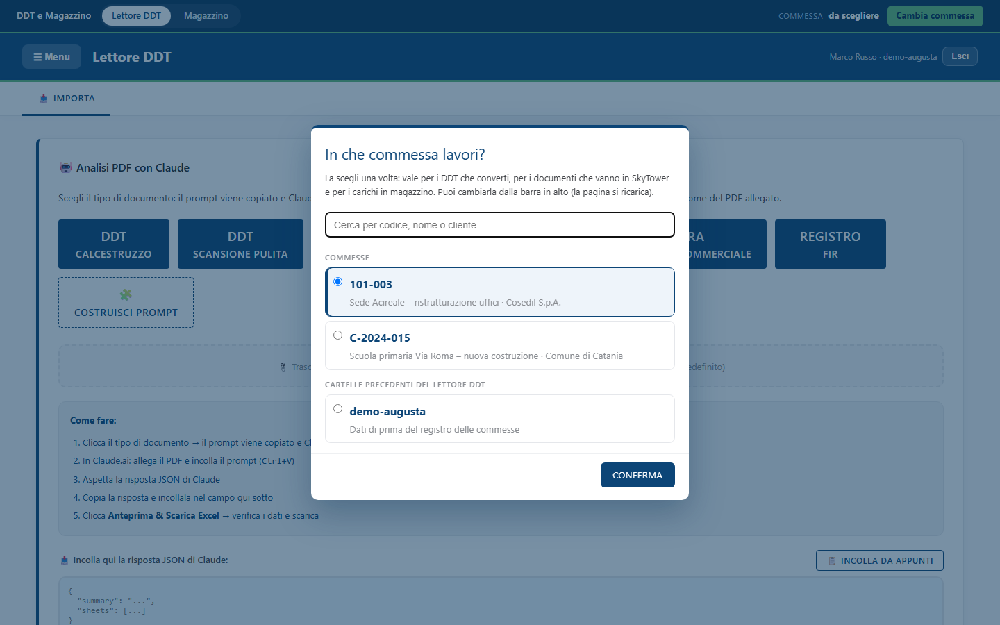
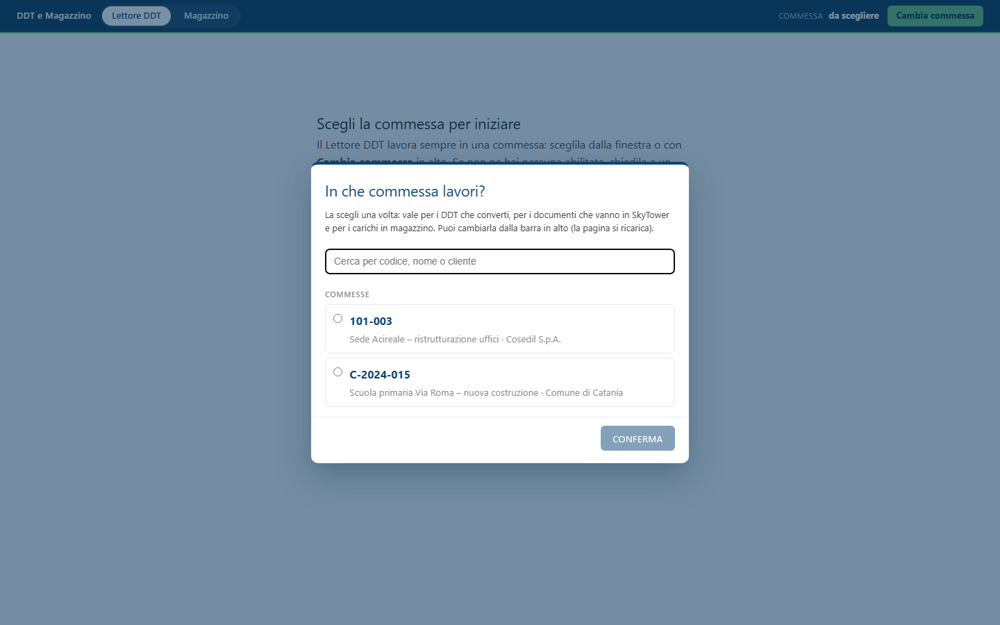
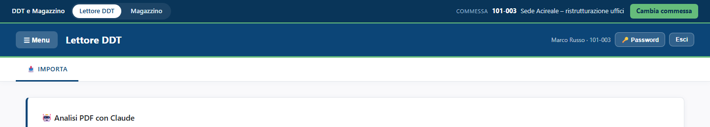
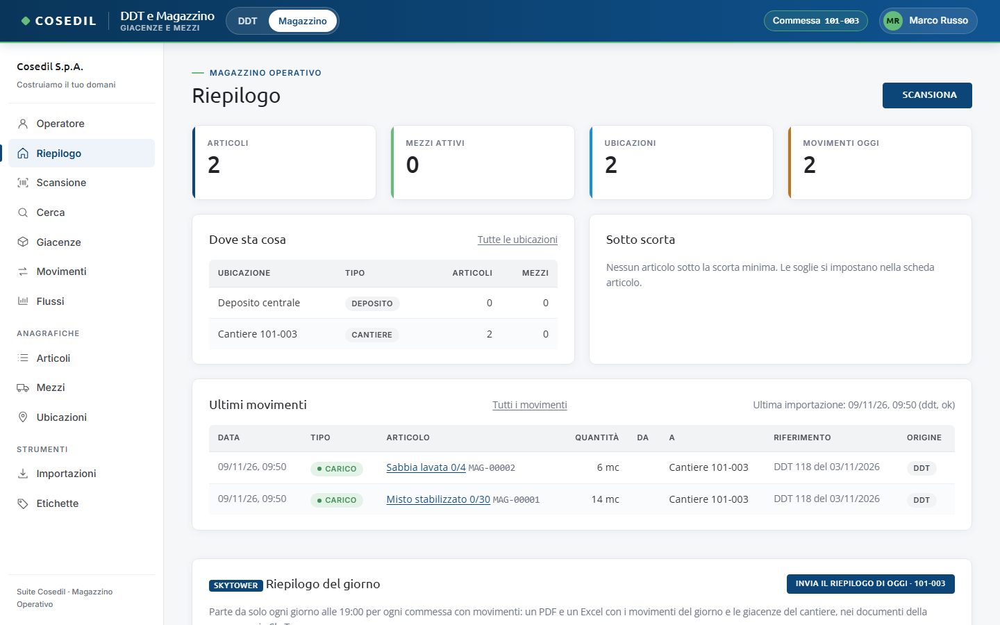
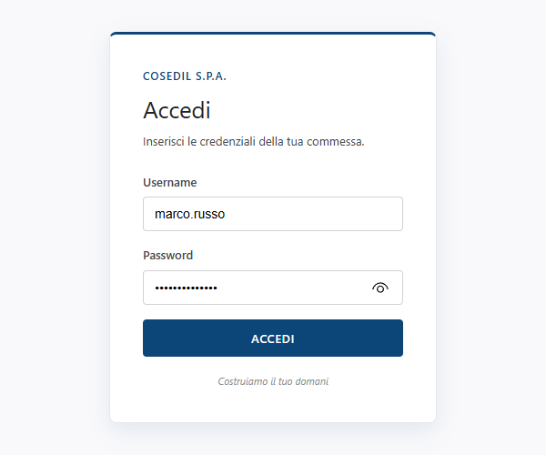
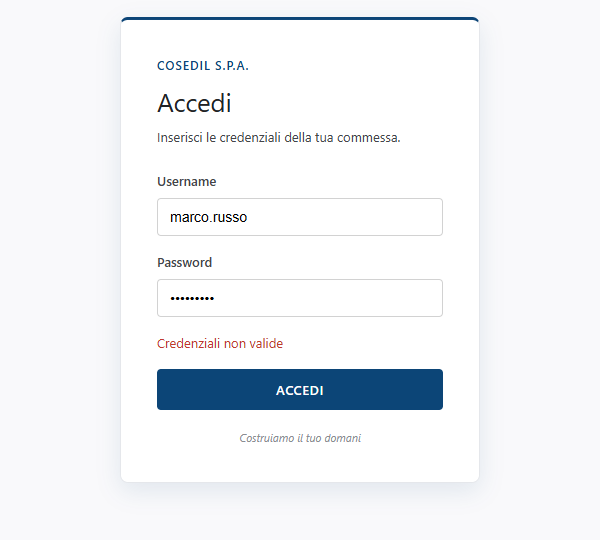
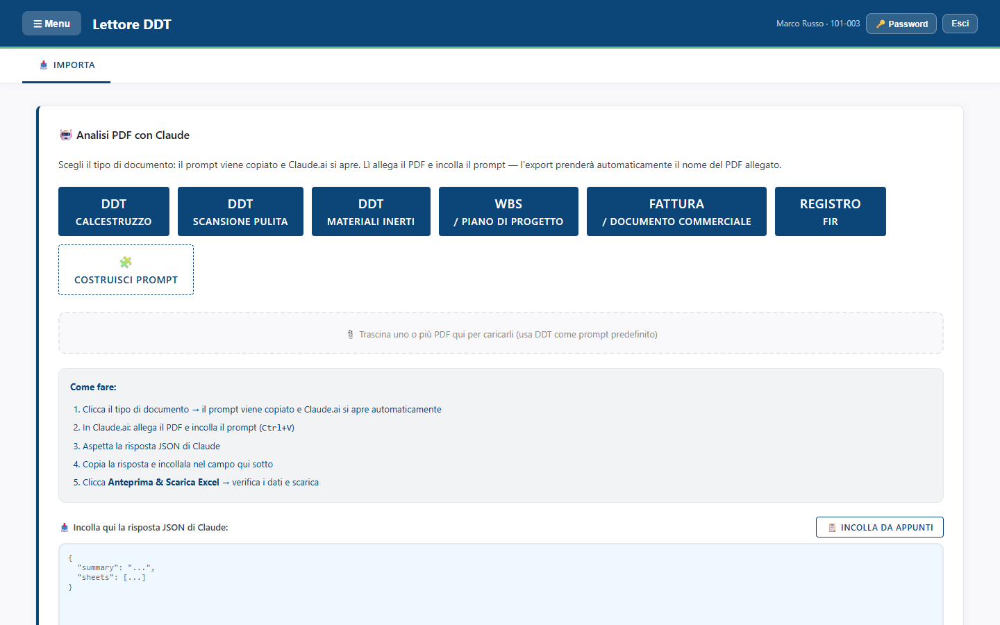
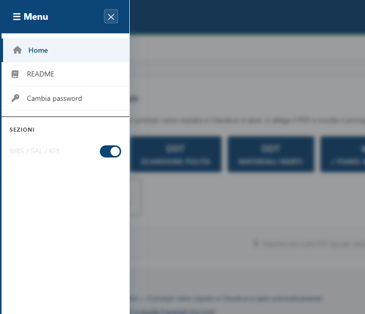
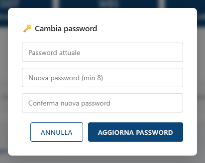

<!-- "><(((º> sabusabu <º)))>< -->
# 1. Entrare, scegliere la commessa, uscire

[← Indice](README.md)

## Aprire il Lettore DDT

1. Apri il **Portale** della suite Cosedil ed entra con il tuo utente del Portale.
2. Nella pagina iniziale clicca la scheda **DDT e Magazzino** (fino all'8 novembre 2026 si chiamava *Lettore
   DDT* e il Magazzino aveva una scheda sua): si apre in una nuova pagina del browser.

**Un solo accesso.** Dal 9 novembre 2026 non c'è un secondo login: entri con l'utente e la password del Portale e
basta, sia nella parte DDT sia nel Magazzino.

- Se nel Portale sei abilitato a **DDT e Magazzino** e nel Lettore DDT non avevi ancora un utente, il programma
  te lo crea da solo la prima volta che entri (senza una password sua: vale quella del Portale). All'inizio non
  ha commesse: le abilita un amministratore (vedi sotto).
- Se nel Portale sei abilitato **solo al Magazzino**, la scheda ti porta direttamente nel **Magazzino**; la voce
  *Lettore DDT* nella barra in alto resta grigia. Se un amministratore ti toglie il Lettore DDT nel Portale
  mentre ci lavori, la parte DDT si chiude alla prossima operazione (entro mezzo minuto) e, ricaricando la
  pagina, sei nel Magazzino con la stessa commessa.
- Il tuo **nome** è quello del Portale: se cambia lì, cambia anche qui.
- Se l'amministratore ha **disattivato** il tuo utente del Lettore DDT, compare una pagina che lo dice, con il
  pulsante **VAI AL MAGAZZINO**: il Magazzino lo puoi usare lo stesso.
- Chi è **amministratore nel Portale** è amministratore anche qui: vede tutte le commesse e il pulsante **Admin**.

## La commessa all'ingresso

La prima cosa che il programma chiede è **in che commessa lavori**. La scegli una volta: vale per tutto quello
che fai finché resti dentro, cioè per

- i DDT che converti (l'archivio della commessa, il riepilogo per fornitore);
- i documenti che vanno in **SkyTower** (il PDF della bolla e l'Excel della conversione);
- i **carichi in magazzino** (i materiali della bolla entrano nel cantiere di quella commessa).

1. Cerca la commessa per codice, nome o cliente, oppure scorri l'elenco: sono le commesse del **registro della
   suite** (le stesse di InCampo, SkyTower e Magazzino) in cui puoi lavorare, vedi qui sotto. Nell'immagine
   Marco Russo ha abilitate 101-003 e C-2024-015 più la sua cartella di prima; la 101-006, che c'è nel
   registro, per lui non compare. Quella proposta è l'ultima che hai usato.
2. Clicca la commessa e poi **CONFERMA**: la pagina si ricarica con la commessa scelta.

**Quali commesse vedi.** Nell'elenco ci sono solo le commesse in cui puoi lavorare:

- un **amministratore** vede tutte le commesse del registro e tutte le cartelle precedenti;
- gli altri vedono solo le commesse che un amministratore ha **abilitato sul loro utente** (pagina *Admin ›
  Account*, pulsante *Commesse*, vedi il [capitolo 5](05-pannello-admin.md)). Un utente che non ha ancora un
  elenco vede la sua commessa di sempre, come prima del 9 novembre;
- se ne hai **una sola**, il programma la sceglie da solo e la finestra non compare;
- se non ne hai **nessuna**, la finestra dice *"Nessuna commessa abilitata sul tuo account del Lettore DDT"*:
  chiedi a un amministratore di abilitartene una. Intanto puoi usare il Magazzino.

Una commessa tolta da un amministratore smette di funzionare subito: alla prossima operazione compare
*"La commessa … non è abilitata sul tuo account"* e la finestra di scelta si riapre.

Sotto **Cartelle precedenti del Lettore DDT** trovi, se ti è stata abilitata, la cartella che il tuo utente
usava prima del registro delle commesse (per esempio *demo-augusta*): lì restano i DDT convertiti prima, e la
puoi riaprire per consultarli. Se l'elenco di un amministratore è vuoto, il registro delle commesse non è ancora
stato riempito: chiedi a un amministratore del Portale (*Portale › Commesse*).

Per chi usa **solo il Magazzino** la commessa è solo il filtro proposto di giacenze e movimenti: la sceglie
liberamente fra tutte quelle del registro (il Magazzino non ha limiti per commessa) e non dà accesso ai dati del
Lettore DDT.

## La barra in alto: Lettore DDT e Magazzino

Nel Lettore DDT, in cima alla pagina, c'è una barra blu scuro:

- **Lettore DDT** e **Magazzino** passano da una sezione all'altra (stesso indirizzo, nessun nuovo accesso);
- a destra la **commessa** in cui stai lavorando e il pulsante **CAMBIA COMMESSA**, che riapre la finestra di
  scelta.

Nella sezione **Magazzino** le stesse cose stanno nella testata del Magazzino: **DDT** e **Magazzino** per
passare da una parte all'altra e, a destra, la **commessa** scelta all'ingresso; cliccandola si cambia.

Giacenze, movimenti, mezzi e scansione del codice a barre anche col telefono sono spiegati nella
[guida del Magazzino](../../../magazzino-operativo/docs/guida/README.md). Sul telefono in cantiere basta aprire la
stessa pagina e toccare **Magazzino**.

Dal 4 novembre 2026 il Lettore DDT **si apre solo dal Portale**. Se provi ad aprirlo da un vecchio
segnalibro senza essere entrato nel Portale, vieni rimandato al login del Portale (o compare il messaggio
*"Accesso richiesto: entra dal Portale Suite Cosedil"*). Se nel Portale non vedi la scheda Lettore DDT, non sei
ancora abilitato: chiedi all'amministratore. Come entrare nel Portale e come si chiedono le abilitazioni è
spiegato nella [guida del Portale](../../../portale/docs/guida/README.md).

## Senza Portale: il login del Lettore DDT

Il modulo **Username / Password** del Lettore DDT si vede solo in un'installazione **senza il Portale** (per
esempio un PC di prova): chi entra dal Portale non lo vede mai.

1. Scrivi **Username** e **Password**.
2. Clicca **ACCEDI**.

Se nome o password sono sbagliati compare in rosso **"Credenziali non valide"**: ricontrolla maiuscole e
minuscole e riprova.

> Dopo **5 password sbagliate** di fila l'accesso da quel PC si blocca per **15 minuti**. Aspetta, oppure fatti
> impostare una password nuova dall'amministratore (il blocco però scade da solo, non si sblocca prima).

Se compare **"Account disabilitato"**, l'amministratore ha sospeso il tuo accesso: i tuoi dati ci sono ancora,
chiedigli di riattivarlo.

## La schermata principale

In alto a destra trovi il tuo nome e la commessa (es. *Marco Russo · 101-003*) ed **Esci** (il pulsante
**Password** c'è solo senza Portale). Sotto c'è la scheda **IMPORTA**, dove si fa tutto il lavoro di tutti i giorni.

Vedi e salvi solo i dati della **commessa scelta all'ingresso**: chi lavora sulla stessa commessa condivide gli
stessi dati, le altre commesse restano separate.

Gli amministratori vedono più schede (Conversione automatica, Archivio DDT, Fornitori, WBS, SAL, Dashboard KPI) e
il pulsante giallo **Admin**: vedi il [capitolo 4](04-strumenti-amministratori.md).

## Il menu laterale

Il pulsante **☰ Menu** in alto a sinistra (oppure il mouse portato sul bordo sinistro dello schermo) apre il
menu:

- **Home**: torna alla scheda Importa.
- **README**: la documentazione tecnica del programma (non serve per l'uso quotidiano).
- **Cambia password**: come il pulsante Password in alto (solo senza Portale).
- **Sezioni › WBS / SAL / KPI**: mostra o nasconde le schede WBS, SAL e Dashboard KPI. Queste schede sono
  riservate agli amministratori: per un utente normale l'interruttore non cambia niente.

In fondo alla pagina ci sono anche i pulsanti **HOME**, **LEGGI README** e **LEGGI MANUALE**, che apre il
testo di questa guida (capitoli 1-6, senza immagini).

## Cambiare la password

Entrando dal Portale la password è **quella del Portale** e si cambia nel Portale: nel Lettore DDT il pulsante
**Password** non c'è. Quello che segue vale solo per un'installazione senza Portale: fallo al primo accesso, se
la password te l'ha data l'amministratore.

1. Clicca **Password** in alto a destra (oppure ☰ Menu › **Cambia password**).
2. Scrivi la **password attuale**, poi la **nuova** (almeno **8 caratteri**) e ripetila.
3. Clicca **AGGIORNA PASSWORD**.

Password dimenticata? Da qui non si può cambiare senza quella attuale: chiedi all'amministratore di
impostartene una nuova, poi cambiala tu.

> Questa è la password del **Lettore DDT** senza Portale, diversa da quella del Portale.

## Uscire

Clicca **Esci** in alto a destra: torni al **Portale** (non a un login), da dove esci dalla suite. Su un PC
condiviso esci sempre a fine lavoro anche dal Portale.

[Avanti: convertire un DDT →](02-convertire-un-ddt.md)
