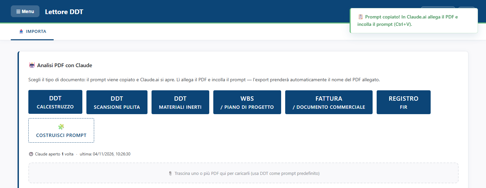
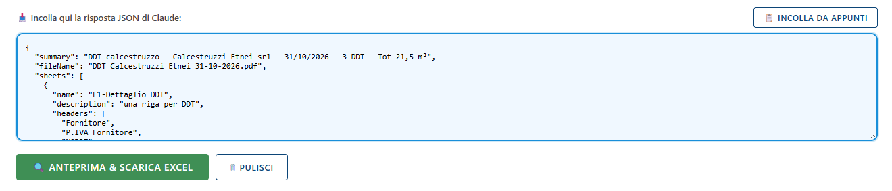
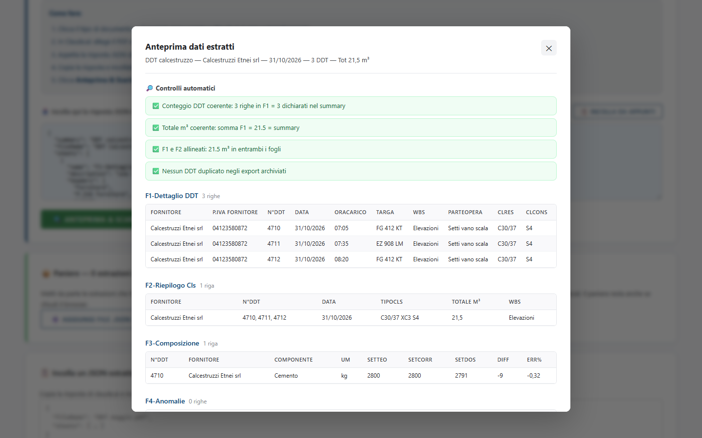
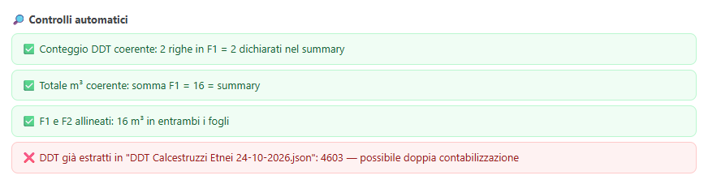
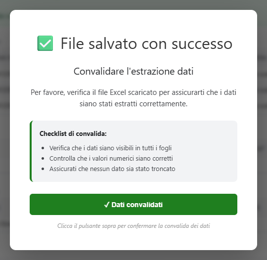
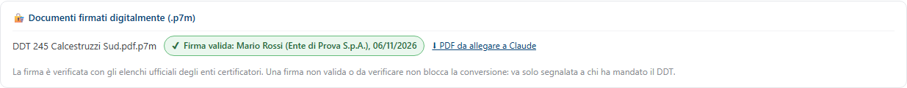

<!-- "><(((º> sabusabu <º)))>< -->
# 2. Convertire un DDT in Excel (passo per passo)

[← Indice](README.md)

Ti servono: il **PDF del DDT** (o di più DDT dello stesso fornitore) e un account su **claude.ai**, che si apre
in una finestra a parte. Il Lettore DDT non legge da solo il PDF: lo legge Claude, con le istruzioni (il
*prompt*) che il Lettore DDT prepara per te.

## Passo 1 — Scegli il tipo di documento

Nella scheda **IMPORTA**, riquadro **Analisi PDF con Claude**, clicca il pulsante del tuo documento:

| Pulsante | Quando usarlo |
|---|---|
| **DDT Calcestruzzo** | bolle del calcestruzzo (classe, consistenza, m³, orari di carico e scarico) |
| **DDT Scansione pulita** | come sopra, ma il PDF contiene anche pagine da scartare (copertine, certificati, pagine bianche) |
| **DDT Materiali inerti** | DDT di cava: misto stabilizzato, sabbia, pietrisco, tout venant |
| **WBS / Piano di progetto** | computi, preventivi, piani lavori |
| **Fattura / Documento commerciale** | fatture, ordini, bolle generiche |
| **Registro FIR** | formulari dei rifiuti (FIR, DUD) |

Al clic succedono due cose: le istruzioni vengono **copiate negli appunti** e si apre **Claude.ai** in una
nuova finestra. In alto a destra compare il messaggio verde *"Prompt copiato! In Claude.ai allega il PDF e
incolla il prompt (Ctrl+V)."*



Sotto i pulsanti il Lettore DDT tiene il conto di quante volte hai aperto Claude (*"Claude aperto 1 volta ·
ultima: …"*).

> Se il browser blocca la finestra di Claude, consenti i popup per il Lettore DDT, oppure apri tu
> https://claude.ai/new. Se compare *"Copia il prompt manualmente"*, il browser non ha dato il permesso di usare
> gli appunti: riprova cliccando di nuovo il pulsante.

## Passo 2 — In Claude: allega il PDF e incolla

1. Nella finestra di Claude **allega il PDF** (graffetta o trascinamento).
2. Clicca nel campo del messaggio e premi **Ctrl+V**: compaiono le istruzioni copiate.
3. Invia e aspetta la risposta: è un blocco di testo che inizia con `{` e contiene `"summary"` e `"sheets"`.
4. **Copia tutta la risposta** (in Claude c'è il pulsante *Copia* sotto il blocco).

> Un PDF per chat: per il PDF successivo usa una chat nuova. Dopo il primo DDT compare il pulsante
> **🔁 Prossimo PDF**, che svuota il riquadro, ricopia le ultime istruzioni usate e apre una chat nuova.

## Passo 3 — Incolla la risposta nel Lettore DDT

Torna al Lettore DDT e incolla la risposta nel riquadro azzurro **Incolla qui la risposta JSON di Claude**
(clic nel riquadro e **Ctrl+V**, oppure il pulsante **INCOLLA DA APPUNTI**).



Il testo incollato resta nel riquadro per 48 ore anche se chiudi la pagina. **PULISCI** lo svuota.
Non serve togliere le righe ```` ```json ```` che a volte Claude aggiunge: il Lettore DDT le ignora.

## Passo 4 — Anteprima e controlli automatici

Clicca **ANTEPRIMA & SCARICA EXCEL**. Si apre la finestra **Anteprima dati estratti**: in alto il riassunto
(fornitore, data, numero di DDT, totale m³), poi i **Controlli automatici** e i fogli che finiranno nell'Excel.



I controlli verificano che i numeri tornino:

- **Conteggio DDT coerente**: le righe del foglio F1 sono tante quanti i DDT dichiarati nel riassunto;
- **Totale m³ coerente** e **F1 e F2 allineati**: la somma dei metri cubi è la stessa nei fogli e nel riassunto;
- **Nessun DDT duplicato negli export archiviati**: quei numeri di DDT non sono già stati convertiti.

Verde = tutto a posto. Arancione = da guardare (per esempio *"Stessa targa con stesso orario carico (possibile
doppia lettura)"*). **Rosso** = errore: per esempio un DDT già convertito in un altro Excel, che rischia di
essere contato due volte:



Con un controllo rosso non scaricare a occhi chiusi: apri il PDF e verifica. Se Claude ha sbagliato, chiudi
con **Annulla**, chiedi a Claude di correggere (o rifai la chat) e incolla di nuovo.

Nella finestra hai tre pulsanti:

- **Conferma e scarica Excel**: crea il file e lo scarica (prossimo passo);
- **Metti nel paniere**: mette da parte l'estrazione per unirla ad altre in un solo Excel (vedi
  [capitolo 3](03-paniere-e-altri-caricamenti.md));
- **Annulla**: chiude senza fare niente.

## Passo 5 — Scarica e convalida

Clicca **Conferma e scarica Excel**. Il file si scarica con il nome del PDF (es. *DDT Calcestruzzi Etnei
31-10-2026.xlsx*) e compare la finestra **File salvato con successo**:



Apri l'Excel scaricato e segui la *Checklist di convalida*: dati presenti in tutti i fogli, numeri giusti,
niente di tagliato. Poi clicca **✓ Dati convalidati**: compare *Convalida registrata* e gli amministratori
vedono quell'Excel come *✓ Convalidato*. Finché non lo clicchi, resta *✗ Da convalidare*.

Il Lettore DDT conserva una copia dell'estrazione nella tua commessa: finisce nell'**Archivio DDT** e nel
riepilogo **Fornitori** che consultano gli amministratori, e il registro dei DDT scaricati compare nel loro
pannello.

## Caricare il PDF anche nel Lettore DDT (facoltativo)

Sotto i pulsanti c'è il riquadro tratteggiato **"Trascina uno o più PDF qui per caricarli (usa DDT come prompt
predefinito)"**. Trascinandoci il PDF:

- il Lettore DDT controlla che sia un PDF valido e ricorda il suo nome, che diventa il nome dell'Excel;
- copia le istruzioni del **DDT Calcestruzzo** e apre Claude, come il pulsante;
- se trascini **un solo PDF**, alla conversione il PDF viene archiviato anche in **SkyTower**, nella commessa
  aziendale del tuo account (se l'amministratore l'ha impostata). Non vedrai messaggi: se SkyTower non è
  raggiungibile il DDT resta comunque nel Lettore DDT.

Il PDF va comunque allegato anche in Claude: il browser non può passarglielo da solo.

## DDT firmati digitalmente (.p7m)

Alcuni fornitori mandano il DDT **firmato digitalmente**: il file si chiama per esempio
`DDT 245.pdf.p7m` e Windows non lo apre come un PDF. Il Lettore DDT lo accetta come un PDF qualunque:
trascinalo nel riquadro tratteggiato (o sceglilo con un pulsante del tipo di documento).

1. Il Lettore DDT apre la "busta" firmata, tira fuori il PDF e **verifica la firma** con gli elenchi ufficiali
   degli enti certificatori: che il documento non sia stato modificato dopo la firma, che il certificato sia
   di un ente riconosciuto, non revocato e valido.
2. Compare il riquadro **Documenti firmati digitalmente (.p7m)** con il nome del file e l'esito:
   - verde **Firma valida** — chi ha firmato, l'ente e la data;
   - rosso **Firma NON valida** — per esempio *"Il documento è stato modificato dopo la firma"* o certificato
     revocato o scaduto;
   - giallo **Firma da verificare** — per esempio l'ente non è negli elenchi ufficiali o lo stato del
     certificato non si è potuto controllare (rete assente).
   Passando il mouse sul bollino si leggono tutti i firmatari e i motivi.
3. Il **PDF estratto** si scarica da solo (e resta il collegamento **⬇ PDF da allegare a Claude**): è questo
   che va allegato in Claude, perché Claude non apre i file `.p7m`.



Una firma non valida o da verificare **non blocca** la conversione: si converte lo stesso, ma va segnalato a
chi ha mandato il DDT. L'esito della firma resta nell'estrazione archiviata e nel registro del pannello Admin;
in **SkyTower** va il file firmato originale (con il suo valore legale).

[← Accesso](01-accesso.md) · [Avanti: paniere e altri caricamenti →](03-paniere-e-altri-caricamenti.md)
