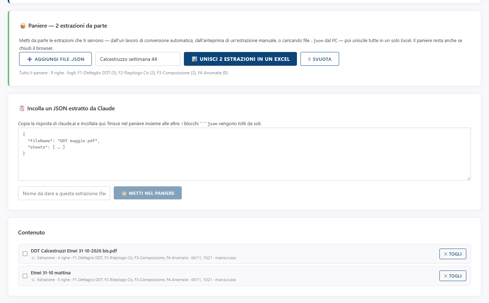
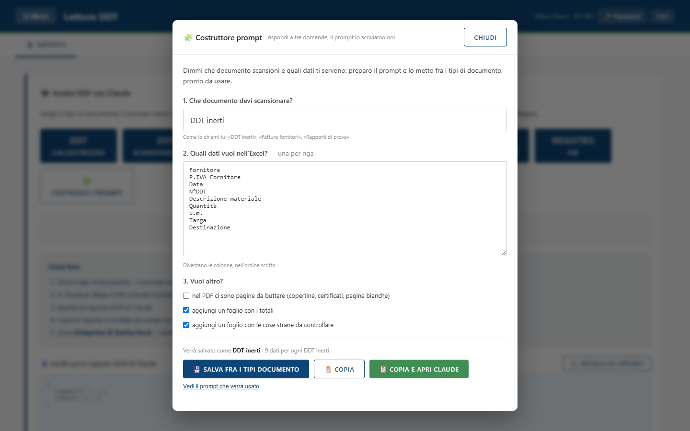

<!-- "><(((º> sabusabu <º)))>< -->
# 3. Paniere, tipi di documento e altri modi di caricare i dati

[← Indice](README.md)

## Il paniere: più DDT in un solo Excel

Ogni conversione produce un Excel per PDF. Se invece ti serve **un solo Excel** con i DDT di più PDF (per
esempio tutto il calcestruzzo della settimana), usa il **paniere**, sotto il riquadro di Claude nella scheda
Importa.

Le estrazioni entrano nel paniere in quattro modi:

- dall'anteprima, con il pulsante **Metti nel paniere** invece di *Conferma e scarica Excel*;
- dal riquadro **Incolla un JSON estratto da Claude**: incolli la risposta di Claude, se vuoi le dai un nome
  (*Nome da dare a questa estrazione*) e clicchi **METTI NEL PANIERE**;
- con **AGGIUNGI FILE .JSON**, da file salvati sul PC;
- (amministratori) dall'Archivio DDT o da un lavoro di conversione automatica.

Nel riquadro **Contenuto** vedi l'elenco: nome, numero di righe, fogli, data e chi l'ha aggiunta. **TOGLI**
toglie una voce. La spunta a sinistra serve a unire **solo** le voci scelte.

Per creare l'Excel: scrivi se vuoi un nome in **Nome dell'Excel (facoltativo)** e clicca **UNISCI N ESTRAZIONI
IN UN EXCEL**. I fogli con lo stesso nome (F1-Dettaglio DDT, F2-Riepilogo…) vengono impilati uno sotto l'altro.
**SVUOTA** cancella tutto il paniere.

> Il paniere è **della commessa**: resta anche se chiudi il browser e lo vedono anche i colleghi della stessa
> commessa. Svuotalo quando hai finito.

## Costruisci prompt: un tipo di documento nuovo

Se il tuo documento non è tra i pulsanti (per esempio una bolla di un fornitore con un modulo particolare),
clicca **COSTRUISCI PROMPT**. Rispondi a tre domande:

1. **Che documento devi scansionare?** — il nome che gli dai tu (es. *DDT inerti*);
2. **Quali dati vuoi nell'Excel?** — uno per riga: diventano le colonne, nell'ordine scritto;
3. **Vuoi altro?** — pagine da buttare, un foglio con i totali, un foglio con le cose strane da controllare.

In fondo:

- **SALVA FRA I TIPI DOCUMENTO**: aggiunge un pulsante 🧩 con quel nome accanto agli altri. È visibile a
  **tutti gli utenti** del Lettore DDT; lo può cancellare solo chi l'ha creato o un amministratore;
- **COPIA**: copia le istruzioni negli appunti;
- **COPIA E APRI CLAUDE**: copia e apre Claude, come i pulsanti dei tipi documento;
- **Vedi il prompt che verrà usato**: mostra il testo esatto.

Gli amministratori vedono una versione più completa della finestra (indizi da cercare, controlli, ecc.).

## Importare un Excel di progetto (formato "Output C.D.")

Il riquadro **Importa da Excel (formato Output C.D.)** legge un Excel di budget con i fogli *Output C.D.* e
*Quadro di riepilogo* (codici WBS, articoli, quantità, prezzi, ricavi, costi). Trascina il file nel riquadro
o clicca **SCEGLI FILE EXCEL (.XLSX)**. Se il foglio non c'è compare *"Foglio 'Output C.D.' non trovato!"* con
l'elenco dei fogli trovati.

I dati importati servono alle schede **WBS**, **SAL** e **Dashboard KPI**, che sono riservate agli
amministratori (vedi il [capitolo 4](04-strumenti-amministratori.md#wbs-sal-e-dashboard-kpi)).

## Backup e esportazione del progetto

In fondo alla scheda Importa:

- **Carica Backup › CARICA .JSON**: riprende un progetto salvato prima;
- **Salva / Esporta**: **ESPORTA EXCEL (.XLSX)** (fogli WBS, Articoli, Avanzamenti SAL), **ESPORTA CSV** e
  **BACKUP JSON** (copia completa del progetto).

I pulsanti di Salva / Esporta si attivano solo quando c'è un progetto caricato (messaggio *"Importa dati per
abilitare l'esportazione."*). Non riguardano i DDT: per i DDT l'Excel si scarica dall'anteprima.

[← Convertire un DDT](02-convertire-un-ddt.md) · [Avanti: strumenti degli amministratori →](04-strumenti-amministratori.md)
