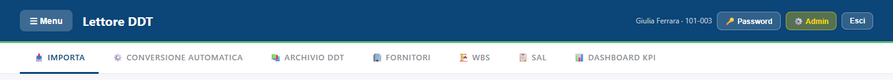
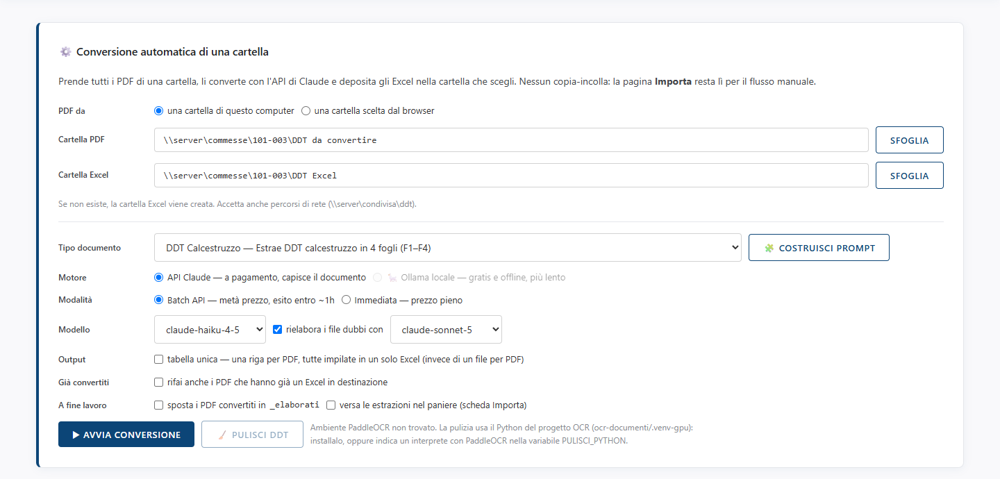
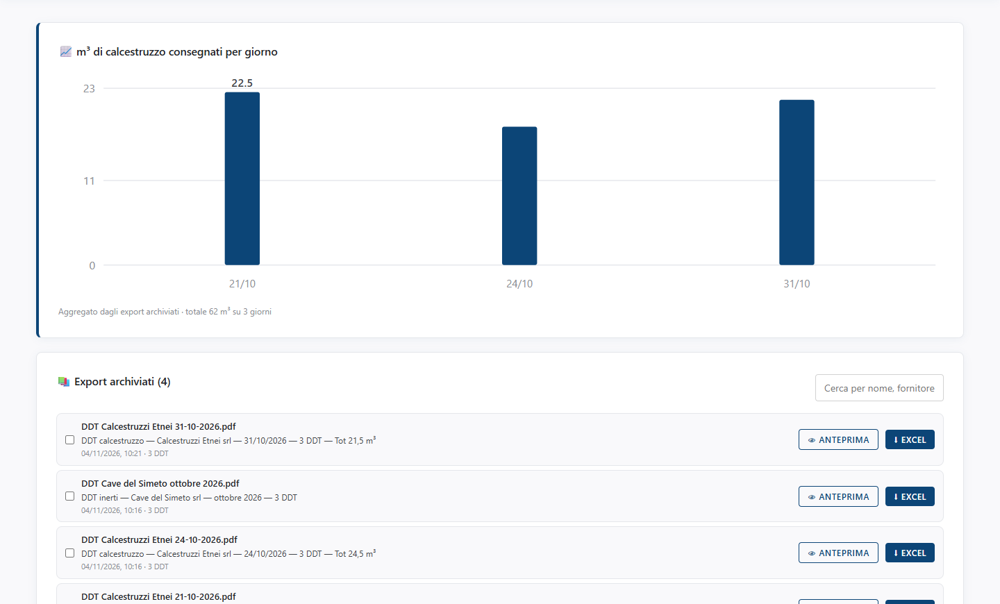
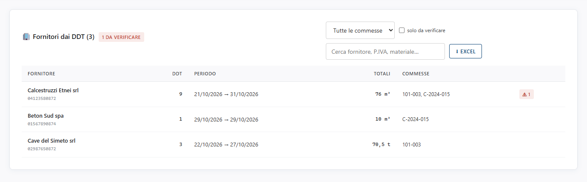
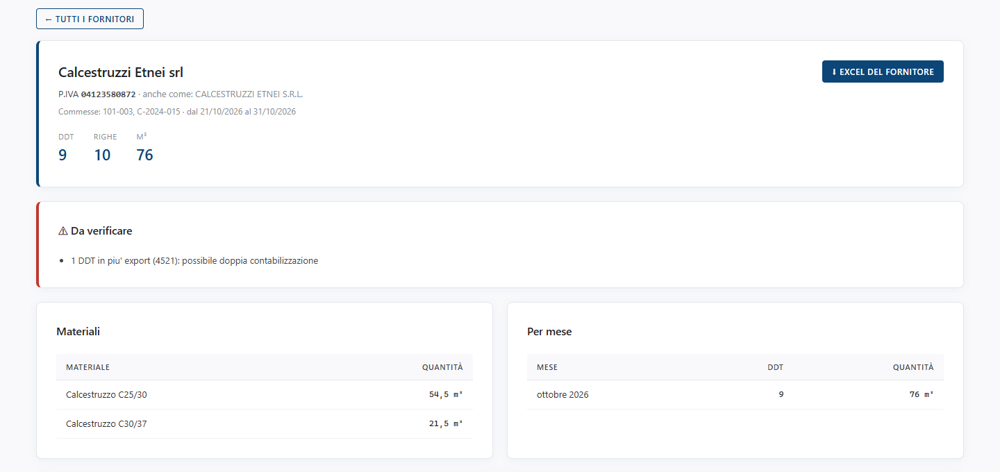

<!-- "><(((º> sabusabu <º)))>< -->
# 4. Strumenti degli amministratori

[← Indice](README.md)

Chi è **amministratore** del Lettore DDT vede più schede e il pulsante giallo **Admin** in alto a destra:

Per avere queste schede servono **due cose**: l'account del Lettore DDT deve essere *Admin* e, nel Portale,
l'utente deve essere amministratore dell'app Lettore DDT. Se manca la seconda, schede e pulsante **Admin** non
compaiono e sotto le schede una riga gialla dice *"Il tuo account del Lettore DDT è da amministratore, ma nel
Portale Suite non sei amministratore di questo programma…"*: fatti abilitare nel Portale (vedi la
[guida del Portale](../../../portale/docs/guida/README.md)). La stessa regola vale per la conversione
automatica quando è riservata agli amministratori.

## Conversione automatica di una cartella

Scheda **CONVERSIONE AUTOMATICA**: prende tutti i PDF di una cartella e li converte da sola con l'API di Claude,
senza copia-incolla. **Costa** (l'API di Claude è a pagamento) e per questo è riservata agli amministratori.

1. **PDF da**: *una cartella di questo computer* (il PC dove gira il Lettore DDT; vanno bene anche percorsi di
   rete come `\\server\commesse\101-003\DDT da convertire`) oppure *una cartella scelta dal browser* (i PDF
   vengono caricati dal tuo PC).
2. **Cartella PDF** e **Cartella Excel**: scrivile o usa **SFOGLIA**. La cartella Excel, se non esiste, viene
   creata.
3. **Tipo documento**: gli stessi tipi della scheda Importa (compresi quelli creati con **COSTRUISCI PROMPT**).
4. **Motore**:
   - *API Claude* — a pagamento, capisce il documento (scelta normale);
   - *Ollama locale* — gratis e senza internet, ma più lento e meno preciso: il risultato va ricontrollato.
     Se è grigio, sul server non è installato o manca il modello (passando il mouse si legge il motivo);
   - *OCR locale* — solo per il Registro FIR.
5. **Modalità**: *Batch API* (metà prezzo, risultato entro circa un'ora) oppure *Immediata* (prezzo pieno).
6. **Modello**: il modello di Claude; con *rielabora i file dubbi con* i file con controlli non superati
   vengono rifatti con un modello più preciso.
7. Opzioni: **tabella unica** (tutti i PDF in un solo Excel), **rifai anche i PDF che hanno già un Excel**,
   **sposta i PDF convertiti in `_elaborati`**, **versa le estrazioni nel paniere**.
8. Clicca **AVVIA CONVERSIONE**.

Il lavoro compare nell'elenco **Lavori** sotto il modulo, con lo stato (*in attesa*, *in corso*, *completato*,
*errore*, *annullato*), l'esito di ogni file, il diario e i costi. Mentre è in corso si può **Annulla lavoro**.
A fine lavoro gli Excel si prendono con **Salva nella cartella**, **Scarica Excel** o **Scarica .zip**, oppure
si versano nel paniere. Se il Lettore DDT si riavvia durante un lavoro, alla ripartenza raccoglie i risultati
già pagati invece di rifarli.

Il lavoro gira nella **commessa scelta all'ingresso**. Come la conversione singola, a fine lavoro ogni PDF
convertito va anche in **SkyTower**, con il suo **Excel** (o l'Excel unico, con *tabella unica*), e i materiali
entrano come **carichi in magazzino**: il diario del lavoro lo dice (*"Magazzino: 5 carichi registrati
(Cantiere 101-003)"*, *"SkyTower: 5 Excel nella commessa"*). Con **sposta i PDF convertiti in `_elaborati`**
parte il file nella sua nuova posizione. Se un PDF sparisce dalla cartella mentre il lavoro gira (spostato o
cancellato a mano), il diario lo dice con *"PDF originale non trovato: non inviato a SkyTower"*; l'Excel
e l'archivio della commessa restano validi.

**PULISCI DDT** prepara le scansioni sporche prima della conversione. Serve un componente di riconoscimento
testo installato sul server: se manca, accanto al pulsante compare *"Ambiente PaddleOCR non trovato"* e il
pulsante resta spento (chiedi all'amministratore di sistema).

Se in alto compare il riquadro rosso **"API key Anthropic mancante"**, la chiave dell'API non è impostata:
inseriscila dal pannello Admin (capitolo 5, *Chiave API*). Nel frattempo si lavora dalla scheda Importa.

> Le cartelle **sorvegliate** (configurate dall'amministratore di sistema) convertono da sole i PDF che ci
> finiscono dentro; quando ci sono, il loro stato compare in un riquadro in questa scheda. Lì non c'è nessuno a
> cui chiedere la commessa: la sceglie l'amministratore, una volta per cartella, dalla tendina **Commessa** del
> riquadro (l'elenco del registro della suite). Una cartella con una commessa che non è nel registro è segnata
> con *"non è nel registro della suite: i DDT non vanno in SkyTower"*.

**DDT firmati digitalmente (.p7m)**: nella cartella possono esserci anche file `.pdf.p7m`. Prima della
conversione il Lettore DDT apre ogni busta e verifica la firma; nell'elenco dei file del lavoro compare il
bollino dell'esito (verde valida, rosso non valida, giallo da verificare, dettaglio passando il mouse) e il
diario riporta una riga per ogni documento firmato. Una busta che non si apre (file rotto) fallisce da sola,
gli altri file vanno avanti. Con **sposta i PDF convertiti in `_elaborati`** si sposta il file firmato
originale. `DDT 12.pdf.p7m` e `DDT 12.pdf` nella stessa cartella darebbero lo stesso Excel: il lavoro si ferma
con *Conflitto di nomi* e chiede di rinominarne uno.

## Archivio DDT

Scheda **ARCHIVIO DDT**: tutte le conversioni salvate della tua commessa, dalla più recente.

- Il grafico in alto mostra i **m³ di calcestruzzo consegnati per giorno**.
- **Cerca per nome, fornitore, N°DDT…** filtra l'elenco.
- **ANTEPRIMA** riapre l'estrazione nella finestra di anteprima (con i controlli); **EXCEL** riscarica l'Excel.
- La spunta a sinistra mette l'estrazione nel **paniere**.

L'archivio tiene le ultime 50 conversioni per commessa; le più vecchie vengono tolte, ma le consegne restano
nel riepilogo Fornitori.

## Fornitori

Scheda **FORNITORI**: le consegne di tutti i DDT convertiti, raggruppate per fornitore, su **tutte le
commesse**.

- Il menu **Tutte le commesse** restringe a una commessa; **solo da verificare** mostra i fornitori con un
  problema; la casella di ricerca trova fornitore, P.IVA o materiale.
- Per ogni fornitore: P.IVA, numero di DDT, periodo, totali (m³, t, kg…) e commesse. Il bollino rosso **⚠**
  segnala qualcosa da controllare.
- **EXCEL** scarica l'elenco.

I fornitori si riconoscono dalla **partita IVA**: *Calcestruzzi Etnei srl* e *CALCESTRUZZI ETNEI S.R.L.* con la
stessa P.IVA sono lo stesso fornitore. Clic su un fornitore per il **dettaglio**:

Trovi materiali, totali per mese, ogni consegna (data, N°DDT, commessa, quantità, WBS, targa) e il riquadro
**Da verificare**, che segnala:

- **DDT in più export** (possibile doppia contabilizzazione), come il 4521 dell'esempio;
- **P.IVA mai letta** o con cifra di controllo sbagliata (errore di lettura);
- stessa P.IVA con nomi diversi, righe senza quantità.

**EXCEL DEL FORNITORE** scarica tutto, anche oltre le 300 righe mostrate. **← TUTTI I FORNITORI** torna
all'elenco.

## WBS, SAL e Dashboard KPI

Schede per seguire il budget di una commessa, a partire da un Excel *Output C.D.* importato (capitolo 3):

- **WBS**: voci di lavoro e articoli con quantità, prezzi, ricavi, costi e barra di avanzamento; ricerca
  *Cerca articolo, WBS…*;
- **SAL**: nel riquadro **Nuovo SAL** scegli mese e anno e clicca **Crea**; per ogni articolo inserisci la
  quantità fatta nel periodo oppure la percentuale raggiunta; **Chiudi SAL** blocca il periodo, **Riapri** lo
  riapre;
- **Dashboard KPI**: avanzamento, ricavi, costi, margine, grafici budget/realizzato e andamento dei SAL.

Il progetto si salva da solo (nel browser e sul server). Le schede si nascondono da ☰ Menu ›
*WBS / SAL / KPI*.

*Per queste tre schede non ci sono immagini: nella copia di prova non c'era un Excel Output C.D. realistico.*

[← Paniere](03-paniere-e-altri-caricamenti.md) · [Avanti: pannello di amministrazione →](05-pannello-admin.md)
