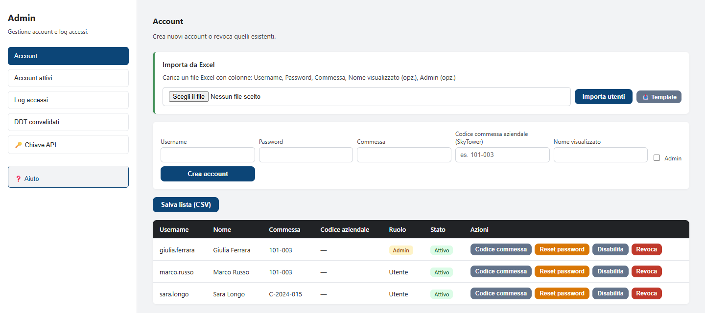
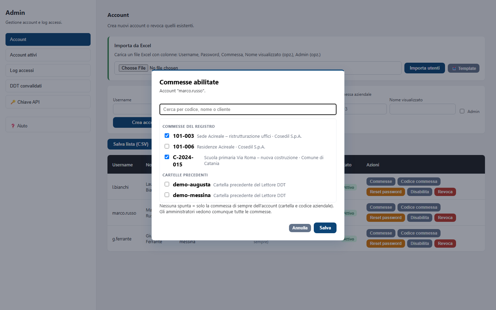
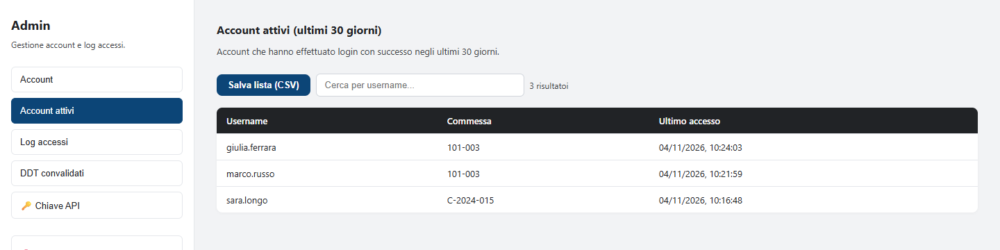
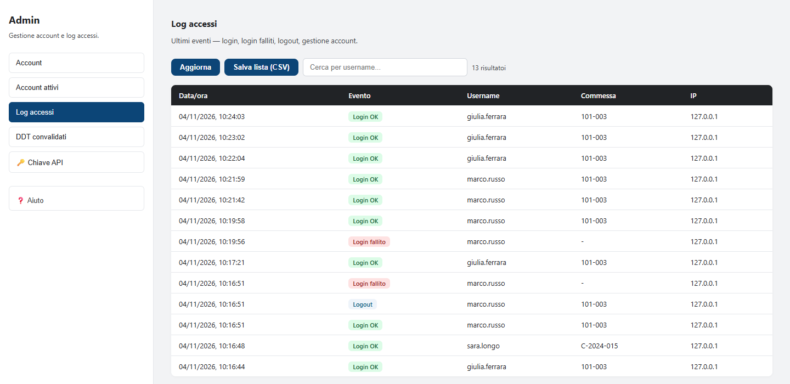
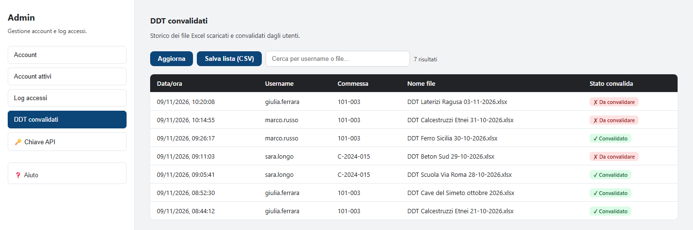
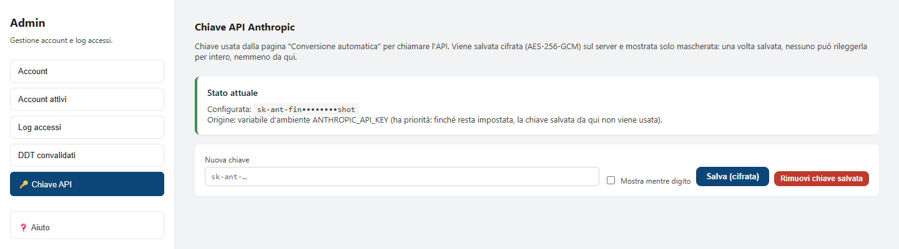

<!-- "><(((º> sabusabu <º)))>< -->
# 5. Pannello di amministrazione

[← Indice](README.md)

Clicca il pulsante giallo **Admin** in alto a destra. Si apre il pannello, con le sezioni nel menu a sinistra:
**Account**, **Account attivi**, **Log accessi**, **DDT convalidati**, **Chiave API** e **Aiuto** (la guida
amministratore completa).

> Il pannello gestisce gli account **del Lettore DDT** (nome utente, commesse abilitate, stato). Chi può aprire
> **DDT e Magazzino** dal Portale, e chi ne è amministratore, si decide invece nel Portale: vedi la
> [guida del Portale](../../../portale/docs/guida/README.md). Dal 9 novembre 2026:
>
> - chi è **amministratore nel Portale** è amministratore anche qui, anche se il suo account del Lettore DDT
>   non ha la spunta Admin; un account con la spunta Admin che nel Portale non è amministratore resta utente;
> - chi è abilitato a DDT e Magazzino nel Portale e non ha un account qui lo trova **creato da solo** al primo
>   ingresso (colonna Ruolo: *dal portale*): senza password propria (vale quella del Portale) e **senza
>   commesse**, finché non gliele abiliti tu con il pulsante **Commesse**.

## Account

### Creare un account

Compila la riga in alto e clicca **Crea account**:

| Campo | Cosa scrivere |
|---|---|
| **Username** | lettere, numeri e `. _ @ -` (es. `marco.russo`); deve essere unico |
| **Password** | almeno 8 caratteri; l'utente la cambia al primo accesso |
| **Commessa** | il codice che separa i dati (es. `101-003`). Chi ha la stessa commessa condivide gli stessi dati |
| **Codice commessa aziendale (SkyTower)** | il codice ufficiale della commessa (es. `101-003`): con questo i PDF dei DDT finiscono anche nella commessa giusta di SkyTower e le righe dei DDT entrano nel Magazzino come carichi del cantiere con lo stesso codice. Vuoto = vale la **Commessa** se è già un codice del registro della suite; altrimenti nessun invio a SkyTower e i carichi del Magazzino restano in "Cantiere &lt;commessa&gt;" (lo segnala il Magazzino) |
| **Nome visualizzato** | il nome che compare in alto nel programma |
| **Admin** | spunta solo per chi deve amministrare |

### Importare molti utenti da Excel

Nel riquadro **Importa da Excel**: **Template** scarica un file d'esempio con le colonne *Username, Password,
Commessa, Nome visualizzato, Admin* (*sì*/*no*). Compilalo, sceglilo con **Scegli il file** e clicca **Importa
utenti**: il messaggio dice quanti account sono stati creati e quali righe sono state scartate e perché.
Il file contiene password in chiaro: cancellalo dopo l'importazione e non mandarlo per email.

### Gestire un account

Nella tabella, colonna **Azioni**:

- **Commesse**: sceglie le **commesse abilitate**, cioè quelle che l'utente può scegliere entrando in DDT e
  Magazzino (vedi sotto);
- **Codice commessa**: cambia il codice commessa aziendale (quello di SkyTower e del Magazzino). Vale per i
  DDT salvati da quel momento; nel Magazzino il cantiere creato prima passa da solo al codice nuovo;
- **Reset password**: imposta una password nuova (almeno 8 caratteri); comunicala all'utente;
- **Disabilita / Abilita**: sospende o riattiva l'accesso **senza cancellare niente** (preferibile);
- **Revoca**: elimina l'account per sempre (i dati della commessa restano). Chiede conferma.

Non puoi disabilitare o revocare te stesso né l'ultimo amministratore attivo. **Salva lista (CSV)** scarica
l'elenco degli account.

### Commesse abilitate

Ogni utente che non è amministratore lavora solo nelle commesse che gli abiliti: le vede nella finestra *In che
commessa lavori?* e il programma rifiuta tutte le altre, anche se qualcuno prova a chiederle a mano. Gli
amministratori le vedono tutte. La colonna **Commesse abilitate** della tabella mostra l'elenco di ciascuno;
*(di sempre)* vuol dire che l'utente non ha un elenco e usa la sua commessa di prima (cartella e codice
aziendale), *nessuna* che non può ancora lavorare nel Lettore DDT.

1. Clicca **Commesse** sulla riga dell'utente.
2. Cerca per codice, nome o cliente e spunta le commesse del registro della suite (ed eventualmente le
   **cartelle precedenti** del Lettore DDT, con i DDT di prima del registro).
3. Clicca **Salva**.

Senza nessuna spunta l'utente torna alla sua commessa di sempre. Se togli una commessa che l'utente sta usando,
smette di funzionare subito e il programma gli chiede di sceglierne un'altra. Ogni cambiamento resta nel **Log
accessi** come *Commesse abilitate*, con chi l'ha fatto, quali commesse sono state aggiunte e quali tolte.

## Account attivi

Gli account che sono entrati almeno una volta negli **ultimi 30 giorni**, con l'ultimo accesso. Utile per
scoprire gli account mai usati.

## Log accessi

Gli ultimi eventi: **Login OK**, **Login fallito**, login bloccati, **Logout**, account creati, revocati,
disabilitati, password cambiate, chiave API aggiornata, **Commessa scelta** (anche quella scelta da sola,
quando l'utente ne ha una sola), **Commesse abilitate** (chi le ha cambiate e come), **DDT convalidato** (un utente ha cliccato *✓ Dati
convalidati*), **DDT firmato (.p7m)** (un utente ha caricato un DDT firmato digitalmente: sotto il bollino il
nome del file e l'esito della firma; bollino verde, rosso o giallo come l'esito). Per ognuno data e ora,
utente, commessa e indirizzo IP.
**Aggiorna** ricarica, la casella cerca per username, **Salva lista (CSV)** scarica.

Molti *Login fallito* dello stesso utente = password dimenticata (proponi un reset) oppure qualcuno che prova
a indovinarla.

## DDT convalidati

Lo storico dei file Excel scaricati: data, utente, commessa, nome del file e **Stato convalida**
(*✓ Convalidato* / *✗ Da convalidare*). Sopra la tabella, il conteggio (*1 risultato*, *12 risultati*) segue
la ricerca.

Ogni Excel scaricato dalla scheda Importa entra come *✗ Da convalidare*; quando l'utente clicca **✓ Dati
convalidati** la **stessa riga** passa a *✓ Convalidato* con l'ora della convalida (dal 06/11/2026: prima il
pulsante non aggiornava lo stato). La convalida compare anche nel **Log accessi** come *DDT convalidato* e nel
registro del Portale come *Excel verificato · convalidato*. Nell'immagine: quattro Excel già convalidati e tre
ancora da convalidare (dati inventati).

## Chiave API

La chiave dell'API di Anthropic (inizia con `sk-ant-`) serve solo alla **Conversione automatica**.

- **Stato attuale** mostra se c'è una chiave e da dove arriva, sempre **mascherata**: una volta salvata nessuno
  può rileggerla per intero.
- Per inserirla: incollala in **Nuova chiave** (spunta *Mostra mentre digito* per controllarla) e clicca
  **Salva (cifrata)**.
- **Rimuovi chiave salvata** la cancella: la conversione automatica smette di funzionare.

Se lo stato dice *"Origine: variabile d'ambiente ANTHROPIC_API_KEY"*, la chiave è impostata sul server e ha la
precedenza su quella salvata qui. Ogni salvataggio o rimozione finisce nel Log accessi.

[← Strumenti degli amministratori](04-strumenti-amministratori.md) · [Avanti: problemi frequenti →](06-problemi-frequenti.md)
