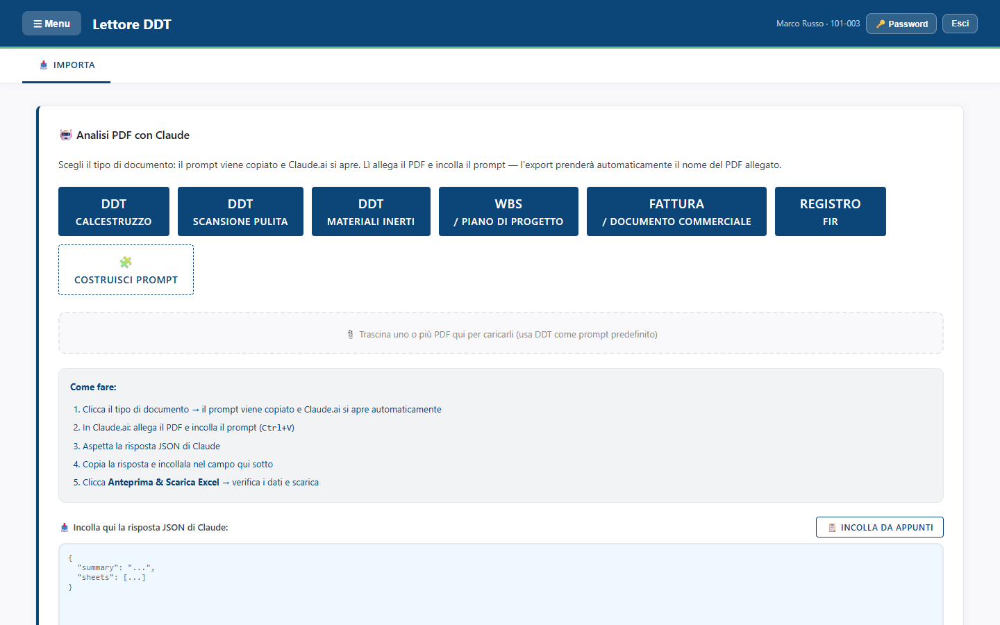

<!-- "><(((º> sabusabu <º)))>< -->
# Lettore DDT — Guida per chi lo usa

Il **Lettore DDT** trasforma i documenti di trasporto (DDT) in PDF in fogli **Excel** ordinati: fornitore,
numero del DDT, data, targa, metri cubi o tonnellate, parte d'opera. Funziona anche con DDT di inerti,
fatture, piani di progetto (WBS) e registri dei rifiuti (FIR).

La lettura del PDF la fa **Claude** (l'intelligenza artificiale): tu scegli il tipo di documento, il Lettore DDT
prepara le istruzioni giuste, le incolli in Claude insieme al PDF e riporti qui la risposta. Il Lettore DDT
controlla i numeri, ti fa vedere un'anteprima e ti scarica l'Excel.

## A chi serve

- **Ufficio acquisti, contabilità, segreteria tecnica**: per mettere in Excel i DDT del calcestruzzo, degli
  inerti e le fatture, senza ricopiarli a mano.
- **Amministratori**: in più convertono intere cartelle di PDF in automatico, consultano l'archivio dei DDT,
  il riepilogo per fornitore e gestiscono gli account.

## Indice

1. [Entrare, cambiare la password, uscire](01-accesso.md)
2. [Convertire un DDT in Excel (passo per passo)](02-convertire-un-ddt.md)
3. [Paniere, tipi di documento e altri modi di caricare i dati](03-paniere-e-altri-caricamenti.md)
4. [Strumenti degli amministratori: conversione automatica, archivio, fornitori](04-strumenti-amministratori.md)
5. [Pannello di amministrazione: account, accessi, chiave API](05-pannello-admin.md)
6. [Problemi frequenti e messaggi](06-problemi-frequenti.md)
7. [Appendice per l'amministratore di sistema](07-amministratore-di-sistema.md)

## In due righe

1. Apri il **Portale**, clicca la scheda **Lettore DDT** ed entra con il tuo utente del Lettore DDT.
2. Clicca il tipo di documento (es. **DDT Calcestruzzo**), allega il PDF in Claude e incolla con **Ctrl+V**.
3. Copia la risposta di Claude, incollala nel riquadro **Incolla qui la risposta JSON di Claude**.
4. Clicca **Anteprima & Scarica Excel**, controlla, poi **Conferma e scarica Excel**.

> Il Lettore DDT si apre **solo passando dal Portale**. Per l'accesso al Portale e per farti abilitare
> al Lettore DDT vedi la [guida del Portale](../../../portale/docs/guida/README.md).

---

*Le immagini di questa guida sono state fatte su una copia di prova con dati inventati (fornitori, commesse
101-003 Sede Acireale e C-2024-015 Scuola Via Roma, utenti di esempio). Guida aggiornata al 4 novembre 2026.*
