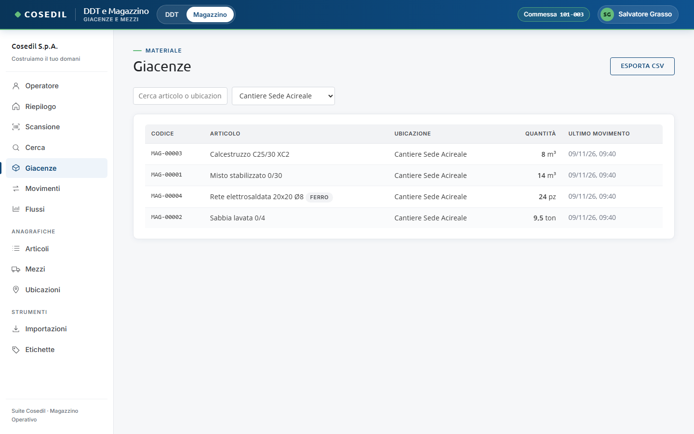
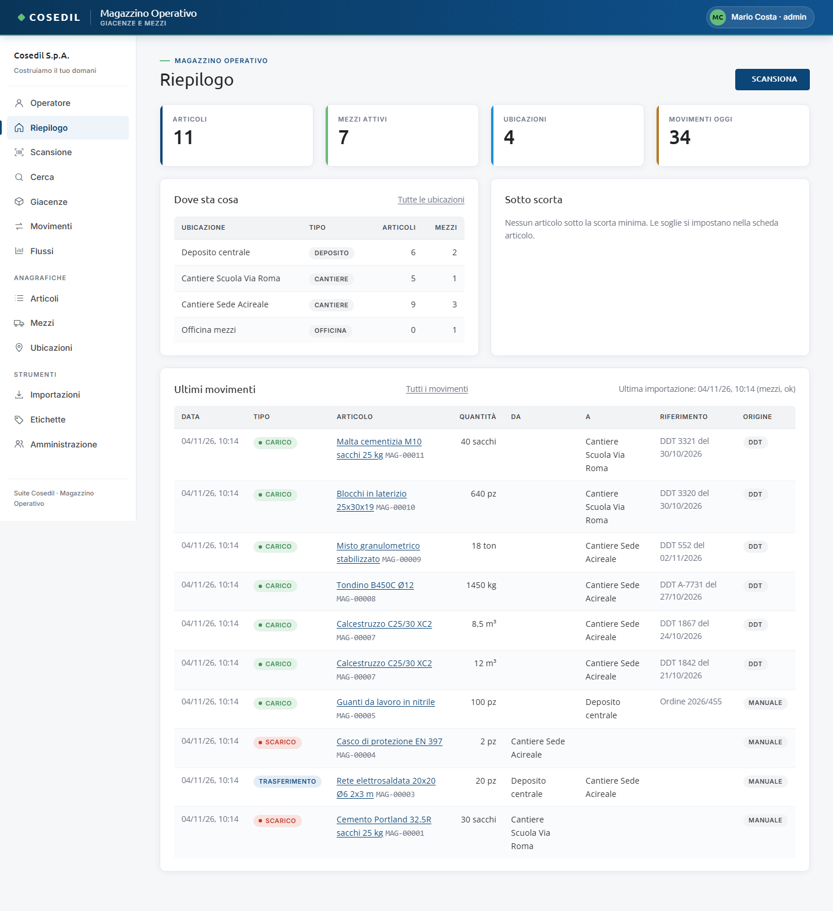

<!-- "><(((º> sabusabu <º)))>< -->
# 1. Primi passi

[← Indice](README.md)

## Come si entra

Dal 09/11/2026 il Magazzino è una parte del programma unico **"DDT e Magazzino"**, insieme al
Lettore DDT. Non ha un login suo: si apre dal **Portale**, cliccando la scheda **DDT e
Magazzino**. All'ingresso il programma chiede **in che commessa lavori** (la scelta vale finché
resti dentro e si cambia dalla parte DDT). Se non hai fatto l'accesso al Portale vieni
rimandato alla pagina di login; se la scheda non compare, il tuo utente non è abilitato né al
Lettore DDT né al Magazzino. Per entrambe le cose vedi la
[guida del Portale](../../../portale/docs/guida/README.md).

- In alto, accanto al nome, le due linguette **DDT | Magazzino**: passano da una parte
  all'altra dello stesso programma.
- A destra la **commessa** scelta all'ingresso (nell'immagine *Commessa 101-003*). Il
  Magazzino la usa come proposta, sempre modificabile:
  - **Giacenze** e **Movimenti** si aprono già filtrati sul cantiere della commessa (nel menu
    a tendina scegli *Tutte le ubicazioni* per vedere tutto);
  - **Ubicazioni** mostra solo quelle della commessa: togli la spunta *solo la commessa …* per
    vederle tutte; **Nuova ubicazione** propone un cantiere con quel codice;
  - in un carico o un trasferimento a mano l'ubicazione di arrivo proposta è il cantiere
    della commessa.
- Il Magazzino si apre all'indirizzo del Lettore DDT seguito da `/magazzino/`. Il vecchio
  indirizzo con il numero di porta del Magazzino serve solo all'amministratore di sistema.

In alto a destra trovi le tue iniziali e il tuo nome; se compare **· admin** sei
amministratore del Magazzino (vedi sotto).

## Com'è fatta la pagina

- **Barra blu in alto**: nome del programma (con le linguette **DDT | Magazzino** e la
  commessa, dentro il programma unico) e il tuo utente.
- **Menu a sinistra**, diviso in tre gruppi:
  - *Operatore, Riepilogo, Scansione, Cerca, Giacenze, Movimenti, Flussi* — il lavoro di ogni giorno;
  - *Anagrafiche*: **Articoli**, **Mezzi**, **Ubicazioni**;
  - *Strumenti*: **Importazioni**, **Etichette** e, solo per gli amministratori, **Amministrazione**.
- **Area centrale**: la vista scelta.

Sul telefono il menu diventa una barra in basso: vedi [Dal telefono](08-telefono.md).

## Il Riepilogo

È la pagina che si apre dal computer.

- **Quattro riquadri**: quanti articoli, mezzi attivi, ubicazioni e movimenti registrati oggi.
- **Dove sta cosa**: per ogni ubicazione quanti articoli e quanti mezzi ci sono. Un clic
  sulla riga apre la scheda dell'ubicazione.
- **Sotto scorta**: gli articoli scesi sotto la *scorta minima* (la soglia si imposta
  nella scheda dell'articolo, vedi [Anagrafiche](04-anagrafiche.md)). Se è vuoto compare
  "Nessun articolo sotto la scorta minima".
- **Ultimi movimenti**: gli ultimi carichi, scarichi e trasferimenti, con l'origine
  (**DDT**, **VFP**, **scansione**, **manuale**) e l'ora dell'ultima importazione automatica.
- **Riepilogo del giorno** (in fondo): i riepiloghi mandati in SkyTower e il pulsante per
  mandare subito quello di oggi, vedi [Collegamenti con la suite](09-suite.md#riepilogo-del-giorno-in-skytower).
- Il pulsante **Scansiona** in alto a destra porta alla [scansione](02-scansione.md).

## Chi può fare cosa

| Tutti gli utenti abilitati | Solo gli amministratori del Magazzino |
|---|---|
| Scansionare, consultare giacenze, mezzi, movimenti, grafici | Eliminare articoli, mezzi, ubicazioni, movimenti e foto |
| Registrare carichi, scarichi, trasferimenti, rettifiche, inventari | Vedere la vista **Amministrazione** |
| Creare e modificare articoli, mezzi, ubicazioni | Caricare a mano un file JSON nelle **Importazioni** |
| Spostare i mezzi e cambiarne lo stato, caricare foto | Vedere i percorsi completi delle cartelle di importazione |
| Stampare le etichette, avviare la lettura delle importazioni | |

I pulsanti **Elimina** non compaiono a chi non è amministratore.
