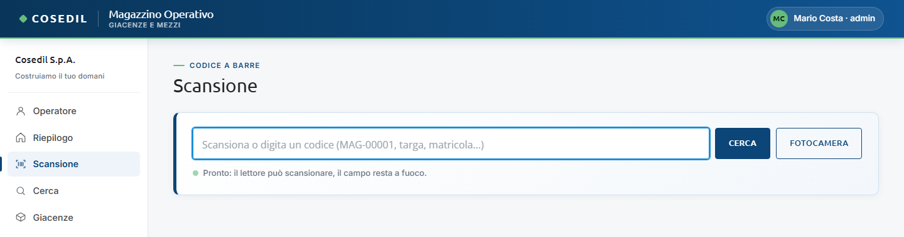
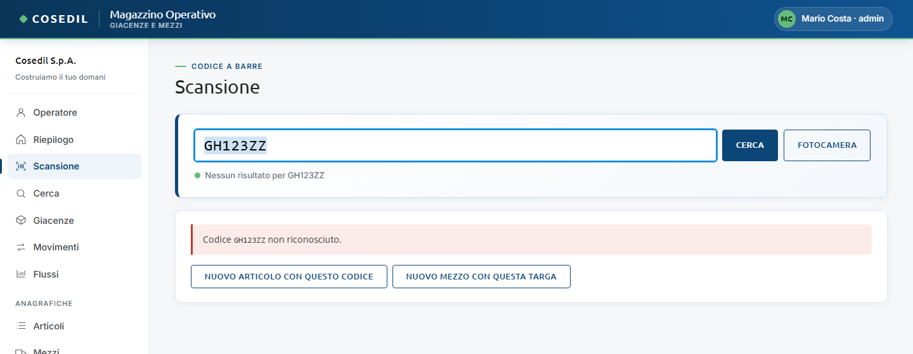
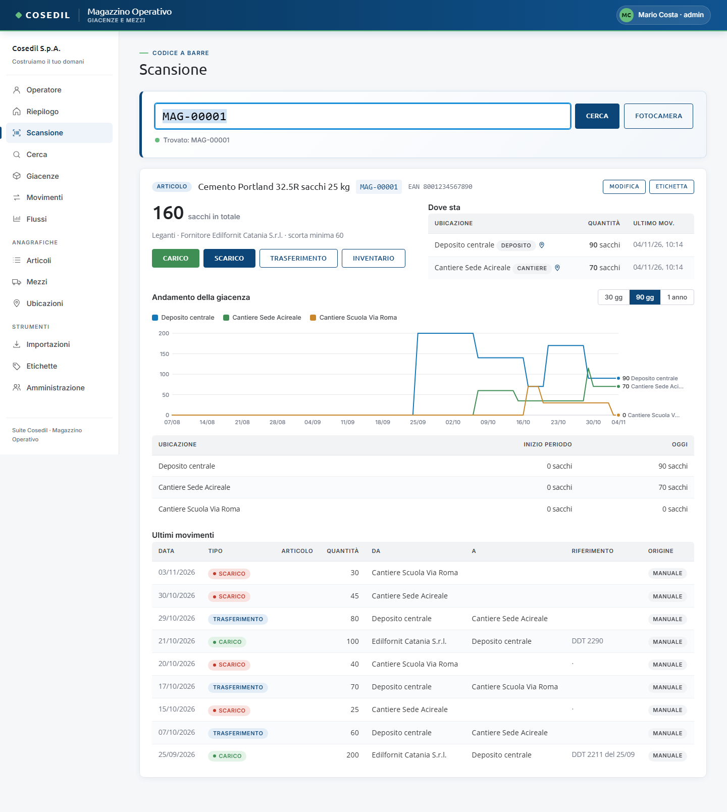
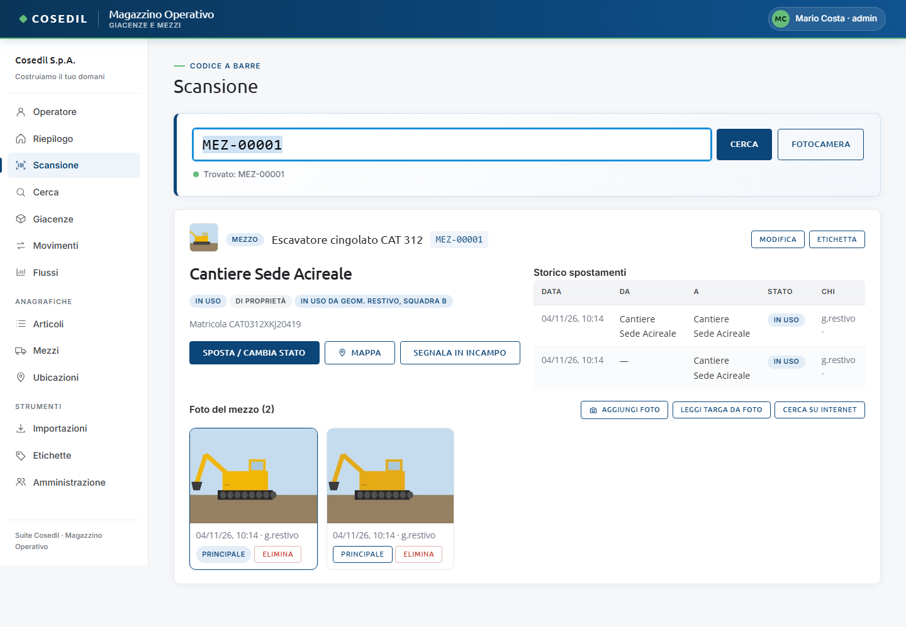
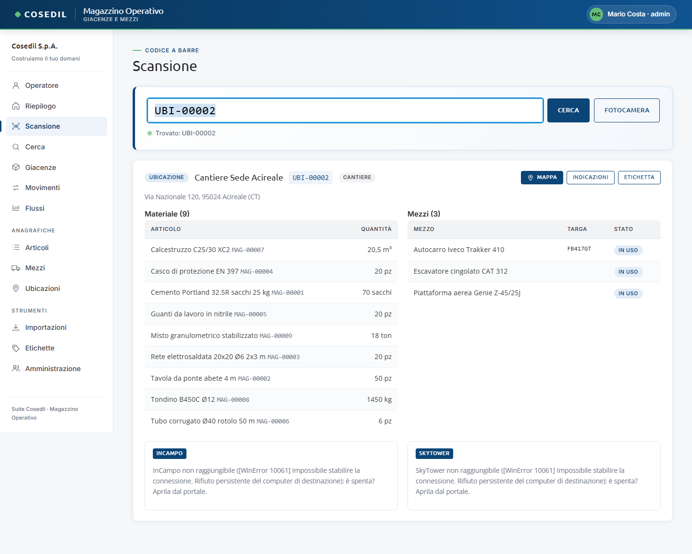

<!-- "><(((º> sabusabu <º)))>< -->
# 2. Scansione e schede

[← Indice](README.md)

La vista **Scansione** è il cuore del Magazzino: si legge un codice e si apre la scheda
di quello che c'è dietro (un articolo, un mezzo o un'ubicazione).

## Con il lettore di codici a barre (USB o Bluetooth)

1. Apri **Scansione** dal menu.
2. Il campo è già pronto ("Pronto: il lettore può scansionare, il campo resta a fuoco").
3. Spara il codice con il lettore: il lettore "scrive" il codice e preme Invio da solo.
4. Sotto compare la scheda; la riga di stato dice "Trovato: MAG-00001".

Il campo resta sempre a fuoco anche se clicchi altrove nella pagina, così puoi
scansionare un codice dopo l'altro senza toccare il mouse.

## Scrivendo il codice a mano

Scrivi nel campo il codice e premi **Cerca** (o Invio). Funzionano:

- i codici interni `MAG-…`, `MEZ-…`, `UBI-…`;
- il **codice esterno** di un articolo (l'EAN del fornitore, se è stato inserito);
- la **targa** o la **matricola** di un mezzo.

## Con la fotocamera

Premi **Fotocamera**: si apre l'inquadratura, punta il codice a barre o il QR e il
Magazzino lo legge da solo (il telefono vibra). Premi **Chiudi fotocamera** per smettere.

La fotocamera funziona solo se il Magazzino è aperto da un indirizzo sicuro
(`https://…`, quello del Portale). Se compare "La fotocamera funziona solo su https o
localhost…" vedi [Se qualcosa non va](11-problemi.md). La prima volta serve internet,
perché il lettore viene scaricato.

## Codice non riconosciuto

Se il codice non esiste compare "Codice … non riconosciuto." e, se ci sono voci simili,
l'elenco **Forse cercavi** (clicca quella giusta). Due pulsanti permettono di creare
subito la voce mancante:

- **Nuovo articolo con questo codice** — il codice letto diventa il codice esterno (EAN);
- **Nuovo mezzo con questa targa** — il codice letto diventa la targa.

## La scheda di un articolo

- In alto: descrizione, codice `MAG-…`, EAN, e i pulsanti **Modifica** ed **Etichetta**.
- A sinistra il **totale** in tutte le ubicazioni, la categoria, il fornitore, la scorta
  minima e i pulsanti **Carico**, **Scarico**, **Trasferimento**, **Inventario**
  (vedi [Movimenti e giacenze](03-movimenti.md)).
- **Dove sta**: la quantità in ogni ubicazione, con l'icona della mappa se l'ubicazione
  ha un indirizzo.
- **Andamento della giacenza**: un grafico con una linea per ubicazione; scegli
  **30 gg**, **90 gg** o **1 anno**.
- **Ultimi movimenti** dell'articolo.

## La scheda di un mezzo

- Dove si trova adesso (in grande), lo **stato** (Disponibile, In uso, Manutenzione,
  Fermo, Restituito), se è di proprietà o a nolo e **chi lo sta usando**.
- Targa, matricola, ditta e date del nolo.
- **Sposta / cambia stato** — vedi [Movimenti e giacenze](03-movimenti.md#spostare-un-mezzo).
- **Mappa** — apre Google Maps sul punto dell'ubicazione attuale.
- **Segnala in InCampo** — compare se il mezzo è in un cantiere con codice commessa:
  apre un task in InCampo (vedi [Collegamenti con la suite](09-suite.md)).
- **Storico spostamenti**: da dove a dove, con quale stato e chi l'ha registrato.
- **Foto del mezzo**: vedi [Anagrafiche](04-anagrafiche.md#foto-dei-mezzi).

## La scheda di un'ubicazione

- Nome, codice `UBI-…`, tipo e indirizzo, con **Mappa**, **Indicazioni** (percorso
  stradale) ed **Etichetta**.
- **Materiale**: gli articoli presenti con la quantità; **Mezzi**: i mezzi che si
  trovano lì con lo stato. Un clic su una riga apre la sua scheda.
- Se l'ubicazione ha un **codice commessa**, in fondo compaiono i riquadri **InCampo** e
  **SkyTower** (vedi [Collegamenti con la suite](09-suite.md)). Nell'immagine i due
  programmi sono spenti e i riquadri lo dicono: il resto della scheda funziona lo stesso.

## Cerca

Se non hai il codice sotto mano usa **Cerca** dal menu: scrivi almeno due lettere
(descrizione, codice, targa, matricola, nome del cantiere) e trovi articoli, mezzi e
ubicazioni in un unico elenco. Vedi l'immagine in [Dal telefono](08-telefono.md#cerca).
