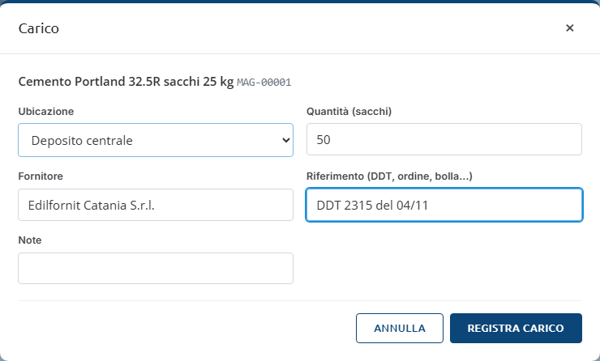
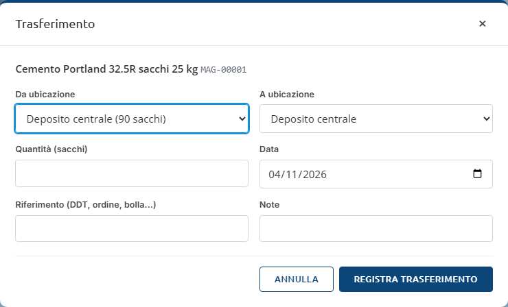
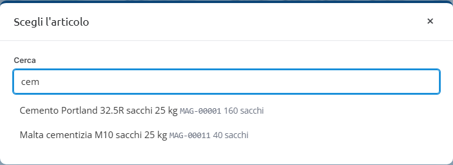
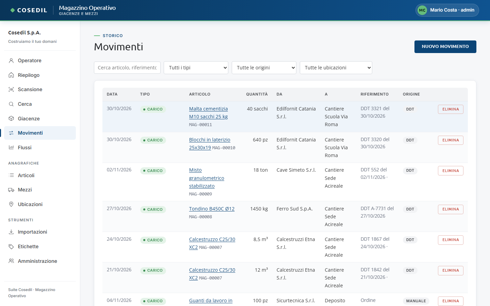
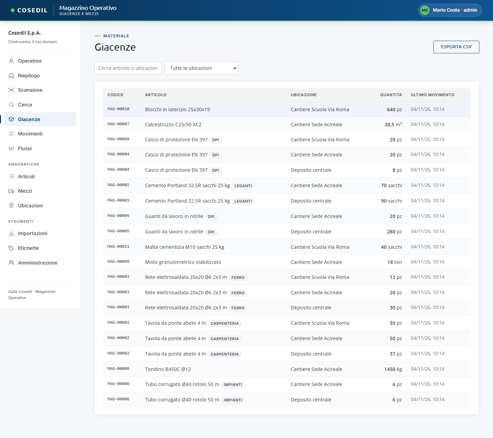
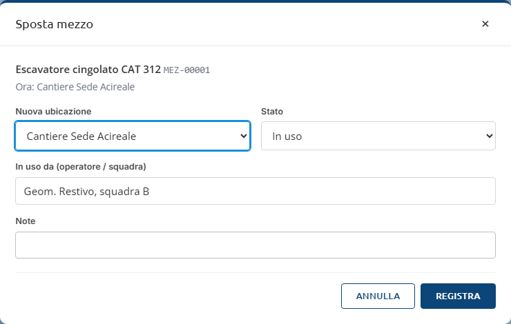

<!-- "><(((º> sabusabu <º)))>< -->
# 3. Movimenti e giacenze

[← Indice](README.md)

## I cinque tipi di movimento

| Movimento | Quando si usa | Effetto sulla giacenza |
|---|---|---|
| **Carico** | arriva materiale dal fornitore | + quantità nell'ubicazione di arrivo |
| **Scarico** | il materiale viene consumato in cantiere | − quantità dall'ubicazione |
| **Trasferimento** | si sposta materiale da un posto all'altro | − da una ubicazione, + nell'altra |
| **Rettifica** | si corregge un errore | quantità con segno (+5 aggiunge, −5 toglie) |
| **Inventario** | si è contato il materiale | scrivi il conteggio reale, il Magazzino registra la differenza |

La giacenza è sempre la **somma dei movimenti**: non c'è un numero da sovrascrivere.

## Registrare un movimento dalla scheda dell'articolo (il modo più veloce)

1. Scansiona l'articolo (vedi [Scansione](02-scansione.md)).
2. Premi **Carico**, **Scarico**, **Trasferimento** o **Inventario**.
3. Compila la finestra e premi **Registra …**.

- **Carico**: ubicazione di arrivo, quantità, fornitore (proposto quello abituale),
  riferimento (n. DDT, ordine, bolla) e note.
- **Scarico** e **Trasferimento**: "Da ubicazione" propone solo le ubicazioni dove
  l'articolo c'è, con la quantità disponibile tra parentesi; per il trasferimento
  scegli anche "A ubicazione". Puoi indicare la **Data** se registri qualcosa in ritardo.

- **Inventario**: scegli l'ubicazione e scrivi il **Conteggio reale**.

A movimento registrato compare in basso a destra il messaggio verde (es. "Carico
registrato") e la scheda si aggiorna.

### Scarico o trasferimento oltre la giacenza

Se provi a togliere più di quanto risulta, il browser chiede conferma con un messaggio
come "Giacenza insufficiente in Deposito centrale: disponibili 20 pz, richiesti 25.
Registrare comunque?".

- **Annulla** se hai sbagliato la quantità o l'ubicazione;
- **OK** se il materiale c'è davvero (per esempio il DDT di carico non è ancora stato
  importato): il movimento viene registrato e la giacenza può andare in negativo, in
  rosso, finché il carico non arriva.

## Registrare un movimento dalla vista Movimenti

Utile per la **Rettifica**, che dalla scheda non c'è.

1. Menu **Movimenti** → **Nuovo movimento**.
2. Nella finestra **Scegli l'articolo** scrivi parte della descrizione o il codice e
   clicca l'articolo.

   

3. Scegli il **Tipo di movimento** (carico, scarico, trasferimento, rettifica, inventario).

   

4. Compila la finestra come sopra e conferma.

## Prelevare il materiale usato (più articoli in una volta)

Quando a fine giornata, o a fine lavorazione, si deve togliere dal cantiere quello che si è consumato, non
serve fare uno scarico per volta. La vista **Prelievo** (dal menu; sul telefono il tasto grande **Preleva**;
nella scheda di un cantiere il tasto **Preleva da qui**) lavora così:

1. in alto a sinistra c'è l'**ubicazione**: nel programma unico DDT e Magazzino è già il cantiere della
   commessa scelta all'ingresso, altrimenti si sceglie dall'elenco;
2. sotto compare **solo il materiale che c'è in quell'ubicazione**, con la quantità disponibile; la casella
   *Cerca articolo* lo filtra. Si tocca un articolo per metterlo nel prelievo, oppure se ne scansiona il
   codice (lettore o fotocamera) nella riga *Scansiona o digita un codice*;
3. a destra, nel riquadro **Da prelevare**, si corregge la quantità di ogni riga e si scrive una causale, per
   esempio "getto fondazioni, squadra B"; una riga si toglie con la ×, *Svuota* ricomincia da capo;
4. **Registra prelievo** scrive uno scarico per ogni riga, tutti con lo stesso riferimento ("Prelievo del
   13/11/2026 10:42"), la causale e **il nome di chi lo ha fatto**, cioè l'utente entrato dal portale.

Chi ha fatto cosa si legge nella colonna **Chi** della vista Movimenti e della scheda articolo, in *Le tue
registrazioni di oggi* della pagina Operatore e, per gli amministratori, in *Chi ha caricato cosa*. Sotto il
riquadro restano gli **ultimi prelievi** fatti da quell'ubicazione. Se una quantità supera la giacenza il
prelievo si ferma e dice per quali articoli; *Registrare comunque* lo forza, come per lo scarico singolo.

## La vista Movimenti

Lo storico di tutti i movimenti (gli ultimi 300), con filtri per testo (articolo,
riferimento, fornitore), **tipo**, **origine** (DDT, scansione, manuale) e
**ubicazione**. Un clic sul nome dell'articolo apre la sua scheda.

Gli **amministratori** vedono anche **Elimina** su ogni riga: dopo la conferma
"Eliminare questo movimento? La giacenza si ricalcola." il movimento sparisce e la
giacenza torna da sola al valore giusto.

## La vista Giacenze

Quanto c'è di ogni articolo in ogni ubicazione, con la data dell'ultimo movimento.
Filtra scrivendo nel campo di ricerca o scegliendo un'ubicazione. **Esporta CSV**
scarica la tabella che stai vedendo (si apre con Excel). Le quantità negative sono in
rosso: di solito manca un carico.

## Spostare un mezzo

Dalla scheda del mezzo (**Sposta / cambia stato**) o dalla lista **Mezzi** (**Sposta**):

- **Nuova ubicazione** (oppure "Lascia dove sta" se cambi solo lo stato);
- **Stato**: Disponibile, In uso, In manutenzione, Fermo, Restituito al noleggiatore;
- **In uso da**: chi ha il mezzo (operatore o squadra). Si cancella da solo quando il
  mezzo torna in uno stato diverso da "In uso";
- **Note**, poi **Registra**. Compare "Spostamento registrato" e lo spostamento entra
  nello storico del mezzo.

Se non cambi né ubicazione, né stato, né chi lo usa, il Magazzino risponde "Indicare una
nuova ubicazione, un nuovo stato o chi lo usa".
