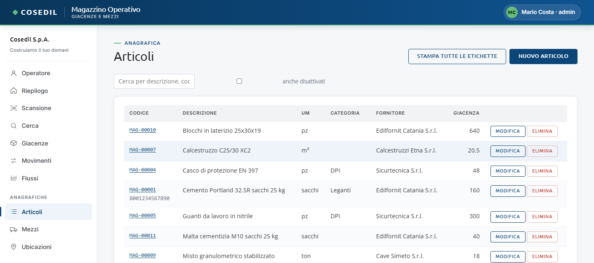
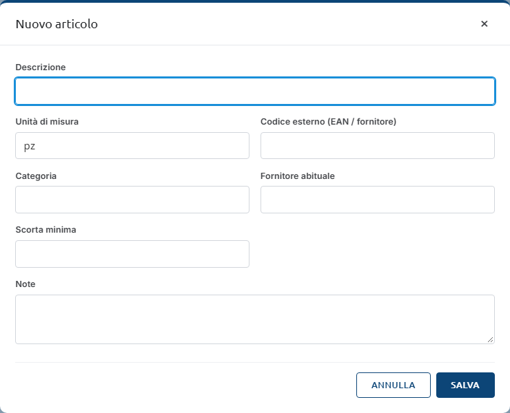
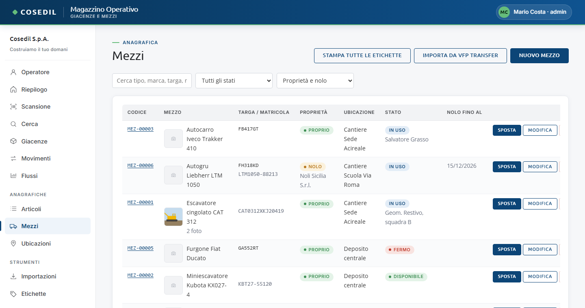
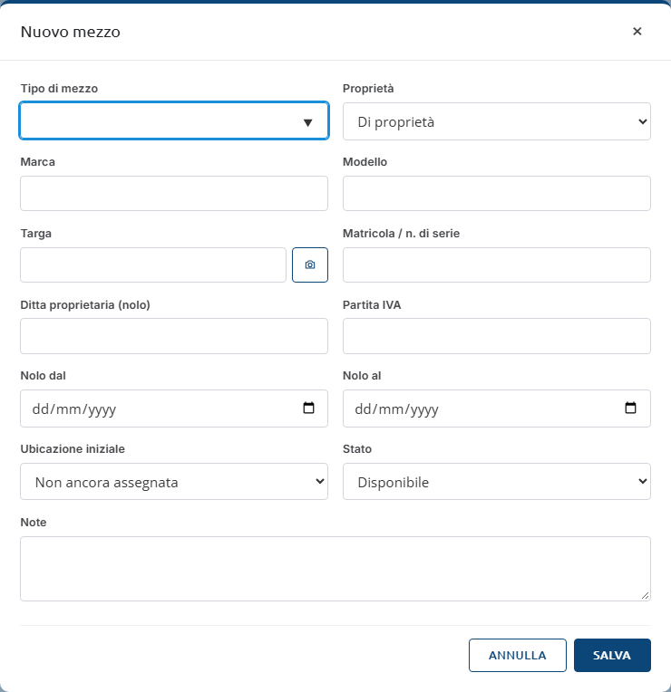
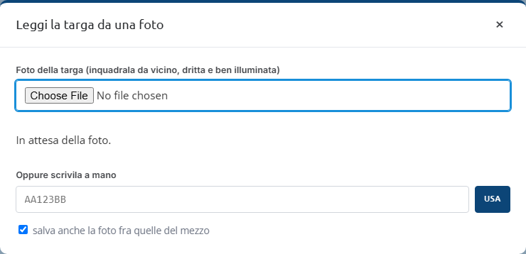
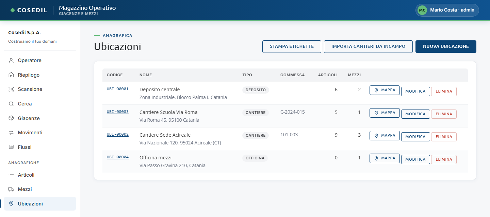
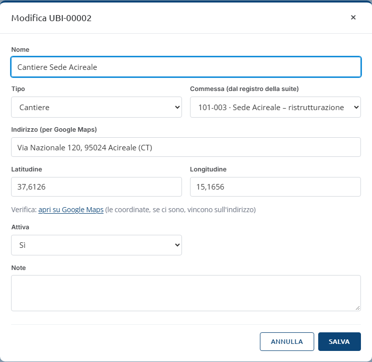

<!-- "><(((º> sabusabu <º)))>< -->
# 4. Anagrafiche: articoli, mezzi, ubicazioni

[← Indice](README.md)

Le anagrafiche stanno nel menu sotto **Anagrafiche**. Tutti gli utenti possono creare e
modificare; **eliminare** è riservato agli amministratori.

## Articoli

L'elenco mostra codice (ed EAN sotto), descrizione, unità di misura, categoria,
fornitore e giacenza totale (in rosso se sotto la scorta minima). Il campo di ricerca
filtra per descrizione, codice o categoria; **anche disattivati** mostra pure gli
articoli spenti (in grigio).

- **Nuovo articolo** apre la scheda vuota:

  

  - **Descrizione** (obbligatoria) e **Unità di misura** (pz, m³, kg, ton, m, m², l,
    colli, sacchi… oppure scrivine un'altra);
  - **Codice esterno (EAN / fornitore)**: se lo inserisci, scansionando il codice a barre
    del fornitore il Magazzino riconosce l'articolo;
  - **Categoria**, **Fornitore abituale**, **Scorta minima** (sotto questa soglia
    l'articolo compare in "Sotto scorta" nel Riepilogo), **Note**.
  - Premi **Salva**: compare "Articolo salvato" e l'articolo riceve il suo codice `MAG-…`.
- **Modifica** riapre la stessa scheda; in più c'è **Attivo** (Sì / No).
- **Elimina** (solo admin): se l'articolo ha movimenti non viene cancellato ma
  **disattivato**, così lo storico resta.

Gli articoli che arrivano dai DDT vengono creati da soli (nota "Creato dall'importazione
DDT"): conviene poi completarli con categoria e scorta minima.

## Mezzi

Per ogni mezzo: codice, foto (o un'icona che cerca il mezzo su internet), targa e
matricola, **Proprio** o **Nolo** (con la ditta), ubicazione, stato e chi lo usa, fine
nolo. Filtri per testo, **stato** e **proprietà**.

Su ogni riga: **Sposta** (vedi [Spostare un mezzo](03-movimenti.md#spostare-un-mezzo)),
**Modifica** ed **Elimina** (solo admin: cancella il mezzo, il suo storico e le foto). La
tabella è larga: se non vedi i pulsanti scorri la tabella verso destra.

In alto:

- **Stampa tutte le etichette** — vedi [Etichette](05-etichette.md);
- **Importa da VFP Transfer** — legge subito le pratiche dei mezzi a nolo (vedi
  [Importazioni](06-importazioni.md)); compare "Importazione mezzi: N pratiche lette";
- **Nuovo mezzo**.

Compila **Tipo di mezzo** (obbligatorio, con suggerimenti: escavatore, autocarro, gru…),
**Proprietà** (Di proprietà / A nolo), marca, modello, targa, matricola; per i mezzi a
nolo ditta proprietaria, partita IVA e date del nolo. Alla creazione scegli anche
l'**Ubicazione iniziale** e lo **Stato**. Poi **Salva** ("Mezzo salvato").

### Leggere la targa da una foto

Il pulsante con la macchina fotografica accanto a **Targa** (e **Leggi targa da foto**
nella scheda del mezzo) apre questa finestra:

1. Scegli o scatta una foto della targa (dal telefono si apre la fotocamera).
   Inquadrala da vicino, dritta e ben illuminata.
2. Attendi "Lettura in corso… %": la prima volta il lettore viene scaricato da internet
   e serve qualche secondo.
3. Compaiono le **targhe trovate**: clicca quella giusta. Se non ne trova ("Nessuna
   targa riconosciuta…") scrivila a mano in **Oppure scrivila a mano** e premi **Usa**.
4. Dalla scheda del mezzo puoi lasciare spuntato **salva anche la foto fra quelle del
   mezzo**. Compare "Targa … salvata".

La lettura avviene nel browser: controlla sempre il risultato prima di confermare.

### Foto dei mezzi

Nella scheda del mezzo, riquadro **Foto del mezzo**:

- **Aggiungi foto**: una o più foto (fino a 10 per volta, massimo 15 MB l'una); dal
  telefono si apre la fotocamera. Il Magazzino le raddrizza e le riduce da solo.
- La prima foto diventa la **Principale** (è la miniatura delle liste); per cambiarla
  premi **Principale** sotto un'altra foto.
- **Elimina** sotto la foto: solo amministratori.
- **Cerca su internet** apre Google Immagini con marca, modello e tipo: utile per
  riconoscere un mezzo che non ha ancora foto.

## Ubicazioni

Depositi, cantieri, officine, fornitori. Per ognuna: codice, nome e indirizzo, tipo,
**commessa**, quanti articoli e mezzi ci sono, e i pulsanti **Mappa** (o "senza
indirizzo"), **Modifica**, **Elimina** (solo admin: se ci sono movimenti o mezzi viene
solo disattivata).

- **Nome** e **Tipo** (Deposito, Cantiere, Officina, Fornitore, Altro).
- **Commessa (dal registro della suite)**: scegli il codice dal menu (es.
  *101-003 · Sede Acireale*). È la chiave che collega l'ubicazione a InCampo e SkyTower:
  vedi [Collegamenti con la suite](09-suite.md). Se un codice non è più nel registro
  compare con "(non nel registro)". Se il registro della suite è vuoto c'è un campo di
  testo libero.
- **Indirizzo** e, se vuoi più precisione, **Latitudine** e **Longitudine**. Sotto
  compare "Verifica: apri su Google Maps": controlla che il punto sia giusto (le
  coordinate vincono sull'indirizzo).
- **Salva** → "Ubicazione salvata".

Le ubicazioni create dall'importazione dei DDT nascono senza indirizzo ("Cantiere
101-003"): aggiungilo una volta e rinominale se serve.

**Importa cantieri da InCampo** crea (o aggiorna, senza doppioni) un'ubicazione di tipo
cantiere per ogni cantiere di InCampo, con nome, indirizzo e commessa. Esito: "InCampo:
N cantieri nuovi, N aggiornati (N commesse)".
