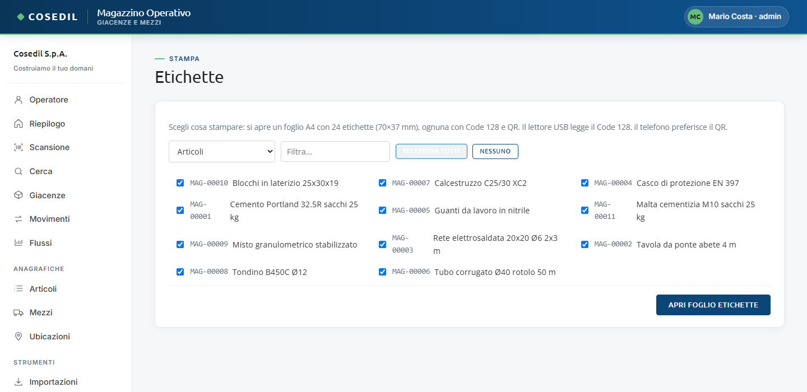
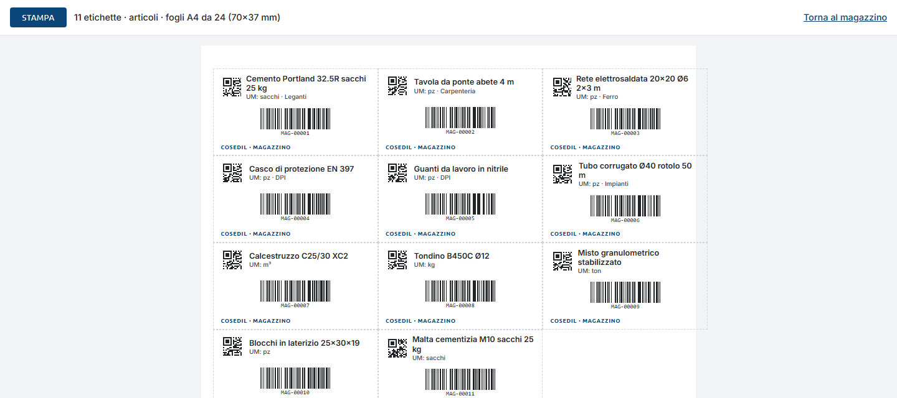

<!-- "><(((º> sabusabu <º)))>< -->
# 5. Etichette

[← Indice](README.md)

Ogni articolo, mezzo e ubicazione ha un'etichetta con il **codice a barre** (Code 128,
quello che legge il lettore USB) e il **QR** (quello che il telefono legge meglio). Si
stampano su fogli adesivi **A4 da 24 etichette (70×37 mm)**.

## Stampare un gruppo di etichette

1. Menu **Etichette**.

   

2. Scegli cosa stampare: **Articoli**, **Mezzi** o **Ubicazioni**.
3. Filtra se serve, poi spunta le voci (o **Seleziona tutti** / **Nessuno**).
4. **Apri foglio etichette**: si apre una nuova scheda con il foglio pronto.

   

5. Premi **Stampa** in alto. Nella finestra di stampa del browser scegli formato A4,
   margini *nessuno* e scala 100%. La barra in alto non viene stampata.
6. **Torna al magazzino** chiude il giro.

Se non spunti nulla compare "Seleziona almeno una voce".

## Altre scorciatoie

- **Etichetta** nella scheda di un articolo, mezzo o ubicazione: il foglio con la sola
  etichetta di quella voce.
- **Stampa tutte le etichette** nelle liste Articoli e Mezzi, **Stampa etichette** in
  Ubicazioni: tutte le voci attive.

## Da sapere

- Il foglio etichette si apre **solo da utenti collegati** (si entra dal Portale): un
  link al foglio inviato a qualcuno che non ha fatto l'accesso non mostra nulla.
- Se in alto alla vista compare "Il pacchetto segno non è installato…", le etichette
  escono con il solo codice a barre, senza QR: avvisa l'amministratore di sistema.
- Prova prima su un foglio di carta normale, appoggiato sopra il foglio adesivo
  controluce, per verificare l'allineamento della stampante.
