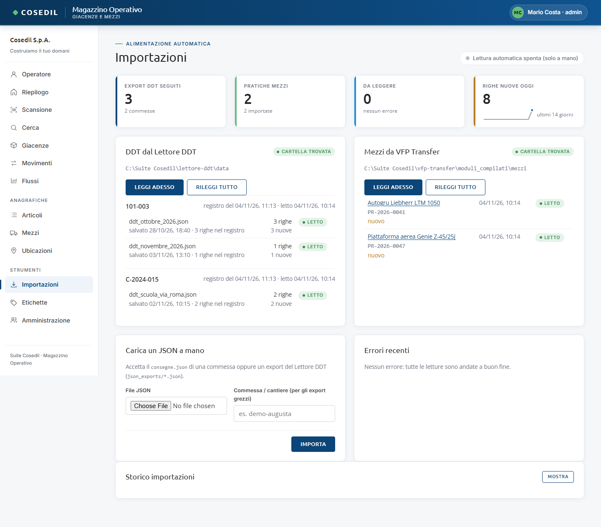

<!-- "><(((º> sabusabu <º)))>< -->
# 6. Importazioni

[← Indice](README.md)

Il Magazzino si alimenta da solo da due programmi della suite:

- **Lettore DDT**: ogni riga dei DDT letti diventa un **carico** nel cantiere della
  commessa. Se il cantiere o l'articolo non esistono vengono creati.
- **VFP Transfer**: ogni pratica di un mezzo a nolo diventa un **mezzo a nolo**,
  posizionato nel cantiere della commessa del contratto.

Il controllo avviene in automatico ogni due minuti circa. La vista **Importazioni**
mostra come sta andando e permette di forzare una lettura.

## Come si legge la pagina

- In alto a destra lo **stato del ciclo automatico**: "In attesa · ogni 120 s · ultimo
  giro … · prossimo …", "Lettura … in corso…" oppure "Lettura automatica spenta (solo a
  mano)".
- **Quattro riquadri**: export DDT seguiti (e quante commesse), pratiche mezzi trovate
  e importate, quante sono **Da leggere** (con gli eventuali errori in rosso) e le
  **righe nuove oggi** con il piccolo grafico degli ultimi 14 giorni.
- **DDT dal Lettore DDT**: per ogni commessa i file esportati dal Lettore DDT, con
  data di salvataggio, righe nel registro, righe importate e un'etichetta:
  **Letto** (verde), **Da leggere** (ambra), **Errore** (rosso).
- **Mezzi da VFP Transfer**: per ogni pratica il mezzo creato (cliccabile) e lo stato.
- **Cartella trovata** / **Cartella assente** dice se il Magazzino vede la cartella da
  cui legge. Il percorso completo lo vedono solo gli amministratori.
- **Errori recenti**: le letture andate male. Se è tutto a posto: "Nessun errore: tutte
  le letture sono andate a buon fine."
- **Storico importazioni** → **Mostra**: l'elenco di tutte le letture con righe, nuove
  ed esito.

## Pulsanti

- **Leggi adesso**: legge subito le novità (DDT o mezzi), senza aspettare il giro
  automatico. Esito: "ddt: N voci lette".
- **Rileggi tutto**: rilegge da capo anche quello che era già stato importato. Non crea
  doppioni: un DDT risalvato nel Lettore DDT **sostituisce** le sue righe.
- **Carica un JSON a mano** (solo amministratori): carica il file `consegne.json` di una
  commessa o un export del Lettore DDT. Per gli export "grezzi" scrivi anche
  **Commessa / cantiere**. Premi **Importa**: sotto compare l'esito (righe, nuove,
  scartate). Chi non è amministratore riceve "Operazione riservata all'amministratore
  del magazzino".

## Da sapere

- Il carico va nel cantiere con quel **codice commessa**; se la destinazione scritta
  sul DDT corrisponde al nome di un'ubicazione, si usa quella.
- Righe senza materiale o quantità vengono **scartate** e contate come tali.
- Un mezzo a nolo spostato a mano **non viene riportato indietro** dalle letture
  successive: la pratica dice dove arriva il mezzo, non dove sta oggi.
- Le importazioni fallite degli ultimi 7 giorni compaiono anche in **Da fare oggi** nella
  home del Portale (vedi [Collegamenti con la suite](09-suite.md)).
