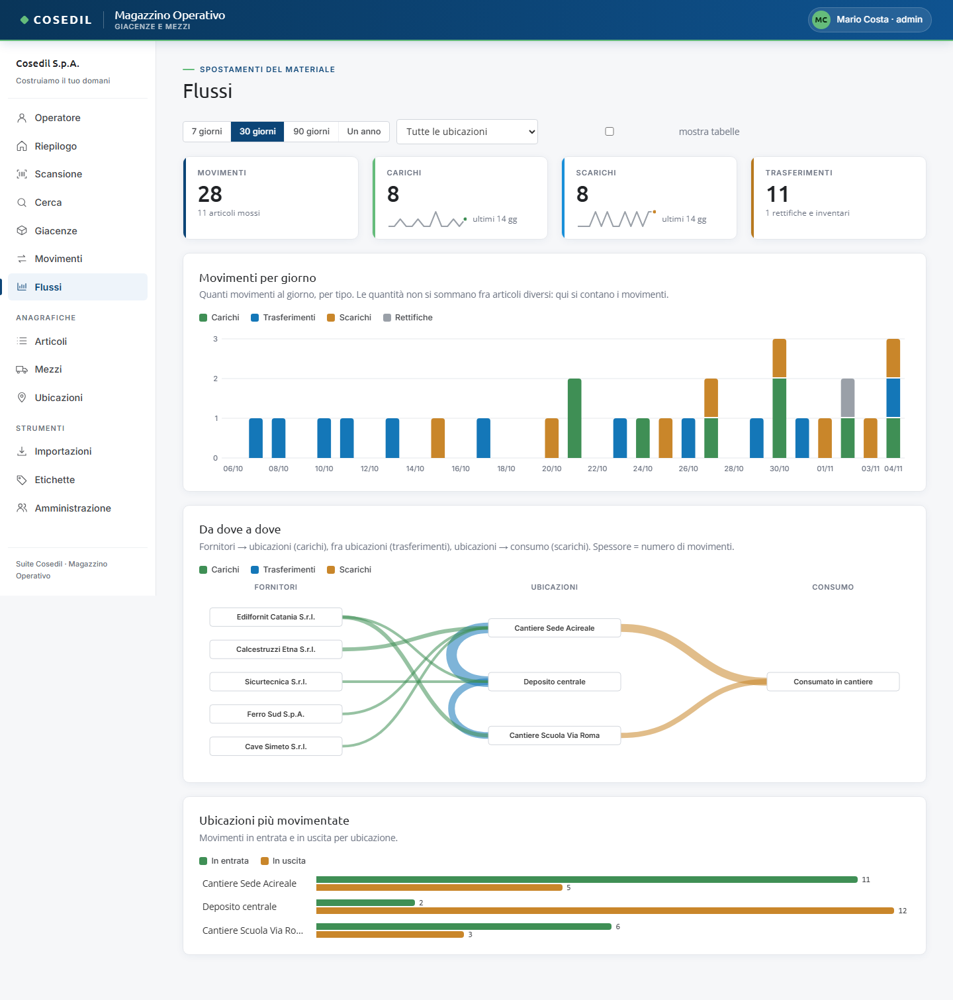

<!-- "><(((º> sabusabu <º)))>< -->
# 7. Flussi

[← Indice](README.md)

La vista **Flussi** mostra con dei grafici come si muove il materiale.

## Filtri

- Periodo: **7 giorni**, **30 giorni**, **90 giorni**, **Un anno**;
- ubicazione: **Tutte le ubicazioni** o una sola;
- **mostra tabelle**: sotto ogni grafico compaiono i numeri in tabella.

Le scelte restano memorizzate nel tuo browser per la volta successiva.

## I grafici

- **Riquadri in alto**: quanti movimenti nel periodo (e quanti articoli mossi), carichi,
  scarichi e trasferimenti, con l'andamento degli ultimi 14 giorni.
- **Movimenti per giorno**: colonne colorate per tipo (carichi, trasferimenti, scarichi,
  rettifiche).
- **Da dove a dove**: a sinistra i fornitori, al centro le ubicazioni, a destra il
  consumo in cantiere. Più è spessa la linea, più movimenti ci sono stati.
- **Ubicazioni più movimentate**: per ogni ubicazione i movimenti in entrata (verde) e in
  uscita (arancio).

Passando il mouse sopra un grafico compaiono i dettagli.

## Perché si contano i movimenti e non le quantità

Metri cubi di calcestruzzo, chili di ferro e pezzi di casco non si possono sommare.
Per questo i grafici contano **quanti movimenti** ci sono stati. Le quantità vere di un
singolo articolo si vedono nel grafico **Andamento della giacenza** della sua scheda
(vedi [Scansione e schede](02-scansione.md#la-scheda-di-un-articolo)).
