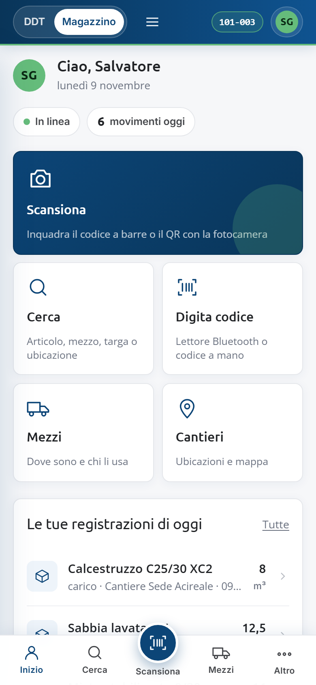
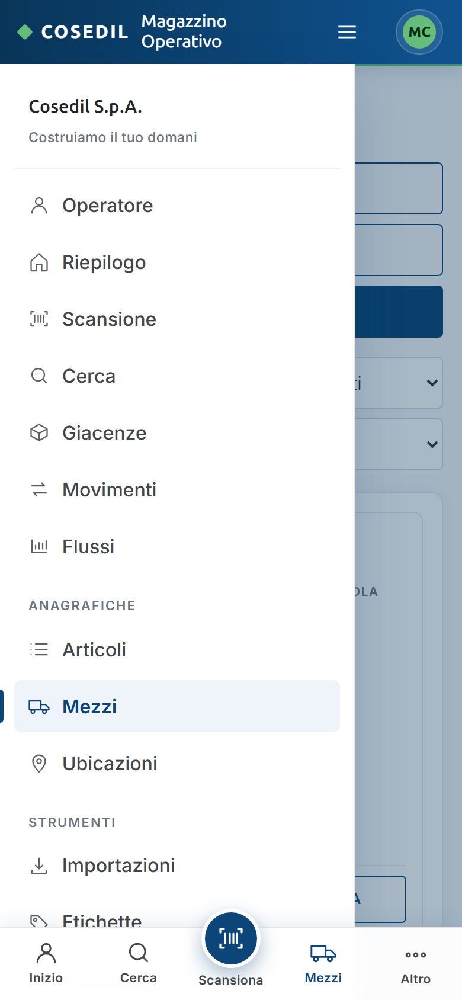
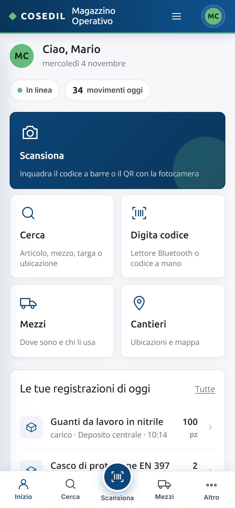
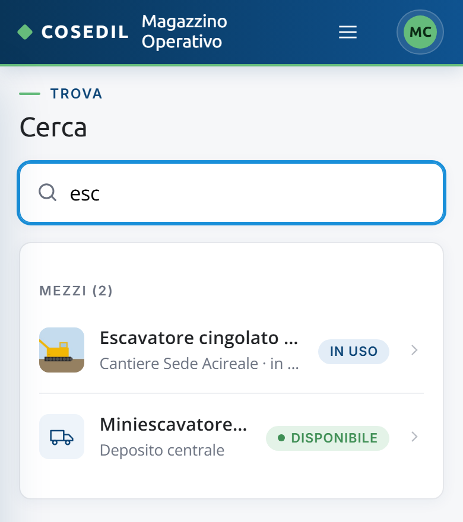
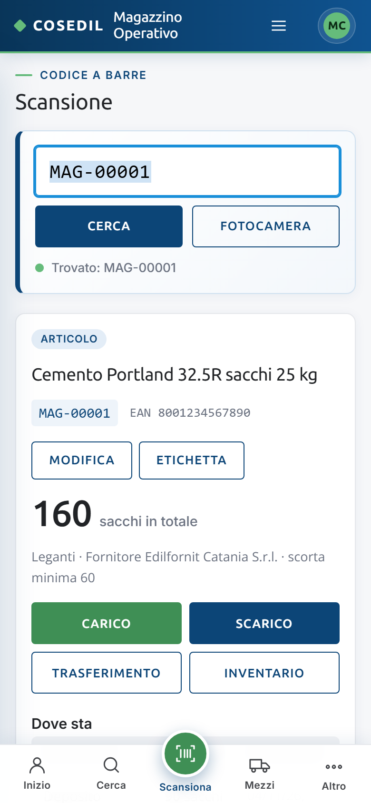
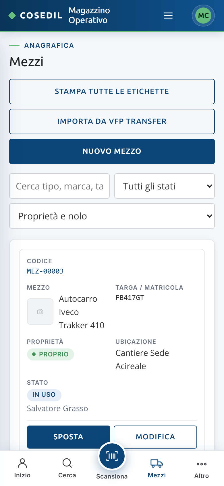

<!-- "><(((º> sabusabu <º)))>< -->
# 8. Dal telefono

[← Indice](README.md)

Sul telefono (o su uno schermo stretto) il Magazzino cambia aspetto: pulsanti grandi,
moduli che salgono dal basso e tabelle trasformate in schede da scorrere col dito.

Per usare la **fotocamera** apri il Magazzino dall'indirizzo `https://…` del Portale,
non da un indirizzo con il numero di porta: altrimenti il pulsante avvisa e non si apre.

Dentro il programma unico "DDT e Magazzino" la barra in alto tiene le linguette **DDT |
Magazzino**, la commessa scelta all'ingresso e le tue iniziali; il logo e il nome del
programma lasciano il posto.

## La barra in basso

| Tasto | Cosa fa |
|---|---|
| **Inizio** | la vista Operatore (sotto) |
| **Cerca** | ricerca unica di articoli, mezzi e ubicazioni |
| **Scansiona** (tondo, al centro) | apre subito la fotocamera |
| **Mezzi** | l'elenco dei mezzi |
| **Altro** | apre il menu completo (tutte le voci del computer) |

## La vista Operatore

È la pagina che si apre dal telefono.

- Il saluto con la data, l'indicatore **In linea** / **Senza rete**, i **movimenti di
  oggi** e, se ci sono, gli articoli **sotto scorta**.
- Tasti grandi: **Scansiona** (fotocamera), **Cerca**, **Digita codice** (lettore
  Bluetooth o codice a mano), **Mezzi**, **Cantieri** (ubicazioni e mappa).
- **Le tue registrazioni di oggi**: i movimenti che hai fatto tu oggi; un tocco apre la
  scheda dell'articolo.
- **Dove sta cosa**: le ubicazioni con quanti articoli e mezzi ci sono.

Dal computer la stessa vista si apre dal menu **Operatore**.

## Cerca

Scrivi almeno due lettere: descrizione, codice, targa, matricola o nome del cantiere. I
risultati sono divisi in **Articoli**, **Mezzi** e **Ubicazioni**; un tocco apre la
scheda.

## Schede e liste sul telefono

Funzionano come sul computer (vedi [Scansione e schede](02-scansione.md)); i pulsanti
sono più grandi e le righe delle tabelle diventano schede con l'etichetta di ogni campo.
Sul telefono il campo del codice non si attiva da solo, così la tastiera non copre la
fotocamera.

## Installare il Magazzino come app

- **Android (Chrome)**: nella vista Operatore compare l'avviso "Aggiungi il Magazzino
  alla schermata Home del telefono" con il tasto **Installa**.
- **iPhone (Safari)**: tocca *Condividi* e poi **Aggiungi alla schermata Home**.

L'icona apre il Magazzino a tutto schermo, come un'app.

## Senza rete

Se la connessione cade compare "Connessione assente: le registrazioni non partono
finché non torna la rete." e l'indicatore diventa **Senza rete**. La pagina resta
visibile ma **niente viene salvato**: ripeti la registrazione quando torna la rete e
controlla in **Le tue registrazioni di oggi** che ci sia.
