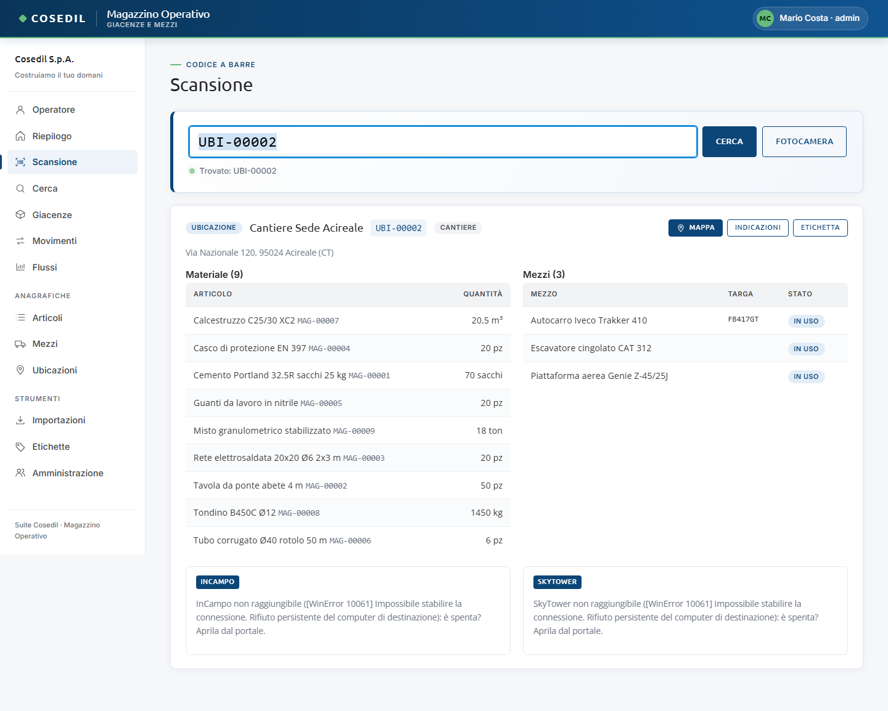
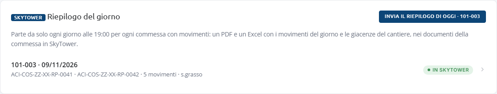

<!-- "><(((º> sabusabu <º)))>< -->
# 9. Collegamenti con la suite

[← Indice](README.md)

Il Magazzino parla con gli altri programmi della suite Cosedil attraverso il **codice
commessa** (es. `101-003`). È lo stesso codice che InCampo ha sulla commessa e SkyTower
nella scheda *Suite Cosedil* del progetto, e viene dal registro unico delle commesse che
si cura nel Portale.

Per collegare un cantiere basta scegliere la commessa nell'ubicazione (**Ubicazioni →
Modifica → Commessa**, vedi [Anagrafiche](04-anagrafiche.md#ubicazioni)). Senza commessa
la scheda dell'ubicazione dice "Senza codice commessa l'ubicazione non si collega a
InCampo e SkyTower: aggiungilo in Modifica."

## Nella scheda dell'ubicazione

In fondo alla scheda di un cantiere con commessa ci sono due riquadri (nell'immagine i
due programmi sono spenti, vedi sotto):

**InCampo**

- i cantieri InCampo della commessa, con il numero di task e di non conformità aperti;
- l'elenco dei **task aperti** e delle **non conformità** (un clic le apre in InCampo);
- **Segnala in InCampo**: scrivi titolo e descrizione e premi **Apri il task in
  InCampo**. Il task nasce aperto e non assegnato sul cantiere; chi segue il cantiere lo
  prende in carico da lì. Lo stesso tasto c'è nella scheda di un mezzo che si trova in
  un cantiere con commessa, con titolo e descrizione già scritti.

**SkyTower**

- i **documenti pubblicati** della commessa (un clic li apre in SkyTower);
- **Invia report giacenze**: dopo la conferma crea in SkyTower un documento PDF con
  materiale e mezzi della commessa, nella cartella "Suite Cosedil", come bozza (WIP).
  Esito: "Report caricato su SkyTower: …".
- **Apri** porta al progetto in SkyTower.
- **Riepilogo di oggi** (all'amministratore e a chi lavora in quella commessa): manda subito
  il riepilogo del giorno, vedi [Riepilogo del giorno in SkyTower](#riepilogo-del-giorno-in-skytower).

Se uno dei due programmi è spento o non raggiungibile il riquadro lo dice (per esempio
"InCampo non risponde: probabilmente è spenta. Aprila dal portale e riprova.") e il resto
funziona.
Aprilo dal Portale e ricarica la scheda.

## Riepilogo del giorno in SkyTower

Ogni giorno, per ogni commessa che ha avuto movimenti, il Magazzino carica in SkyTower, fra i
documenti della commessa (cartella "Suite Cosedil", come bozza WIP), **due documenti**:

- un **PDF** con i movimenti del giorno (ora, tipo, articolo, quantità, da dove a dove, DDT di
  provenienza e fornitore) e le giacenze del cantiere a fine giornata;
- un **Excel** con le stesse due tabelle (più chi ha registrato ogni movimento e l'origine),
  da filtrare o sommare.

Così in SkyTower c'è tutto: il PDF del DDT e l'Excel della conversione li manda la parte
DDT, il riepilogo di magazzino lo aggiunge il Magazzino.

- **In automatico** parte ogni sera all'ora impostata (di solito le 19:00). Se SkyTower è
  spenta riprova da solo appena si riaccende; se il server era spento all'ora del riepilogo,
  il giorno prima si recupera alla riaccensione.
- **A richiesta**: nel **Riepilogo** del Magazzino, in fondo, il riquadro *Riepilogo del
  giorno* ha il pulsante **Invia il riepilogo di oggi** (con la commessa su cui lavori; gli
  amministratori scelgono fra le commesse con movimenti oggi). Lo stesso pulsante c'è nel
  riquadro SkyTower della scheda del cantiere.
- **Niente doppioni**: se i movimenti non sono cambiati dall'ultimo invio compare
  "Riepilogo del … già in SkyTower …: nessun movimento nuovo da allora" e puoi scegliere di
  mandarne comunque un altro. Se sono arrivati movimenti nuovi, il documento in più si chiama
  "… (aggiornamento hh:mm)".
- L'elenco nel riquadro dice cosa è partito: **in SkyTower** (verde, con i due codici dei
  documenti; un clic apre il PDF in SkyTower), **solo il PDF** (l'Excel è mancato: al prossimo
  invio parte solo lui) o **non inviato** (rosso, con il motivo, per esempio una commessa che
  in SkyTower non ha un progetto).

## InCampo legge il Magazzino

Nella dashboard del cantiere, InCampo mostra il materiale e i mezzi presenti nelle
ubicazioni del Magazzino con la stessa commessa.

## "Da fare oggi" nella home del Portale

La home del Portale raccoglie le cose da fare di tutti i programmi. Dal Magazzino arrivano:

- i **mezzi fermi o in manutenzione**, con dove sono e da quando;
- le **importazioni** DDT o mezzi **fallite** negli ultimi 7 giorni;
- solo per gli amministratori, i **cantieri senza codice commessa**.

Un clic sulla voce apre la vista giusta del Magazzino.
