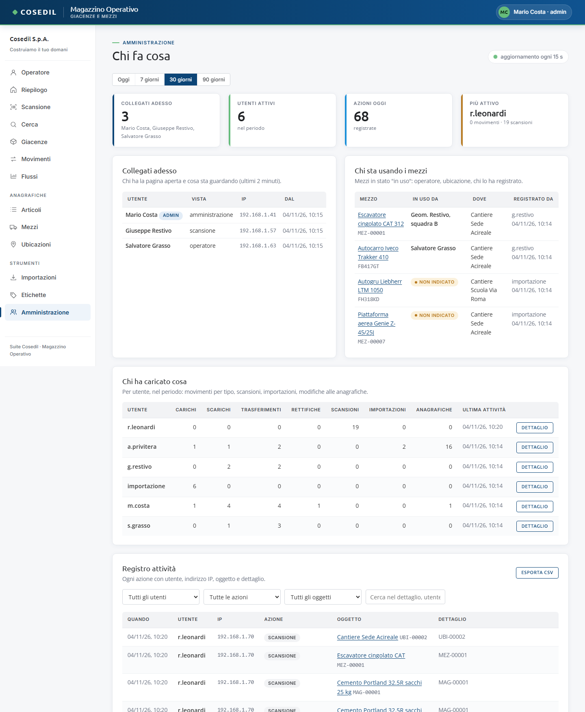
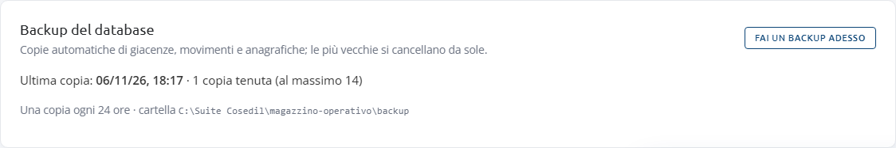

<!-- "><(((º> sabusabu <º)))>< -->
# 10. Amministrazione

[← Indice](README.md)

La vista **Amministrazione** (titolo *Chi fa cosa*) compare nel menu solo agli
**amministratori del Magazzino**. Chi lo diventa si decide nel Portale (vedi la
[guida del Portale](../../../portale/docs/guida/README.md)). Se un utente normale apre
l'indirizzo della vista legge "Area riservata agli amministratori del magazzino."

## Periodo

In alto scegli **Oggi**, **7 giorni**, **30 giorni** o **90 giorni**. La pagina si
aggiorna da sola ogni 15 secondi.

## Le sezioni

- **Riquadri**: quanti sono **collegati adesso** (con i nomi), gli **utenti attivi** nel
  periodo, le **azioni di oggi** e l'utente **più attivo**.
- **Collegati adesso**: chi ha il Magazzino aperto negli ultimi 2 minuti, quale vista
  sta guardando, da quale indirizzo (IP) e da quando. L'elenco si azzera quando il
  Magazzino viene riavviato.
- **Chi sta usando i mezzi**: i mezzi "in uso", chi li usa, dove sono e chi l'ha
  registrato. **non indicato** vuol dire che nessuno ha scritto chi lo usa (succede per
  i mezzi a nolo arrivati da VFP Transfer): conviene completarlo con **Sposta**.
- **Chi ha caricato cosa**: per ogni utente, nel periodo, carichi, scarichi,
  trasferimenti, rettifiche, scansioni, importazioni e modifiche alle anagrafiche.
  L'utente *importazione* sono i carichi entrati da soli dai DDT. **Dettaglio** filtra
  il registro qui sotto su quell'utente.
- **Registro attività**: ogni azione con data, utente, IP, tipo di azione (scansione,
  movimento, creazione, modifica, eliminazione, spostamento mezzo, importazione…),
  oggetto (cliccabile) e dettaglio. Filtri per utente, azione, oggetto e testo libero.
  **Esporta CSV** scarica le righe filtrate (si apre con Excel).

## Backup del database

In fondo alla pagina il riquadro **Backup del database** dice quando è stata fatta
l'**ultima copia**, quante copie sono tenute, ogni quante ore si fa e in quale cartella.

**Fai un backup adesso** ne fa una subito (per esempio prima di una rilettura completa dei
DDT o di molte eliminazioni): compare "Backup fatto: magazzino-…db" e la copia resta nel
registro attività come *Backup del database*. Se l'ultima copia non è riuscita il
riquadro lo segnala in rosso: avvisate l'amministratore di sistema
([capitolo 12](12-amministratore-sistema.md#backup)).

## Le altre cose riservate agli amministratori

- i pulsanti **Elimina** di articoli, mezzi, ubicazioni, movimenti e foto;
- **Carica un JSON a mano** nelle [Importazioni](06-importazioni.md);
- in **Da fare oggi** del Portale, la voce dei cantieri senza codice commessa.
