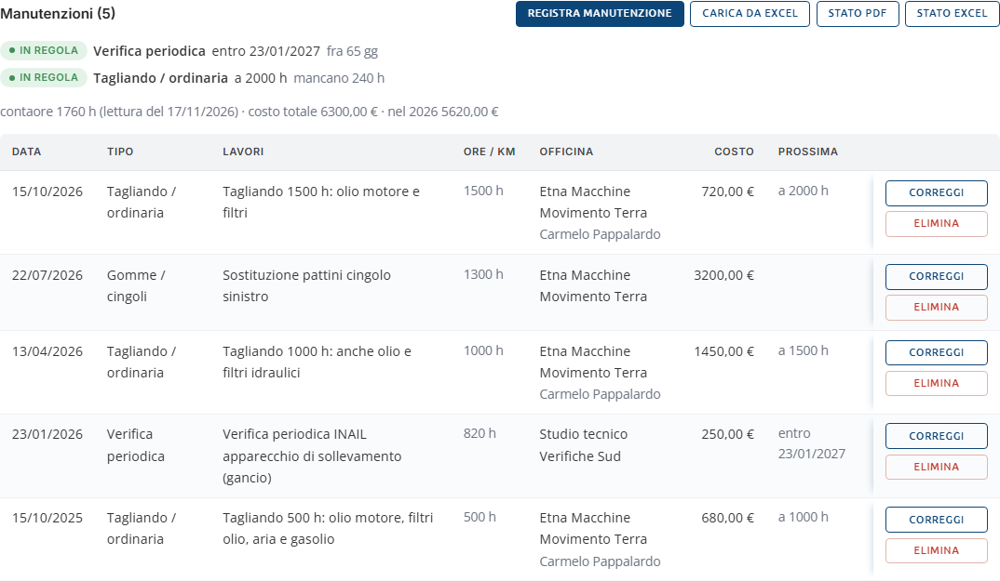
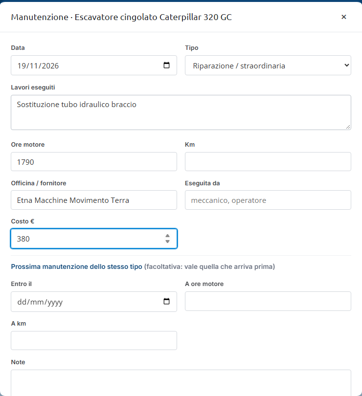
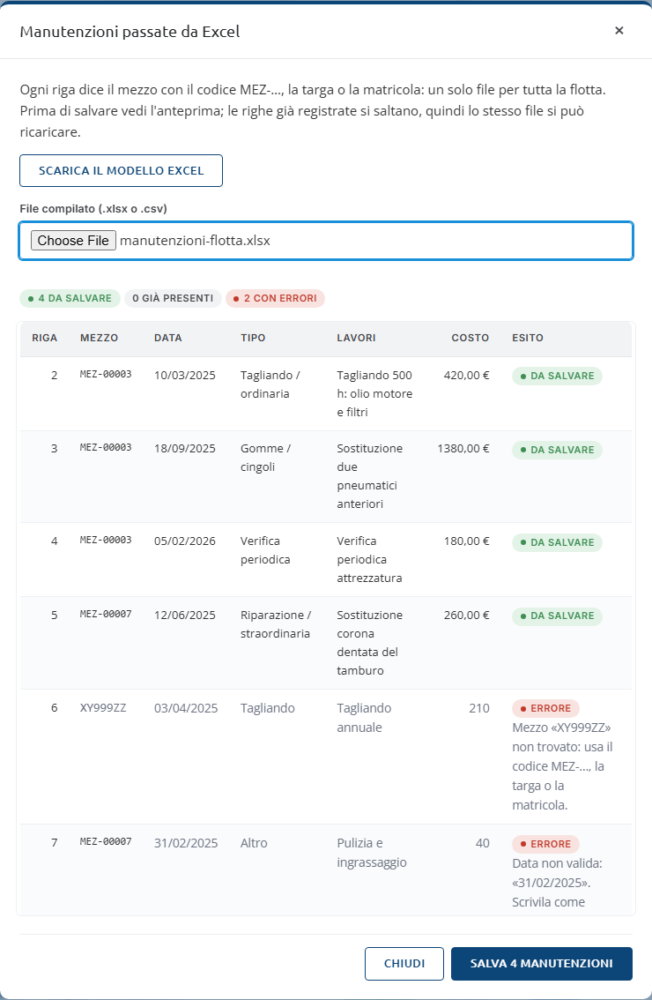
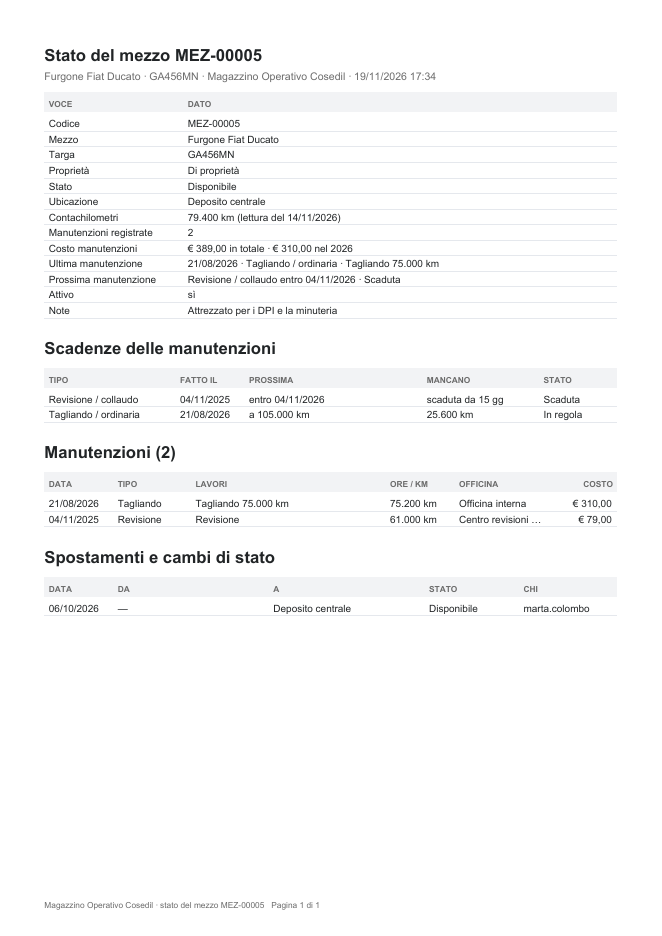
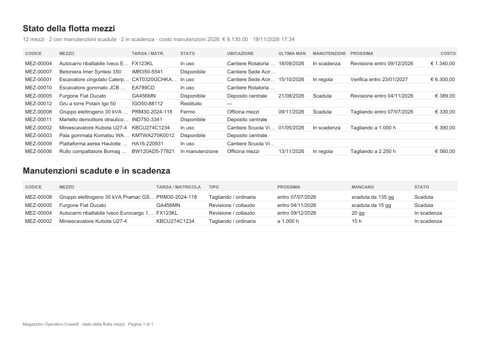
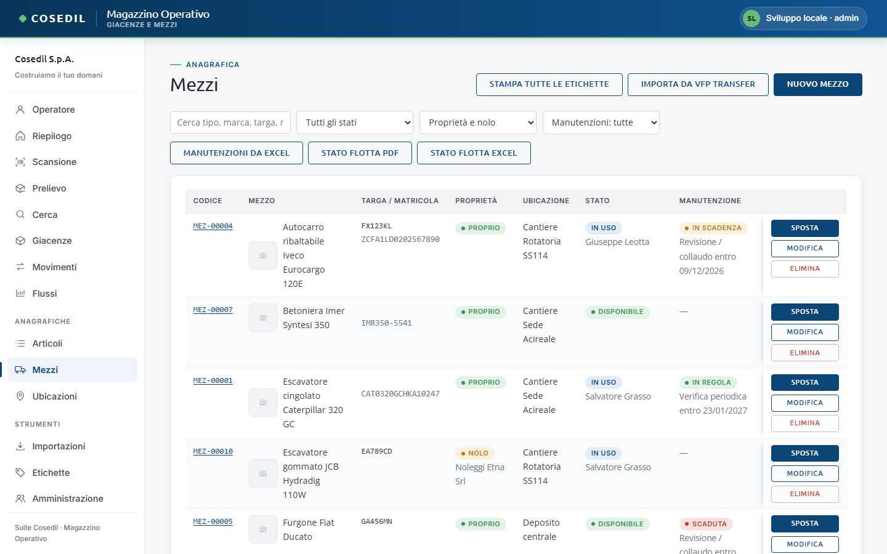
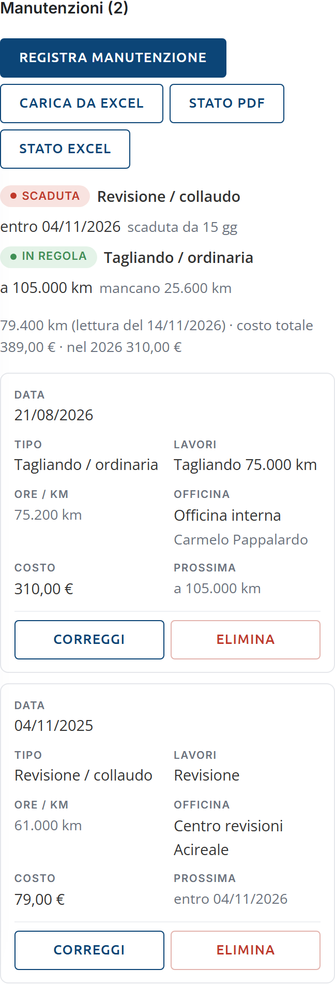

<!-- "><(((º> sabusabu <º)))>< -->
# 13. Manutenzioni dei mezzi

Ogni mezzo ha il suo **registro delle manutenzioni**: tagliandi, riparazioni, revisioni,
verifiche periodiche, gomme o cingoli. Per ogni intervento si può scrivere anche **quando va
rifatto** (una data, a quante ore di motore o a quanti km): il Magazzino avvisa quando la
scadenza si avvicina o è passata.

Le manutenzioni già fatte, che magari stanno in un vecchio foglio Excel, si caricano tutte
insieme da un **file Excel**. In qualsiasi momento si può scaricare lo **stato del mezzo**
oppure quello di **tutta la flotta**, in PDF da stampare o in Excel da rielaborare.

## Nella scheda del mezzo

Apri il mezzo, per esempio con la scansione dell'etichetta, cliccando il codice nella lista
**Mezzi** oppure da **Cerca**. Sotto lo storico degli spostamenti c'è il riquadro
**Manutenzioni**.

- **In alto**, una riga per ogni scadenza aperta, con un bollino colorato:
  - **Scaduta** (rosso): la data è passata oppure le ore o i km sono già stati superati;
  - **In scadenza** (ambra): mancano 30 giorni o meno, 50 ore o meno, 1.000 km o meno;
  - **In regola** (verde): manca ancora tempo.

  Accanto vedi quanto manca, per esempio "fra 65 gg", "mancano 240 h" o "scaduta da 15 gg".
- **Sotto**: l'ultima lettura di **contaore** e **contachilometri**, il **costo totale**
  delle manutenzioni e il costo dell'anno in corso.
- **La tabella**: tutti gli interventi, dal più recente, con data, tipo, lavori, ore o km,
  officina (e chi l'ha fatto), costo e prossima scadenza.
- **Correggi**: compare sulle manutenzioni registrate da te. Gli amministratori la vedono
  su tutte.
- **Elimina**: solo per gli amministratori.

### Come funzionano le scadenze

La scadenza di un tipo di intervento è la **"prossima"** scritta sull'**ultimo** intervento
di quel tipo. Quando registri il tagliando nuovo, la scadenza del tagliando precedente si
chiude da sola e vale quella del nuovo. Se la "prossima" ha più criteri (data, ore e km),
vale **quello che arriva prima**.

Ore e km si confrontano con l'**ultima lettura** del mezzo. La lettura sale da sola quando
registri una manutenzione con un contaore più alto. Puoi anche aggiornarla a mano da
**Modifica**, nei campi **Contaore attuale** e **Contachilometri attuale**.

## Registrare una manutenzione

Nel riquadro **Manutenzioni** premi **Registra manutenzione**.

1. **Data**: è già quella di oggi; cambiala se il lavoro è stato fatto in un altro giorno.
2. **Tipo**: Tagliando / ordinaria, Riparazione / straordinaria, Revisione / collaudo,
   Verifica periodica, Gomme / cingoli oppure Altro.
3. **Lavori eseguiti**: cosa è stato fatto e i ricambi (obbligatorio).
4. **Ore motore** e/o **Km** letti sul mezzo, **Officina / fornitore**, **Eseguita da**
   (la persona) e **Costo €**. Sono tutti facoltativi, ma servono per le scadenze e per i
   costi. Nel campo officina compaiono come suggerimento le officine già usate per quel mezzo.
5. **Prossima manutenzione dello stesso tipo**: entro una data, a un certo numero di ore
   motore o a un certo numero di km. Anche questi campi sono facoltativi.
6. Se il mezzo è **fermo in officina**, spunta la casella in fondo: il mezzo passa allo
   stato **In manutenzione** e nello storico degli spostamenti compare la riga "Fermo per
   manutenzione". Quando torna operativo usa **Sposta / cambia stato** (vedi
   [Spostare un mezzo](03-movimenti.md#spostare-un-mezzo)) e scegli Disponibile o In uso.
7. **Salva**: compare "Manutenzione registrata".

Se la stessa manutenzione è già registrata (stesso mezzo, data, tipo, descrizione, ore, km
e costo), il Magazzino non la salva una seconda volta e te lo dice.

## Caricare le manutenzioni passate da Excel

Si può fare in due modi:

- dalla **scheda di un mezzo**, con **Carica da Excel**: vale per quel mezzo;
- dalla pagina **Mezzi**, con **Manutenzioni da Excel**: un solo file per tutta la flotta.

1. Premi **Scarica il modello Excel** e aprilo. Il file ha tre fogli:
   - **Manutenzioni**: da compilare, una riga per intervento. Se l'hai scaricato dalla
     scheda di un mezzo, il codice del mezzo è già scritto nella prima colonna;
   - **Istruzioni**: cosa scrivere in ogni colonna;
   - **Mezzi**: i codici `MEZ-…`, le targhe e le matricole di tutti i mezzi.
2. In ogni riga scrivi il mezzo (con il codice `MEZ-…`, la targa o la matricola), la
   **Data** (gg/mm/aaaa) e la **Descrizione lavori**. Le altre colonne sono come nel form:
   tipo, ore motore, km, officina, eseguita da, costo, prossima data, prossime ore,
   prossimi km e note. Nel **Tipo** vanno bene anche parole come "tagliando",
   "riparazione", "collaudo" o "pneumatici".
   Se carichi il file dalla scheda di un mezzo, le righe senza mezzo valgono per quello.
3. Salva il file (.xlsx; va bene anche un .csv) e sceglilo in **File compilato**.
4. Il Magazzino mostra l'**anteprima** senza salvare ancora niente:
   - **Da salvare**: righe corrette;
   - **Già presente**: la stessa manutenzione è già registrata, oppure la riga è ripetuta
     nel file. Queste righe vengono saltate;
   - **Errore**: la riga ha un problema che va corretto. In grigio vedi quello che c'è
     scritto nel file e sotto il motivo, per esempio "Mezzo «XY999ZZ» non trovato" o
     "Data non valida".

   Se nel file ci sono colonne che il Magazzino non usa, sono elencate sopra la tabella
   ("Colonne non usate").
5. Premi **Salva N manutenzioni**: entrano solo le righe da salvare. Correggi nel file le
   righe con errori e **ricarica lo stesso file**: le righe già entrate risultano "Già
   presente" e non vengono raddoppiate.

Puoi usare anche un foglio Excel tuo, senza il modello, purché abbia una riga di
intestazioni riconoscibile, per esempio "Targa", "Data intervento", "Lavori eseguiti",
"Contaore" o "Importo". Sopra le intestazioni possono esserci titoli o righe vuote.
I vecchi file **.xls** vanno prima salvati come **.xlsx**.

## Lo stato di un mezzo e della flotta

- **Di un mezzo**: nella scheda, riquadro **Manutenzioni**, premi **Stato PDF** o **Stato Excel**.
- **Della flotta**: nella pagina **Mezzi** premi **Stato flotta PDF** o **Stato flotta
  Excel**. Sono compresi tutti i mezzi attivi.

Il **PDF del mezzo** si apre nel browser e si stampa da lì. Contiene:

- l'anagrafica del mezzo;
- lo stato e dove si trova, chi lo usa e il nolo;
- contaore e contachilometri;
- i costi;
- l'ultima manutenzione e la prossima scadenza;
- le scadenze aperte;
- tutte le manutenzioni;
- gli spostamenti.

Il **PDF della flotta** è in orizzontale e ha due parti:

- una riga per mezzo, con stato, ubicazione, ultima manutenzione, stato delle manutenzioni,
  prossima scadenza e costo totale;
- l'elenco delle **manutenzioni scadute e in scadenza** di tutti i mezzi, dalla più urgente.

Gli **Excel** hanno gli stessi dati divisi in fogli, con date e numeri veri, da ordinare,
filtrare e sommare:

- **Mezzo** (o **Flotta**);
- **Scadenze**;
- **Manutenzioni**;
- **Spostamenti**, solo nell'Excel del singolo mezzo.

Il foglio **Manutenzioni** ha le stesse colonne del modello: lo puoi correggere e
ricaricare con **Manutenzioni da Excel**.

## Nella lista Mezzi

- La colonna **Manutenzione** mostra il bollino della scadenza più urgente (Scaduta, In
  scadenza, In regola) e quale intervento è. Per un mezzo senza scadenze mostra la data
  dell'ultima manutenzione; se non ne ha nessuna, un trattino.
- Il filtro **Manutenzioni** mostra solo i mezzi con scadenze **scadute e in scadenza**,
  **solo scadute** oppure quelli **mai registrati**, cioè senza nessuna manutenzione.
- I pulsanti sotto i filtri: **Manutenzioni da Excel**, **Stato flotta PDF** e **Stato
  flotta Excel**.

## Dal telefono

Il riquadro **Manutenzioni** c'è anche nella scheda del mezzo aperta dal telefono, per
esempio dopo aver scansionato l'etichetta. Le manutenzioni diventano schede una sotto
l'altra e si possono registrare in officina, sul momento.

