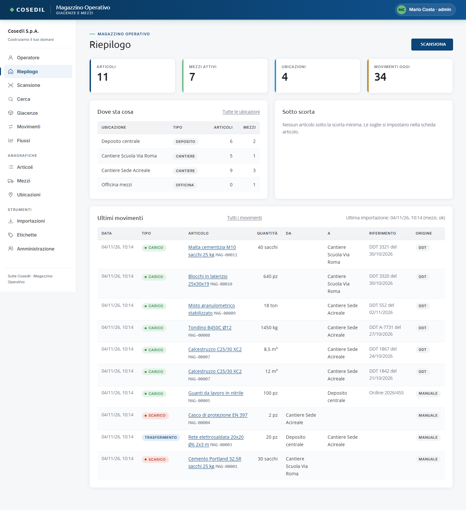

<!-- "><(((º> sabusabu <º)))>< -->
# Magazzino — guida per chi lo usa

Il **Magazzino** (Magazzino Operativo) dice **dove sta il materiale e quanto ce n'è** e
**dove stanno i mezzi**, in deposito, in officina e nei cantieri. Si lavora scansionando
un codice a barre o un QR, dal computer con il lettore oppure dal telefono con la
fotocamera.

Questa guida è per chi lo usa ogni giorno: magazzinieri, capicantiere, impiegati
dell'ufficio tecnico e amministratori. Ogni capitolo spiega dove si clicca, cosa succede
e cosa fare se qualcosa non va.

## Indice

1. [Primi passi](01-primi-passi.md) — come si entra, com'è fatta la pagina, il Riepilogo
2. [Scansione e schede](02-scansione.md) — lettore, fotocamera, scheda articolo, mezzo e ubicazione
3. [Movimenti e giacenze](03-movimenti.md) — carico, scarico, trasferimento, rettifica, inventario
4. [Anagrafiche](04-anagrafiche.md) — articoli, mezzi (foto e targa), ubicazioni e mappa
5. [Etichette](05-etichette.md) — stampare codici a barre e QR su fogli adesivi
6. [Importazioni](06-importazioni.md) — DDT dal Lettore DDT e mezzi a nolo da VFP Transfer
7. [Flussi](07-flussi.md) — i grafici dei movimenti
8. [Dal telefono](08-telefono.md) — la vista Operatore, Cerca, installare l'app
9. [Collegamenti con la suite](09-suite.md) — InCampo, SkyTower, "Da fare oggi" del Portale
10. [Amministrazione](10-amministrazione.md) — chi fa cosa, chi usa i mezzi, registro attività
11. [Se qualcosa non va](11-problemi.md) — messaggi frequenti e cosa fare
12. [Per l'amministratore di sistema](12-amministratore-sistema.md) — avvio, dati, backup

## In due parole

- Ogni cosa ha un **codice**: `MAG-00001` è un articolo, `MEZ-00001` un mezzo,
  `UBI-00001` un'ubicazione (deposito, cantiere, officina…). Il codice si stampa
  sull'etichetta.
- La **giacenza** non si scrive a mano: è la somma dei movimenti. Se un numero è
  sbagliato si corregge con una rettifica o con un inventario, non "sovrascrivendo".
- I **DDT** letti dal Lettore DDT e le **pratiche dei mezzi a nolo** di VFP Transfer
  entrano da soli nel Magazzino.
- Si entra **dal Portale** con il proprio utente: login e abilitazioni sono spiegati
  nella [guida del Portale](../../../portale/docs/guida/README.md).

> Le immagini di questa guida sono fatte con dati di prova (commesse 101-003 Sede
> Acireale e C-2024-015 Scuola Via Roma, persone e fornitori inventati).
