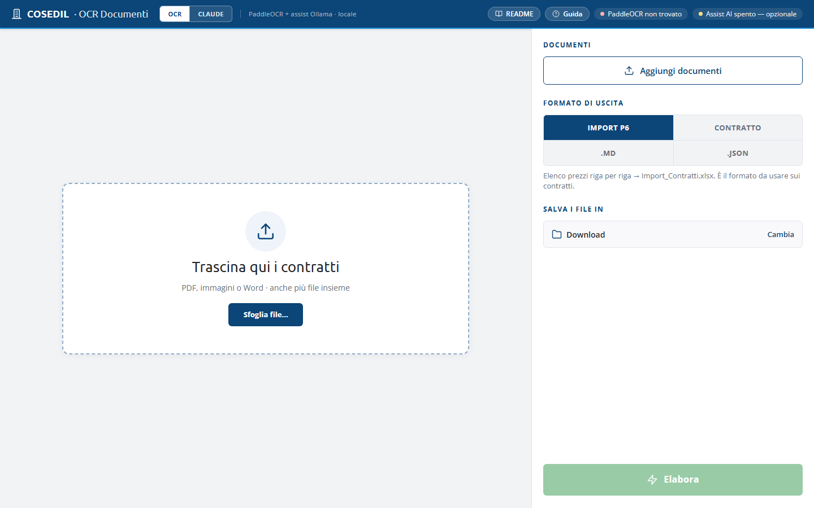
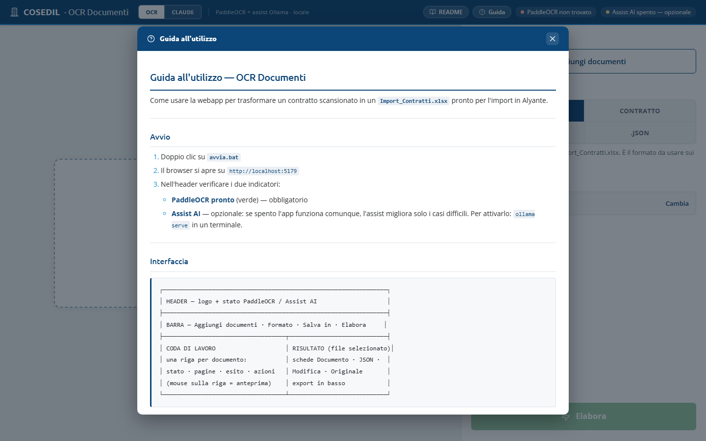
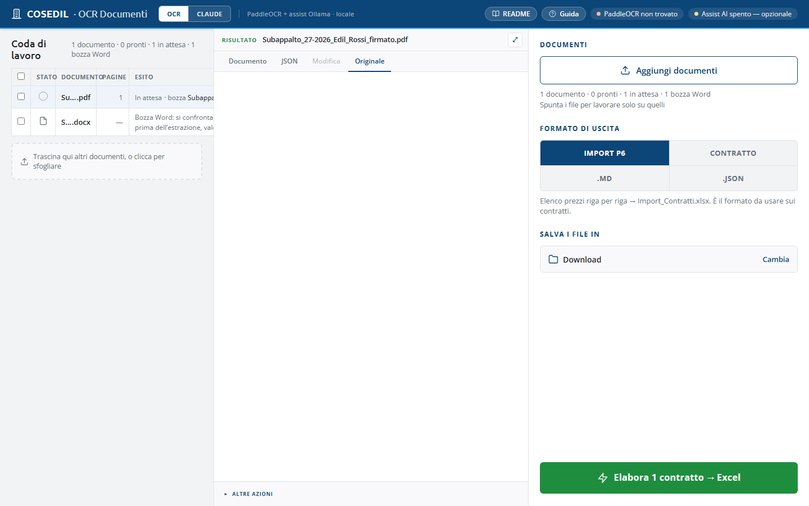
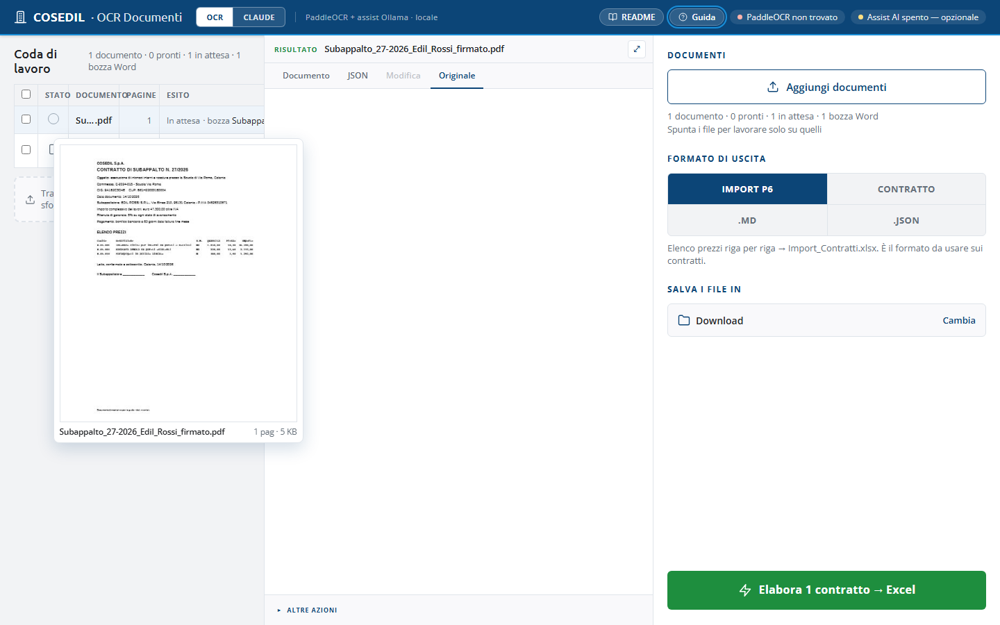

<!-- "><(((º> sabusabu <º)))>< -->
# 1. La schermata e gli indicatori

[← Indice](README.md)

## 1.1 La barra in alto

| Elemento | Cosa indica |
|---|---|
| **OCR** / **CLAUDE** | chi legge i documenti: **OCR** = il motore aziendale (normale); **CLAUDE** = lettura fatta da Claude su claude.ai (vedi [capitolo 4](04-formati-e-claude.md)) |
| **⚙ Impostazioni** | cartella dei contratti, cartella di destinazione e quando avviare la scansione da sola (vedi [7](07-scansione-cartella.md)) |
| **README**, **Guida** | documentazione tecnica e guida rapida dentro il programma |
| **PaddleOCR pronto** (verde) | il motore per leggere le **scansioni** è attivo. Se compare **PaddleOCR non trovato** o **PaddleOCR bloccato** (rosso), le scansioni non si possono leggere; i PDF con testo, i Word e gli Excel funzionano lo stesso. Il motivo è scritto passando il mouse sull'indicatore: avvisa l'amministratore |
| **Server non raggiungibile — riprovo** (giallo) | il programma è stato aperto mentre il server stava ancora partendo, oppure il server è spento. La pagina riprova da sola ogni 3 secondi e passa a *PaddleOCR pronto* appena il server risponde: non serve ricaricare. Se resta così per più di un minuto, riavvia OCR Documenti |
| **Cartella · prossima …** | compare solo con la scansione automatica attiva: quando parte la prossima. *Cartella · in pausa* = il browser vuole di nuovo il permesso sulle cartelle (⚙ Impostazioni → Riattiva) |
| **Assist AI** | aiuto facoltativo che riempie i campi che il programma non ha trovato. *Assist AI spento — opzionale* (giallo) è normale: il programma funziona comunque |

La **Guida** integrata è un riassunto rapido; in alcuni punti descrive ancora
la disposizione precedente della pagina (barra in alto invece del pannello a
destra): fa fede questa guida.

## 1.2 Il pannello a destra

- **Aggiungi documenti**: sceglie i file dal PC (in alternativa si trascinano
  ovunque nella pagina). Sotto: quanti documenti ci sono, quanti pronti e quanti in attesa.
- **Formato di uscita**: **IMPORT P6**, **CONTRATTO**, **.MD**, **.JSON**. È
  una scelta da fare **prima** di elaborare e vale per tutta la coda; sotto c'è
  la riga che spiega il formato scelto.
- **Salva i file in**: dove finiscono gli Excel. *Download* = la cartella
  Download del browser; **Cambia** sceglie una cartella (Chrome/Edge).
- In fondo il pulsante verde **Elabora N contratti → Excel** (diventa
  **Tutto elaborato** a lavoro finito) ed **Esporta N pronti**.

## 1.3 La coda e il risultato

Quando ci sono documenti la pagina si divide in due:

- **Coda di lavoro** (a sinistra): una riga per documento con **Stato** (○ in
  attesa, ✓ elaborato, anello = in corso), **Documento**, **Pagine**, **Esito**
  (etichette con il riassunto) e i pulsanti della riga. Le caselle a sinistra
  servono a lavorare **solo su alcuni** file. **Passando il mouse su una riga
  compare la prima pagina** del documento:

  

- **Risultato** (al centro): il documento selezionato, con le schede
  **Documento**, **JSON** (o **Testo**), **Modifica**, **Originale** e, se c'è
  una bozza Word, **Confronto**. **⤢** allarga il pannello a tutta pagina,
  **‹ Coda** torna indietro.

[Avanti: Da contratto a Excel →](02-contratto-excel.md)
