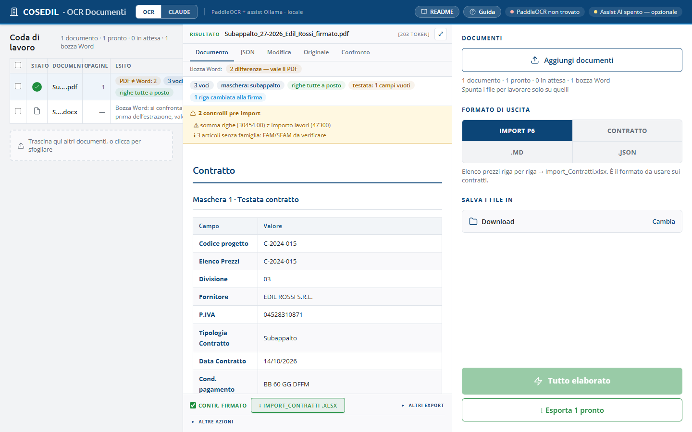
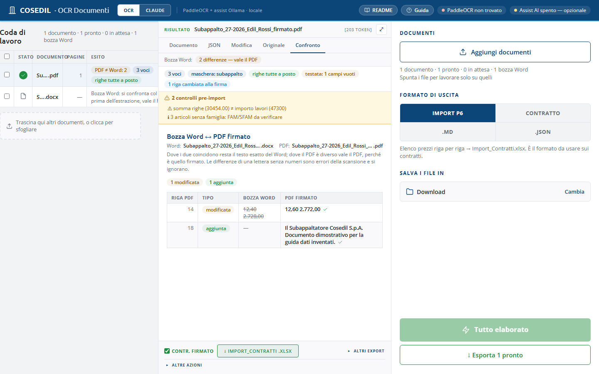
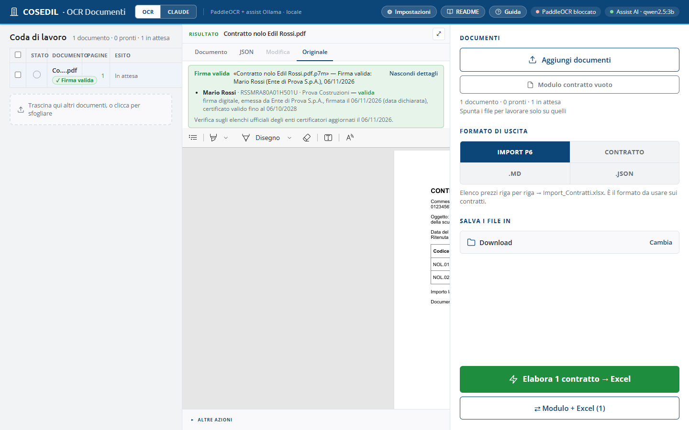

<!-- "><(((º> sabusabu <º)))>< -->
# 2. Da contratto a Import_Contratti.xlsx

[← Indice](README.md)

## 2.1 Un contratto

1. **Trascina** il PDF del contratto nella pagina, oppure **Aggiungi documenti**
   (o **Sfoglia file…** nel riquadro centrale).
2. Lascia **IMPORT P6** come formato (è già scelto all'apertura).
3. Premi **Elabora 1 contratto → Excel** (in basso a destra), oppure
   **Scansiona** sulla riga del documento.
4. Il programma legge il documento, compila i campi e **salva**
   `<nome del contratto>_Import_Contratti.xlsx` nella cartella indicata in
   *Salva i file in*.
5. Controlla il risultato (vedi il [capitolo 3](03-controllo-e-modifica.md))
   e apri l'Excel.

Nella riga della coda compaiono le etichette essenziali (es. *3 voci*,
*righe tutte a posto*, *PDF ≠ Word: 2*); nel pannello ci sono tutte: la
**maschera** usata (es. *subappalto*), quanti campi di testata sono rimasti
vuoti, quante righe vanno riviste, quanti campi ha completato l'Assist AI.

**Formati accettati:** PDF (con testo o scansionato), PDF **firmati
digitalmente** in busta `.p7m` (vedi [2.5](#25-contratti-firmati-digitalmente-p7m)),
immagini (JPG, PNG, WEBP, GIF), Word `.docx` (i vecchi `.doc` vanno salvati come
`.docx`), Excel, testo. Le pagine con testo selezionabile e i Word si leggono **direttamente**,
senza OCR: più veloce e senza errori di lettura. Le pagine scansionate passano
dall'OCR ad alta risoluzione (più lento ma preciso su codici e numeri).

## 2.2 Più contratti in fila

1. Trascina **tutti i contratti insieme** (anche un'intera cartella);
2. premi **Elabora N contratti → Excel**;
3. la prima volta il browser chiede la **cartella di destinazione**: da lì in poi
   resta scritta in *Salva i file in* (si cambia con **Cambia**);
4. il programma elabora un contratto dopo l'altro e per **ognuno** salva il suo
   Excel — un file per contratto, mai uniti.

Durante il giro la barra mostra l'avanzamento (es. `3/12 file · 7/21 pag… ·
64% · ancora ~2 min`). **Un contratto che fallisce non ferma la coda**: la sua
riga mostra il motivo in rosso; a fine giro si rifanno solo quelli con
**Scansiona**. **Annulla** ferma tutto. Su browser diversi da Chrome/Edge gli
Excel finiscono nei Download.

> **Allegati Excel.** Se l'elenco prezzi sta in un Excel allegato (tipico dei
> noli a freddo), caricalo **insieme** al PDF. Con un solo contratto in coda
> l'allegato è suo; con più contratti l'abbinamento si fa per parole in comune
> nel nome del file. Nella coda l'allegato compare senza pulsante «Scansiona».

## 2.3 Bozza Word + PDF firmato

Il contratto nasce in Word e torna firmato in PDF, spesso scansionato, magari
con un prezzo corretto a penna. Caricando **insieme** il `.docx` e il PDF dello
stesso contratto, prima dell'estrazione i due testi vengono **confrontati**:

- dove coincidono si usa il testo del Word (esatto, senza errori di lettura);
- dove il PDF è diverso **vale il PDF**, perché è quello firmato;
- quello che c'è solo nel Word sparisce;
- le differenze di una lettera senza numeri ("Fornltura") sono errori di
  scansione e resta il Word; con i numeri no: "12,40 → 12,60" è una modifica vera.

Nella coda il Word compare come **bozza Word**. Dopo l'elaborazione la riga del
PDF mostra **PDF ≠ Word: N** (o *PDF = Word*) e compare la scheda **Confronto**
con l'elenco: riga del PDF, tipo (*modificata*, *aggiunta*, *rimossa*,
*spostata*), testo della bozza (barrato) e testo del PDF, con la spunta su
quello usato. Nell'esempio il prezzo della rasatura è passato da 12,40 a 12,60 alla firma.

Se avvii un PDF **senza** la sua bozza (o una bozza senza PDF) il programma si
ferma e chiede **«Manca l'altro file»**: **Aggiungi l'altro file** apre la
scelta dei file, **Procedi senza** elabora il documento da solo. In formato
`.JSON` non lo chiede. Se i due documenti sono troppo diversi il confronto si
arrende e si usa il PDF così com'è (la riga lo dice). L'abbinamento si può
cambiare a mano dal menu **⋮** della riga.

## 2.4 I pulsanti della riga

| Pulsante | Cosa fa |
|---|---|
| **Scansiona** | elabora quel documento |
| **↓ Excel** | riscarica l'Excel senza rifare la lettura |
| **Rivedi** | apre il risultato nel pannello |
| **⋮** | **Apri in un'altra finestra** (il file così com'è, comodo da tenere accanto all'Excel), scelta della bozza abbinata, **Rimuovi dalla coda** |

## 2.5 Contratti firmati digitalmente (.p7m)

Un contratto firmato con la firma digitale arriva spesso come `contratto.pdf.p7m`:
una «busta» che contiene il PDF e la firma. Si carica come un PDF qualunque
(trascinandolo, con **Aggiungi documenti** o dalla
[scansione di una cartella](07-scansione-cartella.md)).

1. Il programma apre la busta e mette in coda il **PDF contenuto**, con lo stesso
   nome senza `.p7m` (es. *Contratto nolo Edil Rossi.pdf*). Da qui si elabora come
   sempre: **Elabora → Excel**, modulo contratto, confronto con la bozza Word.
2. Sotto il nome, nella coda, un'etichetta dice com'è la firma:

   | Etichetta | Significato |
   |---|---|
   | **✓ Firma valida** (verde) | documento integro, certificato di un ente certificatore riconosciuto, non revocato e valido |
   | **✗ Firma NON valida** (rossa) | il documento è stato modificato dopo la firma, oppure il certificato è revocato o scaduto senza marca temporale |
   | **! Firma da verificare** (gialla) | non si è potuto controllare tutto: niente rete per la revoca, ente non presente negli elenchi ufficiali, certificato non qualificato |

3. Sopra l'anteprima del documento il riquadro della firma ripete l'esito; con
   **Dettagli firma** si vedono il firmatario (nome, codice fiscale, azienda), l'ente
   che ha emesso il certificato, il tipo di firma (*firma digitale*, *firma
   elettronica qualificata*…), la data di firma, l'eventuale marca temporale e i
   motivi di un esito non verde.

Una firma non valida **non blocca** la lettura: il programma la segnala e il
contratto si elabora lo stesso. Se il contratto deve avere valore legale, controlla
la firma prima di importare l'Excel. La verifica usa gli elenchi ufficiali europei
degli enti certificatori (con quello italiano di AgID), aggiornati ogni giorno.

L'Excel `Import_Contratti` non cambia (le colonne sono quelle di Alyante): l'esito
della firma resta nella coda, nella sessione salvata e, nella scansione di una
cartella, nel registro `registro_scansioni.csv`.

[← La schermata](01-schermata.md) · [Avanti: Controllare e correggere →](03-controllo-e-modifica.md)
